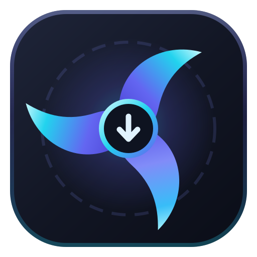
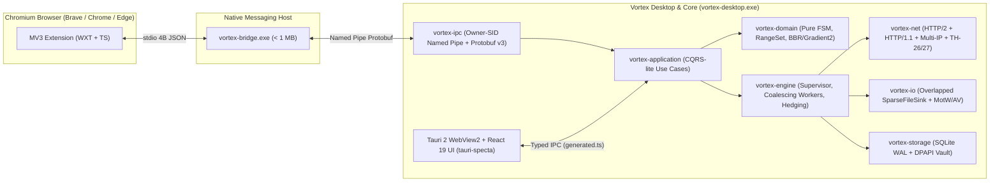

<div align="center">
  
  <h1>Vortex Download Manager</h1>
  <p>
    <strong>High-throughput, open-source download manager for Windows built with Rust, Tauri 2, and React.</strong>
  </p>

  <p>
    <a href="https://github.com/shehabhassanpro-stack/vortex-download-manager/actions/workflows/ci.yml">
      
    </a>
    <a href="https://github.com/shehabhassanpro-stack/vortex-download-manager/actions/workflows/security.yml">
      
    </a>
    <a href="LICENSE">
      
    </a>
    
    
  </p>
</div>

---

## Overview

Vortex is a free, open-source download manager engineered for full line-rate transfers, crash safety, and predictable behavior across hostile real-world hosts. It separates a zero-panic Rust core from a lightweight Tauri 2 / React 19 UI and a minimal Chromium MV3 browser bridge—shipping zero telemetry, zero ads, and per-user Windows installers under 10 MiB that require no administrator privileges.

### Why Vortex

Most desktop download managers either rely on closed-source native hooks that trigger antivirus heuristics, stall when writing parallel segments to disk, or break on modern CDNs and single-stream hosts (Cloudflare JA4 checks, single-use links, strict concurrency caps). Vortex addresses these at the transport, engine, and filesystem layers:

- **Concurrent Overlapped Disk I/O (`FILE_FLAG_OVERLAPPED` + `FSCTL_SET_SPARSE`)** — Each worker coalesces contiguous reads into `2 MiB` slabs written directly to their final offsets in parallel under a `32 MiB` byte-weighted backpressure semaphore. There is no post-download file assembly step and no NTFS zero-fill freeze.
- **High-BDP Adaptive Transport** — Supports `HTTP/2` (`ALPN: h2, http/1.1` with `16 MiB` stream / `64 MiB` connection windows and multi-connection pooling), `512 KiB` HTTP/1.1 read buffering, Multi-IP CDN round-robin striping with 60-second slow-IP quarantine, and `BBR / Gradient2 + AIMD` dynamic worker scaling (`1..32` connections driven by kernel `WSAIoctl(SIO_TCP_INFO)` RTT telemetry).
- **End-Game Tail Hedging & Host Resilience** — Launches hedged requests on the final `≤ min(2%, 16 MiB)` whenever a straggler falls below `30%` of peer median throughput. On strict single-stream hosts (e.g., Pixeldrain), Vortex detects `403`/`429`/`503` rejections, steps down non-fatally, keeps Worker #1's byte-0 stream open uninterrupted, and caches per-host profiles with a 5-minute half-open recovery probe.
- **Confirmation-First Browser Capture (Brave / Chrome / Edge)** — Intercepts browser downloads through an official MV3 extension and a `< 1 MiB` Native Messaging bridge (`vortex-bridge.exe`) over Owner-SID Named Pipes (zero local TCP ports). Uses a `1,400 ms` Probe-Before-Commit budget so WAF-gated (`403`) or single-use (`410`) downloads seamlessly fall back to the browser's original open TCP socket.
- **Defense-in-Depth Security (`TH-01` – `TH-33`)** — Lossless `512-byte` magic-byte verification (flags HTML ad traps, disguised executables, RTLO spoofing, `.lnk`/`.chm`/scripted `.svg`), SSRF & anti-DNS-rebinding `VerifiedIpConnector`, `64 KiB` / `100`-header response limits, origin-pinned Windows DPAPI credentials, NTFS reparse-point TOCTOU protection, Mark-of-the-Web + `IAttachmentExecute` AV scanning, and strict WebView2 origin locking.
- **Crash-Safe Durability (`ADR-008`)** — Periodic 20-second and pause/shutdown checkpoints enforce `FlushFileBuffers` through an exclusive flush barrier *before* committing completed byte ranges to SQLite WAL and an atomic `.vortex.meta` sidecar.
- **Bilingual RTL/LTR Desktop UI** — Full Arabic (`RTL`) and English (`LTR`) interface with calm dark/light OKLCH themes, virtualized download list, live 512-bin segment map, 60-second speed chart, active protocol/concurrency telemetry, and WCAG 2.2 AA contrast compliance.

---

## Verified Budgets & Benchmarks

All figures below are enforced in automated CI and benchmark suites on Windows x64 (`v0.1.0` / post-Phase 1.7):

| Metric | Target Budget | Measured (`v0.1.0`) |
|---|---|---|
| Thin Native Messaging bridge (`vortex-bridge.exe`) | `< 1 MB` | **`882.50 KiB`** |
| Desktop UI production bundle (gzip) | `< 200 KB` | **`155.67 kB`** |
| Browser MV3 extension bundle | `< 200 KB` | **`70.6 kB`** |
| Windows Per-User NSIS installer (no UAC) | `< 15 MB` | **`6.03 MiB`** |
| Windows Per-User WiX MSI installer (no UAC) | `< 15 MB` | **`8.62 MiB`** |
| 20 GiB sparse file tail write | `< 50 ms` | **`~47–50 ms`** |
| 64 MiB download across 8 workers (`WriteFile` syscalls) | `≤ 64` (`≥ 1.5 MiB/write`) | **`≤ 64` syscalls** (`99%+` reduction) |
| Headless Core cold start (`spawn` → Named Pipe health) | `< 300 ms` | **`< 170 ms`** (steady-state) |
| Idle background Core memory (WebView2 closed) | `< 60 MiB` | **`< 60 MiB`** |
| Line coverage (`vortex-error` / `vortex-domain` / `vortex-engine`) | `≥ 90%` each | **`100%` / `92.69%` / `90.40%`** |
| Line coverage (6 core crates combined) | `≥ 75%` | **`77.63%`** |

---

## Architecture

Vortex follows a strict **5-level Hexagonal + Layered + DDD** dependency DAG enforced automatically on every build by [`tools/arch-check`](tools/arch-check):



### Workspace Layout

| Layer | Crates / Packages | Responsibility |
|---|---|---|
| **Level 0** | `crates/vortex-error` | Canonical `VTX-*` error taxonomy, `Recoverability`, `TraceId` (UUIDv7) |
| **Level 1** | `crates/vortex-domain`, `crates/vortex-observability` | Pure domain FSM, `RangeSet`, `SegmentationPolicy`, `AdaptiveConcurrencyController`, magic-byte inspector, zero-leak redaction & flight recorder |
| **Level 2** | `crates/vortex-application` | Hexagonal ports (`ByteSource`, `FileSink`, `SecretStore`, `PlatformIntegration`), CQRS-lite use cases, `AppConfig` |
| **Level 3** | `crates/vortex-engine`, `crates/vortex-net`, `crates/vortex-io`, `crates/vortex-storage`, `crates/vortex-ipc`, `crates/vortex-platform` | Actor supervision, overlapped sparse I/O, HTTP/2 & HTTP/1.1 pool, SQLite WAL + DPAPI, Protobuf Named Pipe server, Windows OS integration |
| **Level 4** | `apps/desktop/src-tauri`, `apps/desktop/ui`, `apps/bridge`, `extension/` | Tauri 2 Composition Root, React 19 UI, thin Native Messaging bridge, Chromium MV3 extension |
| **Tools** | `tools/arch-check`, `tools/test-lab`, `tools/bench` | Architecture fitness tests, programmable hostile HTTP/1.1 & HTTP/2 server, performance & budget test suite |

---

## Getting Started

### Prerequisites (Windows 10 / 11 x64)

- **Rust** stable toolchain (Edition 2024; see [`rust-toolchain.toml`](rust-toolchain.toml))
- **Node.js 24+** and **pnpm 10+**
- **Protobuf compiler (`protoc`)** available on `PATH`
- **Cargo tools** (optional, for full local CI): `cargo-nextest`, `cargo-llvm-cov`, `cargo-deny`, `cargo-audit`, and [`just`](https://github.com/casey/just)

### Build & Run Locally

```powershell
# 1. Install JavaScript / TypeScript workspace dependencies
pnpm install

# 2. Verify formatting, strict Clippy (-D warnings), architecture DAG, bindings & tests
just ci

# 3. Build Desktop UI & Brave MV3 Extension
pnpm build:ui
pnpm build:ext

# 4. Build Per-User Windows NSIS (.exe) & WiX (.msi) installers (< 15 MB gate)
just build-installer
```

Built installers are written to:
- `target/release/bundle/nsis/Vortex Download Manager_0.1.0_x64-setup.exe`
- `target/release/bundle/msi/Vortex Download Manager_0.1.0_x64_en-US.msi`

To load the browser extension in **Brave / Chrome / Edge**:
1. Open `brave://extensions` (or `chrome://extensions`) and enable **Developer mode**.
2. Click **Load unpacked** and select `extension/.output/chrome-mv3`.
3. Launch Vortex Desktop (it automatically registers the `HKCU` Native Messaging manifest for Brave, Chrome, and Edge without admin rights).

### Running Tests & Benchmarks

```powershell
# Full Rust & TypeScript test suite
just test

# Real Brave + vortex-bridge.exe + Tauri WebView2 End-to-End suite
just e2e-brave

# Performance, memory (< 60 MiB), Cold Start (< 300 ms) & 20 GiB sparse budgets
just check-budgets

# Coverage gates (>= 90% error/domain/engine, >= 75% core crates)
just test-cov
```

---

## Documentation

Engineering design specifications and Architecture Decision Records live in [`docs/`](docs/) *(primary architectural specs are authored in Arabic with standard English technical terminology)*:

- [`docs/Vortex-Architecture-Design.md`](docs/Vortex-Architecture-Design.md) — Full Software Architecture & Technical Design Document
- [`docs/Tasks.md`](docs/Tasks.md) — Master topological roadmap and completion gates (`Phase 0` – `Phase 4`)
- [`docs/Engineering-Standards.md`](docs/Engineering-Standards.md) — Coding standards, zero-panic rules, testing, and review checklists
- [`docs/Protocol-Spec.md`](docs/Protocol-Spec.md) — Channel A / B / C IPC specification (`Protobuf v3` + `tauri-specta`)
- [`docs/Threat-Model.md`](docs/Threat-Model.md) — Microsoft SDL STRIDE threat matrix (`TH-01` – `TH-33`)
- [`docs/Ultra-High-Throughput-Engine-Spec.md`](docs/Ultra-High-Throughput-Engine-Spec.md) — Phase 1.7 Overlapped IOCP, High-BDP HTTP/2, and BBR/Gradient2 design
- [`docs/adr/README.md`](docs/adr/README.md) — Architecture Decision Records (`ADR-001` – `ADR-021`)

---

## Roadmap

- **Phases 0 – 1.7 (`v0.1.0` — Completed):** Core engine, overlapped sparse disk I/O, High-BDP HTTP/2 & Multi-IP transport, BBR/Gradient2 auto-scaling (`1..32`), End-Game hedging, strict-host step-down, confirmation-first Brave/Chrome/Edge capture, 5-layer security hardening, and per-user Windows installers.
- **Phase 2 (`v1.0` — Next):** Hybrid YouTube / HLS / DASH media pipeline (`4K 60fps` / `MP3` with on-demand signed `yt-dlp` & `ffmpeg-min`), FTP/FTPS, multi-queue scheduler & hierarchical rate limiter, `BLAKE3` / `Repr-Digest` verification, link refresh, Firefox MV3 support, fuzzing, and signed auto-updates.
- **Phase 3 (`v1.x`):** HTTP/3 (QUIC), SFTP, Metalink 4, `vortex-cli`, sandboxed WASM plugins (`wasmtime`), safe auto-extract, portable mode.
- **Phase 4 (`v2.0`):** Native BitTorrent (`librqbit`), macOS & Linux support, LEDBAT++ polite mode, `io_uring` / Windows `IoRing`.

---

## Security & Privacy

- **Zero Telemetry (`ADR-014`):** Vortex makes no analytics, tracking, or background phone-home requests.
- **Strict Non-Goals (`ADR-011`):** DRM circumvention and CAPTCHA bypassing are permanently out of scope.
- **Vulnerability Disclosure:** Please report security issues privately through GitHub Private Vulnerability Reporting—never in public issues. See [`SECURITY.md`](SECURITY.md) for response SLAs.

## Contributing

Contributions are welcome. Please review [`CONTRIBUTING.md`](CONTRIBUTING.md), [`CODE_OF_CONDUCT.md`](CODE_OF_CONDUCT.md), and [`docs/Engineering-Standards.md`](docs/Engineering-Standards.md) before opening a pull request.

## License

- Core engine, desktop application, and native bridge: **[GPL-3.0-or-later](LICENSE)**
- Browser extension wrapper (`extension/`): **`MPL-2.0 OR GPL-3.0-or-later`** (see [`ADR-013`](docs/adr/0013-gpl3-license.md))
