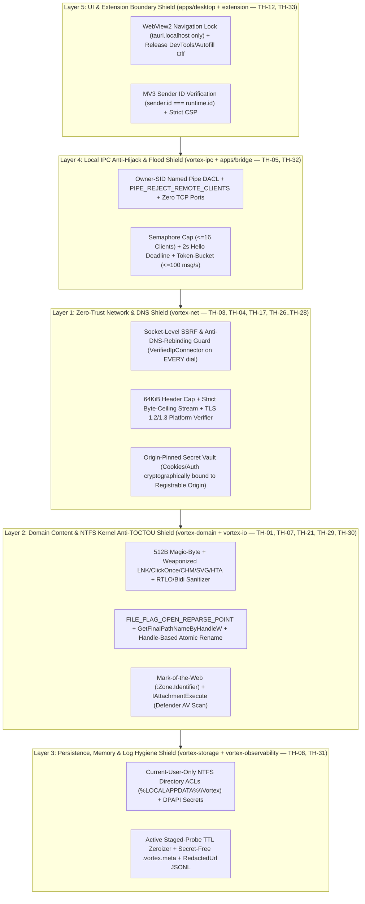

# 🔐🛡️ Vortex Download Manager — مواصفة الطبقات الأمنية المتعمقة ومنع أخطاء وسوء الاستخدام
**(Defense-in-Depth Cybersecurity Architecture for Phase 0–1 & Proactive User-Misuse Prevention Spec)**

> **الإصدار:** `1.1` — **الحالة:** **مكتملة ومُنفّذة بالكامل في `Phase 1.6` ✅** *(مع فك ارتباط سقف ترويسات `TH-27` عن مخزن قراءة جسم البيانات `256–512 KiB` في `Phase 1.7` وفق [Ultra-High-Throughput-Engine-Spec.md](./Ultra-High-Throughput-Engine-Spec.md))*
> **المرجعية الأمنية:** **Microsoft Security Development Lifecycle (SDL)** · **OWASP ASVS / Desktop Security** · **NIST Zero-Trust Architecture** · **Chromium Safe Browsing & Download Protection Architecture**.
> **نطاق التطبيق الصارم:** تغطي هذه الوثيقة **حصرياً** الطبقات المبنية في `Phase 0` و`Phase 1` (`vortex-error`, `vortex-observability`, `vortex-domain`, `vortex-application`, `vortex-net`, `vortex-io`, `vortex-storage`, `vortex-ipc`, `vortex-platform`, `apps/bridge`, `apps/desktop`, `extension`) مع تصميم نقاط ربط نظيفة (Clean Extension Hooks) للمراحل المستقبلية دون سحب أي ميزة من `Phase 2/3/4` قبل أوانها.
> **المراجع المرتبطة:** [Threat-Model.md](./Threat-Model.md) (`TH-01` → `TH-33`) · [Host-Resilience-And-Contract-Integrity-Spec.md](./Host-Resilience-And-Contract-Integrity-Spec.md) · [Ultra-High-Throughput-Engine-Spec.md](./Ultra-High-Throughput-Engine-Spec.md) · [Smart-Capture-And-Anti-Abuse-Spec.md](./Smart-Capture-And-Anti-Abuse-Spec.md) · [Vortex-Architecture-Design.md](./Vortex-Architecture-Design.md) (§12, §17, §23)

---

## الجزء الأول: معمارية الدفاع المتعمق ذات الطبقات الخمس (5-Layer Defense-in-Depth for Phase 0 & Phase 1)

برامج إدارة التحميل هي من أكثر التطبيقات المكتبية تعرضاً للهجمات عالمياً لأنها تستقبل **روابط، ترويسات، أسماء ملفات، وتدفقات بايتات غير موثوقة 100% من الإنترنت المفتوح** وتكتبها مباشرةً على نظام ملفات المستخدم. لتحقيق أعلى معايير الأمن السيبراني العالمية، نُحصّن معمارية `Phase 0` و`Phase 1` بخمس حلقات دفاعية متتالية (إذا تجاوز هجوم طبقة، أوقفته الطبقة التي تليها حتمياً):

---

### 1.1 الطبقة الأولى: درع الشبكة والـ DNS صفري الثقة (`crates/vortex-net` — `TH-26`, `TH-27`, `TH-28`)

#### أ) الحماية الشاملة على مستوى المقبس ضد `DNS Rebinding` و`SSRF` المباشر (`TH-26` — `VerifiedIpConnector`)
- **الثغرة الدقيقة التي نغلقها:**
  في التصميم التقليدي، فحص `SSRF` عند التحويلات (`302 Redirect`) فقط يترك ثغرتين خطيرتين:
  1. **الاستهداف المباشر (`Direct Local/Metadata SSRF`):** صفحة ويب خبيثة تمرر رابطاً مباشراً إلى `http://169.254.169.254/latest/meta-data` أو `http://192.168.1.1/backup.cfg`.
  2. **هجوم `DNS Rebinding (TOCTOU)` بين العمال:** خادم DNS خبيث يملك النطاق `evil.example` يردّ أثناء طلب `probe_and_stream` بعنوان IP عام شرعي (`93.184.216.34` بـ `TTL = 0`)، وبعد `500ms` عندما يفتح `Worker #2` طلب `open_range` يردّ بـ `127.0.0.1` أو `192.168.1.1`!
- **الضابط الهندسي الصارم:**
  1. دمج فحص العناوين المحظورة (`Loopback 127.0.0.0/8, ::1`، `Link-Local 169.254.0.0/16, fe80::/10`، `Private RFC1918 10/8, 172.16/12, 192.168/16`، `Unique Local fc00::/7`، `CGNAT 100.64.0.0/10`، `Multicast/Broadcast/Unspecified`) **داخل `VortexConnector::call` مباشرةً بعد حل DNS وقبل استدعاء `TcpStream::connect` لكل مقبس شبكي بدون استثناء**!
  2. في بيئة الإنتاج، تكون عناوين الشبكة الداخلية محظورة افتراضياً (`allow_private_network: false` في `AppConfig`، مع إتاحة خيار متقدم صريح لمستخدمي الشبكات المنزلية `NAS` وتفعيله حصراً في اختبارات `tools/test-lab` المحلية).
  3. إذا بدأ التحميل على عنوان **عام (Public IP)** أثناء `probe`، يُحظر قطعياً على أي اتصال لاحق (`open_range` أو `Resume`) لنفس التحميل أن يتصل بعنوان **خاص أو محلي** حتى لو تغير سجل DNS (`VTX-SEC-001`)!

#### ب) سقف الترويسات الصارم وحارس الفيضان الزائد للبايتات (`TH-27` — `Header-Bomb & Stream Over-Delivery Guard`)
- فرض سقف صارم لمجموع أحجام ترويسات HTTP (**`≤ 64 KiB`**، مع `max_header_list_size(64 * 1024)` في HTTP/2) ورفض أي استجابة تتجاوز **`100` ترويسة** لمنع هجمات `Slowloris` / `Header Bomb` — **مع فصله عن مخزن قراءة جسم البيانات (`256–512 KiB` في `Phase 1.7` / `ADR-021`)** حتى لا تُخنق سرعة تدفق البايتات!
- تغليف كل تدفق قادم من الشبكة بمغلّف **`BoundedByteStream` / `HyperBodyStream`**: إذا طُلب مدى بطول $L$ بايت (`Range: bytes=a-(a+L-1)`) أو أعلن الخادم `Content-Length = S`، يُقطع القارئ فوراً عند استلام $L$ بايت (ويرفض أي زيادة خبيثة `> S` بكود `VTX-NET-005`)، فلا يستطيع خادم خبيث إرسال تيار لا نهائي لملء القرص أو الكتابة فوق أجزاء مجاورة!

#### ج) ربط الأسرار بالأصل المسجّل (`TH-28` — `Origin-Pinned Secret Vault`)
- تعديل واجهة حفظ واسترجاع بيانات الاعتماد في `vortex-application` / `vortex-storage` بحيث يُربط كل سر مخزن في **Windows DPAPI** بزوج **`(DownloadId, OriginKey)`** (`scheme + host + port`).
- عند أي `Resume` أو `open_range`، يتحقق المحرك برمجياً من تطابق أصل الطلب الفعلي مع `OriginKey` المحفوظ قبل فك تشفير وحقن `Cookie` أو `Authorization` — مما يجعل تسريب الكوكيز لنطاق خارجي مستحيلاً رياضياً في جميع المسارات!

---

### 1.2 الطبقة الثانية: درع فحص المحتوى ونواة ملفات Windows NTFS (`crates/vortex-domain` & `crates/vortex-io` — `TH-29`, `TH-30`)

#### أ) الحماية النووية ضد سباق الروابط الرمزية ونقاط الوصل (`TH-29` — `Anti-TOCTOU NTFS Reparse-Point & Handle-Based Rename`)
- **الثغرة الكلاسيكية الخطيرة في برامج التحميل:**
  التحقق النصي من المسار قبل فتح الملف عرضة لهجوم سباق التوقيت (**TOCTOU Symlink / NTFS Junction Attack**): عملية محلية منخفضة الصلاحية تزرع رابطاً رمزياً أو `NTFS Directory Junction` مكان `file.zip.vortex` أو مجلده الفرعي ليشير إلى ملف حساس داخل ملف تعريف المستخدم (`Startup` أو `.ssh\authorized_keys` أو `AppData`)، فيقوم مدير التحميل بالكتابة فوقه أو استبداله عند الـ `rename`!
- **الضابط الهندسي على مستوى Win32 Kernel (`vortex-io`):**
  1. فتح ملفات `.vortex` و`.vortex.meta` على Windows مع العلم **`FILE_FLAG_OPEN_REPARSE_POINT`** (أو فحص `GetFileInformationByHandleEx` للتأكد من خلو المقبض المفتوح من `FILE_ATTRIBUTE_REPARSE_POINT`).
  2. استدعاء **`GetFinalPathNameByHandleW`** على المقبض المفتوح فعلياً والتحقق من أنه يقع داخل المسار القانوني لمجلد الحفظ المعتمد (`canonical_save_dir`) وأنه ليس مسار جهاز أو شبكة مخفياً!
  3. تنفيذ التسمية النهائية الذرية عبر المقبض المفتوح (أو `MoveFileExW` بدون `MOVEFILE_REPLACE_EXISTING` افتراضياً ما لم يختر المستخدم صراحةً `overwrite_existing = true`)، مما يقضي نهائياً على استبدال ملفات المستخدم الموجودة بالخطأ أو الخداع!

#### ب) توسيع الدرع الأمني ضد امتدادات الاختراق الحديثة وسموم Unicode (`TH-30` — `Weaponized Container & Bidi Spoofing Shield`)
نرقّي `FilenameSanitizer` و`ContentSecurityInspector` في `crates/vortex-domain` ليواكبا أحدث أساليب البرمجيات الخبيثة (Malware Initial Access Vectors):
1. **تطهير محارف التزوير الاتجاهي في الأسماء (`Anti-RTLO & Zero-Width Spoofing`):**
   - تجريد وحظر كافة محارف التحكم في اتجاه النص (`U+202A`..`U+202E` وعلى رأسها **`RTLO U+202E`** الذي يجعل `invoice_fdp.exe` يُقرأ بصرياً `invoice_exe.pdf`!) ومحارف العزل (`U+2066`..`U+2069`) والمحارف الصفرية غير المرئية (`U+200B`..`U+200D`, `U+FEFF`) في `FilenameSanitizer`، مع رفع راية تحذير أمني إذا احتوى الاسم الأصلي القادم من الخادم على محاولة تلاعب بـ `RTLO`!
2. **توسيع قائمة البصمات والامتدادات الخطرة (`High-Risk Execution Vectors`):**
   - **ملفات الاختصارات المسلّحة (`.lnk`):** كشف البصمة الثنائية `4C 00 00 00 01 14 02 00` (`Windows Shell Link`).
   - **ملفات أوامر الصدفة والمستكشف والنقرة الواحدة:** `.scf`, `.url`, `.library-ms`, `.search-ms`, `.application`, `.appref-ms` (ClickOnce), `.SettingContent-ms`, `.deskthemepack`.
   - **حاويات السكربتات والتعليمات البرمجية:** `.chm` (بصمة `49 54 53 46` / `ITSF`), `.hta`, `.wsf`, `.wsh`, `.jse`, `.vbe`, `.ps1`, `.psm1`, `.psd1`, `.reg`, `.cpl`, `.inf`, `.msp`, `.msix`, `.appx`.
   - **فحص حقن السكربتات في صور `.svg` (`SVG Script Smuggling`):** إذا كان الامتداد `.svg` أو `image/svg+xml` واحتوت أول `512` بايت على `<script` أو `onload=` أو `javascript:`، يُوسم بتحذير أمني صريح!
   - **تنبيه حاويات الأقراص القابلة للتركيب (`.iso`, `.img`, `.vhd`, `.vhdx`):** إظهار ملاحظة توعوية هادئة للمستخدم تذكّره بفحص محتويات القرص الافتراضي قبل تشغيل أي ملف بداخله.

---

### 1.3 الطبقة الثالثة: تحصين التخزين المحلي، صلاحيات الملفات، وتصفير الذاكرة النشط (`crates/vortex-storage` & `crates/vortex-observability` — `TH-31`)

1. **صلاحيات مجلد البيانات الحصرية للمستخدم الحالي (`Restrictive Local State NTFS ACL`):**
   - عند تهيئة مجلد `%LOCALAPPDATA%\Vortex` (الذي يضم `vortex.db` و`-wal` و`config.toml` ومجلد `logs/`)، تطبّق `vortex-platform` قائمة تحكم وصول (`DACL`) تقصر القراءة والكتابة على **المستخدم الحالي (`Owner SID`) والنظام (`SYSTEM`) فقط**، لمنع أي حساب محلي آخر على نفس الحاسوب المشترك من قراءة سجل التحميلات!
2. **نقاء ملفات `.vortex.meta` من الأسرار (`Secret-Free Sidecar Invariant`):**
   - ملفات الاسترداد الجانبية `.vortex.meta` المحفوظة في مجلد التنزيلات لا تحفظ أبداً أي كوكيز أو ترويسات مصادقة، وتخزّن الروابط بعد تمريرها على منطق حجب المعاملات السرية عند التصدير أو بدون أسرار جلسة — بحيث لو نسخ المستخدم المجلد لفلاشة خارجية لا تتسرب أي بيانات جلسة!
3. **الحاصد الدوري للدفعات المعلقة في الذاكرة (`Active Staged-Probe Zeroizing Reaper`):**
   - تشغيل مهمة تنظيف خفيفة كل `15 ثانية` تحذف تلقائياً أي إدخال انتهت صلاحيته (`> 120s`) من `staged_probes`، تغلق مقبس الشبكة، وتُصفّر كوكيزه في الذاكرة عبر `zeroize` فوراً دون انتظار وصول طلب التقاط جديد!

---

### 1.4 الطبقة الرابعة: درع حماية قناة الاتصال المحلي من الإغراق (`crates/vortex-ipc` & `apps/bridge` — `TH-32`)

تنفيذ الضوابط الكمية الصارمة المنصوص عليها في `Protocol-Spec.md` §5 فعلياً داخل خادم `Named Pipe` في `crates/vortex-ipc`:
1. **سقف الاتصالات المتزامنة (`Bounded Connection Semaphore`):** السماح بحد أقصى **`16` عميل Named Pipe متزامن** (`MAX_CONCURRENT_PIPE_CLIENTS = 16`) لمنع استنزاف مقابض نواة Windows (`Handle Exhaustion DoS`).
2. **مهلة المصافحة الصارمة (`2.0s Handshake Deadline`):** أي عميل يتصل بالأنبوب ولا يكمل رسالة `HelloRequest` صالحة خلال `2.0 ثانية` يُفصل فوراً.
3. **محدد معدل الرسائل لكل عميل (`Per-Client Token Bucket: 100 msg/s, burst 40`):** أي عميل يتجاوز المعدل يُردّ عليه بـ `ApiError(VTX-IPC-004)`، وإذا كرر التجاوز `3` مرات متتالية يُغلق اتصاله لحماية استقرار المحرك.

---

### 1.5 الطبقة الخامسة: عزل نافذة `WebView2` وتوثيق مرسل الإضافة (`apps/desktop` & `extension` — `TH-33`)

1. **قفل التصفح الصارم داخل نافذتي `main` و`confirm` (`WebView2 Anti-Navigation Guard`):**
   - تفعيل حارس `on_navigation` في `apps/desktop/src-tauri` بحيث يسمح **فقط** بأصل الواجهة المدمجة (`tauri://localhost` / `http://tauri.localhost` / `https://tauri.localhost`، وخادم Vite المحلي في وضع التطوير `#[cfg(debug_assertions)]` فقط).
   - **الأثر الأمني الحاسم:** حتى لو سحب المستخدم صفحة `.html` خبيثة أو رابطاً خارجياً وأفلته بالخطأ خارج منطقة الإسقاط، يستحيل أن تنتقل نافذة `WebView2` إلى موقع خارجي يتمتع بصلاحيات IPC!
2. **تعطيل أدوات المتصفح غير الضرورية في نسخ الإصدار النهائي (`Release WebView2 Hardening`):**
   - إيقاف الإكمال التلقائي لكلمات المرور والنماذج العامة في `WebView2`، وتعطيل فتح `DevTools` في نسخ الـ `Release` مع الإبقاء على شاشة التشخيص الرسمية الآمنة داخل التطبيق.
3. **التحقق الصارم من هوية المرسل داخل إضافة المتصفح (`Strict Extension Sender Check`):**
   - التحقق في `extension/src/entrypoints/background.ts` من أن `sender.id === chrome.runtime.id` وأصل صفحة الإضافة داخلي (`chrome-extension://<id>/`) قبل قبول أي أمر تعديل إعدادات أو إرسال رابط عبر `runtime.onMessage`.

---

## الجزء الثاني: منظومة منع أخطاء المستخدم الشائعة والإصلاح والتنبيه الاستباقي (`UX-M01` → `UX-M12`)

لكي لا يشعر المستخدم بأي ارتباك (`Zero User Confusion`) في مواقف الاستخدام اليومي الواقعية، نطبّق مصفوفة الوقاية والتصحيح الذاتي التالية في `Phase 1.6`:

| المعرّف | الخطأ الشائع / حالة سوء الاستخدام الواقعية | كيف يعالجه Vortex تلقائياً (منع / إصلاح ذاتي / تنبيه واضح بلا غموض) |
|---|---|---|
| **`UX-M01`** | **لصق رابط صفحة مشاهدة بدلاً من رابط الملف المباشر** (مثل لصق `https://pixeldrain.com/u/8nHKszgt` أو `github.com/.../blob/...` أو صفحة عرض `MediaFire` / `Google Drive` في `[+ رابط جديد]`). | 1) **محوّل ذكي آمن للأنماط القياسية المعروفة:** يحوّل `pixeldrain.com/u/<id>` تلقائياً إلى `https://pixeldrain.com/api/file/<id>?download` وروابط `github.com/.../blob/...` إلى `raw.githubusercontent.com/...` مع شارة توضيحية لطيفة. 2) لصفحات العرض التفاعلية التي تعيد `text/html`: **يمنع حفظ ملف HTML تالف**، ويعرض تنبيهاً واضحاً: *"هذا رابط صفحة ويب وليس رابط الملف المباشر"* مع زر **[🌐 فتح الصفحة في المتصفح لالتقاط الملف]**. |
| **`UX-M02`** | **محاولة حفظ ملف أكبر من `4 GB` على فلاشة بنظام `FAT32`** (يفشل في البرامج التقليدية بعد ضياع ساعة وعند وصول `99%`!). | فحص نوع نظام الملفات مسبقاً عبر `GetVolumeInformationW` قبل بدء التحميل؛ إذا كان القرص **`FAT32`** وحجم الملف **`> 4,294,967,295` بايت (`4 GiB - 1`)**، يُمنع البدء فوراً بكود **`VTX-DISK-005`** ورسالة واضحة تقترح اختيار قرص `NTFS` أو `exFAT`! |
| **`UX-M03`** | **حذف المستخدم للملف المؤقت `.vortex` يدوياً من المجلد بينما التحميل متوقف مؤقتاً ثم الضغط على `[استئناف]`** (قد ينتج عنه ملف به فجوة أصفار تالفة في البداية!). | فحص إلزامي لوجود وسلامة ملف `.vortex` على القرص لحظة `Resume` وعند إقلاع التطبيق: إذا كان الملف المؤقت مفقوداً بينما `completed_ranges` غير فارغة، **يُمنع الاستكمال على ملف فارغ**، ويُعاد ضبط الأجزاء المكتملة نظيفاً مع تنبيه **`VTX-DISK-006`** (*"تم حذف الملف المؤقت خارجياً — أُعيد التحميل من البداية لضمان عدم تلف الملف"*). |
| **`UX-M04`** | **مسح امتداد الملف بالخطأ أثناء تعديل الاسم في نافذة التأكيد** (مثل تحويل `BT_The_Manor.zip` إلى `BT_The_Manor` فلا يتعرف عليه Windows بعد انتهاء التحميل!). | 1) عند التركيز على حقل اسم الملف في `SmartConfirmModal`، يتم **تظليل الاسم بدون الامتداد** تلقائياً (تماماً مثل Windows Explorer). 2) إذا حذف المستخدم الامتداد الأصلي `.zip` دون كتابة امتداد بديل، يظهر شريط تنبيه فوري مع استعادة بنقرة واحدة **[إبقاء امتداد `.zip`]**! |
| **`UX-M05`** | **انقطاع جلسة Wi-Fi العامة (`Captive Portal`) أثناء التحميل أو عند البداية** (إرسال الراوتر لصفحة تسجيل دخول `200 OK` HTML بدلاً من البايتات). | رفض قاطع لأي رد `200 OK` أو `text/html` على طلبات `Range` الجزئية دون لمس ملف `.vortex` إطلاقاً، وإيقاف مؤقت آمن مع تنبيه المستخدم بأن شبكة الـ Wi-Fi تطلب تسجيل الدخول. |
| **`UX-M06`** | **التباس حجر مضاد الفيروسات (`Windows Defender Quarantine`) مع خطأ صلاحيات المجلد** (حيرة المستخدم عند اختفاء ملف محمّل فجأة!). | التمييز الدقيق لأكواد Win32 `ERROR_VIRUS_INFECTED (225)` و`ERROR_VIRUS_DELETED (226)` وتصنيفها كـ **`VTX-SEC-003`** (*"قام Windows Defender بحجر الملف لاحتوائه على برمجية ضارة محتملة"*) بدلاً من رسائل فشل القرص العامة! |
| **`UX-M07`** | **خلل ساعة نظام Windows يسبب فشل `403` متكرر على الروابط الموقّعة (`S3` / `Cloudflare R2` / `CDN`)**. | مقارنة ترويسة `Date` من الخادم مع ساعة الجهاز عند حدوث `403`؛ إذا زاد الفارق عن `5 دقائق`، يظهر التشخيص المباشر **`VTX-AUTH-002`** لتنبيه المستخدم لضبط وقت جهازه بدلاً من محاولات إعادة غير مجدية! |
| **`UX-M08`** | **النقر المزدوج أو تكرار إضافة نفس الرابط الجاري تحميله حالياً** (فتح عمليتي تحميل تتنافسان على السرعة وتنتجان `file (1).zip` دون قصد). | إذا كان نفس الرابط في حالة `Downloading` أو `Staged` حالياً، تبرز نافذة التأكيد تنبيهاً واضحاً: *"هذا الملف قيد التحميل بالفعل الآن"* مع زر أساسي **[👁️ عرض التحميل الجاري]** بدلاً من تكرار التحميل بالخطأ. |
| **`UX-M09`** | **الحيرة من فرق الحجم المعروض بين المواقع (`1.12 GB` عشري) والنظام (`1.04 GiB` ثنائي)** كما ظهر في ملف Pixeldrain (`1,117,448,674 B`). | توحيد وضوح الوحدات: عرض الحجم بترميز واضح غير مضلل مع إظهار القيمتين في نافذة التأكيد ومفتش التقدم (مثلاً `1.04 GiB (1.12 GB)` أو تلميح البايتات الدقيقة) حتى يطمئن المستخدم تماماً أن الملف كامل بلا نقصان! |
| **`UX-M10`** | **تغيير شبكة الـ VPN أو انقطاع الراوتر المؤقت يستهلك كل محاولات إعادة المحاولة (`max_retries`) ويفشل التحميل**. | تجميد عداد محاولات الفشل تلقائياً عندما يكتشف مراقب الشبكة انقطاع الإنترنت الكلي (`Offline`) واستئناف التحميل تلقائياً فور عودة الاتصال دون استنزاف رصيد المحاولات! |
| **`UX-M11`** | **الخشية من حذف الملف المكتمل من القرص عند الضغط على `Delete` لتنظيف القائمة**. | زر الحذف العادي (`Delete`) يحذف السجل من القائمة فقط مع شريط **[تراجع خلال 6 ثوانٍ]** ولا يلمس الملف على القرص أبداً؛ بينما الحذف الفعلي من القرص (`Shift+Delete`) معزول بنافذة تأكيد حمراء صريحة تذكر اسم الملف وحجمه. |
| **`UX-M12`** | **قلق المستخدم عند إغلاق النافذة الرئيسية أثناء تحميل ملف ضخم**. | تحديث تلميح أيقونة الـ System Tray حياً بعدد التحميلات النشطة والسرعة الإجمالية، مع إشعار هادئ عند أول إغلاق يؤكد استمرار التحميل بأمان كامل في الخلفية. |

---

## الجزء الثالث: الأكواد التشخيصية الجديدة المضافة لسجل `vortex-error` (`Phase 1.6`)

تُضاف الأكواد الثابتة التالية إلى `crates/vortex-error` ووثيقة المعمارية (§30.3) مع مفاتيح ترجمة كاملة بالعربية والإنجليزية:

| الكود | الفئة | القابلية للاستعادة (`Recoverability`) | المعنى الدقيق | الإجراء المقترح (`SuggestedAction`) |
|---|---|---|---|---|
| **`VTX-RES-005`** | `Resource` | `SelfHealed` | الخادم يقيّد عدد الاتصالات المتزامنة — تم خفض التوازي تلقائياً وإكمال التحميل | لا يلزم إجراء (إشعار تشخيصي هادئ فقط) |
| **`VTX-RES-006`** | `Resource` | `UserActionRequired` | الموقع يطلب تحققاً بشرياً (`CAPTCHA`) أو استُنفدت الحصة المجانية المؤقتة | `OpenReferrerInBrowser`, `Retry` |
| **`VTX-AUTH-002`** | `Auth` | `UserActionRequired` | انحراف كبير في ساعة نظام Windows أبطل صلاحية الرابط الموقّع (`Clock Skew`) | `SyncSystemClock`, `Retry` |
| **`VTX-DISK-005`** | `Disk` | `UserActionRequired` | حجم الملف (`> 4 GiB`) يتجاوز الحد الأقصى لنظام ملفات القرص (`FAT32`) | `ChangeFolder` |
| **`VTX-DISK-006`** | `Disk` | `SelfHealed` / `UserActionRequired` | الملف المؤقت `.vortex` حُذف أو نُقل خارجياً قبل الاستئناف | `RestartFromScratch`, `ChangeFolder` |
| **`VTX-SEC-003`** | `Security` | `Permanent` | قام مضاد الفيروسات (`Windows Defender`) بحجر الملف أو حذفه لوجود تهديد محتمل | `OpenWindowsSecurity`, `CopyDiag` |

---

## الجزء الرابع: مصفوفة الاختبارات الأمنية واختبارات منع سوء الاستخدام (`Security & Misuse Test Suite`)

لا تُغلق `Phase 1.6` إلا بنجاح الاختبارات الآلية التالية بنسبة **100%**:
1. **اختبار `DNS Rebinding & Direct SSRF` على مستوى المقبس (`TH-26`):** إثبات رفض الاتصال بـ `127.0.0.1` و`169.254.169.254` و`192.168.1.1` في الوضع الإنتاجي سواء عبر رابط مباشر أو تبديل سجل DNS بين `probe` و`open_range`.
2. **اختبار `BoundedByteStream & Header Cap` (`TH-27`):** خادم خبيث في `test-lab` يرسل `128 KiB` ترويسات أو يضخ بايتات تتجاوز مدى `Range` المطلوب ← يُرفض ويُغلق الاتصال فوراً دون كتابة بايت زائد واحد!
3. **اختبار `Origin-Pinned Credentials` (`TH-28`):** إثبات استحالة استرجاع أو إرسال كوكيز مخزنة لـ `origin-a.example` عند طلب اتصال بـ `origin-b.example`.
4. **اختبار `NTFS Symlink / Junction TOCTOU` (`TH-29`):** زرع رابط رمزي / نقطة وصل `Junction` مكان ملف `.vortex` على Windows والتأكد أن `vortex-io` يرفض الفتح/التسمية بكود `VTX-SEC-001` دون المساس بالملف الهدف!
5. **اختبار `RTLO & Weaponized Signatures` (`TH-30`):** تمرير أسماء تحتوي `\u{202E}` وبصمات `.lnk` و`.chm` و`.svg` يحوي `<script>` والتأكد من تطهير الاسم ورفع التحذير الأمني الحرج وتعطيل زر `Enter` السريع.
6. **اختبار `IPC Flood & Connection Cap` (`TH-32`):** فتح `> 16` اتصال أنبوب متزامن وإرسال `> 100` رسالة/ثانية والتحقق من رد `VTX-IPC-004` وحماية استقرار المحرك.
7. **اختبارات منع أخطاء الاستخدام (`UX-M01`..`UX-M06`):** تحويل `pixeldrain.com/u/<id>` تلقائياً، كشف صفحات العرض `text/html`، منع ملف `5 GiB` على `FAT32` مسبقاً، واكتشاف حذف `.vortex` قبل الاستئناف بصفر تلف للبيانات!
