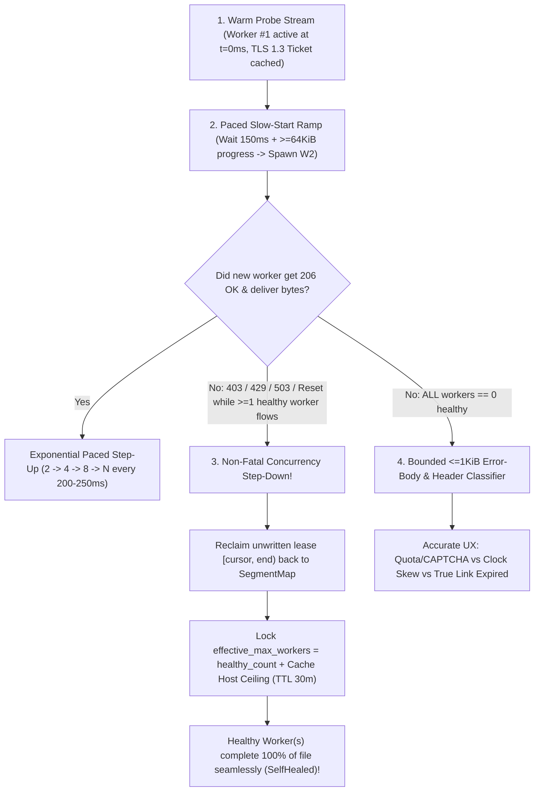

# ⚡🛡️ Vortex Download Manager — مواصفة مرونة الخوادم الواقعية، التدرج الذكي للاتصالات، وتكامل العقود الآلي
**(Real-World Host Resilience, Paced Slow-Start Concurrency & Zero-Drift IPC Contract Integrity Spec)**

> **الإصدار:** `1.1` — **الحالة:** **مكتملة ومُنفّذة بالكامل في `Phase 1.6` ✅** *(مع ترقيات الأداء القصوى لـ `SmartHostProfileCache` وفصل `NetConnectionLost` وتفعيل `ALPN: h2/http/1.1` في **`Phase 1.7`** وفق [Ultra-High-Throughput-Engine-Spec.md](./Ultra-High-Throughput-Engine-Spec.md))*
> **المرجعية الهندسية:** معايير هندسة الشبكات والموثوقية في **Google (TCP Slow-Start / BBR / Chromium Net Stack)** و**Envoy Proxy (Outlier Detection)** و**Netflix (Adaptive Concurrency Limits)** و**Stripe / Tauri (Contract-First Typegen)**.
> **المراجع المرتبطة:** [Vortex-Architecture-Design.md](./Vortex-Architecture-Design.md) (§8.2, §8.3, §8.5, §11.2, §23.2) · [Protocol-Spec.md](./Protocol-Spec.md) · [Cybersecurity-Layers-And-Misuse-Prevention-Spec.md](./Cybersecurity-Layers-And-Misuse-Prevention-Spec.md) · [Ultra-High-Throughput-Engine-Spec.md](./Ultra-High-Throughput-Engine-Spec.md) · [ADR-009](./adr/0009-dynamic-segmentation-endgame-aimd.md) · [ADR-015](./adr/0015-error-taxonomy-zero-panic.md) · [ADR-021](./adr/0021-ultra-high-throughput-iocp-and-adaptive-transport.md)

---

## 1. التشخيص الجنائي الدقيق للحادثة الواقعية (Forensic Post-Mortem: `pixeldrain.com` Incident)

أثناء الاختبار العملي لنسخة ما بعد `Phase 1.5` لتحميل ملف فعلي (`BT_The_Manor_0.31.4.zip` بحجم `1,117,448,674` بايت ≈ `1.12 GB` عشري / `1.04 GiB` ثنائي) من موقع الاستضافة الشهير **`pixeldrain.com`** (`https://pixeldrain.com/u/8nHKszgt` ← `https://pixeldrain.com/api/file/8nHKszgt?download`)، وقع خطآن متزامنان (`Trace ID: 01a21a47-a3c6-7172-b955-429ab22ae17e`):
1. توقّف التحميل فوراً عند `0%` بحالة **`NeedsAttention (VTX-RES-002: HTTP 403 link expired or forbidden)`**.
2. انهيار لوحة التقدم الجانبية (`LiveInspectorDrawer`) برسالة حمراء من `FeatureErrorBoundary`:
   `Cannot read properties of undefined (reading 'map')`.

الفحص الجنائي لقاعدة البيانات الفعلية (`vortex.db`) وسجلي `core.jsonl` و`core-flight-recorder.jsonl` كشف **الجذور الهندسية الحقيقية الكاملة** لكلتا المشكلتين:

### 1.1 الجذر الأول: هجوم القطيع المفاجئ (`8-Socket Cold Burst`) وقتل التحميل بسبب فشل اتصال فرعي واحد
بمراجعة الطوابع الزمنية بالميلي ثانية في `core-flight-recorder.jsonl` عند `23:55:07.100Z`:
1. **نجاح الاستكشاف الأول (`Worker #1`):** طلب `probe_and_stream` نجح فعلاً بحالة `206 Partial Content` وحجم `1,117,448,674` بايت مع دعم `Accept-Ranges: bytes`، وكان الاتصال الأول مفتوحاً وسليماً وجاهزاً لضخ البيانات!
2. **اندفاع `7` اتصالات باردة في نفس الميلي ثانية (`Simultaneous Cold Dial Burst`):** فور ضغط المستخدم على تأكيد التحميل، أطلق `DownloadActor` في `crates/vortex-engine/src/worker.rs` سبعة اتصالات إضافية (`worker_id: 2..8`) **دفعة واحدة في اللحظة الزمنية ذاتها (`t = 0ms`)**!
3. **فشل استئناف جلسات TLS 1.3 وبصمة `ALPN: None`:**
   - أظهر سجل `rustls` داخل الصندوق الأسود حرفياً: `Not resuming` و`ALPN protocol is None` على جميع المقابس السبعة!
   - **لماذا `Not resuming`؟** لأن فتح `7` اتصالات متزامنة قبل اكتمال أول مصافحة واستلام تذكرة `TLS 1.3 NewSessionTicket` (أو عدم مشاركة نفس مثيل مخزن الجلسات بين `probe` و`workers`) يجبر كل اتصال على مصافحة تشفيرية كاملة باردة في نفس اللحظة.
   - **لماذا `ALPN: None`؟** لأن `crates/vortex-net/src/connector.rs` لم يضبط `tls_config.alpn_protocols = vec![b"http/1.1".to_vec()]`، وهو سلوك شاذ تلتقطه أنظمة الحماية على الـ CDNs كعميل آلي (Bot Scraper) لأن كل المتصفحات الحقيقية تُعلن `ALPN` دائماً!
4. **سياسة الخوادم المجانية ومراكز التحميل (`Per-IP Concurrency Policing`):**
   - مواقع استضافة الملفات الشهيرة (`Pixeldrain`, `MediaFire`, `GoFile`, `1Fichier`, `Google Drive`, `HuggingFace`, `Mega`, وبوابات `Cloudflare WAF`) تحدّ صراحةً عدد الاتصالات المتزامنة لكل عنوان IP في الحسابات المجانية (عادةً اتصال واحد أو اتصالان كحد أقصى، أو ترفض فتح 8 مقابس في 1ms).
   - لذلك ردّ `pixeldrain.com` على `worker_id: 4` بكود **`HTTP 403 Forbidden`**.
5. **الخطأ القاتل في آلة إدارة العمال (`Single-Worker 403 Assassinating Healthy Download`):**
   - في `crates/vortex-engine/src/worker.rs`، صُنِّف أي رد `403` من أي عامل كخطأ قاتل على مستوى التحميل بالكامل (`fatal_worker_err = Some(error); workers_cancel.cancel(); break;`)!
   - النتيجة الكارثية: فشل العامل رقم `#4` (الزائد عن حاجة الخادم أصلاً!) قام **بقتل العامل رقم `#1` السليم المفتوح** وإجهاض ملف الـ `1.12 GB` بالكامل بدلاً من الاكتفاء بعدد الاتصالات التي قبلها الخادم!
6. **تجاهل جسم رسالة الخطأ (`Blind 403 Mapping`):**
   - في `crates/vortex-net/src/client.rs`، حُوِّل كل كود `403` أو `410` أعمى إلى `FetchError::LinkExpired` دون قراءة أول بضع مئات من البايتات من جسم الرد (حيث يرسل Pixeldrain مثلاً JSON صريحاً مثل `{"success":false,"value":"file_rate_limited_captcha_required"}` أو رسالة تجاوز عدد الاتصالات!).

### 1.2 الجذر الثاني: انحراف العقد بين Rust وTypeScript (`ApiError` Schema Drift & Swallowed Specta Export)
1. **اختلاف تسمية الحقول (`snake_case` مقابل `camelCase`):**
   - في `crates/vortex-error/src/api_error.rs`، هُيكل `ApiError` بـ `#[derive(Serialize, Deserialize)]` الافتراضي بدون `#[serde(rename_all = "camelCase")]`، فأرسل عبر القناة C (Tauri IPC) الحقول بصيغة `suggested_actions` و`technical_detail` و`trace_id`، وصيغة `recoverability` كـ Enum خارجي الوسم (`"UserActionRequired"` أو `{"Transient":{"retry_after_ms":...}}`).
   - في المقابل، استوردت الواجهة `apps/desktop/ui/src/bindings/client.ts` النوع `ApiError` يدوياً من `@vortex/protocol` (المكتوب للقناة A بصيغة `camelCase`: `suggestedActions: string[]`).
2. **ابتلاع فشل التوليد الآلي بصمت (`Silent Error Swallowing in Test`):**
   - في `apps/desktop/src-tauri/src/commands.rs`، الاختبار `export_specta_typescript_bindings_to_ui` كتب `let _ = build_specta_builder().export(Typescript::default(), ...)`!
   - لأن الأوامر تحتوي أعداداً `u64` و`usize`، يرفض `specta-typescript 0.0.15` التصدير افتراضياً ما لم تُضبط الحقول عبر `#[specta(type = f64)]`؛ وبسبب `let _ =` ابتُلع الخطأ بصمت وبقي ملف `generated.ts` فارغاً!
3. **النتيجة في وقت التشغيل:** عندما استلم `VtxErrorCard.tsx` الكائن الحقيقي من Rust، كانت `error.suggestedActions` تساوي `undefined`، فانهار استدعاء `.map(...)` داخل `LiveInspectorDrawer`!

---

## 2. الحلول الخوارزمية والمعمارية العالمية المعتمدة (Big-Tech Grade Architecture)

راجعنا جميع الحلول الممكنة، واستبعدنا الحلول الترقيعية السطحية (مثل الاكتفاء بتأخير ثابت عشوائي أو `error.suggestedActions?.map(...)` وحدها)، واعتمدنا **منظومة حلول متكاملة من 4 ركائز هندسية عالمية**:

### 2.1 الركيزة الأولى: التدرج البطيء الموزون للاتصالات وتذخير تذاكر TLS 1.3 (`Paced Slow-Start Worker Ramp-Up`)
مستوحى مباشرةً من خوارزمية **TCP Slow-Start (RFC 5681)** ومجدول المقابس في **Chromium Network Service**:

1. **مشاركة مخزن الجلسات والـ DNS عبر المحرك (`Shared Transport Context`):**
   - يشترك `probe_and_stream` وجميع عمال `DownloadActor` في مثيل `HttpByteSource` واحد يضم `rustls::client::Resumption::in_memory_sessions(256)` مع الإعلان الصريح عن **`alpn_protocols = vec![b"http/1.1".to_vec()]`**.
   - بمجرد انتهاء مصافحة الـ `Probe` (`Worker #1`)، تكون تذكرة الجلسة المشفرة (`TLS 1.3 Session Ticket`) وعنوان الـ IP المحلول جاهزَين في الذاكرة!
2. **جدول الإقلاع المتدرج المشروط بالنجاح (`Success-Gated Staggered Ramp`):**
   - **الموجة 0 (`t = 0ms`):** يبدأ `Worker #1` فوراً من التدفق الدافئ (`PrependByteStream` + `16 MiB` RAM buffer) بصفر تأخير (`0ms`).
   - **الموجة 1 (`t ≈ +150ms` وبعد استلام `>= 64 KiB` فعلية من `Worker #1`):** يُطلق `Worker #2` فقط (مستهلكاً تذكرة TLS 1.3 بـ `1-RTT` نظيف).
   - **الموجات التالية (`2 → 4 → 8 → N_max` بفاصل `200ms + Uniform(0..50ms)` لكل موجة):**
     $$\Delta N_{\text{wave}} = \min\!\big(N_{\text{active}},\; N_{\text{target}} - N_{\text{active}}\big)$$
     **الشرط الصارم للترقية:** لا تُطلق الموجة التالية إلا بعد أن يتلقى عمال الموجة الحالية رد `206 Partial Content` ويكتبوا أول شريحة بيانات بنجاح ودون أي إشارة رفض (`403`/`429`/`503`)!

### 2.2 الركيزة الثانية: الخفض السلس غير القاتل للتوازي واسترداد العقود (`Non-Fatal Concurrency Step-Down & Lease Reclamation`)
مستوحى من **Envoy Outlier Detection** ومبدأ **Graceful Degradation** في الأنظمة الموزعة عالية الاعتمادية:

1. **البديهية الذهبية للمحرك (`The Forward-Progress Survival Invariant`):**
   > **طالما يوجد اتصال نشط واحد على الأقل (`healthy_streaming_workers >= 1`) يحقق تقدماً فعلياً في كتابة البايتات، يُحظر قطعياً إلغاء التحميل بسبب رد `403` أو `429` أو `503` أو قطع اتصال على أي اتصال ثانوي إضافي (`worker_id > 1`)!**
2. **بروتوكول استرداد العقد الذري (`Atomic Unwritten Lease Reclamation`):**
   - عندما يفشل العامل الإضافي $w_k$ عند الموضع $\text{cursor}_k \in [\text{start}_k, \text{end}_k)$:
     - الجزء المكتوب قبل $\text{cursor}_k$ مُسجَّل بأمان، أما المدى المتبقي غير المكتوب $[\text{cursor}_k, \text{end}_k)$ فيُحرَّر فوراً عبر دالة النطاق النقية `SegmentMap::abort_and_reclaim_worker(worker_id)` ليعود كفجوة حرة يلتقطها العامل السليم تلقائياً عند إنهائه لعقده الحالي!
     - **الضمان الرياضي (مُثبت بـ `proptest`):**
       $$\text{Completed} \cup \bigcup_{j \neq k} [\text{cursor}_j, \text{end}_j) \cup \text{UnallocatedGaps} = [0, S)$$
       صفر فقدان لأي بايت، وصفر تداخل!
   - **تحديث `Phase 1.7` (`ADR-021`):** يقتصر خفض التوازي القسري وتسجيل `hard_cap` في `SmartHostProfileCache` **حصراً** على ردود الرفض الصريحة (`403` / `429` / `503`) على العمال الثانويين — ولا يُطبَّق على `NetConnectionLost` العابر — مع إضافة استكشاف ناعم (`Half-Open Probe` بعد `5 دقائق`) وتذكّر `proven_optimal_workers` للمواقع السريعة وترقية `ALPN` إلى `["h2", "http/1.1"]`.
3. **قفل سقف التوازي وذاكرة قدرات النطاق (`HostCapabilityCache` ← `SmartHostProfileCache` في `Phase 1.7`):**
   - فور رصد رفض اتصال ثانوي (`403` / `429` / `503`) بينما اتصال آخر يعمل:
     - يُقفل سقف التوازي لهذا التحميل فوراً عند $N_{\text{ceiling}} = \max(1, N_{\text{healthy}})$ ويُمنع فتح أي عمال جدد له.
     - يُحفظ السقف المكتشف في **`HostCapabilityCache`** داخل `vortex-net` / `vortex-engine` (`AHashMap<RegistrableHost, HostCapabilityEntry>` بسعة LRU `512` نطاقاً ومهلة `TTL = 30 min`):
       - مثال واقعي: على `pixeldrain.com`، إذا قبل الخادم اتصالاً واحداً أو اتصالين ورفض الثالث بـ `403`، يستمر التحميل الحالي بسرعة كاملة حتى `100%`، وتبدأ أي تحميلات تالية من `pixeldrain.com` مباشرةً بالسقف الآمن (`1` أو `2`) دون استفزاز جدار حماية الخادم!
     - يُسجَّل حدث تشخيصي هادئ (`VTX-RES-005` بتصنيف `Recoverability::SelfHealed`) دون إزعاج المستخدم بأي نافذة خطأ حمراء!

### 2.3 الركيزة الثالثة: المصنّف الذكي المحدود لأجسام ردود الخطأ (`Bounded Sanitized HTTP Error Classifier`)
عندما تفشل **جميع** الاتصالات النشطة (`healthy_streaming_workers == 0`) بكود `403` أو `429` أو `503` أو `410`:
1. يقرأ `vortex-net` أول **`1,024` بايت كحد أقصى** (`Limited::new(body, 1024)`) بمهلة قراءة لا تتجاوز `500ms`، وينظف أي توكنات أو مسارات عبر `RedactedUrl` قبل الفحص.
2. يُصنّف الخطأ بدقة جراحية عبر مصفوفة القواعد التالية بدلاً من التخمين الأعمى:

| إشارات الترويسات / جسم الرد (أول `≤ 1 KiB`) | التصنيف الدقيق (`ErrorCode`) | السلوك ورسالة المستخدم الواضحة |
|---|---|---|
| `worker_id > 1` مع وجود عامل نشط سليم (أو نص `too_many_connections` / `simultaneous` / `concurrent`) | **`VTX-RES-005`** (`SelfHealed` — `ConcurrencyCapped`) | خفض تلقائي صامت لعدد الاتصالات إلى السقف المقبول وإكمال التحميل بدون انقطاع! |
| Pixeldrain `file_rate_limited_captcha_required` / `hotspot`، أو Cloudflare `cf-mitigated: challenge`، أو رسائل `quota` / `bandwidth limit` / `captcha` | **`VTX-RES-006`** (`UserActionRequired` — `HostQuotaOrCaptcha`) | رسالة صريحة: *"الموقع يفرض حدّاً للتحميل المجاني أو يطلب تحقق CAPTCHA في المتصفح"* + زر **[🌐 فتح صفحة المصدر في المتصفح]** (التزام صارم بـ `ADR-011`: لا محاولة آلية لتجاوز CAPTCHA). |
| XML/JSON يحتوي `RequestTimeTooSkewed` أو فرق `\|HTTP Date - Local UTC\| > 5 min` مع كود `403` | **`VTX-AUTH-002`** (`UserActionRequired` — `ClockSkewDetected`) | رسالة دقيقة: *"ساعة نظام Windows لديك غير مضبوطة بفارق X دقيقة مما يبطل الروابط الموقّعة — اضبط الوقت ثم أعد المحاولة."* |
| كود `429` أو `503` مع ترويسة `Retry-After` قابلة للتحليل | **`VTX-NET-004`** (`Transient` — `RateLimited`) | انتظار دقيق لمدة `Retry-After` + Decorrelated Jitter ثم استئناف تلقائي من آخر بايت. |
| كود `403` / `410` بعد استبعاد الحالات أعلاه (انتهاء صلاحية توكن الرابط فعلياً) | **`VTX-RES-002`** (`UserActionRequired` — `LinkExpired`) | الانتقال لـ `NeedsAttention` مع زر **[🔄 تحديث الرابط]** أو **[🌐 فتح صفحة المصدر]**. |

### 2.4 الركيزة الرابعة: تكامل العقود الآلي بنسبة `100%` ومنع انهيار الواجهة (`Zero-Drift Contract Integrity`)
لمنع تكرار خطأ `LiveInspectorDrawer` أو أي انحراف مستقبلي بين Rust وTypeScript نهائياً:

1. **توحيد التمثيل السلكي لـ `ApiError` (`Canonical camelCase Wire Contract`):**
   - إضافة `#[serde(rename_all = "camelCase")]` على `ApiError` في `crates/vortex-error/src/api_error.rs` مع تمثيل واضح ومسطح لحالة الاستعادة (`recoverability: String` + `retryAfterMs: Option<u64>`) مطابق حرفياً لـ `Protocol-Spec.md` (§2.2 و§30.1) ولحزمة `@vortex/protocol`!
   - بهذا تصبح القناة A (`Extension ↔ Bridge`) والقناة C (`Desktop UI ↔ Core`) متطابقتين بنسبة **100%** في أسماء الحقول وأنواعها!
2. **إصلاح تصدير `tauri-specta` وبوابة فحص الانحراف في CI (`Mandatory Codegen Gate`):**
   - ضبط مُصدّر `tauri-specta` (`specta-typescript 0.0.15`) عبر تعليقات `#[cfg_attr(feature = "specta", specta(type = f64))]` على حقول `u64`/`i64` في نماذج الـ DTO مع `Typescript::default()`
     (آمن رياضياً في JavaScript حتى `Number.MAX_SAFE_INTEGER = 9,007,199,254,740,991` بايت ≈ `8 PiB`!).
   - استبدال `let _ = ...export(...)` الصامتة بفحص صارم داخل اختبار `export_specta_typescript_bindings_to_ui` الإلزامي الذي يعمل في `just check-bindings` و`just ci` وCI، مع التحقق من أن `apps/desktop/ui/src/bindings/generated.ts` محدّث بالكامل وأن `client.ts` يتحقق من تطابق العقود وقت الترجمة (`assertTypeSync`)!
3. **التطبيع الدفاعي عند حدود الواجهة (`Zero-Throw Boundary Normalizer`):**
   - إضافة دالة `normalizeApiError(raw: unknown): ApiError` في `apps/desktop/ui/src/bindings/client.ts` تتحقق من بنية أي خطأ قادم من Tauri (حتى لو كان خطأ نصياً خاماً من إطار Tauri نفسه أو بيانات قديمة مخزنة) وتضمن دائماً أن `suggestedActions` مصفوفة صالحة `SuggestedAction[]` و`messageParams` كائن سليم قبل وصوله لأي مكون React!
   - تحصين `VtxErrorCard.tsx` و`LiveInspectorDrawer.tsx` باختبارات وحدة (`Vitest` + `@testing-library/react`) تغطي جميع حالات `NeedsAttention` و`Failed` و`ApiError` الناقصة أو المشوهة.

---

## 3. مصفوفة التحقق والاختبارات الإلزامية (`Phase 1.6` Verification Matrix)

1. **اختبار محاكاة `Pixeldrain` والخوادم المقيدة للتوازي في `tools/test-lab`:**
   - إضافة مسار معادٍ جديد في `tools/test-lab`: **`/concurrency-capped/{max_streams}/{size}`** يقبل حتى `max_streams` اتصالات متزامنة (`1` أو `2`) بـ `206 Partial Content` ويرفض أي اتصال متزامن إضافي بكود `403 Forbidden` وجسم JSON يحاكي Pixeldrain/Cloudflare!
   - **معيار النجاح الحاسم:** يبدأ Vortex التحميل بتدرج بطيء، وعند اصطدام العامل الإضافي بـ `403` يسترد عقده في `0ms`، يثبّت التوازي على `max_streams`، ويكمل تحميل الملف بالكامل بنسبة **`100%`** وتطابق **`SHA-256`** دون أي تدخل من المستخدم ودون الانتقال لـ `NeedsAttention`!
2. **اختبار استئناف تذاكر TLS 1.3 والإعلان عن `ALPN: http/1.1`:**
   - اختبار تكامل يتحقق من أن اتصالات العمال اللاحقة تعلن `http/1.1` في مصافحة TLS وتستفيد من مخزن الجلسات المشترك.
3. **اختبار مصنّف أجسام الأخطاء (`Error Classifier Suite`):**
   - التحقق من التمييز الدقيق بين `VTX-RES-005` (سقف اتصالات)، `VTX-RES-006` (CAPTCHA / حصة مجانية)، `VTX-AUTH-002` (انحراف ساعة النظام `RequestTimeTooSkewed`)، و`VTX-RES-002` (انتهاء صلاحية الرابط الفعلي).
4. **اختبار بوابة تكامل العقود (`Specta Contract Gate + UI Error Card Resilience`):**
   - فشل البناء فوراً إذا انحرف `generated.ts` عن هياكل Rust، واجتياز اختبار عرض `LiveInspectorDrawer` و`VtxErrorCard` لكل أكواد `VTX-*` بالعربية (RTL) والإنجليزية (LTR) بصفر استثناءات!
