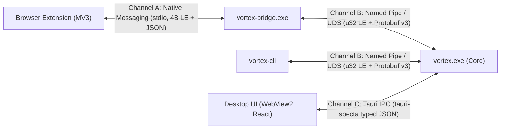
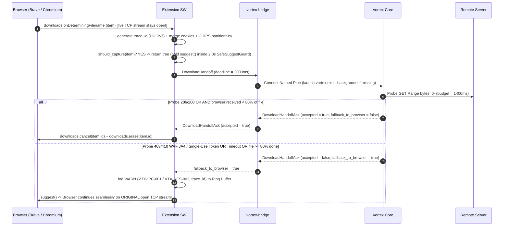

# 🔌 Vortex Download Manager — مواصفة بروتوكول الاتصال الداخلي (IPC & Native Messaging Protocol Spec v1)

> **الإصدار:** `1.0` — **النمط:** Contract-First (المخطط هو المصدر الوحيد للحقيقة).
> **النطاق:** جميع قنوات الاتصال بين العمليات الأربع: `Extension ↔ vortex-bridge ↔ Vortex Core ↔ Desktop UI / CLI`.

---

## 1. نظرة عامة على قنوات الاتصال

**القاعدة الأمنية الصارمة:** **لا يُفتح أي منفذ TCP/UDP محلي (`localhost:PORT`) أبداً.** كل اتصال محلي يتم عبر قنوات نظام تشغيل معزولة بصلاحيات المستخدم الحالي فقط.



| القناة | النقل الفيزيائي | التشفير / التغليف | حد حجم الرسالة | آلية الأمان |
|---|---|---|---|---|
| **A: Ext ↔ Bridge** | `stdin` / `stdout` (Native Messaging) | 4-byte Little-Endian `u32` + UTF-8 JSON | Host→Ext: **1 MiB** (قيد المتصفح) / Ext→Host: **4 MiB** | `allowed_origins` مقيّد بمعرّف الإضافة الرسمي فقط. |
| **B: Bridge/CLI ↔ Core** | Windows Named Pipe `\\.\pipe\vortex-core-<USER_SID>` (وعلى Linux/macOS: `$XDG_RUNTIME_DIR/vortex/core.sock` بصلاحيات `0600`) | 4-byte Little-Endian `u32` + **Protobuf v3** | **4 MiB** كحد أقصى لكل إطار | Windows SDDL DACL يقيّد الوصول بالـ **Owner SID الحالي فقط** (`D:(A;;GA;;;<USER_SID>)`) + منع الاتصالات الشبكية (`PIPE_REJECT_REMOTE_CLIENTS`) + سقف `16` عميلاً متزامناً ومحدد معدل `100 msg/s`. |
| **C: UI ↔ Core** | Tauri IPC الداخلي (`main` + `confirm` windows) | JSON مكتوب الأنواع ومولّد آلياً عبر `tauri-specta` (`#[specta(type = f64)]` + `camelCase` موحد لـ `ApiError`) | مقيد بالذاكرة | Tauri Capabilities بأقل صلاحيات + Strict CSP + حارس `on_navigation` (`tauri.localhost` فقط) + بوابة فحص عدم انحراف `generated.ts` في CI. |

---

## 2. صيغة الإطارات والظرف الموحّد (Framing & Envelope)

### 2.1 التغليف الثنائي (Binary Framing)
لكل من القناة A (JSON) والقناة B (Protobuf):

```text
+-----------------------------------+------------------------------------------+
|  length: uint32 (Little-Endian)   |  payload: byte[length]                   |
|  (4 bytes, 1 <= length <= MAX)    |  (JSON UTF-8 on Ch.A / Protobuf on Ch.B) |
+-----------------------------------+------------------------------------------+
```

- أي إطار بطول `0` أو يتجاوز `MAX_FRAME_BYTES` يُرفض فوراً مع إغلاق الاتصال وتسجيل `WARN (VTX-IPC-003)` — حماية من هجمات استنفاد الذاكرة (DoS).

### 2.2 مخطط Protobuf المرجعي (`proto/vortex_ipc.proto` — v1)

```protobuf
syntax = "proto3";
package vortex.ipc.v1;

// Envelope موحّد لكل الرسائل المتبادلة على Named Pipe
message Envelope {
  uint32 protocol_version = 1;       // الحالية: 1
  string message_id       = 2;       // UUIDv7 فريد لكل رسالة (للربط بين الطلب والرد)
  string reply_to         = 3;       // فارغ في الطلبات، ويحمل message_id الطلب في الردود
  string trace_id         = 4;       // UUIDv7 للتتبع الموزع عبر كل العمليات
  int64  timestamp_ms     = 5;       // Unix epoch milliseconds

  oneof body {
    HelloRequest          hello               = 10;
    HelloAck              hello_ack           = 11;
    Ping                  ping                = 12;
    Pong                  pong                = 13;
    DownloadHandoff       download_handoff    = 14;
    DownloadHandoffAck    download_handoff_ack = 15;
    DownloadBatch         download_batch      = 16;
    MediaDetected         media_detected      = 17;
    MediaDownloadRequest  media_download      = 18;
    LinkRefreshBegin      link_refresh_begin  = 19;
    LinkRefreshCandidate  link_refresh_cand   = 20;
    SettingsChanged       settings_changed    = 21;
    DiagnosticsDumpReq    diagnostics_req     = 22;
    DiagnosticsDumpResp   diagnostics_resp    = 23;
    HealthCheckReq        health_req          = 24;
    HealthCheckResp       health_resp         = 25;
    BringToFront          bring_to_front      = 26;
    ApiError              error               = 99;
  }
}

message HelloRequest {
  string client_kind     = 1;        // "extension-brave" | "extension-chrome" | "extension-firefox" | "cli"
  string client_version  = 2;        // SemVer e.g. "1.0.0"
  uint32 min_supported_v = 3;        // أقدم إصدار بروتوكول يدعمه العميل
  uint32 max_supported_v = 4;        // أحدث إصدار بروتوكول يدعمه العميل
  repeated string capabilities = 5;  // e.g. ["handoff", "media", "link-refresh", "diag-dump"]
}

message HelloAck {
  uint32 negotiated_version = 1;
  string core_version       = 2;
  repeated string capabilities = 3;
  CaptureRules capture_rules = 4;    // قواعد الالتقاط المحدثة للإضافة
}

message CaptureRules {
  bool enabled                    = 1;
  uint64 min_file_size_bytes      = 2; // افتراضي: 1_048_576 (1 MiB)
  repeated string extensions      = 3;
  repeated string mime_types      = 4;
  repeated string excluded_hosts  = 5;
  bool capture_in_incognito       = 6; // افتراضي: false
}

message DownloadHandoff {
  string url            = 1;         // ≤ 8192 bytes, http/https only
  string final_url      = 2;
  string referrer       = 3;
  string suggested_name = 4;         // ≤ 512 bytes
  string mime_type      = 5;
  optional uint64 size_bytes = 6;
  string user_agent     = 7;
  string cookies        = 8;         // حساس (عادية + مقسّمة CHIPS) — يُغلّف بـ SecretString فور القراءة
  map<string, string> headers = 9;   // ≤ 64 headers
  bool incognito        = 10;
  string source         = 11;        // "determining-filename" | "context-menu" | "video-button" | "cli"
  bool auto_start       = 12;
  string top_level_site = 13;        // e.g. "https://example.com" (سياق CHIPS partitionKey)
}

message DownloadHandoffAck {
  string download_id         = 1;    // UUIDv7 للتحميل الجديد أو الدفعة المعلقة (إن قُبل)
  bool accepted              = 2;    // true فقط بعد نجاح أول Probe وفحص Burst Quarantine!
  bool duplicate_found       = 3;
  bool fallback_to_browser   = 4;    // true عند 403/410 (Cloudflare JA4 أو توكن أحادي الاستخدام)
  string fallback_reason     = 5;    // e.g. "waf_tls_bound" | "single_use_token" | "burst_limit_reached"
}

message Ping {
  int64 sent_at_ms = 1;
}

message Pong {
  int64 echo_sent_at_ms = 1;
}

message DownloadBatch {
  repeated DownloadHandoff items = 1;
}

message MediaStreamOption {
  string format_id     = 1;          // e.g. "2160p60-av1", "1080p60-vp9", "mp3-320"
  string label         = 2;
  string container     = 3;          // "mp4" | "mkv" | "mp3" | "m4a"
  optional uint64 approx_size_bytes = 4;
  bool audio_only      = 5;
}

message MediaDetected {
  string page_url      = 1;
  string media_url     = 2;          // رابط صفحة الفيديو أو m3u8/mpd
  string title         = 3;
  string mime_type     = 4;
  repeated MediaStreamOption options = 5;
}

message MediaDownloadRequest {
  string page_url      = 1;
  string media_url     = 2;
  string format_id     = 3;
  repeated string subtitle_langs = 4; // e.g. ["ar", "en"]
  string user_agent    = 5;
  string cookies       = 6;          // حساس — يُغلّف بـ SecretString فور القراءة
  string top_level_site = 7;
  bool is_playlist     = 8;
}

message LinkRefreshBegin {
  string download_id   = 1;
  string referrer_url  = 2;
  string expected_name = 3;
  string expected_mime = 4;
  optional uint64 expected_size_bytes = 5;
}

message LinkRefreshCandidate {
  string download_id   = 1;
  DownloadHandoff candidate = 2;
}

message SettingsChanged {
  CaptureRules capture_rules = 1;
}

message DiagnosticsDumpReq {
  uint32 max_entries   = 1;          // افتراضي: 500
}

message DiagnosticsDumpResp {
  string extension_logs_jsonl = 1;   // منظف من الأسرار
}

message HealthCheckReq {}

message HealthCheckResp {
  bool core_ok         = 1;
  bool db_ok           = 2;
  bool pipe_ok         = 3;
  uint64 free_disk_bytes = 4;
}

message BringToFront {
  optional string open_url = 1;      // رابط اختياري ممرر من النسخة الثانية عبر Single-Instance
}

message ApiError {
  string code              = 1;      // ثابت: e.g. "VTX-IPC-001"
  string category          = 2;      // "Network" | "Resource" | "Auth" | "Disk" | "Integrity" | "Database" | "Ipc" | "Security" | "Internal"
  string recoverability    = 3;      // "Transient" | "UserActionRequired" | "Permanent" | "SelfHealed" | "IsolatedBug"
  optional uint64 retry_after_ms = 4; // مملوء عند Transient إن توفر
  string user_message_key  = 5;      // مفتاح i18n
  map<string, string> message_params = 6;
  repeated string suggested_actions  = 7;
  string technical_detail  = 8;      // منظف 100% من الأسرار
  string trace_id          = 9;
}
```

> **تطابق JSON القياسي عبر القناتين A وC (`Canonical camelCase Wire Contract`):**
> 1. تستخدم القناة A (Native Messaging) أسماء الحقول بصيغة `camelCase` مع `v`, `id`, `replyTo`, `traceId`, `timestampMs`, `type`, `payload`، ويقوم `vortex-bridge` بالترجمة الثنائية السريعة بين JSON ↔ Protobuf دون تعديل منطق الأعمال.
> 2. على القناة C (`Desktop UI ↔ Core` عبر Tauri IPC)، يُسلسل `ApiError` أيضاً بصيغة **`camelCase` المطابقة تماماً** (`code`, `category`, `recoverability`, `retryAfterMs`, `userMessageKey`, `messageParams`, `suggestedActions`, `technicalDetail`, `traceId`) مع توليد آلي كامل للأنواع في `apps/desktop/ui/src/bindings/generated.ts` عبر `tauri-specta` (`#[specta(type = f64)]` في `specta-typescript 0.0.15`) وبوابة فحص آلية في CI تمنع أي انحراف بين Rust وTypeScript (انظر [Host-Resilience-And-Contract-Integrity-Spec.md](./Host-Resilience-And-Contract-Integrity-Spec.md)).

---

## 3. المصافحة وتفاوض القدرات (Handshake & Capability Negotiation)

1. فور اتصال `vortex-bridge` بـ `Core` (أو الإضافة بـ `Bridge`)، يرسل العميل `HelloRequest` ضمن مهلة **2 ثانية**.
2. يحسب `Core` النسخة المتفاوض عليها:
   `negotiated = min(client.max_supported_v, core.max_supported_v)`
   إذا كان `negotiated < max(client.min_supported_v, core.min_supported_v)` ← يرد `Core` بخطأ `VTX-IPC-002` (عدم توافق إصدار) مع إجراء مقترح `UpdateVortex`.
3. يحسب تقاطع القدرات (`client.capabilities ∩ core.capabilities`) ويرد بـ `HelloAck` شاملاً أحدث `CaptureRules`.
4. يبدأ بعدها تبادل `Ping`/`Pong` كل **30 ثانية** لاكتشاف الاتصالات الميتة (Dead Peers).

---

## 4. تسلسل التشغيل التلقائي وآلية Fallback الآمنة (Zero-Lost-Download)

المشكلة الكلاسيكية في مديري التحميل: المستخدم يضغط رابطاً، الإضافة تلغي تحميل المتصفح، ثم يفشل البرنامج في الرد — **فيضيع التحميل!**
نمنع ذلك عبر آلة حالات وميزانية زمنية صارمة:



> [!IMPORTANT] **لماذا لا نستدعي `downloads.pause()` أبداً؟**
> في نواة Chromium الداخلية (`DownloadItemImpl::Pause`)، استدعاء `pause()` يغلق مقبس الـ TCP/HTTP الفعلي، واستدعاء `resume()` يفتح طلب `Range` جديداً فيفشل مع الروابط أحادية الاستخدام (Single-Use Tokens) والخوادم التي لا تدعم `Range`!
> بدلاً من ذلك:
> - **على Chromium (Brave / Chrome / Edge):** نرجع `true` من `onDeterminingFilename` ونؤخر استدعاء `suggest()` داخل حارس `SafeSuggestGuard` (`try/finally` + مهلة `2.0s` تضمن استدعاء `suggest()` دائماً عند أي خطأ). يظل الاتصال الأصلي حياً؛ فإذا قبل الـ Core ننفّذ `cancel + erase`، وإذا رفض (أو كان الملف صغيراً اكتمل ≥ 80% منه بالفعل) نستدعي `suggest()` فيكمل المتصفح على **نفس مقبس الـ TCP المفتوح** بصفر طلبات إضافية!
> - **على Firefox MV3 (الذي لا يوفّر `onDeterminingFilename` لكنه احتفظ رسمياً بـ `webRequestBlocking`):** نستخدم `browser.webRequest.onHeadersReceived` الحاجب بـ Promise غير متزامن ينتظر نتيجة الـ Probe؛ يعيد `{ cancel: true }` عند القبول، أو `{}` عند الـ Fallback ليكمل Firefox على نفس الاتصال المفتوح!

---

## 5. قواعد التحقق ومكافحة إساءة الاستخدام (Input Validation & Anti-DoS)

قبل تمرير أي رسالة من `vortex-ipc` إلى `vortex-application` يتم فحص:

| الحقل | الحد الصارم | الإجراء عند المخالفة |
|---|---|---|
| طول الإطار الكلي | `≤ 4 MiB` (و`≤ 1 MiB` باتجاه الإضافة) | إغلاق الاتصال + `WARN (VTX-IPC-003)` |
| طول `url` و`final_url` و`referrer` | `≤ 8,192` حرف | رفض `VTX-SEC-001` |
| بروتوكول `url` | `http://` أو `https://` (أو `ftp://`/`sftp://` إن فُعّلت) | رفض فوري لـ `file://`, `javascript:`, `data:`, `\\UNC` |
| طول `suggested_name` | `≤ 512` حرف، خالٍ من `\0` | تنظيف عبر `FilenameSanitizer` |
| عدد `headers` | `≤ 64` ترويسة، كل قيمة `≤ 8 KiB` | رفض `VTX-SEC-001` |
| طول `cookies` | `≤ 64 KiB` | اقتطاع/رفض + عدم تسجيلها أبداً |
| الاتصالات المتزامنة ومهلة المصافحة | `≤ 16` عميلاً متزامناً + مهلة `2.0s` لرسالة `HelloRequest` | رفض/فصل فوري لحماية مقابض النظام (`TH-32`) |
| معدل الرسائل (Rate Limit) | `≤ 100` رسالة/ثانية لكل عميل IPC (`TokenBucket`, `burst = 40`) | تأخير/رفض `VTX-IPC-004` وفصل المهاجم المتكرر |
| صلاحية UTF-8 | صارم | رفض الإطار |

---

## 6. قواعد التطور والتوافق الخلفي (Protocol Evolution & Compatibility)

نتّبع قواعد **Google Protobuf Compatibility Rules** حرفياً:

1. **التوافق المضمون:** `Core` يدعم دائماً الإضافات من الإصدار الحالي والإصدارين السابقين (**`N`, `N-1`, `N-2`**)، والعكس صحيح عبر Capability Negotiation.
2. **مسموح دون رفع `protocol_version`:**
   - إضافة حقول `optional` جديدة بأرقام Tags غير مستخدمة.
   - إضافة أنواع رسائل جديدة في `oneof body` (الطرف الأقدم يتجاهلها بأمان ويرد `UnsupportedCapability`).
3. **ممنوع منعاً باتاً داخل نفس `protocol_version`:**
   - إعادة استخدام رقم Tag قديم (يُعلَّم بـ `reserved`).
   - تغيير نوع حقل أو معناه الدلالي.
   - حذف حقل مستخدم من عملاء `N-1` أو `N-2`.
4. **اختبار التوافق الآلي (Golden Wire Tests):** نحتفظ في `crates/vortex-ipc/tests/golden/` بعينات ثنائية (`.bin` و`.json`) من كل إصدار سابق، ويثبت CI في كل PR أن الكود الجديد يفك تشفيرها بنجاح 100%.

---

## 7. ربط التتبع الموزّع (Trace Context Propagation)

- كل عملية تبدأ من الإضافة تولّد `trace_id` (UUIDv7) وتضعه في `Envelope.trace_id`.
- `vortex-bridge` ينشئ Span: `tracing::info_span!("bridge.forward", trace_id = %env.trace_id, msg_id = %env.message_id)`.
- `Vortex Core` يستخرج `env.trace_id` ويربطه بـ `DownloadActor` و`Worker` و`ApiError`.
- عند حدوث خطأ في أي نقطة، يُعاد `ApiError` حاملاً نفس `trace_id` ليظهر للمستخدم في الواجهة أو الإشعار — مما يمكّن من ربط سجلات العمليات الأربع (`extension` + `bridge` + `core` + `ui`) في ثوانٍ.
