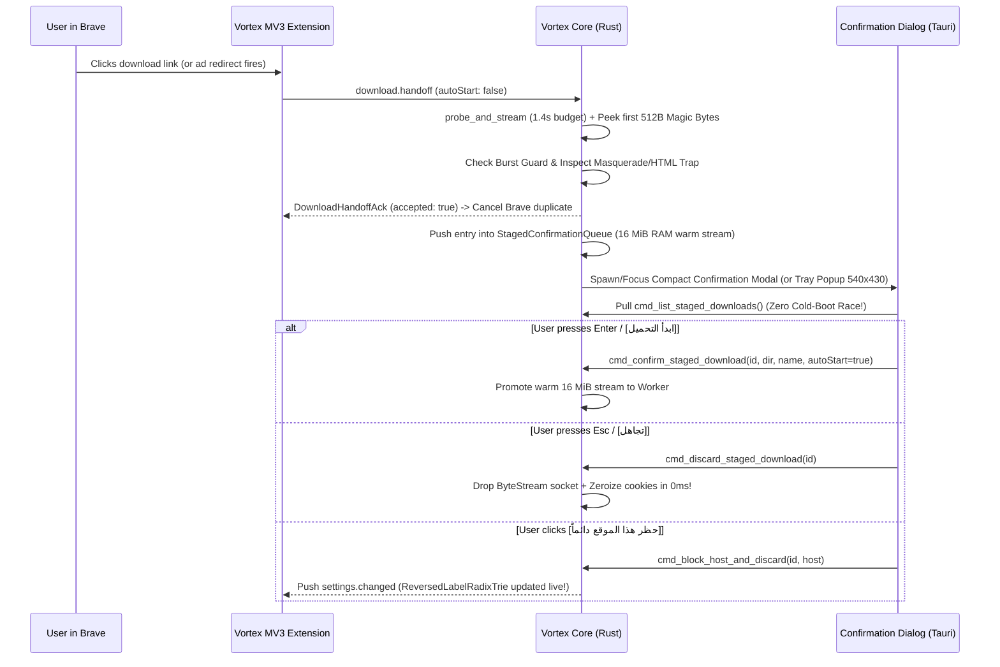

# 🛡️ Vortex Download Manager — مواصفة تأكيد الالتقاط الذكي والحماية الاستباقية من المواقع الإعلانية وسوء الاستخدام
**(Smart Capture Confirmation, Anti-Ad-Trap Shield & Proactive Reliability Spec)**

> **الإصدار:** `1.2` — **الحالة:** **مكتملة ومُنفّذة بالكامل في `Phase 1.5` ✅ ومُعزّزة بطبقات `TH-26` → `TH-33` و`UX-M01` → `UX-M12` في `Phase 1.6` ✅**
> **المراجع المرتبطة:** [Vortex-Architecture-Design.md](./Vortex-Architecture-Design.md) (§8.2, §13.4, §15.4) · [Protocol-Spec.md](./Protocol-Spec.md) (§4) · [Threat-Model.md](./Threat-Model.md) · [Creative-UI-And-Brand-Overhaul-Spec.md](./Creative-UI-And-Brand-Overhaul-Spec.md) · [Cybersecurity-Layers-And-Misuse-Prevention-Spec.md](./Cybersecurity-Layers-And-Misuse-Prevention-Spec.md)

---

## 1. التشخيص الجنائي الدقيق للمشكلة الحالية (Forensic Root-Cause Analysis)

عند تجربة النسخة الأولية (MVP) عملياً على متصفح **Brave**، تبيّن أن النقر على أي رابط تحميل يبدأ التنزيل والكتابة على القرص فوراً بصمت دون سؤال المستخدم. الفحص الدقيق للكود كشف **سلسلة من 4 أسباب تقنية مترابطة** أدت إلى هذا السلوك، بالإضافة إلى ثغرات تجربة مستخدم استباقية عند تصفح المواقع المليئة بالإعلانات والنوافذ المنبثقة:

### 1.1 الأسباب المباشرة في الكود الحالي
1. **تثبيت `autoStart: true` خطأً في إضافة المتصفح (`extension/src/lib/live-handoff.ts:354`):**
   - دالة `handleDeterminingFilename` ترسل حالياً `autoStart: true` داخل رسالة `download.handoff`، وهو ما يخالف المواصفة الأصلية في `Vortex-Architecture-Design.md` §13.4 (`"autoStart": false`) و§15.8 (*"Click any download link → Vortex dialog: press Enter → Fast multi-connection download"*).
   - في `crates/vortex-application/src/use_cases.rs:569`، المعادلة `let should_auto_start = cmd.auto_start || cfg.auto_start_handoff;` تجعل `cmd.auto_start == true` يتجاوز إعداد المستخدم `cfg.auto_start_handoff == false` دائماً!
2. **تجاهل رابط التجهيز `vortex://staged/<id>` في الواجهة (`apps/desktop/ui/src/App.tsx:78-86`):**
   - عندما تكون `should_auto_start == false`، يقوم `handoff_from_browser` (`use_cases.rs:573-592`) بحفظ الدفق الدافئ (`16 MiB` RAM buffer) داخل `staged_probes` وبث الحدث `AppEvent::BringToFront { open_url: Some("vortex://staged/<id>") }`.
   - لكن مستمع `onOpenUrl` في `App.tsx:80` يتحقق فقط من `http://` و`https://`، فيسقط `vortex://staged/<id>` في فرع `else { void refresh(); }` دون فتح نافذة التأكيد إطلاقاً!
3. **سباق التوقيت عند الاستيقاظ من شريط المهام (`Tray Cold-Boot Event Race` في `apps/desktop/src-tauri/src/main.rs:238-242`):**
   - لأن Vortex يدمّر `WebView2` عند الإغلاق لتوفير الذاكرة (`< 45 MB` Idle)، فإن استدعاء `open_or_focus_main_window(&fwd_handle)` متبوعاً فوراً في السطر التالي بـ `fwd_handle.emit("vortex://open-url", u)` يطلق الحدث قبل أن تكتمل تهيئة شجرة React داخل `WebView2` (`~180–350ms`)، فيضيع الحدث تماماً!
4. **غياب أمر التخلص الفوري من الدفق المؤقت (`Missing Discard Staged Command`):**
   - عند رفض المستخدم لتحميل غير مرغوب فيه (أو إغلاق نافذة التأكيد بـ `Esc`)، لا يوجد حالياً أمر `cmd_discard_staged_download(staged_id)` لإغلاق مقبس الشبكة فوراً وتفريغ مخزن الـ `16 MiB` ومسح الكوكيز المؤقتة، بل يبقى الاتصال معلقاً حتى انتهاء مهلة الـ TTL (`120s`).

---

## 2. معمارية تأكيد الالتقاط الذكي بصفر إهدار للوقت (`Zero-Waste Smart Confirmation Flow`)

الهدف الهندسي: **منح المستخدم تحكماً كاملاً وواضحاً قبل كتابة بايت واحد على القرص، مع الحفاظ على سرعة بدء `0ms` فور ضغط `Enter`!**

### 2.1 المتطلبات التقنية الدقيقة للتنفيذ
1. **الإعداد الافتراضي الآمن (`Ask Before Download by Default`):**
   - تعديل `extension/src/lib/live-handoff.ts` لإرسال `autoStart: false` في المسار التلقائي (`determining-filename`).
   - إبقاء `auto_start_handoff: false` كقيمة افتراضية في `AppConfig`، مع توفير خيار صريح للمستخدمين المتقدمين (**"بدء التحميل تلقائياً للنطاقات الموثوقة فقط"** أو **"تلقائياً للملفات غير التنفيذية"**).
   - **قاعدة أمان غير قابلة للتجاوز:** حتى لو فعّل المستخدم البدء التلقائي العام، **يُمنع منعاً باتاً البدء التلقائي الصامت لأي ملف تنفيذي أو مشبوه** (`.exe`, `.msi`, `.msix`, `.scr`, `.bat`, `.cmd`, `.ps1`, `.vbs`, `.hta`, `.lnk`, `.reg`, `.cpl`, `.jar`) أو عند اكتشاف عدم تطابق البصمة السحرية (`Magic Bytes`)!
2. **طابور التأكيد المقاوم لسباق التوقيت (`Pull-Based StagedQueue`):**
   - توسيع `StagedProbeEntry` في `ApplicationService` ليحمل نموذج قراءة كامل `StagedDownloadDto`:
     - `staged_id`, `display_url`, `origin_host`, `referrer_host`, `cross_origin_redirected: bool`
     - `suggested_file_name`, `category_id`, `suggested_save_dir`, `total_size`, `supports_range`
     - `security_assessment: ContentSecurityAssessment` (انظر القسم 3)
     - `duplicate: Option<DuplicateMatchDto>`, `created_at_ms`, `expires_at_ms`
   - إضافة 4 أوامر `tauri-specta` جديدة:
     - `cmd_list_staged_downloads() -> Vec<StagedDownloadDto>` (تستدعيها الواجهة فور إقلاعها وعند استقبال حدث `vortex://staged-changed` — فيستحيل ضياع أي نافذة تأكيد عند الاستيقاظ من الـ Tray!).
     - `cmd_discard_staged_download(staged_id: String) -> ()` (تغلق مقبس الـ HTTP فوراً، تصفّر `SecretCredentials` بـ `zeroize`، وتحرر الـ RAM).
     - `cmd_discard_all_staged_downloads() -> u32` (زر **"رفض وإغلاق الكل"** عند التعرض لعاصفة إعلانات).
     - `cmd_block_capture_host(host: String, discard_staged_id: Option<String>) -> AppConfig` (يضيف النطاق إلى `excluded_hosts` ويدفعه حياً للإضافة عبر `settings.changed`).
3. **وضع النافذة الذكي عند الخمول في الـ Tray (`Compact Confirmation Mode`):**
   - إذا كانت النافذة الرئيسية مفتوحة: تفتح نافذة التأكيد كـ **Modal أنيق** فوقها مع التركيز الفوري على زر البدء (ما لم يكن الملف خطراً).
   - إذا كانت النافذة الرئيسية مغلقة في الـ Tray: بدلاً من فتح النافذة الرئيسية العملاقة (`1120×720`) فوق متصفح المستخدم، يفتح Vortex نافذة تأكيد مدمجة وأنيقة (`580×520` في منتصف الشاشة بتأثير Mica عبر مسار `?mode=confirm` وصلاحية نافذة `confirm` في `capabilities/default.json`) وبمجرد اتخاذ القرار تعود للخلفية بهدوء!

---

## 3. الدرع الاستباقي ضد المواقع الإعلانية، الخداع، والملفات الملغمة (`TH-20` → `TH-25`)

المستخدم العادي يزور يومياً مواقع تحميل أفلام، برامج، ألعاب، أو مواقع رفع ملفات مجانية مليئة بالنوافذ الإعلانية المنبثقة (Pop-unders / Fake Download Buttons). يتفوق Vortex على IDM وكل مديري التحميل التقليديين عبر **5 طبقات حماية ذكية تعمل في `0ms` قبل الحفظ**:

### 3.1 الفحص السحري لأول 512 بايت في الذاكرة (`Zero-Cost Magic-Byte & HTML-Trap Sniffer` — `TH-21`)
بما أن `probe_and_stream` يقرأ أول شريحة من الاستجابة في مخزن الذاكرة (`16 MiB` RAM ring buffer)، يقوم المحرك بمعاينة أول `512` بايت (`peek_header_bytes` **دون استهلاكها من الدفق!**) ومقارنتها مع الامتداد المعلن و`Content-Type`:

| الحالة المكتشفة | كيف نكتشفها برمجياً | ما يراه المستخدم في نافذة التأكيد |
|---|---|---|
| **1. فخ صفحة ويب متنكرة كملف (`Fake HTML Ad/Countdown Page`)** | الامتداد `.zip`/`.rar`/`.mp4`/`.apk`/`.pdf` لكن أول بايتات غير فارغة تبدأ بـ `<!DOCTYPE html` أو `<html` أو `<script` (أو `Content-Type: text/html`) | 🟠 **تحذير واضح:** *"تنبيه: الخادم أرسل صفحة ويب (HTML) وليس ملفاً حقيقياً! غالباً هذا إعلان أو صفحة انتظار خادعة."* (مع إبراز زر **[تجاهل]** كخيار مُوصى به). |
| **2. برمجية تنفيذية متنكرة كفيديو/مستند/أرشيف (`Masquerading Executable — Malware Trap`)** | الاسم ينتهي بـ `.mp4`/`.mkv`/`.pdf`/`.jpg`/`.zip` أو امتداد مزدوج خادع مثل `Movie.1080p.mp4.exe` أو محارف عكس الاتجاه `RTLO`، أو البصمة الثنائية تبدأ بـ **`4D 5A` (`MZ` — Windows PE/EXE/DLL/SCR)** أو **`4D 53 43 46` (`MSCF` — Cabinet)** أو **`D0 CF 11 E0` (`MSI`)** | 🔴 **درع خطر حرج:** *"خطر أمني: هذا الملف برنامج تنفيذي لنظام Windows متنكّر في هيئة ملف آخر!"* — **يُعطَّل زر `Enter` السريع تلقائياً** لمنع الموافقة بالخطأ، ويصبح زر **[✕ إلغاء وحظر المصدر]** هو الزر الأساسي! |
| **3. ملف تنفيذي صريح من موقع عابر للأصول (`Cross-Origin Ad Executable`)** | الامتداد تنفيذي (`.exe`/`.msi`/`.bat`/`.ps1`...) وكان نطاق صفحة المصدر (`referrer_host` مثل `watch-movie.example`) مختلفاً تماماً عن نطاق التحميل النهائي (`origin_host` مثل `ad-cdn-xyz.biz`) | 🟡 **شريط تنبيه المصدر:** يعرض بوضوح: `بدأت النقرة من: watch-movie.example ➔ التحميل الفعلي من: ad-cdn-xyz.biz` مع شارة **"برنامج قابل للتشغيل"**. |
| **4. ملف سليم متطابق البصمة (`Verified Signature Match`)** | البصمة السحرية تطابق الامتداد (`50 4B 03 04` لـ `ZIP`، `52 61 72 21` لـ `RAR`، `37 7A BC AF` لـ `7z`، `25 50 44 46` لـ `PDF`، `ftyp` لـ `MP4`، `1A 45 DF A3` لـ `MKV/WebM`) | 🟢 **شارة موثوقية هادئة:** `✓ نوع الملف الحقيقي مطابق (أرشيف ZIP / فيديو MP4)`. |

### 3.2 حارس عواصف الإعلانات والتحميلات المتتالية (`Ad-Burst Storm Quarantine` — `TH-20`)
- **المشكلة الواقعية:** في مواقع الإعلانات، ضغطة واحدة قد تفتح 4 تبويبات إعلانية ترسل 4 طلبات تحميل خلال ثانيتين، فيرتبك المستخدم من تعدد النوافذ أو يضغط `Enter` على النافذة الخاطئة!
- **الحل الهندسي:**
  1. **منع سرقة التركيز أثناء الكتابة (`Anti-Focus-Stealing / Clickjacking Delay`):** عندما تظهر نافذة تأكيد جديدة لم يكن المستخدم يتوقعها، لا يُقبَل ضغط `Enter` أو النقر على زر **[ابدأ التحميل]** خلال أول **`350ms`** من ظهور النافذة (`Input Grace Lock` مثل متصفحات Chrome/Firefox عند ظهور مربعات حوار الأمان!)، حتى لو ضغط المستخدم بالصدفة في نفس لحظة انبثاق الإعلان فلن يبدأ التحميل بالخطأ أبداً!
  2. **تجميع الدفعات المتلاحقة (`Stacked Queue Header`):** إذا وصل أكثر من طلب التقاط بينما نافذة التأكيد مفتوحة (أو وصل > 2 طلب خلال `3 ثوانٍ`)، **لا نفتح نوافذ متراكبة مبعثرة!** بل تُجمع في شريط علوي أنيق داخل نفس نافذة التأكيد:
     `🔔 يوجد 3 طلبات تحميل معلّقة للمراجعة (1 من 3) — [رفض الكل ✕]`
  3. **حد أقصى للدفعات المعلقة في الذاكرة (`Max 8 Staged Streams`):** لمنع موقع خبيث من فتح 100 اتصال `staged_probes` لاستنزاف الذاكرة (`100 × 16 MiB` — DoS `TH-14`)، نضع سقفاً صارماً: **أقصى عدد للدفعات المعلقة في آنٍ واحد = `8` دفعات** (وما زاد عنها من نفس النطاق يُرفض تلقائياً مع إرجاع `fallback_to_browser: false` أو إشعار حظر عاصفة).

### 3.3 التحكم السريع في المواقع المزعجة (`One-Click Site Exclusion & Alt-Key Bypass`)
- داخل نافذة التأكيد، بجانب اسم نطاق الموقع (`referrer_host` أو `origin_host`)، توجد قائمة مصغّرة سريعة:
  - **[🚫 عدم التقاط أي تحميل من `<domain>` مجدداً]**: يحدّث `excluded_hosts` فوراً في `config.toml` ويرسل التحديث للإضافة لحظياً.
- تذكير لطيف أسفل النافذة للمستخدم الجديد: *"💡 نصيحة: اضغط باستمرار على مفتاح `Alt` أثناء النقر في المتصفح لتجاوز Vortex مؤقتاً."*

### 3.4 أمان فتح الملفات المكتملة في الواجهة (`Safe Post-Download Open Policy` — `TH-23`)
- في جدول التحميلات الرئيسي:
  - النقر المزدوج على صف **قيد التحميل أو متوقف** يفتح **لوحة التقدم وتفاصيل الأجزاء (`Live Inspector`)**.
  - للملفات المكتملة ذات الامتدادات التنفيذية عالية الخطورة (`.exe`, `.msi`, `.bat`, `.cmd`, `.scr`, `.ps1`, `.vbs`, `.reg`)، الزر الأساسي الظاهر في الصف هو **[📂 عرض في المجلد]** (`SHOpenFolderAndSelectItems`)، بينما يتطلب تشغيلها المباشر من داخل Vortex نافذة تأكيد صغيرة تذكّر المستخدم بمصدر الملف، مع الاعتماد الكامل على `ShellExecuteW` حتى يفحصها Windows SmartScreen عبر وسم `:Zone.Identifier` (`TH-07`).

---

## 4. إصلاحات الأداء والاعتمادية وتجربة الاستخدام الاستباقية (Proactive Perf & UX Fixes)

أثناء الفحص الشامل للكود الحالي، رصدنا النقاط الإضافية التالية التي سنعالجها جذرياً ضمن نفس المرحلة (`Phase 1.5`) قبل الانتقال للمرحلة الثانية:

1. **إصلاح خطأ الإيقاف/الاستئناف على الصفوف غير المحددة (`App.tsx:357-359`):**
   - الكود الحالي يستدعي `selectDownload(item.id); void pauseOrResumeSelected();`، وبما أن حالة Zustand/React لا تكون قد قرأت `selectedId` الجديد داخل نفس الإغلاق في بعض الحالات أو تغيّر تحديد المستخدم دون داعٍ، سنستبدلها بدالة مباشرة **`togglePauseResumeById(id: string)`** تعمل على العنصر المستهدف بدقة 100%.
2. **إزالة القيم التوضيحية الثابتة من لوحة التقدم والإضافة (`ProgressPanel.tsx` & `AddDownloadPanel.tsx`):**
   - إزالة النصوص والأرقام الوهمية الاحتياطية (`ubuntu-26.04-desktop-amd64.iso`، `D:/Downloads/Compressed`، وأرقام السرعة التجريبية) واستبدالها بقراءة المسار الافتراضي الحقيقي للمستخدم من `cmd_get_settings()` وحالة فارغة أنيقة عند عدم تحديد أي عنصر.
3. **منتقي مجلدات Windows الأصلي + فتح الملف/المجلد (`Native Win32 Shell Integration`):**
   - إضافة 3 قدرات أصلية خفيفة جداً في `vortex-platform` (عبر `windows-sys` COM بدون أي مكتبات خارجية ثقيلة تحافظ على حجم المثبت `< 15 MB`):
     - `cmd_pick_folder(initial_dir: Option<String>) -> Option<String>`: يفتح نافذة اختيار المجلدات الحديثة لنظام Windows 11 (`IFileOpenDialog` مع `FOS_PICKFOLDERS`).
     - `cmd_reveal_in_folder(download_id: String) -> ()`: يفتح Windows Explorer مع تحديد الملف المحمّل مباشرةً (`SHOpenFolderAndSelectItems`).
     - `cmd_open_downloaded_file(download_id: String) -> ()`: يفتح الملف المكتمل بأمان عبر `ShellExecuteW("open", ...)` بعد التحقق من وجوده على القرص.
4. **تحجيم ديناميكي كامل لجدول الـ Virtualization (`ResizeObserver` + `flex: 1`):**
   - استبدال الارتفاع الثابت `blockSize: "440px"` في `VirtualizedDownloadsTable.tsx` بحاوية مرنة تملأ كامل مساحة العمل المتاحة مهما كبر أو صغر حجم النافذة أو دقة الشاشة (`1080p` / `1440p` / `4K`) مع الحفاظ على ثبات `60 FPS`.
5. **فحص المساحة الفورية داخل نافذة التأكيد قبل البدء (`Live Free-Space Preview`):**
   - عرض المساحة الحرة الفعلية على القرص المختار داخل نافذة التأكيد نفسها (`متاح على C:\: 142.5 GB — بعد التحميل: 137.4 GB`)؛ وإذا غيّر المستخدم مسار الحفظ لقرص ممتلئ يظهر التحذير لحظياً قبل الضغط على **[ابدأ التحميل]**!

---

## 5. مصفوفة الاختبارات الإلزامية لهذه المواصفة (Verification Matrix)

لا تُعتمد هذه المواصفة كمكتملة إلا باجتياز الاختبارات الآلية التالية:
1. **اختبار البصمة السحرية (`Magic-Byte Sniffer Unit + Integration Tests`):**
   - كشف ملف `.zip` يبدأ بـ `<!DOCTYPE html>` كـ `HtmlTrap`.
   - كشف ملف `movie.mp4` يبدأ بـ `MZ` (`0x4D, 0x5A`) أو امتداد مزدوج `video.mp4.exe` كـ `ExecutableMasquerade`.
   - التأكد بنسبة **100%** أن معاينة أول `512` بايت **لا تستهلك أو تُسقط أي بايت** من الدفق الدافئ (`SHA-256` مطابق تماماً عند بدء التحميل!).
2. **اختبار عاصفة الإعلانات وسقف الذاكرة (`Burst & Staged Cap Test`):**
   - إرسال `12` طلب `handoff_from_browser` متتالية خلال ثانية واحدة والتحقق من تطبيق سقف الـ `8` دفعات وتفريغ المرفوض فوراً بلا تسريب ذاكرة أو مقابس مفتوحة.
3. **اختبار E2E على متصفح Brave الحقيقي (`Confirmation & Discard Flow`):**
   - النقر على رابط في Brave ← التأكد أن التحميل **يتوقف في طابور التأكيد الدافئ (`staged`) ولا يكتب على القرص** حتى يوافق المستخدم ← ضغط **[تجاهل]** يغلق الاتصال فوراً ويبقى مجلد التحميل فارغاً ← ضغط **[ابدأ التحميل]** يكمل بـ `0ms` إهدار ويطابق `SHA-256`!
