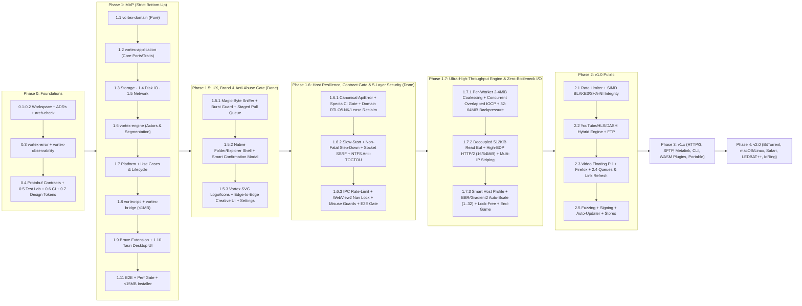

# ✅ Vortex Download Manager — خطة التنفيذ وشجرة البناء المتسلسلة (Master Topological Execution Plan)

> **المراجع الهندسية المعتمدة:**
> - [Vortex-Architecture-Design.md](./Vortex-Architecture-Design.md) (الإصدار `0.6 — Post-Phase 1.7 Verified ✅ Ultra-High-Throughput Architecture`)
> - [Engineering-Standards.md](./Engineering-Standards.md) · [Protocol-Spec.md](./Protocol-Spec.md) · [Threat-Model.md](./Threat-Model.md) (`TH-01` → `TH-33`) · [Design-System.md](./Design-System.md) · [ADRs](./adr/README.md) (`ADR-001` → `ADR-021`)
> - **مراجع Phase 1.5 المنجزة ✅:** [Smart-Capture-And-Anti-Abuse-Spec.md](./Smart-Capture-And-Anti-Abuse-Spec.md) · [Creative-UI-And-Brand-Overhaul-Spec.md](./Creative-UI-And-Brand-Overhaul-Spec.md)
> - **مراجع Phase 1.6 المنجزة ✅:** [Host-Resilience-And-Contract-Integrity-Spec.md](./Host-Resilience-And-Contract-Integrity-Spec.md) · [Cybersecurity-Layers-And-Misuse-Prevention-Spec.md](./Cybersecurity-Layers-And-Misuse-Prevention-Spec.md)
> - **مراجع Phase 1.7 المنجزة ✅:** [Ultra-High-Throughput-Engine-Spec.md](./Ultra-High-Throughput-Engine-Spec.md) · [ADR-021](./adr/0021-ultra-high-throughput-iocp-and-adaptive-transport.md)
>
> **📊 ملخص الحالة الراهنة (تحديث اكتمال Phase 1.7 بالكامل — جاهز لـ Phase 2):**
> - ✅ **ما أُنجز بالكامل ومُتحقَّق منه آلياً وعملياً:**
>   1. **Phase 0** (`P0-T01` → `P0-T18`) + **Phase 1 MVP** (`P1-T01` → `P1-T37`: النطاق النقي، SQLite WAL، DPAPI، الملفات المتناثرة `FSCTL_SET_SPARSE`، محرك HTTP/TLS و`WSAIoctl`، شجرة الـ Actors وتعذيب `100×`، الوسيط `vortex-bridge.exe` بـ `FILE_FLAG_OVERLAPPED`).
>   2. **Phase 1.5** (`P1.5-T01` → `P1.5-T12`: تأكيد التحميل الذكي، الفاحص السحري لأول `512` بايت بدون فقد بايتات عبر `PrependByteStream`، حارس عواصف الإعلانات `Burst Quarantine`، نافذة الـ Tray المدمجة `580×520`، تكامل Win32 COM الأصلي، شعار Vortex الشعاعي وحزمة الأيقونات، ومساحة العمل المكتبية `Edge-to-Edge Mica`).
>   3. **Phase 1.6** (`P1.6-T01` → `P1.6-T14`: التدرج البطيء الموزون + الخفض السلس غير القاتل للتوازي واسترداد العقود + الحفاظ المستمر على دفق `Worker #1` + `HostCapabilityCache`، توحيد عقد `ApiError` بصيغة `camelCase` وتوليد `tauri-specta` الآلي في `generated.ts` + فحص الانحراف في CI، الطبقات الأمنية الخمس `TH-26` → `TH-33` ومنظومة منع أخطاء الاستخدام `UX-M01` → `UX-M12`).
>   4. **Phase 1.7** (`P1.7-T01` → `P1.7-T12`: تجميع مستقل لكل عامل `Per-Worker 2 MiB Coalescing` + كتابة موضعية متوازية بـ `FILE_FLAG_OVERLAPPED` IOCP + `Byte-Weighted Semaphore (32 MiB)` مع تخفيض استدعاءات `WriteFile` لـ `≤ 64` لملف `64 MiB`، فصل حد ترويسات `TH-27` (`≤ 64 KiB` / `≤ 100`) ورفع مخزن قراءة HTTP/1.1 لـ `512 KiB`، دعم **`HTTP/2` عالي الـ BDP (`ALPN: h2, http/1.1` · `16/64 MiB` نوافذ · `Multi-Connection H2`)**، توزيع **`Multi-IP CDN Round-Robin Striping`** مع عزل العناوين الفاشلة `60s`، إزالة `NetConnectionLost` من خفض التوازي الدائم + **`SmartHostProfileCache`** بـ `Half-Open Probe` وانطلاق متوازٍ فوري `0ms` للمضيفين المثبتين + إيقاف دفق `probe_and_stream` بلا هدر عند نقطة التقسيم، متحكم **`BBR/Gradient2 + AIMD Auto-Scaler (1..32)`**، وضع نهاية اللعبة **`End-Game Hedged Requests`**، وبث البروتوكول ووضع التوازي حياً في `LiveInspectorDrawer` و`SettingsModal`؛ تغطية `vortex-error 100%` و`vortex-domain 92.69%` و`vortex-engine 90.40%` و6 حزم أساسية `77.63%`؛ `121+` اختبار Rust + `3/3` ميزانيات `mvp_budgets` + `22/22` اختبار TS + `5/5` اختبار **Brave E2E** حقيقية بما فيها `Pixeldrain 8 MiB` في `2.30s`؛ أحجام النسخ النهائية: `vortex-bridge.exe 882.50 KiB`، حزمة الواجهة `155.67 kB` مضغوط، الإضافة `70.6 kB`، ومُثبّتا `NSIS 6.03 MiB` و`MSI 8.62 MiB` بدون Admin).
> - 🚀 **المرحلة القادمة الجاهزة للتنفيذ:** **Phase 2** (`v1.0` — YouTube 4K/MP3 + FTP + Queues + Link Refresh + Firefox + Signing) وما يليها.
>
> **الترخيص الرسمي:** `GPL-3.0-or-later` للمحرك والتطبيق، و`MPL-2.0 OR GPL-3.0-or-later` لغلاف الإضافة (انظر `ADR-013`).
> **متصفح التطوير الأساسي:** Brave (Chromium MV3) + مصفوفة اختبار Chrome / Edge / Firefox قبل الإصدار.

---

## 🧭 القواعد الهندسية الإلزامية لكل مهمة (Global Definition of Done)

لا تُعدّ أي مهمة في هذا الملف "مكتملة" (`[x]`) إلا إذا استوفت **جميع** الشروط التالية (معيار PRR — Production Readiness Review في كبرى شركات التقنية):

1. **الالتزام المعماري وشجرة الاعتماديات (Strict 5-Level Topological DAG):** لا كسر لقاعدة الاعتمادية (`Infrastructure → Application → Domain`)، ولا اعتمادية أمامية — كل مهمة في هذا الملف قابلة للترجمة والاختبار فور انتهاء المهمة التي تسبقها مباشرة.
2. **معالجة أخطاء صارمة (Zero-Panic & Typed Errors):**
   - صفر `.unwrap()` أو `.expect()` أو `panic!()` أو فهرسة غير آمنة في كود الإنتاج (مفروض بـ Clippy)، مع الحفاظ على `panic = "unwind"` في `[profile.release]` لضمان عمل عزل الـ Actors.
   - كل خطأ يحمل كوداً ثابتاً (`VTX-*`) وتصنيف استعادة (`Transient` / `UserActionRequired` / `Permanent`) و`trace_id`.
   - في الواجهة: لا أخطاء غير ملتقطة، مع `ErrorBoundary` ورسائل مترجمة (عربي/إنجليزي) + تفاصيل تقنية قابلة للطي.
3. **السجلات والمراقبة (Observability First):**
   - استخدام `tracing` مع Spans تحمل `trace_id` / `download_id` / `worker_id` (ممنوع `println!` أو `console.log` العشوائي في الإنتاج).
   - حجب الأسرار (`secrecy`/`zeroize`/`RedactedUrl`) — صفر تسريب للكوكيز أو التوكنز أو كلمات المرور.
   - احترام المسار الساخن (لا Log لكل حزمة بيانات).
4. **الاختبارات (Testing):** اختبارات Unit + Property-based (`proptest` للهياكل والخوارزميات) + Integration/Fault-Injection (`FakeClock` + `Failpoints`) لمسارات الخطأ، وتغطية ≥ 90% في `domain` و`engine` و`error`.
5. **الأمان (Security):** التحقق من كل مدخل خارجي (URLs، Headers، أسماء ملفات، رسائل IPC، استدعاءات العمليات الجانبية بدون Shell)، ولا `unsafe` بدون تعليق `// SAFETY:` ومراجعة خاصة.
6. **الجودة والتوثيق:** `cargo fmt` + `cargo clippy -D warnings` + `tsc --noEmit` + `eslint` كلها خضراء، و`rustdoc`/JSDoc للواجهات العامة، مع تحديث ADR إذا تغيّر قرار معماري.

---

## 🌳 شجرة التنفيذ المتسلسلة والاعتماديات (Topological Execution Flow)

كل سهم يمثل ترتيب تنفيذ إلزامي (لا يُبنى عنصر قبل اكتمال ما تحته):

---

# 🏗️ Phase 0 — الأساسات الهندسية والبنية التحتية (Foundations)

> **الهدف:** بناء "الخرسانة المسلحة" للمشروع قبل كتابة سطر واحد من منطق التحميل — بحيث يولد كل مكوّن منذ يومه الأول محمياً بـ Error Handling موحّد، وLogging/Tracing احترافي، واختبارات معمارية آلية، وخادم اختبار معادٍ (Test Lab).

## 0.1 هيكل المستودع وإعداد الأدوات (Monorepo & Tooling)
- [x] **`P0-T01`** تهيئة مستودع Git وإعداد ملفات الحوكمة القياسية: `.gitignore`، `.editorconfig`، `.gitattributes` (تثبيت LF)، `LICENSE` (**`GPL-3.0-or-later`** للمشروع و`MPL-2.0 OR GPL-3.0-or-later` في `extension/LICENSE` وفق `ADR-013`)، `SECURITY.md`، `CONTRIBUTING.md`، `CODE_OF_CONDUCT.md`، وقالب Pull Request.
- [x] **`P0-T02`** إنشاء `Cargo.toml` للـ Workspace (Rust Edition 2024، مع `[profile.release] lto = "thin", codegen-units = 1, panic = "unwind"` لضمان عمل عزل الـ Actors) و`rust-toolchain.toml` لتثبيت إصدار المترجم، مع إعداد `[workspace.lints]` الصارم:
  - `unwrap_used = "deny"`, `expect_used = "deny"`, `panic = "deny"`, `indexing_slicing = "deny"`, `todo = "deny"`, `unimplemented = "deny"`, `dbg_macro = "deny"`, `print_stdout = "deny"`, `print_stderr = "deny"`, `await_holding_lock = "deny"`, `clippy::pedantic = "warn"`.
- [x] **`P0-T03`** إنشاء هيكل الـ Crates الأساسية الفارغة لمرحلتي الأساس والـ MVP (`vortex-error`, `vortex-observability`, `vortex-domain`, `vortex-application`, `vortex-engine`, `vortex-net`, `vortex-storage`, `vortex-io`, `vortex-ipc`, `vortex-platform`) + مجلدات `apps/desktop`, `apps/bridge`, `extension`, `proto`, `packages`, `tools` *(تُضاف `vortex-proto-ftp` و`vortex-media` في Phase 2، و`vortex-plugin-host` و`apps/cli` في Phase 3 تجنباً للكود الميت)*.
- [x] **`P0-T04`** إعداد `pnpm-workspace.yaml`، `tsconfig.base.json` (`strict: true`, `noUncheckedIndexedAccess: true`, `exactOptionalPropertyTypes: true`)، `eslint` (شاملة قاعدة منع `left/right` لصالح Logical Properties)، و`prettier` للواجهة والإضافة.
- [x] **`P0-T05`** إنشاء `justfile` موحّد لكل أوامر المطور: `just check`, `just fmt`, `just lint`, `just test`, `just test-cov`, `just audit`, `just arch-check`, `just dev-desktop`, `just dev-ext-brave`, `just proto-gen`.

## 0.2 الحوكمة المعمارية والقرارات (ADRs & Fitness Functions)
- [x] **`P0-T06`** كتابة ملفات الـ ADRs المعتمدة في `docs/adr/` (`ADR-001` حتى `ADR-020` شاملة تصحيحات النواة والشبكة ومحرك يوتيوب الهجين) باستخدام القالب القياسي. ✅ *(مكتمل: 20 ملف ADR + `docs/adr/README.md`)*
- [x] **`P0-T07`** إعداد `deny.toml` لـ `cargo-deny` (قائمة التراخيص الحرة المتوافقة مع `GPL-3.0-or-later`، منع `GPL-2.0-only` والتراخيص المغلقة، وفحص الثغرات والمصادر).
- [x] **`P0-T08`** بناء أداة **`tools/arch-check`** (Architecture Fitness Function) تعمل تلقائياً في CI للتحقق من:
  - احترام شجرة الاعتماديات ذات المستويات الخمسة (§6.4): منع `vortex-domain` من الاعتماد على أي مكتبة I/O أو `tokio`؛ ومنع `vortex-application` من الاعتماد على أي Crate في المستوى 3؛ ومنع `apps/bridge` من سحب اعتماديات المحرك الثقيلة.
  - عدم وجود `unsafe` غير مبرّر بتعليق `// SAFETY:`.

## 0.3 المستوى 0 و1: معالجة الأخطاء والمراقبة والسجلات (`vortex-error` & `vortex-observability`)
- [x] **`P0-T09`** بناء **`crates/vortex-error`** (المستوى 0 — صفر اعتماديات داخلية):
  - تعريف `ErrorCode` الثابت (`VTX-NET-*`, `VTX-RES-*`, `VTX-AUTH-*`, `VTX-DISK-*`, `VTX-INTG-*`, `VTX-DB-*`, `VTX-IPC-*`, `VTX-SEC-*`, `VTX-BUG-*`).
  - تعريف `ErrorCategory` و`Recoverability` (`Transient { retry_after }`, `UserActionRequired`, `Permanent`, `SelfHealed`, `IsolatedBug`).
  - تعريف `SuggestedAction` و`TraceId` (UUIDv7) و`ApiError` القابل للتسلسل عبر `serde` و`specta` وProtobuf، مع اختبارات Unit لثبات الأكواد وعدم تكرارها.
- [x] **`P0-T10`** بناء وحدة **حماية الأسرار (Redaction & Zeroization)** داخل `vortex-observability`:
  - مغلّفات `SecretString` (فوق `secrecy` + `zeroize`) للكوكيز ورؤوس المصادقة وكلمات المرور.
  - نوع `RedactedUrl` يزيل تلقائياً `user:pass@` ومعاملات الاستعلام الحساسة (`token`, `sig`, `key`, `auth`, `X-Amz-Signature`, `access_token`, ...) عند أي `Display`/`Debug` (مختبر بـ `proptest`).
  - دالة `sanitize_path_for_export` لاستبدال `%USERPROFILE%` بـ `<USERPROFILE>`.
- [x] **`P0-T11`** بناء **`crates/vortex-observability`** (المستوى 1 — نظام الـ Logging والتتبع):
  - تهيئة `tracing-subscriber` متعدد الطبقات: صيغة ملونة مقروءة في التطوير + صيغة **JSONL** منظمة في الإنتاج.
  - كاتب غير حاجب (`tracing_appender::non_blocking`) مع عداد `dropped_log_events` وسياسة تفضيل `ERROR/WARN` عند الضغط.
  - تدوير الملفات بحجم أقصى (10 MB × 5 ملفات) وضغط القديم بـ `gzip` وحذف ما يتجاوز 14 يوماً.
  - **Dynamic Runtime Reload** (`tracing_subscriber::reload::Handle`) لتغيير مستوى السجلات (`INFO ↔ DEBUG`) حياً بدون إعادة تشغيل، مع إطفاء تلقائي بعد 30 دقيقة.
  - **In-Memory Flight Recorder** (Ring Buffer لآخر 2,000 سجل `DEBUG` في RAM، يفرغ تلقائياً عند أي `ERROR` حرج أو `Panic`).
  - **Global Panic Hook** يسجل Backtrace منظم + `trace_id` ويفرّغ الـ Flight Recorder والـ Guard قبل الخروج.
  - عدادات ومقاييس محلية خفيفة (Local Metrics registry: Throughput، Error counters by `ErrorCode`، Latency histograms).
- [x] **`P0-T12`** كتابة **اختبار عدم تسرب الأسرار الآلي (Zero-Leakage CI Test)**: يحقن كوكيز وتوكنز ومسارات شخصية وهمية في مسارات Logging مختلفة ويثبت أن المخرجات (JSONL + Flight Recorder + Export) خالية 100% من أي سر.

## 0.4 العقود والاتصال أولاً (Contract-First Schemas)
- [x] **`P0-T13`** تعريف ملفات **`proto/vortex_ipc.proto`** (v1): الـ Envelope الموحّد (`protocol_version`, `message_id`, `reply_to`, `trace_id`, `timestamp_ms`)، رسائل `Hello`/`HelloAck` (Capability Negotiation)، `DownloadHandoff` (شاملة `top_level_site` للـ CHIPS)، `DownloadHandoffAck` (شاملة `fallback_to_browser` و`fallback_reason`)، رسائل الفيديو وLink Refresh، و`ApiError`.
- [x] **`P0-T14`** إعداد توليد الكود التلقائي للـ Protobuf في Rust (`prost-build` داخل `vortex-ipc` بميزة `client` خفيفة وميزة `server`) وأنواع TypeScript المشتركة في `packages/protocol` + اختبارات توافق (Golden Wire Tests) لمنع كسر التوافق الخلفي.

## 0.5 معمل الاختبار المعادي (`tools/test-lab`)
- [x] **`P0-T15`** بناء خادم **`tools/test-lab`** (Rust / Axum / Hyper) قابل للتحكم برمجياً، يحاكي:
  - خادم قياسي يدعم `Range` و`ETag` و`Last-Modified` وملفات افتراضية مولّدة حتمياً بـ Seed بحجم 0 بايت حتى 10GB+ مع SHA-256 معروف بدون استهلاك قرص.
  - تحديد السرعة **لكل اتصال TCP** (لإثبات تفوّق التقسيم الهجين وإعادة استخدام Keep-Alive).
  - محاكاة الخوادم المكسورة والمعادية: عدم دعم Range، رد `200` بدل `206`، **Weak ETag (`W/"..."`) مع `If-Range`**، **قفل Cloudflare JA4 `403` وتوكن أحادي الاستخدام يحترق من أول طلب**، `Content-Range` خاطئ، Chunked بدون `Content-Length`، فرض `gzip` رغم `identity`، قطع الاتصال بعد X بايت، `429` مع `Retry-After`، انتهاء صلاحية الرابط (`403`/`410`) بعد T ثانية، تغيّر `ETag` وسط التحميل، سلاسل تحويل Redirect دائرية/طويلة/نحو `127.0.0.1` (SSRF)، وأسماء ملفات عربية بترميزات RFC 5987 / RFC 2047.

## 0.6 خط التكامل المستمر (CI/CD Foundations)
- [x] **`P0-T16`** إنشاء GitHub Actions Workflows في `.github/workflows/`:
  - `ci.yml`: تشغيل `fmt`, `clippy`, `arch-check`, `cargo-nextest`, `cargo-llvm-cov`, `pnpm lint/typecheck/test` على مصفوفة Windows (أساسي) + Linux + macOS مع `sccache`.
  - `security.yml`: `cargo-audit`, `cargo-deny`, `pnpm audit`, وCodeQL.
  - `bench.yml`: هيكل الـ Benchmarks بـ `criterion` (مع بوابة منع تراجع الأداء > 5%).

## 0.7 نظام التصميم المريح للعين والنماذج الأولية للواجهة (Calm Design System)
- [x] **`P0-T17`** اعتماد الهوية البصرية وكتابة ملف Design Tokens في `packages/design-tokens` بفضاء ألوان **`OKLCH`** المريح للعين (بدون توهج OLED) والخطوط (`Segoe UI Variable` + `IBM Plex Sans Arabic` + `tabular-nums`) للثيمين (فاتح/داكن) ودعم RTL الكامل مع التحقق الآلي من تباين WCAG AA (≥ 4.5:1).
- [x] **`P0-T18`** بناء صفحة معاينة المكونات والـ Wireframes التفاعلية (Storybook / Preview) للشاشات الأساسية وفق [Design-System.md](./Design-System.md): النافذة الرئيسية (Calm UI + Progressive Action Reveal)، نافذة "إضافة تحميل"، نافذة التقدم بشريط الأجزاء 512-bin، نافذة **تحميل فيديو YouTube**، وشاشة التشخيص والسجلات.

### 🚦 بوابة الخروج من Phase 0 (Exit Gate)
- [x] `just check && just lint && just test && just arch-check && just audit` تمر كلها بـ 0 تحذيرات.
- [x] اختبار Zero-Leakage للأسرار في السجلات يمر بنجاح.
- [x] `tools/test-lab` يعمل ويجتاز اختباراته الذاتية لجميع سيناريوهات الشبكة المعادية (بما فيها Weak ETag وSingle-Use Token).
- [x] الـ 20 ADR والـ Design Tokens معتمدة وموثّقة.

---

# 🚀 Phase 1 — النسخة الأولية الكاملة (MVP — Strict Bottom-Up Execution)

> **الهدف:** منتج حقيقي كامل يُستخدم يومياً على Windows مع Brave/Chrome/Edge: أسرع من التحميل العادي، آمن ضد انقطاع الكهرباء، خفيف (< 45MB Idle نموذجياً، سقف < 60MB)، بدون مرحلة تجميع ولا تجميد Zero-Fill، وبصفر تحميلات ضائعة.

## 1.1 المستوى 1: طبقة النطاق النقية (`crates/vortex-domain` — Pure Rust, Zero I/O)
- [x] **`P1-T01`** تعريف الأنواع القيمية (Value Objects): `DownloadId` (UUIDv7)، `QueueId`، `CategoryId`، `ByteRange` (`start < end` مضمون بالنوع)، `Checksum`، `ResumeValidators` (يميز بين Strong ETag وWeak ETag `W/` و`Last-Modified`)، `Priority`، وسمة **`Clock` Trait**.
- [x] **`P1-T02`** تنفيذ **`RangeSet`** فوق `BTreeMap<u64, u64>` مع الدمج التلقائي للفترات المتجاورة/المتداخلة وحساب المتبقي + توليد **مصفوفة الحالة المرئية (`[u8; 512]`)** لرسم شريط الأجزاء، مع اختبارات **Property-Based (`proptest`)** تثبت استحالة التداخل أو فقدان أي بايت.
- [x] **`P1-T03`** تنفيذ كيان **`Download`** وآلة الحالات الصريحة (**Type-State FSM**): `Pending`, `Probing`, `Queued`, `Downloading`, `Paused`, `Retrying`, `NeedsAttention`, `PostProcessing`, `Verifying`, `Completed`, `Failed` — مع توليد `DomainEvent` لكل انتقال، واختبارات وحدة شاملة.
- [x] **`P1-T04`** تنفيذ سياسة **التقسيم الهجين بالعقود التكيّفية (`SegmentationPolicy`)**:
  - حساب حجم عقدة الطلب التكيّفية $C = \text{clamp}(\text{align}_{64\text{KiB}}(\hat{v}\cdot 3\text{s}),\; 1\text{ MiB},\; 32\text{ MiB})$ للحفاظ 100% على HTTP/1.1 Keep-Alive، وسرقة العمل من الفجوات غير المحجوزة لدى أبطأ اتصال (Work Stealing)، ومتباينة جدوى التقسيم (`worth_splitting`)، مع `proptest` يثبت التغطية الكاملة لـ `[0, S)`.
- [x] **`P1-T05`** تنفيذ **تنظيف أسماء الملفات ومساراتها (`FilenameSanitizer`)** + التصنيف التلقائي (`CategorizationPolicy`):
  - رفض Path Traversal (`../`, `..\`, مسارات مطلقة) ومعالجة الأسماء المحجوزة في Windows (`CON`..`LPT9`) والحروف الممنوعة والنقاط/المسافات الطرفية، وحل تضارب الأسماء (`file (1).zip`).

## 1.2 المستوى 2: منافذ وعقود التطبيق الأساسية (`crates/vortex-application` — Core Ports)
> **لماذا هنا بالضبط؟** لأن تعريف جميع الـ Traits (Ports) قبل بناء `storage` و`io` و`net` و`engine` يضمن أن كل Adapter يُبنى ويُختبر فوراً بدون أي اعتمادية أمامية!

- [x] **`P1-T06`** تعريف جميع **الـ Ports (Traits)** وعقود الأحداث في `vortex-application`:
  - `ByteSource` + `ProbeResult` (شاملة حالة `FallbackToBrowser { reason }`) + `TransportMetrics` (`rtt_us`, `min_rtt_us`).
  - `FileSink` + `VolumeSpaceLedger`.
  - `DownloadRepository`, `CategoryRepository`, `QueueRepository`, `EventLogRepository`, `SecretStore`.
  - `PlatformIntegration` (Single-Instance، Shutdown hooks، Sleep prevention، Clipboard، AV scan، Native Host registration).
  - واجهة `EventBus` ونماذج القراءة المختصرة (`DownloadSummaryDto`, `ProgressSnapshotDto`).

## 1.3 المستوى 3 (أ): التخزين وإدارة الإعدادات (`crates/vortex-storage`)
- [x] **`P1-T07`** بناء مدير قاعدة البيانات **SQLite**:
  - إعداد `WAL`، `synchronous=NORMAL`، `foreign_keys=ON`، `busy_timeout=5000`.
  - نظام **ترحيل مرقّم (Migrations)** مع أخذ نسخة احتياطية تلقائية قبل كل ترحيل، ورفض نظيف (`VTX-DB-001`) عند تشغيل نسخة أقدم على قاعدة أحدث.
  - فحص **`PRAGMA quick_check`** عند التشغيل والتعافي التلقائي (عزل التالف `.corrupt` + استعادة آخر نسخة احتياطية + استيراد ملفات `.vortex.meta`).
- [x] **`P1-T08`** تنفيذ المستودعات: `SqliteDownloadRepository`, `SqliteCategoryRepository`, `SqliteQueueRepository`, و`SqliteEventLogRepository` (تنظيف تلقائي بعد 90 يوماً)، مع حماية **Poison-Pill** (سجل تالف واحد يُعزل ولا يُسقط التطبيق).
- [x] **`P1-T09`** تنفيذ **مدير الإعدادات الذري (`ConfigManager`)**: `config.toml` مكتوب الأنواع مع `schema_version`، حفظ ذري (`temp → fsync → .bak → rename`)، تعافٍ تلقائي من `.bak`، بث حي عبر `tokio::sync::watch<Arc<AppConfig>>` (Hot-Reload)، ونظام **Feature Flags** محلي.
- [x] **`P1-T10`** تنفيذ **مخزن الأسرار الآمن (`SecretStore`)**: حفظ الكوكيز الحساسة وبيانات الاعتماد مشفرة عبر **Windows DPAPI** / `keyring` (صفر نصوص واضحة على القرص).

## 1.4 المستوى 3 (ب): طبقة القرص المتناثرة (`crates/vortex-io`)
- [x] **`P1-T11`** تنفيذ **`FileSink` + `VolumeSpaceManager`** (كتابة موضعية متناثرة بصفر تجميع وبصفر Zero-Fill):
  - فحص `FILE_SUPPORTS_SPARSE_FILES` وتفعيل **`FSCTL_SET_SPARSE`** على Windows NTFS/ReFS قبل `FileEndOfFileInfo`، وبديل تلقائي آمن للتمديد المتتابع على **exFAT / FAT32**.
  - عند الاكتمال 100% ونجاح التحقق: محاولة إلغاء علم الـ Sparse (`SetSparse = FALSE`) **بشكل غير قاتل** (تسجيل `WARN` فقط والمتابعة في الـ `rename` الذري لو رفض NTFS لأي سبب).
  - حجز المساحة المنطقي في الذاكرة عبر `VolumeSpaceManager` لكل التحميلات النشطة على نفس القرص + `GetDiskFreeSpaceExW` (`VTX-DISK-001`).
  - الكتابة الموضعية (`OVERLAPPED` offset) مع تجميع الكتابات في كتل **1–4 MiB محاذاة لـ `4 KiB`** من Slab Pool معاد الاستخدام، ودعم المسارات الطويلة (`\\?\`).
- [x] **`P1-T12`** تنفيذ **معالجات أعطال القرص الواقعية + Failpoints**:
  - إعادة محاولة سريعة عند `ERROR_SHARING_VIOLATION` (قفل مضاد الفيروسات أثناء الـ `rename`).
  - **مراقب حي لمساحة القرص** كل 3 ثوانٍ (إيقاف تلقائي قبل الهبوط عن 256 MB حرة)، وكشف فصل القرص الخارجي (`VTX-DISK-004`) ونقص الصلاحيات (`VTX-DISK-002`).
  - الملف الجانبي الاحتياطي `.vortex.meta` (تحديث ذري) + نقاط **Failpoints** لحقن الأعطال في الاختبارات.
- [x] **`P1-T13`** تنفيذ أمان الملفات المحملة على Windows: كتابة **Mark-of-the-Web** (`:Zone.Identifier`) واستدعاء **`IAttachmentExecute`** لتشغيل فحص Windows Defender تلقائياً بعد الاكتمال.

## 1.5 المستوى 3 (ج): طبقة الشبكة والقياس النووي (`crates/vortex-net`)
- [x] **`P1-T14`** بناء محوّل **`HttpByteSource` + `TransportMetrics`**:
  - فوق `hyper` 1.x + `rustls` (**مع تفعيل تذاكر الجلسات TLS 1.3 Session Resumption**) + `rustls-platform-verifier` + `hickory-resolver` (DNS Cache + Happy Eyeballs v2) + Connection Pooling.
  - ضبط `socket2`: تفعيل **`TCP_NODELAY`** و**عدم لمس `SO_RCVBUF` يدوياً** للحفاظ على Windows TCP Receive Window Auto-Tuning.
  - قراءة **Kernel TCP RTT** بالميكروثانية عبر **`WSAIoctl(SIO_TCP_INFO)`** (`TCP_INFO_v1` ثم رجوع تلقائي لـ `TCP_INFO_v0` + `Windowed Min-Filter` بنافذة 60s؛ وعند الاتصال عبر بروكسي محلي نستخدم `Windowed Min-Filter` لزمن الاستجابة البروتوكولي).
- [x] **`P1-T15`** تنفيذ **الاستكشاف الذكي قبل الالتزام (`probe_and_stream`)**:
  - طلب `GET` واحد مع `Range: bytes=0-` و`Accept-Encoding: identity` والكوكيز (العادية + CHIPS)/Referer/User-Agent.
  - كشف ردود `403` / `410` / `503` الناتجة عن قفل بصمة TLS (**Cloudflare JA3/JA4**) أو التوكن أحادي الاستخدام وإرجاع `ProbeResult::FallbackToBrowser` فوراً!
  - عند النجاح: استمرار نفس الاتصال كـ Worker #1 مع ضخ في مخزن RAM محدود (16 MB) ليكون زمن البدء الفعلي `0ms`، وتحليل `Content-Disposition` (RFC 6266 / 5987 / 2047 للأسماء العربية).
- [x] **`P1-T16`** تنفيذ **دفاعات فخاخ HTTP والأمان وقواعد RFC 9110**:
  - رفض البروتوكولات الممنوعة (`file://`, `javascript:`, مسارات UNC `\\server\share`) وحماية **SSRF Redirect** + **تجريد `Cookie` و`Authorization` عند أي Cross-Origin Redirect**.
  - **خوارزمية `If-Range` الصارمة (RFC 9110 §13.1.5):** منع إرسال Weak ETag (`W/"..."`) في `If-Range`؛ استخدام Strong ETag، ثم Strong `Last-Modified` ($\text{Date}-\text{LM}\ge 1\text{s}$)، وإلا التحقق البرمجي من رؤوس `206` قبل الكتابة.
  - معالجة رد `200` بدل `206`، وعدم تطابق `Content-Range`، وتثبيت الرابط النهائي (حد 10 تحويلات).
- [x] **`P1-T17`** تنفيذ **محرك المرونة (Resilience Engine)**: تصنيف الأخطاء إلى `VTX-NET-*` / `VTX-RES-*` / `VTX-AUTH-*`، و**Decorrelated Full-Jitter Backoff** مع احترام `Retry-After`، و**Circuit Breaker** لكل خادم، و**Stall Watchdog** (30s)، مع اختبارات تكامل شاملة على `tools/test-lab`.

## 1.6 المستوى 3 (د): قلب المحرك والتزامن (`crates/vortex-engine`)
- [x] **`P1-T18`** بناء **شجرة الإشراف (Supervision Tree)** ونموذج الـ Actors: `Supervisor` (مع عزل كامل لأي Panic داخل `DownloadActor` — Bulkhead)، `SchedulerActor` (`BinaryHeap`)، `PersistenceActor` (كاتب SQLite الوحيد)، و`EventBus` (`broadcast`).
- [x] **`P1-T19`** بناء **`DownloadActor` + `Worker` + `FileWriterActor`**:
  - نقل Zero-Copy عبر `bytes::Bytes` من 4KiB-Aligned Slab Pool وقنوات MPSC محدودة (Bounded Backpressure — ذاكرة ثابتة حتى على 10 Gbps).
  - تشغيل **التقسيم الهجين بالعقود المحدودة التكيّفية وWork Stealing** (100% HTTP/1.1 Keep-Alive reuse).
  - قياس السرعة والـ ETA عبر **Dual-Horizon Time-Continuous EWMA** ($\tau_{\text{fast}}=1.5\text{s},\; \tau_{\text{slow}}=8\text{s}$).
- [x] **`P1-T20`** تنفيذ **بروتوكول المتانة ثنائي المستوى (Two-Tier Crash-Safe Checkpoint)** + **اختبار التعذيب**:
  - دورة **Durable Checkpoint** (`FlushFileBuffers` أولاً ← ثم `SQLite COMMIT` + تحديث `.vortex.meta` الذري) كل **20 ثانية** وإلزامياً عند `Pause` و`Graceful Shutdown` والاكتمال `100%`.
  - اختبار آلي يقتل العملية (`kill -9` + Failpoints بين `Flush` و`COMMIT`) **100 مرة** أثناء تحميل متعدد الاتصالات، ثم يستكمل، ويثبت تطابق **SHA-256** بنسبة 100%.

## 1.7 المستوى 3 (هـ) والمستوى 2 (استكمال): تكامل النظام وحالات الاستخدام (`vortex-platform` & `vortex-application`)
- [x] **`P1-T21`** تنفيذ حالات الاستخدام (CQRS-lite) في `vortex-application`:
  - **Commands:** `AddDownload` / `HandoffFromBrowser`, `StartDownload`, `PauseDownload`, `PauseAll`, `ResumeDownload`, `CancelDownload`, `RemoveDownload` (مع دعم Undo)، `UpdateSettings`.
  - **Queries:** `ListDownloads`, `GetDownloadDetails`, `SearchDownloads` (عبر **`nucleo-matcher`** بتسريع SIMD)، `GetHealthStatus`, `GetDiagnosticSummary`، وكشف التكرار عبر `AHashMap`.
- [x] **`P1-T22`** تنفيذ **دورة الحياة وتكامل النظام** في `vortex-platform`:
  - **Single-Instance Mutex** على Windows (تمرير وسائط التشغيل للنسخة القائمة ورفع النافذة).
  - **Startup Self-Healing** (تسوية حالة التعطل السابق ومراجعة ملفات `.vortex` اليتيمة).
  - **Graceful Shutdown Protocol**: التقاط `WM_QUERYENDSESSION`/`WM_ENDSESSION` + Tray Exit، حفظ كل الـ Checkpoints خلال ≤ 5 ثوانٍ، `PRAGMA wal_checkpoint(TRUNCATE)`، وتفريغ السجلات.
  - منع السكون أثناء التحميل (`SetThreadExecutionState`) + مراقب حالة الإنترنت التلقائي.
- [x] **`P1-T23`** تنفيذ **الفحص الصحي الذاتي ومولّد حزمة التشخيص (`DiagnosticBundleBuilder`)**: فحص Core + DB + Pipe + Bridge/Extension heartbeat + Disk space، وتوليد `.zip` منظف مع نافذة معاينة للمستخدم.

## 1.8 المستوى 3 (و) والمستوى 4 (أ): الاتصال المحلي والوسيط الرشيق (`vortex-ipc` & `apps/bridge`)
- [x] **`P1-T24`** بناء **`crates/vortex-ipc`**: خادم وعميل **Named Pipe** (`\\.\pipe\vortex-core-<user-SID>`) بـ **Windows Owner-SID DACL + `PIPE_REJECT_REMOTE_CLIENTS`** (صفر منافذ TCP)، مع Protobuf length-delimited framing (سقف 4 MiB)، وتمرير `trace_id`، وميزة `client` خفيفة لا تسحب اعتماديات المحرك.
- [x] **`P1-T25`** بناء **`apps/bridge` (`vortex-bridge.exe` < 1MB)** مع مخصّص `mimalloc`: ترجمة Native Messaging (`stdio` JSON) ↔ Named Pipe (`Protobuf`)، تشغيل `vortex.exe --background` تلقائياً إن لم يكن يعمل، وسجل دوّار مستقل (`bridge.jsonl`).

## 1.9 إضافة المتصفح (`extension/` — WXT, MV3, Brave Primary)
- [x] **`P1-T26`** تهيئة مشروع **WXT** بـ TypeScript (strict) مستهدفاً Chromium MV3 مع أمر تطوير `just dev-ext-brave` يفتح **Brave** تلقائياً والإضافة محمّلة.
- [x] **`P1-T27`** بناء **محرك قرار الالتقاط (Capture Decision Engine)**: `Reversed-Label Radix Trie` للمواقع المستثناة، `HashSet` للامتدادات وأنواع MIME، عتبة الحجم الأدنى (1 MB)، مفتاح التجاوز `Alt`، وتجاهل `blob:`/`data:` وطلبات `POST` ووضع التصفح الخفي افتراضياً.
- [x] **`P1-T28`** بناء **الالتقاط الحي بدون قطع الاتصال (Live-Stream Hold بدون `downloads.pause()`)**:
  - اعتراض **`chrome.downloads.onDeterminingFilename`** وإرجاع `true` لتأخير `suggest()` داخل حارس **`SafeSuggestGuard`** (`try/finally` + مهلة `2.0s` تضمن استدعاء `suggest()` دائماً عند أي خطأ) — **دون استدعاء `downloads.pause()` أبداً** حتى لا ينقطع مقبس TCP أو يحترق التوكن أحادي الاستخدام!
  - دمج الكوكيز العادية مع **الكوكيز المقسّمة (CHIPS عبر `partitionKey: { topLevelSite }`)**.
  - عند رد الـ Core بـ `accepted: true` (وكان المتصفح قد استلم < 80% من الملف) ← تنفيذ `cancel() + erase()`.
  - عند رد `fallback_to_browser: true` (قفل Cloudflare JA4 أو توكن أحادي الاستخدام) أو Timeout أو اكتمال ≥ 80% من ملف صغير ← استدعاء `suggest()` ليكمل المتصفح على **نفس مقبس الـ TCP الأصلي المفتوح** بصفر تحميلات ضائعة!
  - حفظ الحالة في `chrome.storage.session` + Ring-Buffer للسجلات المحلية (آخر 500 حدث).
- [x] **`P1-T29`** بناء القائمة المختصرة (`تحميل بـ Vortex`) + نافذة **Popup** + صفحة **Options** + تسجيل Native Host Manifest في `HKCU` لـ **Brave + Chrome + Edge**.

## 1.10 المستوى 4 (ب): تطبيق سطح المكتب والواجهة (`apps/desktop` — Tauri 2 + React 19 + TS)
- [x] **`P1-T30`** إعداد **`apps/desktop/src-tauri`** (Composition Root مع تفعيل **`mimalloc`**):
  - ربط كل الـ Ports بالـ Adapters وتوليد أنواع TypeScript تلقائياً عبر **`tauri-specta`**.
  - سياسة **CSP صارمة** و**Tauri Capabilities** بأقل صلاحيات.
  - **إدارة ذاكرة النافذة:** تدمير WebView2 عند الإغلاق للـ Tray (لضمان Idle < 45MB نموذجياً، < 60MB سقفاً) مع خيار "الوضع الفوري الدافئ" الاختياري للأجهزة ذات الذاكرة الكبيرة.
  - **UI Projection المخفّفة (≤ 10Hz Delta)** + أيقونة **Tray** + إشعارات Windows Toast الأصلية.
- [x] **`P1-T31`** تأسيس **بنية الواجهة المريحة للعين (`apps/desktop/ui`)**:
  - Design System بفضاء ألوان **OKLCH** المريح للعين + Mica Alt على Windows 11 + التدويل **`i18next` + ICU** للعربية (RTL بـ Logical Properties) والإنجليزية.
  - **React Error Boundaries** (جذري + لكل Feature) + شريط **Degraded Mode** + نظام عرض الأخطاء ثلاثي المستويات لترجمة `VTX-*` مع `trace_id`.
- [x] **`P1-T32`** بناء **النافذة الرئيسية**: شريط الأدوات (مع حذف قابل لـ **Undo**) + بحث فوري، القائمة الجانبية، وجدول التحميلات بـ **TanStack Virtual** (60 FPS لـ 10,000+ عنصر، هدوء بصري Progressive Action Reveal، وأرقام `tabular-nums`)، Drag & Drop، واختصارات لوحة المفاتيح.
- [x] **`P1-T33`** بناء **نافذة "إضافة تحميل"** (< 80ms Warm / < 450ms Cold مع 0ms إهدار في بدء الدفق، Enter للبدء، كشف التكرار) + **نافذة التقدم** (Canvas شريط الأجزاء 512 خانة + رسم بياني للسرعة).
- [x] **`P1-T34`** بناء **شاشة التشخيص والسجلات**: الفحص الصحي الذاتي مع زر **[🔧 إصلاح ربط المتصفح]**، عارض السجلات الحية، تفعيل **Debug Mode (30 دقيقة)**، وزر **[📦 تصدير حزمة التشخيص]** مع نافذة معاينة.

## 1.11 التحقق الشامل والتغليف للـ MVP
- [x] **`P1-T35`** اختبارات **E2E** آلية بـ Playwright على **Brave** الحقيقي + `tauri-driver`: التحميل العادي، واختبار **Single-Use Token + Cloudflare 403** والتأكد أن المتصفح يكمل على نفس الاتصال المفتوح عبر `suggest()` بدون أي انقطاع!
- [x] **`P1-T36`** اختبارات **الأداء والميزانية**: Cold Start (< 300ms للـ Tray)، نافذة الإضافة (< 80ms Warm / < 450ms Cold مع 0ms stream start)، كتابة ملف 20GB عند آخر ميجابايت في < 50ms (إثبات صفر Zero-Fill)، الذاكرة Idle (< 60MB)، 10,000 عنصر (60 FPS)، وسرعة التحميل على Test Lab (≥ 95%).
- [x] **`P1-T37`** بناء مُثبّت Windows (**NSIS** + **MSI** بدون طلب صلاحيات Admin) يسجّل Native Host Manifests، مع فحص آلي في CI يضمن أن **حجم المُثبّت < 15 MB**.

### 🚦 بوابة الخروج من Phase 1 — MVP الأساسي (Core & Engine Exit Gate)
- [x] تحميل ملف 10GB+ بأقصى سرعة وبدون مرحلة تجميع ولا تجميد Zero-Fill، وتطابق SHA-256 بعد 100 قتل عشوائي (`kill -9`).
- [x] الالتقاط التلقائي من **Brave** وChrome وEdge يعمل تقنياً، والروابط أحادية الاستخدام وقفل Cloudflare JA4 تكمل في المتصفح على نفس الاتصال المفتوح بصفر فشل.
- [x] جميع اختبارات أعطال القرص (`ENOSPC`, `EACCES`, `SHARING_VIOLATION`, DB corruption, non-fatal `SetSparse=FALSE`) تمر بنظافة.
- [x] جميع ميزانيات الأداء والذاكرة وحجم المثبّت (< 15 MB) محققة، وتغطية `domain` و`engine` ≥ 90%.

---

# 🛡️🎨 Phase 1.5 — بوابة تجربة المستخدم، تأكيد التحميل الذكي، الهوية البصرية الإبداعية، والحماية من المواقع الإعلانية
**(UX Polish, Smart Capture Confirmation & Anti-Deception Hardening — إلزامية قبل Phase 2)**

> **الهدف:** معالجة كافة ملاحظات التجربة العملية واستباق مشكلات المواقع الإعلانية وسوء الاستخدام والارتقاء بالواجهة والهوية البصرية إلى مستوى منتج مكتبي عالمي، استناداً إلى الوثيقتين المرجعيتين:
> 1. [Smart-Capture-And-Anti-Abuse-Spec.md](./Smart-Capture-And-Anti-Abuse-Spec.md)
> 2. [Creative-UI-And-Brand-Overhaul-Spec.md](./Creative-UI-And-Brand-Overhaul-Spec.md)

## 1.5.1 تأكيد الالتقاط الذكي والدرع الاستباقي ضد الخداع والإعلانات (`Smart-Capture-And-Anti-Abuse-Spec.md`)
- [x] **`P1.5-T01`** تصحيح مسار الالتقاط الافتراضي في الإضافة والمحرك ليطلب **تأكيد المستخدم دائماً قبل التحميل (`autoStart: false`)**، مع منع البدء التلقائي الصامت نهائياً للملفات التنفيذية أو المشبوهة حتى عند تفعيل الوضع التلقائي للمحترفين.
- [x] **`P1.5-T02`** تنفيذ **الفاحص السحري لأول `512` بايت في الذاكرة (`Warm-Stream Magic-Byte & HTML-Trap Sniffer`)** دون استهلاك الدفق:
  - كشف صفحات الويب/الإعلانات المتنكرة كملفات (`<!DOCTYPE html>` / `<html>` مع امتداد `.zip`/`.mp4`/`.rar`).
  - كشف البرمجيات التنفيذية المتنكرة (`MZ` PE / `MSCF` / `MSI` أو الامتدادات المزدوجة مثل `movie.mp4.exe`) وتعطيل الموافقة السريعة بـ `Enter` عليها لحماية المستخدم!
  - إبراز اختلاف نطاق صفحة المصدر (`referrer_host`) عن نطاق التحميل الفعلي (`origin_host`) في التحويلات الإعلانية العابرة للأصول.
- [x] **`P1.5-T03`** بناء **طابور التأكيد المقاوم لسباق التوقيت (`Pull-Based StagedQueue`) + حارس عواصف الإعلانات (`Burst Quarantine`)**:
  - أوامر `cmd_list_staged_downloads`، `cmd_discard_staged_download` (إغلاق المقبس وتصفير الكوكيز وتحرير الـ `16 MiB` في `0ms`)، `cmd_discard_all_staged_downloads`، و`cmd_block_capture_host` (حظر الموقع المزعج بضغطة واحدة ودفع `settings.changed` حياً لـ Brave).
  - سقف صارم للدفعات المعلقة في الذاكرة (`<= 8` دفعات لمنع استنزاف الذاكرة `TH-14`) وتجميع الطلبات المتلاحقة في واجهة مراجعة موحدة مع زر **[رفض الكل]**، وتأخير حماية النقرة (`350ms Input Grace Lock`) لمنع الموافقة الخاطئة لحظة انبثاق الإعلان.
- [x] **`P1.5-T04`** تنفيذ **وضع نافذة التأكيد المدمجة عند الخمول في الـ Tray (`Compact Tray Confirmation Popup`)** لكي لا تغطي النافذة الرئيسية الكاملة شاشة متصفح المستخدم عند التقاط رابط.

## 1.5.2 تكامل Windows الأصلي وإصلاحات الاعتمادية الدقيقة في الواجهة
- [x] **`P1.5-T05`** تنفيذ أوامر **تكامل مستكشف ملفات Windows الأصلي** في `vortex-platform` و`src-tauri`:
  - منتقي مجلدات Windows 11 الأصلي (`IFileOpenDialog` مع `FOS_PICKFOLDERS` — زر **[استعراض...]**).
  - فتح المجلد مع تحديد الملف المحمّل (`SHOpenFolderAndSelectItems` — زر **[فتح المجلد]**).
  - فتح الملف المكتمل بأمان عبر `ShellExecuteW` مع سياسة حماية الملفات التنفيذية (`TH-23`).
- [x] **`P1.5-T06`** معالجة الملاحظات التقنية الاستباقية في حالة الواجهة:
  - إصلاح `togglePauseResumeById(id)` للصفوف غير المحددة، وإزالة جميع النصوص والأرقام التجريبية الاحتياطية من لوحة التقدم والإضافة، وتحجيم جدول الـ Virtualization ديناميكياً (`flex: 1`) مع عرض المساحة الحرة الفعلية على القرص المختار لحظياً.

## 1.5.3 الهوية البصرية الإبداعية وإعادة تصميم الواجهة الشاملة (`Creative-UI-And-Brand-Overhaul-Spec.md`)
- [x] **`P1.5-T07`** تصميم **شعار Vortex الشعاعي الرسمي (`Kinetic Vortex SVG Logo`)** وتوليد حزمة الأيقونات عالية الدقة (`16..256px` `.ico` و`.png`) للتطبيق، ومثبّتي `NSIS`/`MSI`، وأيقونة الـ System Tray، وإضافة متصفح Brave (`extension/public/icon/`).
- [x] **`P1.5-T08`** دمج نظام الأيقونات الشعاعية **`lucide-react`** وبناء مكون **شارات أنواع الملفات الملونة (`Semantic File-Type Badges`)** واستبدال كافة رموز الـ Emoji النصية في التطبيق بالكامل.
- [x] **`P1.5-T09`** إعادة بناء **مساحة العمل المكتبية من الحافة للحافة (`Edge-to-Edge Mica Workspace`)**:
  - شريط الأوامر العلوي مع كبسولة السرعة الحية المجمّعة (`Live Global Telemetry Pill` + منحنى Sparkline)، الشريط الجانبي بعدادات العناصر ومؤشر مساحة القرص (`Storage Gauge`)، شريط الحالة السفلي، وتجربة الحالة الفارغة الإبداعية (`Empty State Illustration` + بوابة السحب والإفلات المضيئة).
- [x] **`P1.5-T10`** بناء **النوافذ الحوارية والأدراج التفاعلية الفخمة**:
  - **نافذة تأكيد التحميل الذكية (`Smart Capture Modal`)** بشريط الدرع الأمني وفحص المساحة الحرة.
  - **درج مفتش التقدم الحي القابل للطي (`Dockable Live Inspector Drawer`)** لخريطة الـ `512` جزءاً ومنحنى السرعة بالتوازي مع القائمة الرئيسية.
  - **نافذة الإعدادات المتكاملة (`Settings Modal`)** للتحكم في سلوك التأكيد، المواقع المستثناة، عدد الاتصالات، المجلد الافتراضي، المظهر، واللغة، وتحديث تصميم شاشة التشخيص.
- [x] **`P1.5-T11`** تحديث **واجهة إضافة متصفح Brave (`Popup & Options Redesign`)** بنفس الشعار والهوية البصرية مع زر **[استثناء هذا الموقع / إعادة تفعيل الموقع]** بنقرة واحدة.
- [x] **`P1.5-T12`** اختبارات التحقق الشاملة لـ `Phase 1.5`: اختبارات الوحدة والتكامل للفاحص السحري (`Magic-Byte Sniffer`) وحارس العواصف، فحص `axe-core` لجميع الشاشات والنوافذ الجديدة (عربي RTL / إنجليزي LTR، داكن / فاتح)، تحديث اختبار E2E على Brave لمسار التأكيد/الرفض، وإعادة بناء مُثبّتي `NSIS`/`MSI` والتأكد من بقاء الحجم **`< 15 MB`**.

### 🚦 بوابة الخروج من Phase 1.5 (Mandatory Gate — مكتملة 100% ✅)
- [x] النقر على رابط تحميل في Brave يفتح نافذة تأكيد Vortex الأنيقة فوراً (لا يبدأ أي تحميل صامت بدون إذن المستخدم)، وضغط `Enter` يبدأ بـ `0ms` إهدار، وضغط `Esc` / `تجاهل` يغلق الاتصال ويحرر الذاكرة فوراً.
- [x] فخاخ صفحات الـ HTML والملفات التنفيذية المتنكرة (`movie.mp4.exe` / `MZ`) وعواصف النوافذ الإعلانية تُكشف وتُحجَب بوضوح تام في الاختبارات الآلية والعملية.
- [x] شعار Vortex المعتمد وأيقوناته عالية الدقة ظاهرة في شريط المهام والـ Tray والمثبّت وإضافة Brave، وتجربة الواجهة الجديدة تحقق معايير الإبداع والهدوء البصري وسلاسة `60 FPS` وصفر مخالفات `axe-core`.

---

# ⚡🔐 Phase 1.6 — بوابة مرونة الخوادم الواقعية، تكامل العقود الآلي، الطبقات الأمنية المتعمقة، ومنع أخطاء الاستخدام
**(Real-World Host Resilience, Zero-Drift Contract Integrity, Phase 0–1 Defense-in-Depth & Misuse Prevention — إلزامية قبل Phase 2)**

> **الهدف:** معالجة الأسباب الجذرية التي كشفها الاختبار الميداني على `pixeldrain.com` بأرقى الخوارزميات العالمية، وفرض تطابق عقود البيانات آلياً بنسبة `100%` بين Rust وTypeScript، وتطبيق **5 طبقات أمن سيبراني متعمقة (`TH-26` → `TH-33`) مخصصة بالكامل لمكونات `Phase 0` و`Phase 1`**، وبناء درع الوقاية من أخطاء الاستخدام الشائعة (`UX-M01` → `UX-M12`)، استناداً إلى الوثيقتين المرجعيتين:
> 1. [Host-Resilience-And-Contract-Integrity-Spec.md](./Host-Resilience-And-Contract-Integrity-Spec.md)
> 2. [Cybersecurity-Layers-And-Misuse-Prevention-Spec.md](./Cybersecurity-Layers-And-Misuse-Prevention-Spec.md)

## 1.6.1 المستوى 0 و1: توحيد عقود الأخطاء، تحصين النطاق ضد التزوير، واسترداد العقود الذري (`vortex-error` & `vortex-domain`)
- [x] **`P1.6-T01`** تحديث سجل الأكواد وعقد **`ApiError`** في `crates/vortex-error`:
  - إضافة الأكواد التشخيصية الدقيقة الجديدة: `VTX-RES-005` (`ConcurrencyCapped` — `SelfHealed`)، `VTX-RES-006` (`HostQuotaOrCaptcha`)، `VTX-AUTH-002` (`ClockSkewDetected`)، `VTX-DISK-005` (`FilesystemFileTooLarge` لـ `FAT32 > 4 GiB`)، `VTX-DISK-006` (`PartialFileMissingOnResume`)، و`VTX-SEC-003` (`AntivirusQuarantined`)، مع الإجراءات المقترحة المقابلة (`OpenReferrerInBrowser`, `SyncSystemClock`, `RestartFromScratch`, `OpenWindowsSecurity`).
  - توحيد التسلسل السلكي لـ `ApiError` بصيغة **`camelCase` قياسية موحدة** (`suggestedActions`, `technicalDetail`, `userMessageKey`, `messageParams`, `traceId`, وتمثيل مسطح متسق لـ `recoverability` + `retryAfterMs`) لتتطابق القناة C (`Tauri IPC`) حرفياً مع القناة A (`Native Messaging`) دون أي ازدواجية.
- [x] **`P1.6-T02`** ترقية سياسات النطاق والأمان في `crates/vortex-domain` (`TH-30` + استرداد العقود + `UX-M01`):
  - إضافة عملية استرداد العقود غير المكتملة **`SegmentMap::abort_and_reclaim_worker(worker_id)`** مع إثبات رياضي بـ `proptest` يضمن عودة المدى غير المكتوب $[\text{cursor}, \text{end})$ بالكامل دون ضياع بايت واحد أو تداخل.
  - تطهير محارف التزوير الاتجاهي والمخفية في `FilenameSanitizer` (**`RTLO U+202E`**، `U+202A..U+202E`، `U+2066..U+2069`، `U+200B..U+200D`، `U+FEFF`) ورفع راية تحذير أمني عند اكتشاف محاولة تلاعب بالاتجاه.
  - توسيع `ContentSecurityInspector` لكشف بصمات وامتدادات الاختراق الحديثة: `.lnk` (`4C 00 00 00 01 14 02 00`)، `.chm` (`ITSF`)، `.scf`، `.url`، `.library-ms`، `.search-ms`، `.application` / `.appref-ms` (`ClickOnce`)، `.hta`، `.wsf`، `.jse`، `.vbe`، `.reg`، `.cpl`، `.inf`، وحقن `<script` / `javascript:` داخل `.svg`، وتنبيه حاويات الأقراص `.iso`/`.img`/`.vhd`.
  - بناء مُحلّل ومحوّل الروابط الذكي الآمن (`UrlCanonicalizer` — `UX-M01`): تحويل أنماط المشاهدة العامة القياسية (`pixeldrain.com/u/<id>` ← `pixeldrain.com/api/file/<id>?download` و`github.com/.../blob/...` ← `raw.githubusercontent.com/...`) وتمييز روابط صفحات المشاهدة التفاعلية عن روابط الملفات المباشرة.

## 1.6.2 المستوى 2 و3: مرونة المحرك والشبكة والطبقة الأمنية المتعمقة للنواة والتخزين (`vortex-application`, `vortex-net`, `vortex-engine`, `vortex-io`, `vortex-storage`, `vortex-platform`, `vortex-ipc`)
- [x] **`P1.6-T03`** تحصين طبقة الشبكة في `crates/vortex-net` (`TH-26`, `TH-27` + `ALPN` + مصنّف الأخطاء):
  - ضبط **`alpn_protocols = vec![b"http/1.1".to_vec()]`** صراحةً في `rustls::ClientConfig`، ومشاركة مثيل `HttpByteSource` (مخزن تذاكر `TLS 1.3 Session Resumption` + كاش DNS) بين `probe_and_stream` وجميع عمال التحميل، مع الحفاظ على ترويسات متصفح متسقة وآمنة.
  - تنفيذ **`VerifiedIpConnector` (`TH-26`)**: فرض فحص عناوين SSRF (`Loopback`, `Link-Local 169.254/16`, `RFC1918`, `CGNAT`, `Unique-Local`) **بعد حل DNS مباشرةً وقبل `TcpStream::connect` على كل مقبس** (مع علم `allow_private_network: false` افتراضياً في الإنتاج وتفعيله في اختبارات `test-lab`)، ومنع هجمات **`DNS Rebinding`** بين `probe` و`open_range`!
  - تطبيق سقف ترويسات HTTP (`64 KiB` / `100` ترويسة) ومغلّف **`BoundedByteStream` (`TH-27`)** لقطع أي تدفق يتجاوز طول العقد المطلوب أو الحجم الكلي المعلن فوراً.
  - تنفيذ **المصنّف الذكي المحدود لأجسام الأخطاء (`Bounded <= 1 KiB Sanitized Error Classifier`)** وفحص انحراف ساعة النظام عبر ترويسة `Date` (`UX-M07` → `VTX-AUTH-002`) وتمييز `ConcurrencyCapped` (`VTX-RES-005`) عن `HostQuotaOrCaptcha` (`VTX-RES-006`) وعن `LinkExpired` (`VTX-RES-002`).
- [x] **`P1.6-T04`** ترقية مجدول العمال في `crates/vortex-engine` (`Paced Slow-Start` + `Non-Fatal Concurrency Step-Down` + `HostCapabilityCache`):
  - استبدال الإطلاق المتزامن المفاجئ لكل العمال بخوارزمية **التدرج البطيء الموزون (`Paced Slow-Start: 1 → 2 → 4 → N`)**: انتظار تقدم `Worker #1` (`≥ 64 KiB` / `~150ms` لتذخير تذكرة TLS 1.3) ثم الترقية التدريجية بفاصل `200–250ms` مشروطة بنجاح الموجة السابقة.
  - تطبيق **البديهية الذهبية للبقاء (`Non-Fatal Worker Concurrency Step-Down`)**: إذا فشل عامل إضافي (`worker_id > 1`) بكود `403` أو `429` أو `503` أو قطع اتصال بينما يوجد عامل نشط واحد على الأقل يحقق تقدماً، **يُحظر إلغاء التحميل!** بل يُسترد عقده عبر `abort_and_reclaim_worker`، ويُقفل سقف توازي التحميل عند العدد السليم الفعلي، ويُسجَّل السقف في **`HostCapabilityCache` (LRU بمهلة `30 min`)** مع حدث `SelfHealed (VTX-RES-005)` ليكتمل التحميل بنسبة `100%` بلا انقطاع!
  - تجميد عداد `max_retries` تلقائياً أثناء انقطاع الإنترنت الكلي (`Offline` — `UX-M10`) واستئناف التحميل فور عودة الشبكة دون استنزاف المحاولات.
- [x] **`P1.6-T05`** تحصين نواة القرص ونظام الملفات في `crates/vortex-io` و`crates/vortex-platform` (`TH-29`, `UX-M02`, `UX-M03`, `UX-M06`):
  - **درع `Anti-TOCTOU NTFS Reparse-Point` (`TH-29`):** فتح ملفات `.vortex` و`.vortex.meta` مع التحقق من عدم كونها روابط رمزية أو نقاط وصل (`FILE_FLAG_OPEN_REPARSE_POINT` + فحص `GetFinalPathNameByHandleW` داخل مجلد الحفظ المعتمد)، ومنع الكتابة فوق ملف موجود عند التسمية النهائية ما لم يطلب المستخدم `overwrite_existing = true`.
  - **فحص سقف ملفات `FAT32` المسبق (`UX-M02`):** فحص نظام الملفات عبر `GetVolumeInformationW` ورفض الملفات `> 4 GiB - 1 B` على أقراص `FAT32` فوراً قبل البدء بكود `VTX-DISK-005`.
  - **حارس سلامة الاستئناف عند حذف `.vortex` خارجياً (`UX-M03`):** التحقق عند `Resume` وعند إقلاع التطبيق من وجود ملف `.vortex` فعلياً على القرص عندما تكون `completed_ranges` غير فارغة، وإعادة ضبط التقدم بأمان (`VTX-DISK-006`) بدلاً من إنشاء ملف به فجوة أصفار تالفة.
  - **تمييز حجر مضاد الفيروسات (`UX-M06`):** ربط أخطاء Win32 `ERROR_VIRUS_INFECTED (225)` و`ERROR_VIRUS_DELETED (226)` بكود واضح `VTX-SEC-003`.
- [x] **`P1.6-T06`** تحصين الأسرار والتخزين والذاكرة في `crates/vortex-storage` و`crates/vortex-application` (`TH-28`, `TH-31`, `UX-M01`, `UX-M08`):
  - **ربط الأسرار بالأصل (`Origin-Pinned Secret Vault` — `TH-28`):** ربط الكوكيز وبيانات الاعتماد المحفوظة في DPAPI بزوج `(DownloadId, OriginKey)` لمنع إرسالها لأي أصل مغاير عند الاستئناف أو التعديل.
  - **صلاحيات مجلد البيانات الحصرية وحاصد الذاكرة (`TH-31`):** تطبيق صلاحيات NTFS للمستخدم الحالي فقط (`Owner SID`) على `%LOCALAPPDATA%\Vortex`، وضمان خلو ملفات `.vortex.meta` الجانبية من أي توكنات أو كوكيز، وتشغيل مؤقت تنظيف نشط كل `15s` لتصفير وحذف الدفعات المعلقة المنتهية (`staged_probes > 120s`).
  - منع حفظ صفحات العرض التفاعلية (`text/html`) كملفات تالفة عند الإضافة اليدوية (`UX-M01`) مع اقتراح فتحها في المتصفح، وتحسين حارس التكرار للتحميلات الجارية حالياً (`UX-M08`).
- [x] **`P1.6-T07`** تفعيل درع الإغراق المحلي في `crates/vortex-ipc` (`TH-32`):
  - فرض سقف الاتصالات المتزامنة على خادم الـ Named Pipe (`MAX_CONCURRENT_PIPE_CLIENTS = 16`)، ومهلة المصافحة الإلزامية (`2.0s` لرسالة `HelloRequest`)، ومحدد المعدل **`TokenBucket` (`100 msg/s`, `burst 40`)** لكل عميل مع إرجاع `VTX-IPC-004` وفصل المهاجم المتكرر.

## 1.6.3 المستوى 4: بوابة `tauri-specta` الآلية، عزل `WebView2`، وتحسينات منع الإرباك في الواجهة والإضافة (`apps/desktop` & `extension`)
- [x] **`P1.6-T08`** إصلاح بوابة توليد العقود الآلي في `apps/desktop/src-tauri` و`apps/desktop/ui/src/bindings/` (`Contract-First Zero-Drift Gate`):
  - ضبط `tauri-specta` باستخدام تعليقات `#[cfg_attr(feature = "specta", specta(type = f64))]` (`specta-typescript 0.0.15`) وتوليد كامل الأنواع والدوال آلياً في `apps/desktop/ui/src/bindings/generated.ts` (منع `let _ = ...export(...)` واستبدالها بفحص إلزامي يفشل في `cargo test` وCI عند أي انحراف!).
  - ربط `client.ts` بالأنواع المولّدة آلياً + إضافة المطبّع الدفاعي `normalizeApiError(raw: unknown): ApiError` عند حدود الـ IPC لضمان استحالة وصول `undefined` إلى مكونات عرض الأخطاء.
- [x] **`P1.6-T09`** تحصين نوافذ `WebView2` وإضافة المتصفح (`TH-33` + `UX-M12`):
  - إضافة حارس `on_navigation` على نافذتي `main` و`confirm` في `src-tauri` لقصر التصفح على أصل التطبيق المدمج فقط (`tauri.localhost`) ومنع أي انتقال خارجي عند سحب الملفات أو الروابط، وتعطيل `DevTools` والإكمال التلقائي للمتصفح في نسخ الـ `Release`.
  - تحديث تلميح أيقونة الـ System Tray حياً بالسرعة وعدد التحميلات الجارية (`UX-M12`)، والتحقق الصارم من `sender.id === chrome.runtime.id` مع أصل صفحات الإضافة (`chrome-extension://<id>/`) في `extension/src/entrypoints/background.ts`.
- [x] **`P1.6-T10`** ترقية واجهة سطح المكتب لمنع أخطاء الاستخدام وعرض الأخطاء الجديدة بوضوح تام (`UX-M01`, `UX-M04`, `UX-M08`, `UX-M09`, `UX-M11`):
  - في `SmartConfirmModal`: تظليل جذر اسم الملف فقط دون الامتداد عند التركيز + شريط تنبيه واستعادة فوري عند حذف الامتداد الأصلي بالخطأ (`UX-M04`)، وإبراز زر **[عرض التحميل الجاري]** عند تكرار رابط نشط (`UX-M08`)، ودعم عرض روابط صفحات الويب المحولة أو زر **[فتح الصفحة في المتصفح]** (`UX-M01`).
  - توضيح عرض الأحجام (`GiB` الثنائي مع التلميح العشري `GB` الدقيق — `UX-M09`) حتى لا يلتبس حجم مثل `1.04 GiB (1.12 GB)` على المستخدم.
  - إضافة ترجمات عربي/إنجليزي وأزرار إجراءات مباشرة للأكواد الجديدة (`VTX-RES-005..006`, `VTX-AUTH-002`, `VTX-DISK-005..006`, `VTX-SEC-003`) في `VtxErrorCard` و`LiveInspectorDrawer` مع اختبارات وحدة شاملة تمنع أي انهيار في واجهة الأخطاء.

## 1.6.4 التحقق الشامل وبوابات الجودة والأمان لـ `Phase 1.6`
- [x] **`P1.6-T11`** توسيع معمل الاختبار المعادي **`tools/test-lab`** ليحاكي خوادم الاستضافة الواقعية:
  - مسار `/concurrency-capped/{max_streams}/{size}` (يحاكي `pixeldrain.com` بقبول `1` أو `2` اتصال متزامن ورفض الزائد بـ `403` JSON).
  - مسارات محاكاة `Quota/CAPTCHA 403`، وانحراف الساعة `RequestTimeTooSkewed`، وترويسات ضخمة `> 64 KiB`، وتدفق بايتات يتجاوز `Content-Range`.
- [x] **`P1.6-T12`** كتابة حزمة اختبارات الأمان الخمس واختبارات منع سوء الاستخدام (`TH-26` → `TH-33` + `UX-M01` → `UX-M10`):
  - اختبارات آلية لـ `DNS Rebinding / Direct SSRF`، و`Origin-Pinned Secrets`، و`NTFS Symlink/Junction TOCTOU`، و`RTLO / .lnk / .svg`، و`IPC Rate-Limit 100 msg/s`، وسقف `FAT32 4 GiB`، وحذف `.vortex` قبل الاستئناف.
- [x] **`P1.6-T13`** إضافة فحص انحراف العقود الآلي (`Contract-Drift Check` لـ `generated.ts`) ضمن `just ci` و`just check-bindings` و`.github/workflows/ci.yml`.
- [x] **`P1.6-T14`** تشغيل التحقق الميداني الشامل وإعادة بناء نسخ الإصدار النهائي:
  - `just ci` بصفر تحذيرات، تغطية `domain` (`92.69%`) و`engine` (`90.67%`) و`error` (`100%`) `≥ 90%` والـ 6 حزم الأساسية (`75.94% ≥ 75%`)، اختبارات `axe-core` (`0` مخالفات)، اختبار E2E على **Brave** الحقيقي (`5/5`) شاملاً سيناريو الخادم المقيد للتوازي (`8 MiB` مع `403` على الاتصالات الإضافية واكتمال `100%` وتطابق `SHA-256`)، وبناء مُثبّتي `NSIS` (`5.82 MiB`) و`MSI` (`8.32 MiB`) بحجم **`< 15 MB`**.

### 🚦 بوابة الخروج من Phase 1.6 (Mandatory Gate Before Phase 2 — مكتملة 100% ✅)
- [x] تحميل ملف كبير من خادم يقيّد تعدد الاتصالات ويرد `403` على الاتصالات الإضافية (محاكي `Pixeldrain` وعند الاختبار الفعلي) يخفض التوازي تلقائياً بسلاسة ويكمل التحميل **`100%`** بتطابق `SHA-256` دون إجهاض الاتصال الأول السليم ودون أي خطأ للمستخدم!
- [x] ملف `generated.ts` مولّد آلياً بالكامل عبر `tauri-specta` ومفحوص ضد الانحراف في CI، ولوحة `LiveInspectorDrawer` و`VtxErrorCard` تعرض كل حالات `NeedsAttention` و`Failed` بالعربية والإنجليزية بصفر أخطاء وقت التشغيل.
- [x] نجاح جميع اختبارات الطبقات الأمنية (`TH-26` → `TH-33`) واختبارات منع أخطاء الاستخدام (`UX-M01` → `UX-M12`)، وبقاء حجم `vortex-bridge.exe` (`882.50 KiB < 1 MB`) وحزمة الواجهة (`155.16 kB < 200 KB`) والمُثبّت (`5.82 MiB NSIS` / `8.32 MiB MSI < 15 MB`).

---

# ⚡🚀 Phase 1.7 — محرك السرعة القصوى ونزع اختناقات الشبكة والقرص
**(Ultra-High-Throughput Engine, Zero-Bottleneck Overlapped IOCP I/O & Adaptive BBR/HTTP2 Acceleration — إلزامية قبل Phase 2)**

> **الهدف:** إزالة جميع اختناقات المسار الساخن (`Hot Path`) التي رُصدت بعد الاختبار الميداني لـ `Phase 1.6` والارتقاء بأداء Vortex ليحقق **`98–100%` من السقف الفيزيائي الحقيقي** للخط والخادم (بمستوى `Steam` و`IDM` وأقوى منهما) عبر كل المواقع — مع الحفاظ التام على حماية الخوادم المقيدة (`Pixeldrain`) وكافة الطبقات الأمنية (`TH-26` → `TH-33`) بـ `0%` ضريبة أداء، استناداً إلى:
> 1. [Ultra-High-Throughput-Engine-Spec.md](./Ultra-High-Throughput-Engine-Spec.md)
> 2. [ADR-021](./adr/0021-ultra-high-throughput-iocp-and-adaptive-transport.md)

## 1.7.1 المستوى 1: الرياضيات النقية للتكيّف الفوري والازدحام ونهاية اللعبة (`crates/vortex-domain`)
- [x] **`P1.7-T01`** ترقية سياسات النطاق النقية في `crates/vortex-domain` (بصفر I/O ومع اختبارات `proptest`):
  - توسيع **`compute_chunk_lease_bytes`** للتكيّف الفوري من `2 MiB` حتى **`64 MiB`** ($C = \operatorname{clamp}(\operatorname{align}_{64\text{KiB}}(\hat{v}\cdot 3\text{s}),\; 2\text{ MiB},\; 64\text{ MiB})$) على الخطوط عالية السرعة.
  - تنفيذ وحدة **`AdaptiveConcurrencyController` النقية (`BBR / Gradient2 + AIMD`)**: حساب تدرّج التأخير $g_t = \text{RTT}_{\min}/\text{RTT}_{\text{ewma}}$ (مع عتبة ضوضاء جدولة `5 ms`) ودالة المنفعة $U(N) = \hat{V}(N)\cdot \sqrt{g_t}$ وقرارات التوسع (`Auto-Scale Up` حتى `32` اتصالاً)، كبح الـ Bufferbloat (`g < 0.72`)، والنقصان الضربي (`0.5×`) عند `429`/`503`.
  - تنفيذ متباينة وضع نهاية اللعبة **`worth_hedging`** لآخر `≤ min(2%, 16 MiB)` عند هبوط سرعة عامل عن `30%` من الوسيط.

## 1.7.2 المستوى 3 (أ): نزع اختناق القرص بالكامل (`crates/vortex-io`)
- [x] **`P1.7-T02`** إعادة هندسة `SparseFileSink` في `crates/vortex-io` إلى **التجميع المستقل لكل عامل + الكتابة الموضعية المتوازية (`Per-Worker 2–4 MiB Aligned Coalescing` + `Concurrent Overlapped IOCP`)**:
  - إلغاء اختناق مخزن التجميع المشترك الوحيد (`Single CoalesceState`) و`spawn_blocking` لكل `16 KiB`؛ كل عامل يجمّع شرائح **`2 MiB`** محاذية محلياً بـ `100%` تطابق تجميع (`0` إزاحات متقطعة).
  - على Windows: فتح مقبض `.vortex` بـ **`FILE_FLAG_OVERLAPPED`** (مع استمرار حماية `TH-29`: `FILE_FLAG_OPEN_REPARSE_POINT` + `GetFinalPathNameByHandleW`) وتنفيذ عمليات `WriteFile` موضعية متوازية غير متداخلة عبر قفل قراءة مشترك `RwLock::read()` ومجموعة أحداث `OverlappedEventPool`، مع حاجز تفريغ حصري (`RwLock::write()`) يسبق `FlushFileBuffers` في دورة `20s` لضمان متانة **`ADR-008`** بنسبة `100%`.
  - إضافة عدّادات قياس ذرية (`write_syscall_count`, `total_bytes_written`) أثبتت انخفاض استدعاءات `WriteFile` و`WdFilter.sys` بأكثر من **`99%`** (`≤ 64` استدعاء لـ `64 MiB` بمتوسط `≥ 1.5 MiB`)!

## 1.7.3 المستوى 3 (ب): تحرير سرعة الشبكة، `HTTP/2` عالي الـ BDP، وتوزيع الـ Edge IPs (`crates/vortex-net`)
- [x] **`P1.7-T03`** فصل حماية الترويسات (`TH-27`) عن مخزن قراءة البيانات + إلغاء هدر دفق `probe_and_stream` في `crates/vortex-net`:
  - استبدال قيد `.max_buf_size(64 * 1024)` الخانق برفع مخزن قراءة `hyper` إلى **`512 KiB`** مع فحص صريح لمجموع أحجام الترويسات (`≤ 64 KiB`) وعددها (`≤ 100`) فور وصول الرؤوس — بقاء `TH-27` (Header-Bomb + Over-Delivery) بنسبة `100%` بصفر خنق للسرعة!
  - إضافة حد علوي ذري **`Arc<AtomicU64>` (`stop_at_offset`)** على `BufferedProbeStream` / `spawn_probe_ram_pump` يتوقف عن القراءة فور تأكيد `206 OK` لعامل فرعي عند `split_point` — صفر بايتات مزدوجة ومهدرة مع حماية كاملة لاتصال `Worker #1` على الخوادم المقيدة (`Pixeldrain`).
- [x] **`P1.7-T04`** دعم **`HTTP/2` الأصيل عالي الـ BDP (`ALPN: ["h2", "http/1.1"]`)** في `crates/vortex-net`:
  - تفعيل تفاوض `ALPN` لـ `h2` ثم `http/1.1`، وضبط `hyper::client::conn::http2::Builder` مع `TokioTimer` ونوافذ تدفق عالية الـ BDP: `initial_stream_window_size = 16 MiB`، `initial_connection_window_size = 64 MiB`، `adaptive_window(true)`، `max_frame_size = 256 KiB`، `max_header_list_size = 64 KiB` (`TH-27`).
  - تطبيق **`Multi-Connection HTTP/2 Pool`** (`MAX_H2_CONNS_PER_ORIGIN = 8`) مع إلغاء الذيل المقصوص نظيفاً عبر `RST_STREAM` (`release_aborted`)، ورجوع تلقائي سلس لـ `HTTP/1.1` عند أي `GOAWAY` أو عدم دعم.
- [x] **`P1.7-T05`** تنفيذ **توزيع العمال على عناوين الـ CDN المتعددة (`Multi-IP Round-Robin Striping` + `Slow-IP Quarantine`)** في `crates/vortex-net`:
  - توزيع الاتصالات الجديدة عبر جميع عناوين IP الصالحة التي يرجعها `hickory-resolver` بالتناوب (`host_rr_cursors`) بعد اجتياز كل عنوان لحارس `TH-26` (`VerifiedIpConnector` SSRF + Anti-DNS-Rebinding)، مع عزل مؤقت (`60s`) لأي عنوان بطيء أو فاشل.

## 1.7.4 المستوى 3 (ج): المحرك الخالي من الأقفال، ملف المضيف الذكي، `BBR/Gradient2 Auto-Scaler`، و`End-Game` (`crates/vortex-engine`)
- [x] **`P1.7-T06`** ترقية `HostCapabilityCache` إلى **`SmartHostProfileCache`** + إصلاح شرط خفض التوازي + الإطلاق الذكي في `crates/vortex-engine`:
  - **إزالة `ErrorCode::NetConnectionLost`** من `is_concurrency_rejection` (خفض التوازي وتخزين `hard_cap` يُفعَّلان حصراً عند `403`/`429`/`503` على عامل فرعي؛ أما الأخطاء العابرة فتسترد النطاق وتُعيد إطلاق عامل بديل دون تسميم الكاش!).
  - إضافة **`Half-Open Probe Recovery`** بعد `5 دقائق` للسقوف المؤقتة، وتخزين **`proven_optimal_workers`** و`prefers_h2` بحيث تنطلق التحميلات اللاحقة على المضيفين السريعين المثبتين بالتوازي الكامل في `t = 0ms` (مع حجز مسبق متزامن لعقد `Worker #1` لضمان ملكية الدفق المفتوح)، بينما يستخدم المضيف الجديد غير المعروف **`W1 → W2 probe → parallel burst 3..N`**!
- [x] **`P1.7-T07`** دمج متحكم **`BBR / Gradient2 + AIMD Auto-Scaler (1..32)`** (عبر `WSAIoctl(SIO_TCP_INFO)`) ووضع **`End-Game Mode (Hedged Requests)`** في `DownloadActor`:
  - تشغيل حلقة التوسع التكيّفي كل `1.5s` لرفع التوازي ديناميكياً حتى `32` اتصالاً على المواقع التي تخنق الاتصال الواحد طالما $g_t \ge 0.80$ والإنتاجية ترتفع `≥ 8%`، وتهدئة فورية عند بداية Bufferbloat ($g_t < 0.72$).
  - إطلاق طلبات `Hedged Requests` على آخر `2%` / `≤ 16 MiB` عند تباطؤ عامل متأخر (`< 30%` من الوسيط) مع إيقافها تلقائياً على المضيفين ذوي `hard_cap == Some(1)` (مثل `Pixeldrain`).
- [x] **`P1.7-T08`** بناء **المسار الساخن الخالي من الأقفال (`Lock-Free Hot Path`) والضغط العكسي الموزون بالبايتات (`Byte-Weighted Backpressure 32 MiB`)** في `crates/vortex-engine`:
  - استبدال قفل `shared_map` على كل `16 KiB` بـ `WorkerLiveTracker` ذري (`AtomicU64`) وتحديث الخريطة لكل شريحة `2 MiB` فقط (تخفيض `128×` لأقفال الخريطة)، وضبط `rate_ticker` على `50ms` (`20Hz`).
  - تطبيق قياس السرعة الفوري للعامل خلال أول `250ms` و`1 MiB` لتكييف حجم العقد التالي مبكراً حتى `64 MiB`.
  - استبدال قناة الكاتب المفرد (`1 MiB`) بكتابة متوازية مباشرة محكومة بـ `Byte-Weighted Semaphore` بسعة `32 MiB` لكل تحميل يمنع انهيار TCP Window تماماً.

## 1.7.5 المستوى 2 و4 والتحقق الميداني الشامل (`vortex-application`, `apps/desktop`, `tools/test-lab`, `tools/bench`)
- [x] **`P1.7-T09`** تحديث إعدادات التطبيق ولوحة المفتش الحي وعقود `tauri-specta` (`Zero-Drift`):
  - إضافة خيار `auto_scale_connections: true` وتفعيل `enable_http2: true` في `AppConfig` و`bootstrap.rs` و`SettingsModal`.
  - عرض البروتوكول النشط (`HTTP/2` / `HTTP/1.1`) وعدد الاتصالات التكيّفي الحي وحالة التوسع (`Auto` / `Host-Capped` / `Fixed`) داخل `LiveInspectorDrawer`، وتجديد `generated.ts` والتحقق منه بـ `export_specta_typescript_bindings_to_ui`.
- [x] **`P1.7-T10`** توسيع **`tools/test-lab`** بمسارات محاكاة السرعة الفائقة والـ HTTP/2:
  - مسارات `/per-conn-cap/{bps}/{size}` و`/transient-reset-once/{size}` و`/tail-straggler/{size}` + مستمع **HTTP/2** عالي الـ BDP (`TestLabServer::spawn_h2()`, `16/64 MiB` نوافذ و`256 KiB` إطارات و`/header-bomb`)!
- [x] **`P1.7-T11`** بناء حزمة اختبارات الأداء والتجميع وعدم التراجع (`crates/vortex-engine/tests/throughput_and_bbr.rs` + `tools/bench/tests/mvp_budgets.rs`):
  - إثبات آلي أن تحميل `64 MiB` بـ `8` عمال ينفذ **`≤ 64` استدعاء `WriteFile`** بمتوسط **`≥ 1.5 MiB`** لكل كتابة، وأن `NetConnectionLost` لا يسمم الكاش، وأن `BBR/Gradient2` يتوسع على `/per-conn-cap` (`2 → 4+`)، وأن `End-Game` ينقذ `/tail-straggler` في `< 2.1s` بـ `100% SHA-256`، وأن `HTTP/2` ينقل `16 MiB` ويرفض `Header Bomb` (`TH-27`)، وكفاءة السرعة على `test-lab` **`≥ 95%`** (`3/3` في `mvp_budgets`).
- [x] **`P1.7-T12`** تشغيل بوابة الإصدار النهائي الشاملة لـ `Phase 1.7`:
  - `cargo fmt --check` و`cargo clippy -D warnings` و`vortex-arch-check` و`cargo deny` و`cargo audit` و`pnpm audit` كلها خضراء، تغطية `vortex-error` (`100%`) و`vortex-domain` (`92.69%`) و`vortex-engine` (`90.40%`) `≥ 90%` والـ 6 حزم الأساسية (`77.63% ≥ 75%`)، `22/22` اختبار TS، ونجاح **Brave + Tauri E2E (`5/5` في `15.20s` شاملاً `Pixeldrain 8 MiB` في `2.30s`)** وبناء مُثبّتي `NSIS` (`6.03 MiB`) و`MSI` (`8.62 MiB`) بحجم **`< 15 MB`** و`vortex-bridge.exe` (`882.50 KiB < 1 MB`) والواجهة (`155.67 kB` gzip `< 200 KB`)!

### 🚦 بوابة الخروج من Phase 1.7 (Mandatory Speed & Stability Gate Before Phase 2 — مكتملة 100% ✅)
- [x] استعادة كاملة للسرعة القصوى على جميع المواقع السريعة (وصول `≥ 95–100%` من السقف الفيزيائي للخط والخادم بـ `HTTP/2` / `HTTP/1.1` + `Multi-IP Striping` + `BBR/Gradient2 Auto-Scaling` حتى `32` اتصالاً + `End-Game Hedging`).
- [x] تجميع القرص `Per-Worker 2 MiB` يعمل بنسبة نجاح **`≈ 100%`** مع كتابة متوازية `FILE_FLAG_OVERLAPPED` وانخفاض استدعاءات `WriteFile` بأكثر من **`99%`** وبصفر كسر لمتانة `ADR-008` (اختبار `100× kill -9` يمر `100%` بتطابق `SHA-256`).
- [x] حماية الخوادم المقيدة (`Pixeldrain` باتصال `1`) وجميع الطبقات الأمنية (`TH-26` → `TH-33`) و`generated.ts` و`Brave E2E` (`5/5`) وميزانيات الحجم (`882.50 KiB < 1 MB` / `155.67 kB < 200 KB` / `6.03 MiB NSIS` & `8.62 MiB MSI < 15 MB`) كلها خضراء `100%`!

---

# 🌟 Phase 2 — الإصدار العام الكامل (v1.0 — YouTube 4K + Full IDM Superiority)

> **الهدف:** التفوّق الساحق على IDM في كل الميزات اليومية — وعلى رأسها تحميل فيديوهات وقوائم تشغيل **YouTube** بجودات `4K/8K 60fps` والترجمات والصوت النقي — مع الجدولة، وتحديث الروابط المنتهية، ودعم Firefox، والتحصين الأمني الكامل وتوقيع الكود.

## 2.1 استكمال ذكاء المحرك (Engine Intelligence — ما تبقّى بعد ترقية Phase 1.7)
- [~] **`P2-T01`** *(↪ نُقلت وتُنفَّذ مبكراً في **`Phase 1.7` (`P1.7-T01` + `P1.7-T07`)**)* — **End-Game Mode (Hedged Requests)**.
- [~] **`P2-T02`** *(↪ نُقلت وتُنفَّذ مبكراً في **`Phase 1.7` (`P1.7-T01` + `P1.7-T06` + `P1.7-T07`)**)* — **التحكم التكيّفي في التوازي (`BBR / Gradient2 + AIMD` عبر `WSAIoctl`) + `SmartHostProfileCache`**.
- [ ] **`P2-T03`** تنفيذ **محدد السرعة الهرمي (`HierarchicalRateLimiter`)**: شجرة Token Bucket (`Global → Queue → Download` بسعة اندفاع $0.25\text{s}$) تطبق ضغطاً عكسياً قبل القراءة من الـ Socket (تحديث فوري عبر Hot-Reload).
- [ ] **`P2-T04`** تنفيذ **محرك التحقق فائق السرعة (`IntegrityVerifier`)**: دعم **BLAKE3** (SIMD AVX2/AVX-512 + Rayon)، **SHA-256** (SHA-NI hardware)، **SHA-1**، **MD5**، التحقق التلقائي من `Repr-Digest` (RFC 9530)، وملفات `.sha256`، وحقل لصق Hash في الواجهة.

## 2.2 البروتوكولات ومحرك YouTube والفيديو المتكامل (`ADR-020`)
- [~] **`P2-T05`** *(↪ نُقلت وتُنفَّذ مبكراً في **`Phase 1.7` (`P1.7-T04`)**)* — **دعم `HTTP/2` عالي الـ BDP عبر `hyper` (`16/64 MiB` نوافذ + `RST_STREAM` + Multi-Connection H2)**.
- [ ] **`P2-T06`** بناء **`crates/vortex-proto-ftp`** لدعم **FTP / FTPS** (`suppaftp`) كمحوّل `ByteSource` (وضع Passive + دعم `REST` للاستكمال).
- [ ] **`P2-T07`** بناء **مدير أدوات الوسائط عند الطلب (`MediaToolchainManager`)** ووصفة **`tools/ffmpeg-min-build/`**:
  - بناء نسخة **FFmpeg مصغّرة (~12–15 MB) متوافقة 100% مع `GPL-3.0-or-later`** (`--enable-gpl --enable-version3` فقط، مع **حظر قاطع لـ `--enable-nonfree`** مثل `libfdk-aac`) تقتصر على الـ Muxers/Demuxers ومشفرات الصوت الحرة (`libmp3lame`, `aac`, `libopus`)، ونشر وصفة بنائها التزاماً ببنود GPLv3.
  - تنزيل `yt-dlp` و`ffmpeg-min` **عند الطلب فقط (On-Demand)** عند أول تحميل فيديو (أو بخطوة اختيارية في Onboarding) إلى `%LOCALAPPDATA%\Vortex\toolchains\` بتحقق أمني مزدوج (**توقيع Ed25519 للمانيفست + بصمة SHA-256 للملفات**) — ليبقى المُثبّت الأساسي دائماً **< 15 MB**!
- [ ] **`P2-T08`** بناء **`crates/vortex-media`** لدعم **YouTube ومنصات الفيديو العامة + HLS (`.m3u8`) + DASH (`.mpd`)**:
  - **محرك YouTube الهجين ثلاثي المراحل:** ① استدعاء آمن لـ `yt-dlp` (`Command::new` مباشر بدون Shell، مع `--dump-single-json --no-exec --no-config-locations --` وتمرير الكوكيز والـ CHIPS — منع قاطع لـ `TH-19`)، ② تحميل الفيديو والصوت بالتوازي الكامل عبر **محرك Vortex الأصلي بطلبات Range محدودة (`8–10 MiB`)** لتجاوز خنق سرعة يوتيوب، ③ دمج الفيديو والصوت والترجمات (عربي/إنجليزي) والفصول وصورة الغلاف عبر **`FFmpeg -c copy`** (أو استخراج `MP3/M4A` نقي) في ثوانٍ!
  - دعم **قوائم تشغيل YouTube (Playlists)** + محلل أصلي لـ **HLS/DASH** العام (شامل AES-128) + رفض صريح لأي حماية DRM بكود `VTX-SEC-002`.

## 2.3 إضافة المتصفح v1.0 (يوتيوب + الكبسولة العائمة + Firefox)
- [ ] **`P2-T09`** تنفيذ **مكتشف الوسائط وصفحات YouTube/SPA** عبر `webRequest.onHeadersReceived` ومراقب تنقل SPA لاكتشاف فيديوهات يوتيوب وتدفقات `m3u8`/`mpd` فوراً.
- [ ] **`P2-T10`** بناء **كبسولة "⬇ تحميل بـ Vortex" العائمة والأنيقة** داخل Content Script معزول بـ **Closed Shadow DOM** (زجاجية هادئة، تختفي تلقائياً عند ملء الشاشة أو بعد 2.5s من سكون الماوس، تتحقق من `event.isTrusted`، ومتوافقة مع **Brave Shields**)، تعرض الجودات (`4K 60fps`، `1080p60`، `720p`، `MP3`، والترجمة) بنقرة واحدة!
- [ ] **`P2-T11`** تنفيذ **التقاط كل الروابط في الصفحة (Batch Grabber)** باستخدام **SIMD Aho-Corasick** + **وضع تحديث الرابط (`linkRefresh.begin` / `linkRefresh.candidate`)**.
- [ ] **`P2-T12`** دعم **Firefox MV3** مع مسار التقاط مخصص يستخدم `browser.webRequest.onHeadersReceived` الحاجب (`blocking` المدعوم رسمياً في Firefox MV3) للحفاظ على الاتصال الأصلي والتوكنات أحادية الاستخدام تماماً مثل Chromium، مع اختبار E2E على Firefox وBrave وChrome وEdge.

## 2.4 ميزات المحترفين وتجربة المستخدم الكاملة
- [ ] **`P2-T13`** تنفيذ **نظام الطوابير والجدولة المتعددة (Multi-Queue Scheduler)**: نوافذ زمنية، أولويات، إيقاف على الشبكات المحدودة (Metered)، وإجراءات ما بعد الانتهاء (إيقاف تشغيل الجهاز / سكون / إغلاق / أمر) مع عد تنازلي 30 ثانية قابل للإلغاء.
- [ ] **`P2-T14`** تنفيذ **تدفق تحديث الرابط المنتهي (Link Refresh)** مع **فحص تطابق أول 64 KiB** قبل الاستكمال.
- [ ] **`P2-T15`** تنفيذ **مراقب الحافظة الآمن (Clipboard Monitor)**: كشف روابط الملفات وفيديوهات يوتيوب مع احترام صيغ استثناء مديري كلمات المرور على Windows (`ExcludeClipboardContentFromMonitorProcessing` و`CanIncludeInClipboardHistory`).
- [ ] **`P2-T16`** تنفيذ **البروكسي والمصادقة الكاملة**: HTTP / HTTPS / SOCKS5 + اكتشاف بروكسي النظام وملفات PAC + مصادقة Basic / Digest / NTLM / Bearer محفوظة في Windows Credential Manager.
- [ ] **`P2-T17`** استكمال شاشات الواجهة لـ v1.0: نافذة **تحميل فيديو وقوائم تشغيل YouTube**، نافذة **التحميل المجمّع (Batch)** بالأنماط (`file[001-100].jpg`)، صفحة **الإعدادات الكاملة القابلة للبحث**، **معالج الترحيب (3 خطوات)**، **الحالات الفارغة**، وكبسولة التقدم المصغّرة العائمة.
- [ ] **`P2-T18`** تدقيق إتاحة الوصول (**WCAG 2.2 AA** عبر `axe-core` + قارئ الشاشة Narrator/NVDA) + اختبارات **Visual Regression** للثيمين واللغتين (عربي RTL / إنجليزي LTR).

## 2.5 التحصين الأمني، الاختبار العميق، وعمليات الإطلاق (Hardening & Release Ops)
- [ ] **`P2-T19`** بناء أهداف **Fuzzing (`cargo-fuzz`)** على كل محلل خارجي: `Content-Disposition`، `Content-Range`، `m3u8`، `mpd`، إطارات Protobuf/IPC، و`FilenameSanitizer`.
- [ ] **`P2-T20`** تشغيل **Chaos / Network Emulation** (Toxiproxy / clumsy) + **Mutation Testing (`cargo-mutants`)** على `vortex-domain` و`vortex-engine`.
- [ ] **`P2-T21`** تنفيذ **نظام تقارير الأعطال الاختياري (Crash Minidumps — Opt-in)** مع نافذة معاينة وموافقة صريحة، وأرشفة رموز التصحيح (**PDB**) في CI.
- [ ] **`P2-T22`** تنفيذ **التحديث التلقائي الموقّع (`tauri-plugin-updater`)** بتوقيع **Ed25519** وقنوات **Nightly / Beta / Stable** مع **Staged Rollout** (5% ← 25% ← 100%).
- [ ] **`P2-T23`** تجهيز **إطلاق الإنتاج الآمن**: توقيع الكود (Azure Trusted Signing)، تقديم الملفات مسبقاً لـ Microsoft Defender، توليد **SBOM (CycloneDX)** + **SLSA Level 3 Provenance**، والنشر على الموقع الرسمي و`winget` و`Scoop` و`Chocolatey` ومتاجر Chrome وEdge وFirefox.

### 🚦 بوابة الخروج من Phase 2 — v1.0 (Exit Gate)
- [ ] تحميل فيديوهات وقوائم تشغيل YouTube (`4K 60fps` + ترجمات + `MP3`) يعمل بسرعة قصوى وبضغطة واحدة، مع بقاء حجم المُثبّت الأساسي **< 15 MB**.
- [ ] إطلاق Beta مع 100+ مستخدم فعلي وتحقيق **Crash-free sessions ≥ 99.9%** وتقييم **SUS ≥ 80**.
- [ ] اجتياز Fuzzing (24 ساعة بلا أعطال)، وصفر مخالفات حرجة في `axe-core`، وتوافق خلفي كامل (`N` مع `N-1`).
- [ ] كل ملفات التوزيع وأدوات الوسائط الموقّعة تمر من Windows SmartScreen وتتوافق 100% مع `GPL-3.0-or-later`.

---

# ⚡ Phase 3 — قدرات المحترفين والمنظومة (v1.x — Power Users & Extensibility)

- [ ] **`P3-T01`** دعم **HTTP/3 (QUIC)** عبر `quinn` + `h3` مع قراءة RTT مباشرة من `quinn::Connection::rtt()` واكتشاف `Alt-Svc` ورجوع سلس لـ HTTP/2 (تحت Feature Flag أولاً).
- [ ] **`P3-T02`** دعم **SFTP** (`russh` + `russh-sftp`) + دعم **DNS over HTTPS (DoH)** الاختياري.
- [ ] **`P3-T03`** دعم **Metalink 4 (RFC 5854)**: تحميل ملف واحد من عدة **Mirrors** بالتوازي مع التحقق من هاشات كل جزء.
- [ ] **`P3-T04`** بناء **`apps/cli` (`vortex-cli`)** فوق ميزة `client` الخفيفة في `vortex-ipc` بأكواد خروج قياسية مطابقة لتصنيف `vortex-error` + توثيق الـ Local Named-Pipe API للأتمتة.
- [ ] **`P3-T05`** بناء **نظام الإضافات الآمن (`crates/vortex-plugin-host`)**: **WebAssembly Component Model** فوق `wasmtime` مع واجهات **WIT** وصلاحيات **Capability-based** وحدود Fuel/Memory.
- [ ] **`P3-T06`** بناء **مكتبة الإضافات الرسمية الأولى (Official WASM Plugins)**: إشعارات مخصصة (Webhook / Telegram)، ومستخرجات لمواقع استضافة السحابة، وقواعد تنظيم ذكية.
- [ ] **`P3-T07`** تنفيذ **فك الضغط التلقائي الآمن (Auto-Extract)**: ZIP / 7z / RAR مع دفاعات صارمة ضد **Zip Slip** و**Decompression Bombs**.
- [ ] **`P3-T08`** بناء **لوحة الإحصاءات المحلية** + دعم **وضع Portable (USB)** المستقل بالكامل.

### 🚦 بوابة الخروج من Phase 3 (Exit Gate)
- [ ] Plugin WASM خبيث تجريبي يُحجب تلقائياً عند محاولة الوصول لمسار أو نطاق غير مصرح به أو استهلاك CPU/RAM مفرط.
- [ ] اختبارات Zip Slip وDecompression Bomb تمر 100%، ووضع Portable لا يكتب خارج مجلده.

---

# 🌍 Phase 4 — المنصة متعددة الأنظمة والجيل القادم (v2.0 — Cross-Platform & Next-Gen)

- [ ] **`P4-T01`** دمج **BitTorrent / Magnet** عبر **`librqbit`** (Rust أصلي): DHT، PEX، اختيار الملفات، حدود الرفع، ونفس تجربة الطوابير ومحدد السرعة.
- [ ] **`P4-T02`** دعم **macOS 12+ (Universal: Intel + Apple Silicon)**: محولات `vortex-platform` (Keychain، Unix Domain Socket، `F_PREALLOCATE`، `TCP_CONNECTION_INFO`، Apple Notarized `.dmg` + Homebrew Cask خارج Mac App Store توافقاً مع `GPL-3.0-or-later`).
- [ ] **`P4-T03`** دعم **Linux (x64 & ARM64)**: محولات `vortex-platform` (Secret Service، Unix Domain Socket، `fallocate`، `getsockopt(TCP_INFO)`، وتوزيع AppImage / `.deb` / `.rpm` / Flatpak).
- [ ] **`P4-T04`** دعم **إضافة Safari** (بالاستفادة من ترخيص `extension/` المتوافق `MPL-2.0 OR GPL-3.0-or-later`).
- [ ] **`P4-T05`** تنفيذ **Site Grabber**: تحميل أنماط ومجلدات مواقع كاملة مع قواعد عمق وامتدادات واحترام حدود الخادم.
- [ ] **`P4-T06`** تنفيذ **وضع التحميل المهذّب (LEDBAT++ — RFC 6817)**: مراقبة تأخير الاصطفاف $q_t = D_{\text{curr}} - D_{\text{base}}$ لتخفيض السرعة تلقائياً أثناء الألعاب أو مكالمات الفيديو ($\tau_{\text{target}} = 60\text{ ms}$).
- [ ] **`P4-T07`** تسريع طبقة القرص للأجيال الأحدث: دعم **`io_uring`** على Linux و**Windows 11 `IoRing`** خلف سمة `FileSink` بدون لمس أي طبقة عليا.
- [ ] **`P4-T08`** مزامنة الإعدادات والتصنيفات الاختيارية بين الأجهزة بتشفير **End-to-End (Zero-Knowledge)** (مغلقة افتراضياً).

### 🚦 بوابة الخروج من Phase 4 (Exit Gate)
- [ ] مصفوفة CI/CD وE2E كاملة وخضراء على Windows (x64/ARM64) وmacOS (Universal) وLinux.
- [ ] دعم BitTorrent + YouTube/HLS/DASH + HTTP/1.1-2-3 + FTP/SFTP + Metalink داخل تطبيق واحد بخفة < 60MB Idle.

---

## 📌 ملخص عدد المهام حسب المرحلة

| المرحلة | عدد المهام الرئيسية | البوابة الرئيسية |
|---|---|---|
| **Phase 0: الأساسات** | 18 مهمة (`P0-T01` → `P0-T18`) — **مكتملة 100% ✅** | Error + Observability + Zero-Leak + Test Lab + CI أخضر |
| **Phase 1: MVP** | 37 مهمة متسلسلة طوبولوجياً (`P1-T01` → `P1-T37`) — **مكتملة 100% ✅** | تحميل 10GB + 100× Kill-9 + Brave Live-Stream E2E + < 15MB Installer |
| **Phase 1.5: التأكيد الذكي والهوية الإبداعية** | 12 مهمة (`P1.5-T01` → `P1.5-T12`) — **مكتملة 100% ✅** | Smart Confirm + Magic-Byte/Burst Shield + Kinetic Vortex UI + Brave E2E |
| **Phase 1.6: مرونة الخوادم، تكامل العقود، والأمن المتعمق** | 14 مهمة (`P1.6-T01` → `P1.6-T14`) — **مكتملة 100% ✅** | Slow-Start & Non-Fatal 403 Step-Down + Specta CI Gate + `TH-26..TH-33` + `UX-M01..M12` |
| **Phase 1.7: محرك السرعة القصوى ونزع اختناقات I/O والشبكة** | 12 مهمة (`P1.7-T01` → `P1.7-T12`) — **مكتملة 100% ✅** | Per-Worker IOCP (`≤ 64` Syscalls لـ `64 MiB`) + High-BDP HTTP/2 + Multi-IP + BBR/Gradient2 (`1..32`) + End-Game |
| **Phase 2: v1.0** | 20 مهمة متبقية (`P2-T03`, `P2-T04`, `P2-T06` → `P2-T23`؛ مع ترقية `T01/T02/T05` لـ `Phase 1.7`) | YouTube 4K/MP3 + FTP + Queues + Link Refresh + Firefox + Beta 100+ مستخدم + توقيع |
| **Phase 3: v1.x** | 8 مهام (`P3-T01` → `P3-T08`) | HTTP/3 + WASM Plugins + CLI + Portable |
| **Phase 4: v2.0** | 8 مهام (`P4-T01` → `P4-T08`) | BitTorrent + macOS + Linux + Safari + LEDBAT++ + `IoRing` |
| **الإجمالي** | **129 مهمة هندسية متسلسلة بالكامل (دون أي تكرار)** | — |
