# ⚡🚀 Vortex Download Manager — مواصفة محرك السرعة القصوى ونزع اختناقات الشبكة والقرص
**(Ultra-High-Throughput Engine, Zero-Bottleneck Overlapped IOCP I/O & Adaptive BBR/HTTP2 Acceleration Spec)**

> **الإصدار:** `1.0` — **المرحلة المستهدفة:** `Phase 1.7` (إلزامية قبل الانتقال إلى `Phase 2`)
> **الهدف القياسي:** الوصول إلى **`98–100%` من السقف الفيزيائي الحقيقي** لخط الإنترنت والخادم (`min(ISP Bandwidth, Server/CDN Egress, Disk Write Throughput)`) عبر **جميع المواقع** — بدءاً من الخوادم المقيدة باتصال واحد (`Pixeldrain`) وحتى شبكات الـ CDN العملاقة (`GitHub`, `Cloudflare`, `Fastly`, `Akamai`, `Microsoft`, `Google`) والخوادم التي تفرض خنقاً لكل اتصال — مع الحفاظ على **`100%` من الطبقات الأمنية (`TH-26` → `TH-33`) بـ `0%` ضريبة أداء**.
> **المرجعية العلمية والصناعية:** **Google BBR / "The Tail at Scale" (Dean & Barroso)** · **Netflix Adaptive Concurrency Limits (Gradient2)** · **Steam Multi-CDN Striping & Coalesced IOCP I/O** · **AWS CRT S3 Transfer Manager** · **Cloudflare Pingora / RFC 9113 High-BDP HTTP/2**.
> **المراجع المرتبطة:** [Vortex-Architecture-Design.md](./Vortex-Architecture-Design.md) (§8, §10, §11, §12) · [Host-Resilience-And-Contract-Integrity-Spec.md](./Host-Resilience-And-Contract-Integrity-Spec.md) · [Cybersecurity-Layers-And-Misuse-Prevention-Spec.md](./Cybersecurity-Layers-And-Misuse-Prevention-Spec.md) · [ADR-007](./adr/0007-positional-writes-no-assembling.md) · [ADR-009](./adr/0009-dynamic-segmentation-endgame-aimd.md) · [ADR-021](./adr/0021-ultra-high-throughput-iocp-and-adaptive-transport.md)

---

## 1. التشخيص الجنائي الكامل لاختناقات السرعة (Forensic Throughput Post-Mortem)

بعد التحقق الميداني لنسخة `Phase 1.6`، نجحت حماية الخوادم المقيدة للتوازي (`pixeldrain.com`) بنسبة `100%`، لكن الاختبار العملي كشف **انخفاضاً ملحوظاً في سرعة التحميل على المواقع العادية السريعة**. التشريح الدقيق للمسار الساخن (`vortex-net` ← `vortex-engine` ← `vortex-io`) كشف **7 اختناقات متراكمة** (4 منها نتجت مباشرةً عن `Phase 1.6`، و3 اختناقات معمارية أعمق):

| # | الاختناق ومكانه الفعلي في الكود | الأثر الكارثي على السرعة |
|---|---|---|
| **B1** | **خنق قراءة الشبكة بـ `max_buf_size(64 KiB)`** (`crates/vortex-net/src/connector.rs:34,268,289`) | في `hyper 1.x`، يحد `max_buf_size` مخزن قراءة جسم البيانات بالكامل وليس الترويسات فقط، فتخرج الدفعات بقطع صغيرة (`8–16 KiB`) وتضاعف دورات الـ Async والأقفال وعمليات القرص **4–8×**. |
| **B2** | **تسميم `HostCapabilityCache` عند أي تذبذب شبكة عابر** (`crates/vortex-engine/src/worker.rs:718,734-741`) | إدراج `ErrorCode::NetConnectionLost` ضمن `is_concurrency_rejection` يعني أن أي Packet Drop أو Reset لحظي على عامل واحد يُقفل التحميل على اتصال `1` ويسمم النطاق في الكاش لمدة **30 دقيقة كاملة** دون تعافٍ! |
| **B3** | **التدرج التسلسلي البطيء (`1→2→4→8`) وهدر دفق `Range: bytes=0-`** (`worker.rs:615-646, 1152-1165` و`client.rs:653`) | انتظار كل موجة لتكمل TCP+TLS+HTTP بالتسلسل يهدر `1.5–2s` على الخوادم الدولية؛ كما أن `spawn_probe_ram_pump` يستمر في ضخ ميجابايتات بعد منتصف الملف `S/2` فيتلفها عند إغلاق `carried_preopened` بـ TCP RST (ازدواجية استهلاك الباندويث!). |
| **B4** | **قصر التفاوض على `ALPN: http/1.1` فقط** (`connector.rs:113`) | كثير من شبكات الـ CDN الحديثة (`Cloudflare`, `Fastly`, `Google`, `Akamai`) تمنح أولوية وسرعة أعلى عبر `HTTP/2` وتخنق أو تغلق اتصالات `HTTP/1.1`. |
| **B5** | **كارثة تدمير تجميع القرص (`Single Staging Buffer Thrashing`) + `spawn_blocking` لكل `16 KiB`** (`crates/vortex-io/src/sink.rs:23-28,177-225` و`worker.rs:34`) | مخزن التجميع الواحد (`staging: AlignedStagingBuffer`) يتشاركه كل الـ 8 عمال؛ تداخل الإزاحات يجعل `offset != expected_next` في `~87.5%` من القطع ← **`~0%` نسبة تجميع** ← `~65,000` استدعاء `spawn_blocking` + `WriteFile` + فحص `WdFilter.sys` لكل `1 GB`! وقناة `WRITER_QUEUE_CAPACITY = 64` لا تسع سوى `~1 MiB` فقط فتغلق TCP Receive Window عند أي نبضة تأخير للقرص! |
| **B6** | **تنافس الأقفال على `shared_map` وتكرار تعديل `BTreeMap` على كل `16 KiB`** (`worker.rs:1234-1237, 694, 774`) | آلاف أقفال `tokio::sync::Mutex` وتعديلات `RangeSet` المزدوجة في الثانية، بالإضافة لقفل ونسخ `active` كل `15ms` (`66×/s`). |
| **B7** | **الاتصال بـ IP واحد فقط + سرعة مبدئية جامدة `1 MiB/s` + غياب `BBR Auto-Scaling` و`End-Game`** (`connector.rs:375-391`, `worker.rs:1106`) | كل العمال يضربون نفس الـ Edge IP الأول؛ وأول عقد يُطلب بحجم `3 MiB` فقط حتى على خط `1 Gbps`؛ ولا يوجد توسع ديناميكي حتى `16–32` اتصالاً ولا طلبات `Hedged` لآخر `2%`. |

---

## 2. المعمارية المستهدفة: 6 محاور لسرعة قصوى بمستوى Steam / 1–10 Gbps

```mermaid
flowchart LR
    subgraph NET["1. Multi-IP High-BDP Transport (vortex-net)"]
        DNS["Multi-IP CDN Striping (Round-Robin + Slow-IP Quarantine)"]
        PROTO["ALPN h2 + http/1.1 · 256-512 KiB Read Buf · H2 16/64 MiB Window"]
        SEC1["Zero-Overhead TH-26 SSRF/Rebind + TH-27 Header & Over-Delivery Guard"]
    end

    subgraph ENG["2. Lock-Free Adaptive Engine (vortex-engine)"]
        PROF["Smart Host Profile Cache (proven_concurrency + capped_limit + Half-Open Probe)"]
        BBR["Gradient2 / BBR + AIMD Auto-Scaler (WSAIoctl SIO_TCP_INFO, 1..32 Workers)"]
        ENDG["Lock-Free AtomicU64 Cursors + Instant 250ms Lease Sizing + End-Game Hedging"]
    end

    subgraph IO["3. Zero-Bottleneck Parallel Disk I/O (vortex-io)"]
        COAL["Per-Worker 2-4 MiB 4KiB-Aligned Coalescing Slabs (100% Hit Rate)"]
        BWB["Byte-Weighted Backpressure Semaphore (32-64 MiB/download)"]
        IOCP["Concurrent Overlapped IOCP WriteFile (4-8 Parallel Disk Ops, Zero spawn_blocking/16KiB)"]
    end

    NET --> ENG --> IO
```

---

### 2.1 المحور الأول: مسار قرص بلا اختناقات (`Per-Worker 2–4 MiB Aligned Coalescing` + `Concurrent Overlapped IOCP`)

1. **مخزن تجميع مستقل لكل عامل (`Per-Worker Aligned Coalescing Slab`):**
   - بدلاً من إرسال قطع `16 KiB` خام إلى مخزن واحد مشترك، يحصل كل `Worker` على شريحة تجميع مستقلة بحجم **`2 MiB` أو `4 MiB`** محاذية لـ `4 KiB` من `AlignedSlabPool`.
   - يجمع العامل البايتات المتتالية في الذاكرة المحلية بدون أي قفل عالمي (`Zero Contention`)؛ وعند امتلاء الشريحة (`2–4 MiB`) أو انتهاء العقد (`lease_end`) أو إشارة `Flush/Pause`، يسلّم كتلة متجاورة كاملة دفعة واحدة إلى `FileSink`!
   - **النتيجة الرياضية المباشرة:**
     - ارتفاع نسبة نجاح التجميع من `~0%` إلى **`100%`**.
     - انخفاض استدعاءات `WriteFile` وفحوصات Windows Defender (`WdFilter.sys`) بنسبة **`99.6%`** (من `~65,536` استدعاء/GB إلى **`256–512` استدعاء/GB فقط**!).
2. **الكتابة الموضعية المتوازية الحقيقية (`Concurrent Overlapped Positional I/O`):**
   - في `crates/vortex-io/src/sink.rs` على Windows: فتح مقبض `.vortex` بـ **`FILE_FLAG_OVERLAPPED`** (مع استمرار حماية `FILE_FLAG_OPEN_REPARSE_POINT` و`GetFinalPathNameByHandleW` — `TH-29`!) وتنفيذ الكتابات الكبيرة (`2–4 MiB`) عبر **`WriteFile` الموضعية المتوازية** على مجموعة خيوط I/O مخصصة أو `IOCP` (حتى `4–8` عمليات كتابة متزامنة على إزاحات غير متداخلة، لأن NTFS وNVMe Multi-Queue يدعمان الكتابة المتوازية غير المتداخلة على نفس الملف بكفاءة خطية!).
   - تبقى دورة `FlushDurable` (`FlushFileBuffers` ← `SQLite COMMIT` ← `.vortex.meta`) كما هي كل `20s` مع عزل حاجز (`Barrier`) يفرغ كل الكتابات الطائرة قبل `FlushFileBuffers` لضمان متانة **`ADR-008` بنسبة 100%**.
3. **ضغط عكسي موزون بالبايتات (`Byte-Weighted Backpressure Semaphore`):**
   - استبدال سقف القنوات العددي الصغير (`64` رسالة = `1 MiB`) بـ `tokio::sync::Semaphore` موزون بالبايتات بسعة **`32 MiB` لكل تحميل** (قابلة للضبط حتى `64 MiB` على الخطوط `> 500 Mbps`) ضمن ميزانية الذاكرة الكلية (`< 150 MB` لـ 10 تحميلات).
   - يمنع هذا تماماً انهيار `TCP Receive Window` عند أي توقف لحظي للقرص أو مضاد الفيروسات!

---

### 2.2 المحور الثاني: فك اختناق الشبكة + `HTTP/2` عالي الـ BDP (`Decoupled Read Buffer` + `High-BDP HTTP/2`)

1. **فصل حد ترويسات HTTP (`TH-27`) عن مخزن قراءة البيانات (`256–512 KiB`):**
   - في `crates/vortex-net/src/connector.rs`:
     - إزالة خنق `.max_buf_size(64 * 1024)` الذي كان يقصم قراءة جسم البيانات!
     - رفع مخزن قراءة `hyper` إلى **`512 KiB`** (أو `256 KiB` كحد أدنى مضبوط) للحصول على قراءات كبيرة متدفقة وتقليل دورات الـ `poll` بنسبة **75–85%**.
     - **الإبقاء الكامل على حماية `TH-27` (Header-Bomb):** يُحسب إجمالي حجم الترويسات المجمّع (`sum(name.len() + value.len()) <= 64 KiB`) وعددها (`<= 100`) صراحةً فور استلام `parts.headers`، بالإضافة لاستمرار مغلّف `HyperBodyStream` الصارم ضد `Over-Delivery` (`VTX-NET-005`) — مع تطبيق سقف ترويسات `max_header_list_size(64 * 1024)` أصيل في HTTP/2!
2. **دعم `HTTP/2` الأصيل بمضاعفة نوافذ التدفق (`High-BDP HTTP/2` — RFC 9113):**
   - تحديث `tls_cfg.alpn_protocols = vec![b"h2".to_vec(), b"http/1.1".to_vec()]` (مع خيار تراجع فوري لـ `http/1.1` إذا رفض الخادم أو أغلق H2 بـ `GOAWAY`).
   - ضبط `hyper::client::conn::http2::Builder` خصيصاً للتحميل فائق السرعة (وليس الإعدادات الافتراضية البطيئة `64 KiB`!):
     - `initial_stream_window_size(16 * 1024 * 1024)` (`16 MiB` لكل تيار — يشبع خط `1 Gbps` حتى `RTT = 128ms`!)
     - `initial_connection_window_size(64 * 1024 * 1024)` (`64 MiB` للاتصال الكلي!)
     - `adaptive_window(true)` (ضبط تلقائي ديناميكي لـ BDP من `h2`!)
     - `max_frame_size(16 * 1024 * 1024 - 1)` أو `64–256 KiB` (تجنب تقطيع إطارات `16 KiB` الافتراضية عندما يسمح الخادم بإطارات أكبر!)
     - `max_header_list_size(64 * 1024)` (`TH-27` مضمونة في النواة البروتوكولية!).
   - **استراتيجية تعدد اتصالات TCP مع HTTP/2 (`Multi-Connection H2`):**
     - لأن اتصال TCP واحد في HTTP/2 يعاني من **TCP Head-of-Line Blocking** عند أي فقد حزمة (`p > 0`) أو خنق لكل اتصال من الخادم، يفتح `TransportPool` عدة اتصالات H2 متوازية (يوزعها عبر عناوين Edge IPs المتعددة!) مع دعم إلغاء الذيل المقصوص فوراً عبر `RST_STREAM` دون إغلاق اتصال TCP!

---

### 2.3 المحور الثالث: التوازي التكيّفي الذكي (`BBR / Gradient2 + AIMD Auto-Scaling`) وملف قدرات المضيف (`Smart Host Profile Cache`)

1. **فصل قاطع بين "رفض التوازي الصريح" و"تذبذب الشبكة العابر" (إصلاح الخطأ الجذري `B2`):**
   - **خفض التوازي القسري (`Non-Fatal Concurrency Step-Down`)** يُستدعى **حصراً** عندما يرد الخادم على عامل ثانوي (`worker_id > 1`) برفض صريح للسياسة أو التوازي:
     `ErrorCode::ResLinkExpired (403)` · `ErrorCode::ResConcurrencyCapped` · `ErrorCode::ResQuotaOrCaptcha` · `ErrorCode::NetRateLimited (429 / 503)`!
   - **يُمنع منعاً باتاً** إدراج `ErrorCode::NetConnectionLost` (قطع اتصال عابر، TLS Reset، Timeout) في خفض التوازي أو تسميم الكاش! بل يُعيد العامل المتأثر محاولة عقده (أو يُستبدل باتصال جديد عبر Backoff سريع) دون المساس بسقف توازي التحميل أو بقية العمال.
2. **ترقية `HostCapabilityCache` إلى `SmartHostProfileCache` (حافظ للسرعة العالية والمقيدة معاً!):**
   - يحتفظ لكل مضيف (LRU `512` مضيفاً، `TTL = 30 min`) بسجل غني:
     - `hard_cap: Option<u16>` + `cap_expires_at_ms`: يُملأ فقط عند رفض صريح `403`/`429`/`503` (مثل `pixeldrain.com -> hard_cap = Some(1)`).
     - `half_open_probe_after_ms`: بعد `5 دقائق` من الـ `hard_cap` (إن استمر التحميل أو بدأ تحميل جديد)، يُسمح بمحاولة استكشاف وحيدة لطيفة (`Half-Open Probe`) لـ `cap + 1` لمعرفة إن كان الـ Rate-Limit مؤقتاً، وإذا رُفضت يعود بهدوء لـ `cap` دون أي أثر على `Worker #1`!
     - `proven_optimal_workers: Option<u16>` + `prefers_h2: bool`: يتذكر آخر عدد اتصالات ناجح ومثالي أثبت كفاءته على هذا المضيف (مثلاً `objects.githubusercontent.com -> 16, h2=true`).
3. **إطلاق ذكي بلا تأخير تسلسلي (`Smart Staggered Launch`):**
   - **مضيف معروف وسريع (`proven_optimal_workers = Some(K)` بدون `hard_cap`):** ينطلق فوراً بدفعة متوازية من **`min(K, 8)` اتصالات في `t = 0ms`** (نفس انطلاقة Steam/IDM الفورية!).
   - **مضيف جديد غير معروف (`unknown`):**
     - `t = 0ms`: يبدأ `Worker #1` من الدفق الدافئ (تذخير تذكرة TLS 1.3 + DNS).
     - `Wave 1`: بمجرد وصول `16 KiB` من `Worker #1` (`~10–30ms`) ينطلق **`Worker #2` فقط** كحارس استطلاع (يستكشف إن كان الموقع مثل `Pixeldrain` يرفض التعدد فوراً قبل فتح بقية الاتصالات!).
     - `Wave 2`: فور استلام **`206 Partial Content`** من `Worker #2` (إشارة قبول الخادم للتعدد!) تنطلق **دفعة `3..initial_target` (`8` عمال) بالتوازي الكامل دفعة واحدة** (توفير `~1.5s` من الانتظار المتسلسل مع ضمان أمان `Pixeldrain` بنسبة `100%`!).
4. **متحكم التوسع الديناميكي المضاد للـ Bufferbloat (`Gradient2 / BBR + AIMD Auto-Scaler` — `1..32` اتصالاً):**
   - يقيّم المحرك كل **`1.5–2.0 ثانية`** (بناءً على **`WSAIoctl(SIO_TCP_INFO)`** الموجود فعلاً في `vortex-net` والذي يقرأ `RttUs` و`MinRtt` مباشرة من نواة Windows بالميكروثانية!):
     $$g_t = \frac{\text{RTT}_{\min}}{\text{RTT}_{\text{ewma}, t}} \in (0, 1], \qquad U(N) = \hat{V}(N) \cdot \sqrt{g_t}$$
   - **التوسع الذكي (`Auto-Scale Up` حتى `effective_ceiling ≤ 32`):** إذا لم يوجد `hard_cap` للخادم، وكان $g_t \ge 0.80$ (لا يوجد Bufferbloat)، وحققت الزيادة السابقة نمواً فعلياً في السرعة الكلية $\frac{\hat{V}(N_t) - \hat{V}(N_{t-1})}{\hat{V}(N_{t-1})} \ge 0.08$ (أي أن الخادم يقيّد كل اتصال أو أن خط الإنترنت ما زال لديه سعة غير مشبعة!) ← يرفع المحرك الاتصالات تلقائياً (`8 → 12 → 16 → 24 → 32`)!
   - **كبح الازدحام (`Bufferbloat Brake`):** إذا هبط التدرّج $g_t < 0.72$ دون زيادة سرعة، يثبّت أو يخفض بلطف (`N - 1`) لحماية Ping الألعاب والمكالمات ومنع خنق الراوتر.
   - **نقصان ضربي لطيف عند `429`/`503` (`AIMD`):** $N_{t+1} = \max(1, \lfloor 0.5 \cdot N_t \rfloor)$ مع استرداد عقود العمال الموقوفين ذرياً.

---

### 2.4 المحور الرابع: توزيع عناوين الـ CDN (`Multi-IP Striping`)، إلغاء هدر `bytes=0-`، والتكيّف الفوري لحجم العقد

1. **توزيع الاتصالات على عناوين الـ Edge IPs المتعددة (`Multi-IP CDN Round-Robin Striping`):**
   - عند حل اسم النطاق عبر `hickory-resolver` وعودة قائمة `K > 1` عناوين IP صالحة (مثلاً `4` أو `8` عناوين لـ Cloudflare/Akamai/AWS/Fastly)، بعد نجاح أول اتصال Happy Eyeballs، يوزّع `TransportPool` الاتصالات الجديدة **بالتناوب الذكي (`AtomicUsize` Round-Robin)** على كل العناوين الصالحة التي تجتاز حارس `TH-26` (SSRF/Anti-DNS-Rebinding)!
   - إذا أظهر أحد العناوين بطئاً شاذاً أو فشلاً في الاتصال، يُنقل مؤقتاً لقائمة العزل (`Slow-IP Quarantine` لمدة `60s`) ويمرر الحمل لبقية العناوين السريعة.
   - **الأثر:** كسر سقوف الخادم الطرفي الواحد (Single Edge Node Policing) تماماً كما يفعل عميل Steam وAWS S3 Transfer Manager!
2. **إلغاء إهدار البايتات المزدوجة في `probe_and_stream` (`Zero-Waste Bounded Probe Handoff`):**
   - بدلاً من أن يضخ `spawn_probe_ram_pump` بلا سقف ما بعد `S/2` فيتلف `4–16 MiB` عند توقف `Worker #1` عند نهاية نطاقه المخصص:
     - يحمل `BufferedProbeStream` مؤشر حد علوي ذري (`Arc<AtomicU64>` — `stop_at_offset`) يحدّثه `DownloadActor` فور تقسيم نطاق `Worker #1` إلى `[0, split_point)`!
     - بمجرد وصول `spawn_probe_ram_pump` إلى `stop_at_offset`، يتوقف عن قراءة بايت واحد إضافي بعد `split_point` ويغلق التيار نظيفاً (`RST_STREAM` في HTTP/2 بدون غلق TCP، أو إغلاق فوري في HTTP/1.1 **قبل** إهدار أي ميجابايت في الهواء)!
3. **التكيّف الفوري لحجم العقد (`Instant 250ms Adaptive Lease Sizing`):**
   - بدلاً من بقاء `worker_speed_bps` جامداً عند `1 MiB/s` (عقد `3 MiB`) حتى ينتهي أول عقد بالكامل:
     - يحسب كل عامل سرعته الأولية الحقيقية خلال أول `250–500ms` (أو فور كتابة أول `1 MiB`) ويستخدمها فوراً في حساب العقد التالي:
       $$C = \operatorname{clamp}\!\Big(\operatorname{align}_{64\text{KiB}}\big(\hat{v}_{\text{worker}} \cdot 3.0\text{s}\big),\; 2\text{ MiB},\; 64\text{ MiB}\Big)$$
     - وعلى الخطوط فائقة السرعة (`> 200 Mbps`)، تتسع العقود تلقائياً إلى `32–64 MiB` لتقليل عدد طلبات HTTP/1.1 واختفاء أي فجوات `RTT` بين العقود!

---

### 2.5 المحور الخامس: مسار ساخن خالٍ من الأقفال (`Lock-Free Hot Path`) ووضع نهاية اللعبة (`End-Game Hedged Requests`)

1. **القضاء على قفل `shared_map` لكل `16 KiB` (`Lock-Free Atomic Cursor Tracking`):**
   - يحتفظ كل عامل بعداد ذري خفيف `Arc<AtomicU64>` لموضعه الحالي `cursor` (أو يحدّث `shared_map` و`DownloadActor` **فقط عند إرسال كتلة مجمّعة `2–4 MiB` أو كل `50ms`** بدلاً من كل `16 KiB`!).
   - إزالة الازدواجية في تعديل `RangeSet` (`BTreeMap`) داخل المسار الساخن: المصدر الوحيد للحقيقة لتقدم البايتات هو تقارير الكتابة المجمّعة (`ChunkWritten` بحجم `2–4 MiB`)، ومؤقت السرعة `rate_ticker` يعمل كل `50ms` (`20Hz` — مثالي لـ `10Hz` UI Projection) بدلاً من `15ms` (`66Hz`)!
   - **الأثر:** انخفاض التنافس على الأقفال وتخصيصات `BTreeMap` بنسبة **`> 98%`**، مع إبقاء استهلاك المعالج `< 5%` حتى عند `1 Gbps`!
2. **وضع نهاية اللعبة (`End-Game Mode — Hedged Requests` — Google *"The Tail at Scale"*):**
   - عندما يدخل التحميل آخر **`2%` من حجم الملف (أو `≤ 16 MiB` متبقية)**:
     - إذا كان هناك عامل بطيء تحقق لديه المتباينة:
       $$\hat{v}_i < 0.30 \cdot \operatorname{median}_j(\hat{v}_j) \;\land\; \frac{B_{\text{rem}, i}}{\hat{v}_i} > \max(1.5\text{s},\; 3 \cdot \text{RTT}_{\text{ewma}})$$
     - يُطلق `DownloadActor` طلباً مُحاطاً مكرراً (`Hedged Request`) للمدى المتبقي `[cursor_i, end_i)` على أسرع اتصال دافئ (`Keep-Alive` / `H2`) متاح.
     - أول من يسلّم البايتات يفوز، وتُلغى المهمة الأبطأ فوراً عبر `CancellationToken` (ومع تجاهل أي شريحة مكررة بأمان عبر `RangeSet` — صفر فساد بيانات، وصفر تعليق عند `99%`!).
     - **حماية الخوادم المقيدة:** يُعطَّل `End-Game Hedging` تلقائياً إذا كان للخادم `hard_cap == Some(1)` (مثل `Pixeldrain`) حتى لا يفتح اتصالاً ثانياً مرفوضاً!

---

### 2.6 المحور السادس: الحفاظ على جميع طبقات الأمان (`TH-26` → `TH-33`) بـ `0%` ضريبة أداء

| الضابط الأمني | كيف يعمل مع محرك السرعة القصوى بـ `0%` تكلفة في المسار الساخن |
|---|---|
| **`TH-26` (SSRF + Anti-DNS-Rebinding)** | يُفحص كل IP في قائمة `Multi-IP Striping` مرة واحدة لحظة `resolve_host_ips` قبل `TcpStream::connect` — صفر كلفة أثناء نقل البايتات. |
| **`TH-27` (Header-Bomb + Over-Delivery)** | سقف الترويسات `64 KiB` / `100` ترويسة يُفحص على الرؤوس فقط (مع `max_header_list_size(64 KiB)` في H2)، بينما مخزن القراءة `256–512 KiB` حر بالكامل! وفحص `Over-Delivery` مجرد مقارنة `u64` واحدة لكل كتلة `256 KiB` (`< 1 ns`). |
| **`TH-28` (Origin-Pinned DPAPI Secrets)** | فحص تطابق الأصل يحدث مرة واحدة عند بدء الجلسة فقط. |
| **`TH-29` (NTFS Anti-TOCTOU Reparse-Point)** | `FILE_FLAG_OPEN_REPARSE_POINT` + `GetFinalPathNameByHandleW` يعملان مرة واحدة عند فتح مقبض `FILE_FLAG_OVERLAPPED`، بينما الكتابات المتوازية تعمل مباشرةً على المقبض الموثّق! |
| **`TH-30` → `TH-33`** | فحص أول `512 B` و`RTLO` وحراس IPC و`WebView2` كلها خارج حلقة ضخ البايتات الساخنة (`0 ns` أثر على السرعة!). |

---

## 3. مصفوفة الاختبارات وميزانيات الأداء الإلزامية (`Phase 1.7` Verification Gate)

لا تُغلق `Phase 1.7` إلا بنجاح كافة المقاييس والاختبارات الآلية التالية بنسبة **100%**:

1. **توسيع `tools/test-lab` بمسارات ضغط سرعة واقعية:**
   - `/per-conn-cap/{bps}/{size}`: يقيّد كل اتصال منفرد بسرعة ثابتة (مثلاً `1 MiB/s`) مع دعم حتى `32` اتصالاً — يثبت أن `BBR/Gradient2 Auto-Scaler` يتوسع تلقائياً ويضاعف السرعة أضعافاً مضاعفة مقارنةً بالعدد الثابت!
   - `/transient-reset-once/{size}`: يقطع الاتصال الثاني بـ TCP RST مرة واحدة عابرة — يثبت أن `NetConnectionLost` **لا** يخفض التوازي إلى `1` ولا يسمم `SmartHostProfileCache`!
   - `/tail-straggler/{size}`: يُبطئ آخر جزء `2 MiB` على عامل واحد لـ `50 KiB/s` — يثبت أن `End-Game Hedged Requests` ينقذ التحميل وينهي الملف في جزء من الثانية بتطابق `SHA-256` `100%`!
   - خادم **HTTP/2 TLS** محلي داخل `test-lab` — يثبت تفاوض `ALPN: h2` بنوافذ `16/64 MiB`، ورفض `Header Bomb` (> 64 KiB)، والإلغاء النظيف عبر `RST_STREAM`، والرجوع السلس إلى `HTTP/1.1` عند غياب H2!
2. **اختبار عدّاد التجميع والقرص (`Disk Coalescing & Syscall Budget Test`):**
   - تحميل ملف `64 MiB` عبر `8` عمال متوازيين والتحقق الآلي أن متوسط حجم كل `WriteFile` لا يقل عن **`≥ 1.5 MiB`** وأن عدد استدعاءات الكتابة الكلي **`≤ 64` استدعاءً** (بدلاً من `~4,096` استدعاء سابقاً — تحسّن يفوق `60×`!).
3. **بوابة عدم التراجع (`Zero-Regression Gate`):**
   - استمرار نجاح اختبار `Pixeldrain` (`/concurrency-capped/1/8388608`) بنسبة `100%` مع `SHA-256` مطابق وبقاء `End-Game` معطّلاً تلقائياً عليه.
   - استمرار نجاح كافة اختبارات الأمان (`TH-26` → `TH-33`)، وتغطية `vortex-error` / `vortex-domain` / `vortex-engine` **`≥ 90%`**، واختبار **Brave E2E**، وحجم `vortex-bridge.exe < 1 MB` والمُثبّت **`< 15 MB`**.
   - تحقيق كفاءة سرعة **`≥ 95%`** على `test-lab` متعدد الجيجابت واستهلاك معالج **`< 5%`** عند `1 Gbps`!
