# 🌀 Vortex Download Manager — وثيقة التصميم المعماري الشاملة

> **Software Architecture & Technical Design Document (SADD)**
> الإصدار: `0.6 (Post-Phase 1.7 Verified ✅ Ultra-High-Throughput Architecture)` — التاريخ: نوفمبر 2026
> الحالة: **`Phase 0` و`Phase 1` و`Phase 1.5` و`Phase 1.6` و`Phase 1.7` مكتملة ومحققة بالكامل ✅ — جاهز لبدء `Phase 2`** — الترخيص الرسمي: **`GPL-3.0-or-later`**.
> النطاق: محرك التحميل فائق السرعة (Core Engine) + محرك وسائط YouTube/HLS/DASH + تطبيق سطح المكتب (Desktop App) + إضافة المتصفح (Browser Extension) + معالجة الأخطاء والمراقبة ودورة الحياة + أدوات التوزيع والتحديث.
> **الوثائق الهندسية المكملة:**
> - [Tasks.md](./Tasks.md) — خطة التنفيذ التفصيلية المحدثة (`Phase 0` → `Phase 1` → `Phase 1.5` → `Phase 1.6` → `Phase 1.7` → `Phase 2..4`)
> - [Engineering-Standards.md](./Engineering-Standards.md) — دستور الكود ومعايير Rust / TypeScript / بوابة العقود / الأداء / Review
> - [Protocol-Spec.md](./Protocol-Spec.md) — مواصفة بروتوكول الاتصال الداخلي v1 (Contract-First + Probe-Before-Commit + Specta Channel C)
> - [Threat-Model.md](./Threat-Model.md) — نموذج التهديدات الأمني الكامل (`TH-01` → `TH-33`)
> - [Design-System.md](./Design-System.md) — نظام التصميم المريح للعين (OKLCH + Calm UI) وRTL وWCAG
> - [Smart-Capture-And-Anti-Abuse-Spec.md](./Smart-Capture-And-Anti-Abuse-Spec.md) & [Creative-UI-And-Brand-Overhaul-Spec.md](./Creative-UI-And-Brand-Overhaul-Spec.md) — مواصفاتي `Phase 1.5` المنفذتين ✅
> - [Host-Resilience-And-Contract-Integrity-Spec.md](./Host-Resilience-And-Contract-Integrity-Spec.md) & [Cybersecurity-Layers-And-Misuse-Prevention-Spec.md](./Cybersecurity-Layers-And-Misuse-Prevention-Spec.md) — مواصفاتي `Phase 1.6` المنفذتين ✅
> - [Ultra-High-Throughput-Engine-Spec.md](./Ultra-High-Throughput-Engine-Spec.md) — مواصفة `Phase 1.7` المنفذة والمحققة ✅ لمحرك السرعة القصوى (`Per-Worker IOCP` + `High-BDP HTTP/2` + `BBR/Gradient2 Auto-Scaling` + `Multi-IP Striping` + `End-Game`)
> - [adr/README.md](./adr/README.md) — سجل القرارات المعمارية الرسمية (`ADR-001` → `ADR-021`)

---

## 📑 الفهرس

1. [الملخص التنفيذي](#1-الملخص-التنفيذي)
2. [الرؤية والأهداف ومؤشرات النجاح](#2-الرؤية-والأهداف-ومؤشرات-النجاح)
3. [تحليل المنافسين: ماذا نتعلم من IDM وغيره؟](#3-تحليل-المنافسين)
4. [المبادئ الهندسية الحاكمة](#4-المبادئ-الهندسية-الحاكمة)
5. [المعمارية العامة (C4 Model)](#5-المعمارية-العامة-c4-model)
6. [المعمارية الطبقية الداخلية (Layered + Hexagonal)](#6-المعمارية-الطبقية-الداخلية)
7. [نموذج النطاق (Domain Model — DDD)](#7-نموذج-النطاق-domain-model)
8. [قلب المشروع: محرك التحميل، النماذج الرياضية، والخوارزميات](#8-قلب-المشروع-محرك-التحميل-النماذج-الرياضية-والخوارزميات)
9. [هياكل البيانات المستخدمة ولماذا](#9-هياكل-البيانات-المستخدمة-ولماذا)
10. [نموذج التزامن (Concurrency Model)](#10-نموذج-التزامن-concurrency-model)
11. [طبقة الشبكة والبروتوكولات](#11-طبقة-الشبكة-والبروتوكولات)
12. [طبقة القرص والتخزين (Disk I/O & Persistence)](#12-طبقة-القرص-والتخزين)
13. [إضافة المتصفح (Browser Extension)](#13-إضافة-المتصفح-browser-extension)
14. [الاتصال بين المكونات (IPC & Protocols)](#14-الاتصال-بين-المكونات-ipc)
15. [الواجهة وتجربة المستخدم (UI/UX)](#15-الواجهة-وتجربة-المستخدم-uiux)
16. [حزمة التقنيات (Tech Stack) ومبررات الاختيار](#16-حزمة-التقنيات-tech-stack)
17. [الأمان (Security) والخصوصية](#17-الأمان-والخصوصية)
18. [الأداء (Performance Budgets)](#18-الأداء-performance-budgets)
19. [استراتيجية الاختبار والجودة](#19-استراتيجية-الاختبار-والجودة)
20. [هيكل المستودع وأسلوب العمل الهندسي](#20-هيكل-المستودع-وأسلوب-العمل-الهندسي)
21. [البناء والتوزيع والتحديث (CI/CD & Release)](#21-البناء-والتوزيع-والتحديث)
22. [المراقبة والسجلات والتشخيص (Observability, Logging & Diagnostics)](#22-المراقبة-والسجلات-والتشخيص)
23. [هندسة معالجة الأخطاء والمرونة (Error Handling & Fault Tolerance)](#23-هندسة-معالجة-الأخطاء-والمرونة)
24. [دورة حياة التطبيق، الإعدادات، والتعافي الذاتي (Lifecycle, Config & Self-Healing)](#24-دورة-حياة-التطبيق-الإعدادات-والتعافي-الذاتي)
25. [نظام الإضافات (Plugin System)](#25-نظام-الإضافات-plugin-system)
26. [قائمة الميزات الكاملة: Vortex مقابل IDM](#26-قائمة-الميزات-الكاملة)
27. [خارطة الطريق (Roadmap)](#27-خارطة-الطريق-roadmap)
28. [المخاطر وخطط التخفيف](#28-المخاطر-وخطط-التخفيف)
29. [سجل القرارات المعمارية (ADRs)](#29-سجل-القرارات-المعمارية-adrs)
30. [الملاحق](#30-الملاحق)

---

## 1. الملخص التنفيذي

**Vortex** هو مدير تحميل مجاني بالكامل ومفتوح المصدر، هدفه أن يقدّم تجربة **IDM** نفسها (البساطة، الالتقاط التلقائي من المتصفح، التحميل متعدد الاتصالات، الاستكمال) مع **تفوّق واضح** في:

| المحور | IDM | Vortex (المستهدف) |
|---|---|---|
| السعر | مدفوع (ترخيص سنوي/دائم) | **مجاني 100% + مفتوح المصدر** |
| المحرك | C++ قديم، Windows فقط | **Rust حديث، آمن ذاكرياً، متعدد المنصات** |
| البروتوكولات | HTTP/1.1, FTP | **HTTP/1.1, HTTP/2, HTTP/3 (QUIC), FTP/FTPS, SFTP, HLS, DASH, Metalink, BitTorrent** |
| مرحلة "التجميع" (Assembling) | موجودة (بعد انتهاء التحميل يجمع الأجزاء) | **غير موجودة** — الكتابة مباشرة في مكانها النهائي |
| التحقق من سلامة الملف | محدود | **SHA-256 / BLAKE3 / MD5 تلقائي ويدوي** |
| الخصوصية | — | **صفر Telemetry افتراضياً** |
| الواجهة | تقليدية (Win32) | **حديثة (Fluent-inspired)، داكنة/فاتحة، عربي RTL كامل** |
| الإضافات | لا يوجد | **نظام Plugins آمن عبر WebAssembly** |

**القرارات الكبرى باختصار:**

- **المحرك (Core Engine):** مكتوب بـ **Rust** فوق **Tokio** (async runtime) — نفس الاتجاه الذي تتبناه Microsoft وGoogle وMeta وAWS للأنظمة الحساسة للأداء والأمان.
- **تطبيق سطح المكتب:** **Tauri 2** (غلاف Rust أصلي + واجهة Web عبر WebView2) مع **React + TypeScript**. أخف بكثير من Electron (≈ عُشر الحجم والذاكرة).
- **إضافة المتصفح:** **Manifest V3** بـ **TypeScript** وإطار **WXT**، تدعم Chrome وEdge وBrave وOpera وVivaldi وFirefox.
- **الربط بين الإضافة والبرنامج:** بروتوكول **Native Messaging** الرسمي من المتصفحات (آمن ولا يفتح منافذ شبكة).
- **المعمارية:** **Hexagonal (Ports & Adapters) + Layered + DDD + Actor Model + Event-Driven**.
- **التخزين:** **SQLite (WAL mode)** للحالة والسجل، مع ضمان **Crash-Safety** للاستكمال.

---

## 2. الرؤية والأهداف ومؤشرات النجاح

### 2.1 الرؤية (Vision)
> "أسرع وأبسط وأأمن مدير تحميل في العالم — مجاناً للأبد."

### 2.2 الأهداف (Goals)

| # | الهدف | الوصف |
|---|---|---|
| G1 | **السرعة القصوى** | استغلال كامل لعرض النطاق (حتى 10 Gbps) عبر تقسيم ديناميكي ذكي. |
| G2 | **البساطة المطلقة** | مستخدم جديد يحمّل أول ملف خلال أقل من 60 ثانية من التثبيت، بدون أي إعدادات. |
| G3 | **الموثوقية** | استكمال 100% من التحميلات القابلة للاستكمال حتى بعد انقطاع الكهرباء أو تعطل النظام. |
| G4 | **الخفة** | استهلاك ذاكرة < 45 MB نموذجياً في الخلفية (سقف < 60 MB)، وبدء تشغيل للـ Tray في < 300ms (< 450ms للنافذة الباردة). |
| G5 | **الأمان** | عدم وجود أي ثغرة ذاكرية (Memory Safety)، توقيع رقمي لكل الملفات، تحديثات موقّعة. |
| G6 | **التكامل الكامل مع المتصفحات** | التقاط التحميلات والفيديوهات تلقائياً من كل المتصفحات الرئيسية. |

### 2.3 خارج النطاق (Non-Goals) — مهم جداً
- ❌ **كسر حماية DRM** (مثل Widevine في Netflix/Shahid) — غير قانوني وغير أخلاقي، ولن يُدعم أبداً.
- ❌ تجاوز أنظمة الحماية من الروبوتات أو CAPTCHA.
- ❌ أن يكون Vortex "متصفحاً" أو "مشغل وسائط" كاملاً.
- ❌ دعم Windows 7/8 (المنصة المستهدفة: Windows 10 1809+ و Windows 11 ثم macOS وLinux لاحقاً).

### 2.4 مؤشرات النجاح (KPIs / SLOs)

| المؤشر | المستهدف |
|---|---|
| استغلال عرض النطاق على خادم يدعم Range | ≥ 95% من سرعة الخط (حتى 10 Gbps) |
| نسبة الجلسات الخالية من الأعطال (Crash-free sessions) | ≥ 99.9% |
| زمن بدء التطبيق في الخلفية (Cold start to Tray) | < 300ms |
| زمن بدء دفق البيانات الفعلي بعد النقرة (Effective Stream Start) | **0ms إهدار** (الـ Probe يبدأ الضخ في RAM بالتوازي مع فتح النافذة) |
| زمن ظهور نافذة الإضافة | **< 80ms (Warm)** / **< 450ms (Cold WebView2 spawn)** |
| الذاكرة في الخلفية (Idle, النافذة مغلقة وWebView2 مدمَّر) | < 45 MB نموذجياً (سقف صارم < 60 MB) |
| الذاكرة أثناء 10 تحميلات نشطة | < 150 MB |
| استهلاك المعالج أثناء تحميل 1 Gbps | < 5% على معالج حديث |
| سلاسة قائمة فيها 10,000 تحميل | 60 FPS ثابتة |
| حجم المُثبّت | < 15 MB |

---

## 3. تحليل المنافسين

| البرنامج | نقاط القوة (نأخذها) | نقاط الضعف (نتجنبها) |
|---|---|---|
| **IDM** | التقاط ممتاز من المتصفح، التقسيم الديناميكي، زر "تحميل هذا الفيديو"، بساطة شديدة، تحديث رابط التحميل المنتهي | مدفوع، Windows فقط، مرحلة تجميع بطيئة للملفات الضخمة، واجهة قديمة، لا HTTP/2/3 |
| **FDM (Free Download Manager)** | مجاني، دعم Torrent | ثقيل نسبياً، التقاط أضعف من IDM |
| **XDM (Xtreme Download Manager)** | مفتوح المصدر، التقاط فيديو | مبني على Java/.NET، أداء وذاكرة أضعف، تطوير متقطع |
| **aria2** | محرك قوي جداً، Metalink، Torrent | سطر أوامر فقط، صعب على المستخدم العادي |
| **Motrix** | واجهة جميلة | Electron ثقيل، يعتمد على aria2، لا التقاط فيديو قوي |
| **JDownloader** | دعم مواقع ضخم | Java ثقيل، واجهة معقدة، إعلانات |

**الخلاصة الاستراتيجية:** لا يوجد منتج يجمع (**بساطة IDM** + **قوة aria2** + **حداثة الواجهة** + **خفة Rust** + **مجانية كاملة**). هذه هي الفجوة التي يملؤها Vortex.

---

## 4. المبادئ الهندسية الحاكمة

هذه المبادئ "دستور" المشروع — أي قرار يخالفها يحتاج ADR موثّق يبرر الاستثناء.

### 4.1 مبادئ التصميم الأساسية

| المبدأ | التطبيق في Vortex |
|---|---|
| **SOLID** | كل مكوّن له مسؤولية واحدة (SRP)، المحرك مفتوح للإضافة عبر Traits مغلق للتعديل (OCP)، الاعتماد على التجريدات (DIP) عبر Ports. |
| **Separation of Concerns** | المحرك لا يعرف شيئاً عن الواجهة، والواجهة لا تعرف شيئاً عن HTTP. |
| **Dependency Rule (Clean Architecture)** | الاعتماديات تتجه للداخل فقط: Infrastructure → Application → Domain. الـ Domain لا يعتمد على أي مكتبة خارجية. |
| **KISS / YAGNI** | لا نبني شيئاً "ربما نحتاجه". كل ميزة مرتبطة بحالة استخدام حقيقية. |
| **Fail-Fast + Graceful Degradation** | الخطأ يُكتشف مبكراً، لكن التحميل لا يفشل كله بسبب اتصال واحد. |
| **Defense in Depth** | طبقات حماية متعددة: تحقق من المدخلات + صلاحيات دنيا + توقيع + Sandbox. |
| **Principle of Least Privilege** | البرنامج لا يطلب صلاحيات Administrator أبداً أثناء التشغيل. الإضافة تطلب أقل صلاحيات ممكنة. |
| **Idempotency** | تنفيذ أمر "إيقاف" أو "استئناف" مرتين لا يسبب ضرراً. |
| **Immutability by Default** | البيانات المشتركة بين الـ Threads غير قابلة للتعديل (Rust يفرض هذا عبر Ownership). |
| **Design by Contract** | كل واجهة (Port) لها شروط مسبقة/لاحقة موثقة ومختبرة. |
| **Backward Compatibility** | بروتوكول الاتصال مع الإضافة له إصدارات (Versioned) ولا يُكسر أبداً بين الإصدارات. |
| **Observability First** | كل عملية مهمة لها Log منظم و Metrics منذ اليوم الأول. |
| **Privacy by Design** | لا جمع بيانات إلا بموافقة صريحة (Opt-in). |

### 4.2 الأنماط المعمارية المعتمدة (Architectural Patterns)

1. **Hexagonal Architecture (Ports & Adapters)** — Alistair Cockburn: القلب (Domain + Application) معزول، والعالم الخارجي (HTTP، القرص، الواجهة، المتصفح) يتصل عبر "منافذ" (Traits) و"محولات" (Implementations). هذا يجعل اختبار المحرك ممكناً بدون شبكة حقيقية.
2. **Layered Architecture** — تقسيم صارم لطبقات (Presentation / Application / Domain / Infrastructure).
3. **Domain-Driven Design (DDD)** — لغة موحّدة (Ubiquitous Language)، Aggregates، Value Objects، Domain Events.
4. **Actor Model** — كل تحميل "ممثل" (Actor) مستقل يتواصل برسائل، بدون أقفال مشتركة (Lock-free by design) — النمط المستخدم في Erlang/WhatsApp وAkka.
5. **Event-Driven Architecture** — تغيّرات الحالة تُنشر كأحداث (Events) يستمع لها: الواجهة، قاعدة البيانات، الإشعارات، أيقونة الـ Tray.
6. **CQRS-lite** — فصل الأوامر (Commands: Add/Pause/Resume) عن الاستعلامات (Queries: List/Search) لتبسيط الكود وتحسين الأداء.
7. **State Machine** — دورة حياة التحميل مُنمذجة كآلة حالات صريحة (Explicit FSM) تمنع الحالات المستحيلة على مستوى الـ Type System.
8. **Supervision Trees** — مشرف يعيد تشغيل أي مكوّن فاشل (مستوحى من Erlang/OTP).
9. **Contract-First APIs** — تعريف الرسائل أولاً (Schema) ثم توليد الأنواع لـ Rust وTypeScript تلقائياً.

### 4.3 ممارسات كبرى الشركات التي سنتبناها

| الممارسة | المصدر | التطبيق |
|---|---|---|
| **Design Docs + ADRs** | Google, Uber | هذه الوثيقة + سجل قرارات في `docs/adr/`. |
| **Code Review إلزامي** | Google, Meta | لا دمج بدون مراجعة واحدة على الأقل + CI أخضر. |
| **Trunk-Based Development** | Google, Meta | فرع رئيسي واحد، فروع قصيرة العمر، Feature Flags. |
| **Monorepo** | Google, Meta, Microsoft | كل المكونات في مستودع واحد بإصدار موحّد. |
| **Test Pyramid** | Google Testing Blog | الكثير من Unit tests، أقل Integration، قليل E2E. |
| **SLOs & Error Budgets** | Google SRE | Crash-free ≥ 99.9% كمعيار للإصدار. |
| **Threat Modeling (STRIDE)** | Microsoft SDL | لكل ميزة تتعامل مع مدخلات خارجية. |
| **Secure Supply Chain (SLSA, SBOM)** | Google, OpenSSF | بناء قابل للتحقق، فحص الاعتماديات. |
| **Fuzzing** | Google OSS-Fuzz | لكل محلل (Parser): HTTP headers، m3u8، Content-Disposition. |
| **Conventional Commits + SemVer** | الصناعة | سجل تغييرات تلقائي وإصدارات واضحة. |

---

## 5. المعمارية العامة (C4 Model)

نستخدم **C4 Model** (Simon Brown) لعرض النظام على مستويات تكبير متتالية.

### 5.1 المستوى الأول — System Context

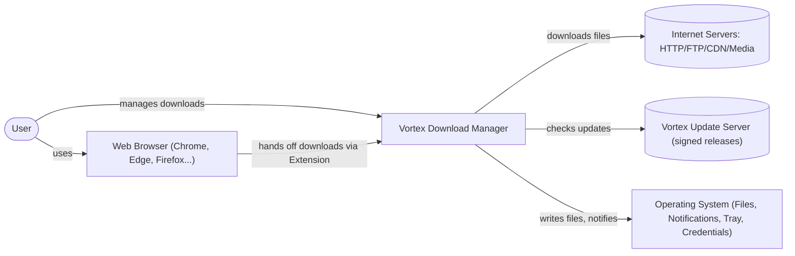

### 5.2 المستوى الثاني — Containers (العمليات Processes)

قرار جوهري: **فصل المكونات في عمليات (Processes) مستقلة** لعزل الأعطال وتقليل الذاكرة.

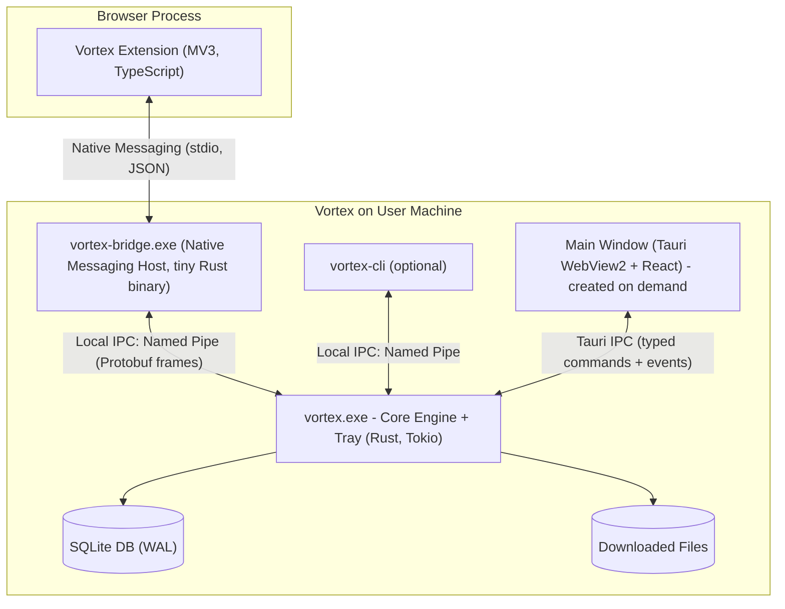

| الحاوية (Container) | المسؤولية | التقنية |
|---|---|---|
| **vortex.exe (Core)** | المحرك، الجدولة، التخزين، أيقونة Tray، يعمل دائماً في الخلفية | Rust + Tokio + Tauri runtime |
| **Main Window** | الواجهة الرسومية — **تُنشأ عند الطلب وتُدمَّر عند الإغلاق** لتوفير الذاكرة (WebView يستهلك 50-80MB) | React + TypeScript داخل WebView2 |
| **vortex-bridge.exe** | وسيط Native Messaging — يشغّله المتصفح، ينقل الرسائل للـ Core، ويشغّل الـ Core إن لم يكن يعمل | Rust (< 1 MB) |
| **Extension** | التقاط التحميلات والفيديوهات من المتصفح | TypeScript + WXT (MV3) |
| **vortex-cli** | التحكم من سطر الأوامر والسكربتات | Rust + clap |
| **SQLite** | الحالة الدائمة: التحميلات، الأجزاء، الإعدادات، السجل | SQLite 3 (WAL) |

> [!NOTE] لماذا عملية Bridge منفصلة؟ لأن المتصفح يشغّل الـ Native Host كعملية فرعية خاصة به ويغلقها عند إغلاقه. لو كان الـ Core هو الـ Host مباشرة، سيموت التحميل بإغلاق المتصفح. الـ Bridge الصغير يحل هذه المشكلة بأناقة — وهو بالضبط ما يفعله IDM عبر `IDMan.exe` و`IEMonitor.exe`.

### 5.3 المستوى الثالث — Components (داخل الـ Core)

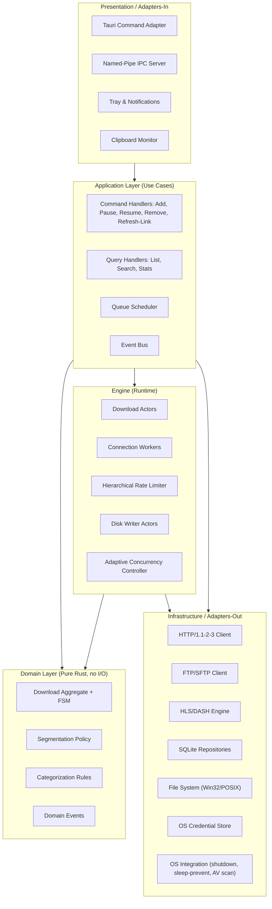

---

## 6. المعمارية الطبقية الداخلية

### 6.1 الطبقات وقاعدة الاعتمادية

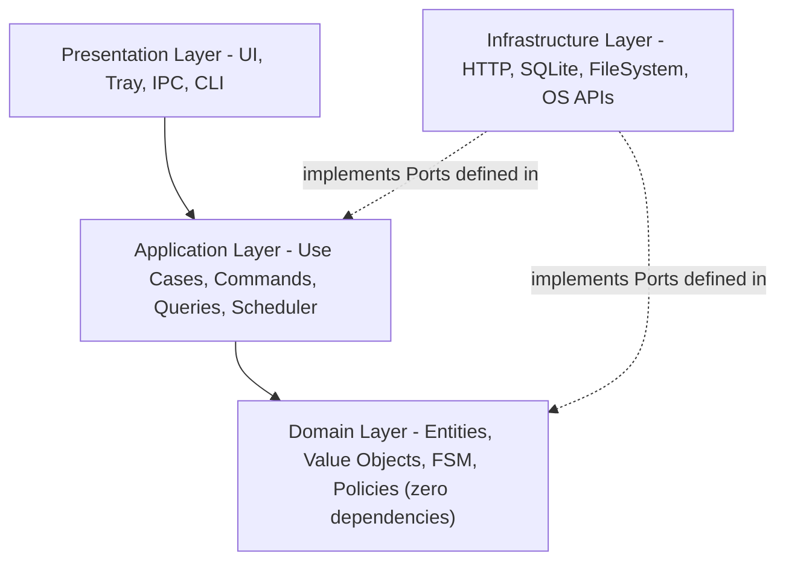

| الطبقة | ماذا تحتوي | ممنوع عليها |
|---|---|---|
| **Domain** | `Download`, `Segment`, `ByteRange`, `DownloadState`, سياسات التقسيم والتصنيف، الأحداث | أي I/O، أي مكتبة شبكة/قاعدة بيانات، أي `async` |
| **Application** | حالات الاستخدام (Use Cases)، تعريف الـ Ports (Traits)، الجدولة، التنسيق | معرفة تفاصيل HTTP أو SQLite |
| **Infrastructure** | تنفيذ الـ Ports: عميل HTTP، مستودعات SQLite، نظام الملفات، APIs النظام | احتواء منطق أعمال (Business Logic) |
| **Presentation** | محولات الإدخال: أوامر Tauri، خادم IPC، Tray، CLI | استدعاء Infrastructure مباشرة |

### 6.2 أمثلة على الـ Ports (العقود)

```rust
// Application layer defines WHAT it needs — Infrastructure decides HOW.
pub trait ByteSource: Send + Sync {
    async fn probe(&self, req: &ResourceRequest) -> Result<ResourceInfo, ProbeError>;
    async fn open_range(&self, req: &ResourceRequest, range: ByteRange)
        -> Result<Box<dyn ByteStream>, FetchError>;
}

pub trait DownloadRepository: Send + Sync {
    async fn save(&self, d: &Download) -> Result<(), RepoError>;
    async fn checkpoint(&self, id: DownloadId, map: &SegmentMap) -> Result<(), RepoError>;
    async fn find(&self, id: DownloadId) -> Result<Option<Download>, RepoError>;
}

pub trait FileSink: Send + Sync {
    async fn preallocate(&self, size: u64) -> Result<(), IoError>;
    async fn write_at(&self, offset: u64, data: Bytes) -> Result<(), IoError>;
    async fn flush_durable(&self) -> Result<(), IoError>;
}
```

> [!TIP] بفضل هذا التصميم: كل بروتوكول جديد (FTP، SFTP، Torrent، HLS) هو مجرد **Adapter جديد** ينفّذ `ByteSource` — بدون لمس سطر واحد في المحرك (Open/Closed Principle).

### 6.3 تقسيم الكود إلى Crates (وحدات Rust)

```
crates/
├── vortex-error         # Unified error taxonomy, stable VTX-* codes, camelCase ApiError & redaction.
├── vortex-observability # Structured tracing, flight recorder, dynamic reload, redaction, metrics.
├── vortex-domain        # Pure domain: entities, FSM, policies, lease reclamation, Magic-Byte/RTLO/LNK security, Clock port.
├── vortex-application   # Use cases, ports (traits), staged pull queue, burst quarantine, scheduler, event bus, config.
├── vortex-engine        # Actors, Lock-Free Hot Path, SmartHostProfileCache, BBR/Gradient2 Auto-Scaler, End-Game Hedging.
├── vortex-net           # HTTP/1.1 + High-BDP HTTP/2 (hyper, rustls+ring), Multi-IP Striping, VerifiedIpConnector (TH-26/27).
├── vortex-proto-ftp     # (Phase 2) FTP/FTPS/SFTP adapters.
├── vortex-media         # (Phase 2) YouTube/HLS/DASH orchestrator & ffmpeg-min muxing.
├── vortex-storage       # SQLite WAL repositories, versioned migrations, origin-pinned DPAPI secrets, atomic config.
├── vortex-io            # Sparse disk writer, Per-Worker 2-4MiB Coalescing + Overlapped IOCP, anti-TOCTOU guard, FAT32, MotW/AV.
├── vortex-ipc           # Local IPC (Protobuf), Owner-SID Named Pipe, connection cap & 100 msg/s token-bucket limiter.
├── vortex-platform      # OS integration (Single-Instance, Shutdown, Win32 COM folder picker/Explorer reveal, NTFS ACLs).
└── vortex-plugin-host   # (Phase 3) WASM plugin runtime (wasmtime), capability-based sandbox.
```

الأداة `cargo-deny` + قواعد مخصصة في CI (`tools/arch-check`) **تمنع** أي Crate من الاعتماد على طبقة أعلى منه (Architecture Fitness Functions).

### 6.4 شجرة الاعتماديات وترتيب البناء الصارم (Strict 5-Level Topological Crate DAG)

تُبنى الوحدات بترتيب طوبولوجي صارم من الأسفل للأعلى (صفر دورات أو اعتماديات أمامية):

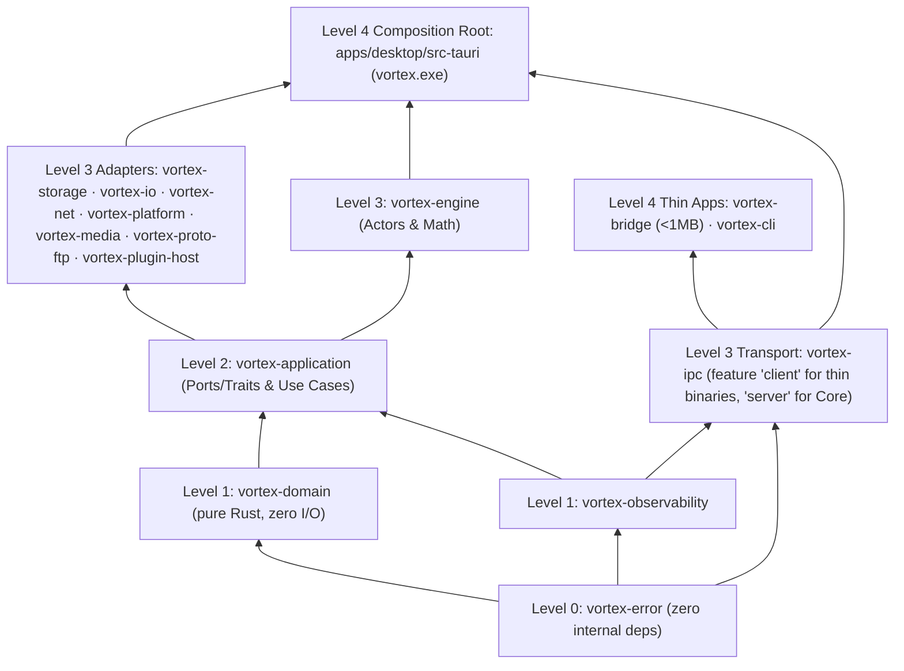

> [!TIP] لاحظ أن `vortex-ipc` مقسّم بميزة (`client` مقابل `server`) بدون الاعتماد على `vortex-engine` أو `SQLite`، بحيث يعتمد `vortex-bridge.exe` و`vortex-cli` على الجزء الخفيف فقط فيظل حجم `vortex-bridge.exe` **أقل من 1 MB** ويُبنى في ثوانٍ!

---

## 7. نموذج النطاق (Domain Model)

### 7.1 اللغة الموحّدة (Ubiquitous Language)

| المصطلح | التعريف |
|---|---|
| **Download** | الكيان الرئيسي (Aggregate Root): طلب تحميل مورد واحد إلى ملف واحد. |
| **Resource** | المورد البعيد: URL + Headers + Cookies + Referrer + بيانات التحقق (ETag, Last-Modified). |
| **Segment** | جزء متصل من الملف `[start, end)` يحمّله اتصال واحد. |
| **SegmentMap** | خريطة كل الأجزاء وحالتها — أساس الاستكمال. |
| **Connection / Worker** | اتصال شبكي فعلي يحمّل Segment. |
| **Queue** | طابور تحميلات له حد أقصى للتحميلات المتزامنة وجدول زمني. |
| **Category** | تصنيف (فيديو، برامج، مضغوطات...) يحدد مجلد الحفظ. |
| **Probe** | الطلب الاستكشافي الأول لمعرفة الحجم ودعم الاستكمال. |
| **Handoff** | تسليم تحميل من المتصفح إلى Vortex. |
| **Link Refresh** | تحديث رابط منتهي الصلاحية مع الحفاظ على التقدم. |

### 7.2 مخطط الكيانات

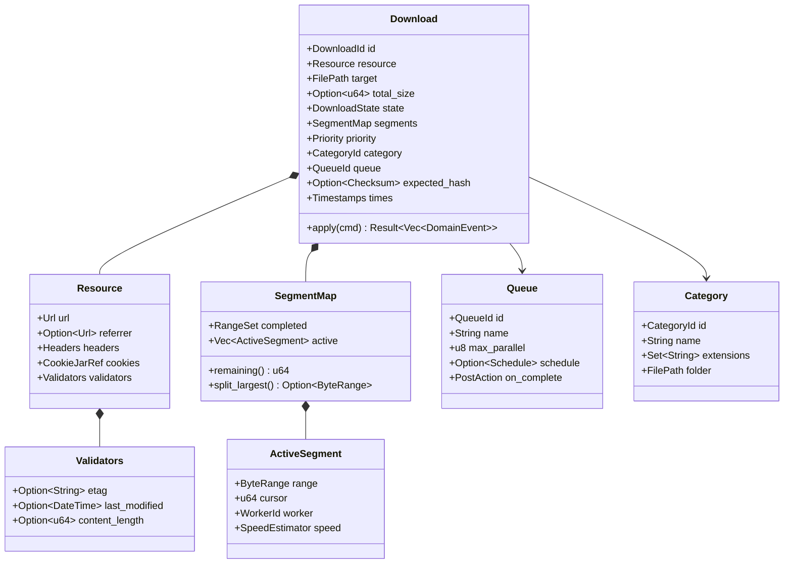

### 7.3 آلة حالات التحميل (State Machine)

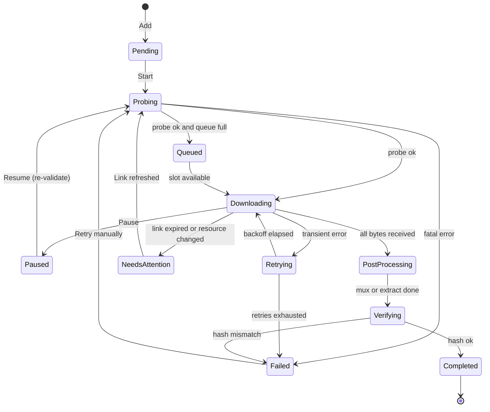

> [!IMPORTANT] الحالات مُنمذجة كـ `enum` في Rust مع بيانات خاصة بكل حالة (Type-State)، فيستحيل مثلاً الوصول لـ "سرعة التحميل" في حالة `Completed` — الـ Compiler يمنع ذلك. هذا يقضي على فئة كاملة من الأخطاء.

### 7.4 الأحداث (Domain Events)

`DownloadAdded`, `ProbeCompleted`, `SegmentStarted`, `SegmentSplit`, `ProgressTick`, `DownloadPaused`, `DownloadResumed`, `RetryScheduled`, `LinkExpired`, `LinkRefreshed`, `DownloadCompleted`, `DownloadFailed`, `VerificationPassed`, `VerificationFailed`.

كل حدث **غير قابل للتعديل** ويحمل `event_id` و`timestamp` و`download_id` — مما يسهل التتبع وإعادة بناء الحالة عند التشخيص.

---

## 8. قلب المشروع: محرك التحميل، النماذج الرياضية، والخوارزميات

هذا القسم هو "السر العلمي" الذي يجعل Vortex يتفوّق على IDM وaria2 سرعةً وذكاءً واستقراراً.

### 8.1 الأساس الفيزيائي والرياضي: لماذا التحميل متعدد الاتصالات أسرع؟

1. **تجاوز قيد حاصل ضرب النطاق في التأخير (Bandwidth-Delay Product — Little's Law):**
   لكي يشبع اتصال شبكي خطاً بسعة $B_{\text{link}}$ وزمن استجابة ذهاب وإياب $\text{RTT}$، يجب أن تكون البيانات الطائرة في الشبكة (In-Flight Bytes) أكبر من أو تساوي:
   $$\text{BDP} = B_{\text{link}} \times \text{RTT}$$
   على سبيل المثال، خط بسرعة $1\text{ Gbps}$ ($125\text{ MB/s}$) مع $\text{RTT} = 80\text{ ms}$ يتطلب $\text{BDP} = 10\text{ MiB}$ في الطيران مستمراً. اتصال TCP واحد يتعثر عند أول فقد حزمة (Packet Loss $p$) وفق معادلة Mathis الشهيرة لسقف سرعة TCP:
   $$V_{\text{TCP-single}} \le \frac{\text{MSS}}{\text{RTT}\cdot \sqrt{p}}$$
   عند فتح $N$ اتصالات متوازية، يتحقق الشرط الكلي بسهولة وتُضرب السعة الفعّالة:
   $$\sum_{i=1}^{N} W_{\text{cwnd}, i} \ge B_{\text{link}} \times \text{RTT}$$
2. **تخطي تحديد السرعة لكل اتصال (Per-Socket Policing):** كثير من الخوادم (ومنها YouTube وبعض الـ CDNs) تحدد سرعة كل طلب/اتصال منفرد، فتقسيم الملف عبر $N$ اتصالات يضاعف السرعة خطياً حتى الوصول لسعة خط المستخدم.
3. **العزل والمرونة:** تعثّر اتصال واحد لا يوقف تدفق البايتات في باقي الاتصالات.

### 8.2 الاستكشاف الذكي قبل الالتزام (Probe-Before-Commit & WAF Auto-Fallback)

بدلاً من إرسال `HEAD` (الذي ترفضه أو تسيء تنفيذه خوادم كثيرة) ثم `GET`، نرسل **طلب `GET` واحد** مع:

```http
GET /file.zip HTTP/1.1
Range: bytes=0-
Accept-Encoding: identity        ← إلزامي! الضغط يفسد حسابات الإزاحة (offsets)
User-Agent: <نفس المتصفح الأصلي>
Referer: <الصفحة الأصلية>
Cookie: <كوكيز المتصفح العادية + المقسّمة CHIPS>
```

| الاستجابة | المعنى | القرار |
|---|---|---|
| `206 Partial Content` + `Content-Range: bytes 0-N/Total` | الخادم يدعم الاستكمال والتقسيم | **وضع متعدد الاتصالات** + رد `accepted: true` للإضافة |
| `200 OK` + `Accept-Ranges: bytes` + `Content-Length` | يدعم غالباً | نتحقق بطلب Range محدود ثانٍ |
| `200 OK` بدون Range | لا يدعم | **اتصال واحد**، ونحذّر المستخدم أن الاستكمال غير مدعوم |
| بدون `Content-Length` (Chunked) | حجم مجهول | اتصال واحد، شريط تقدم غير محدد |
| **`403` / `410` / `503` WAF Challenge** على رابط طازج من المتصفح | قفل بصمة TLS (**JA3/JA4** مثل Cloudflare `cf_clearance`) أو **توكن أحادي الاستخدام** استهلكه طلب المتصفح الأول | **Auto-Fallback فوري للمتصفح!** يرد الـ Core بـ `fallback_to_browser: true` فتستدعي الإضافة `suggest()` (أو تمرّر `onHeadersReceived` في Firefox) ويكمل المتصفح التحميل على **نفس مقبس الـ TCP المفتوح أصلاً** بدون `pause()` وبدون فقدان الملف أو إزعاج المستخدم! |

**الأهم:** عند نجاح الاستكشاف، اتصال الـ Probe **لا يُغلق** — تُعايَن أول `512` بايت عبر `PrependByteStream` (بدون فقد بايت واحد) لكشف فخاخ الـ HTML والبرمجيات التنفيذية المتنكرة (`TH-21` / `TH-30`)، ويستمر الضخ من البايت `0` إلى مخزن RAM دائري (حتى `16 MiB`) ريثما يضغط المستخدم "ابدأ"، فيكون زمن البدء الفعلي **`0ms`**.

### 8.3 التقسيم الديناميكي الهجين، التدرج البطيء الموزون، والخفض غير القاتل للتوازي
**(Hybrid Lease-Based Segmentation + Paced Slow-Start + Non-Fatal Concurrency Step-Down)**

**الفخّان البرمجيان القاتلان في مديري التحميل التقليديين على HTTP/1.1:**
1. **خسارة Keep-Alive بالتنصيف المفتوح:** لو أرسل كل Worker طلباً مفتوحاً `Range: bytes=start-` ثم قلّصنا نهايته إلى `mid` عند التقسيم، فإن بروتوكول **HTTP/1.1 (RFC 9112)** لا يسمح بإيقاف استجابة جارية في منتصفها مع إبقاء الـ Socket حياً؛ الحل الوحيد هو إغلاق مقبس TCP وخسارة **Keep-Alive** وإعادة دفع تكلفة TCP + TLS Handshake!
2. **هجوم القطيع المفاجئ (`N-Socket Burst`) وموت التحميل بسبب رفض اتصال فرعي واحد:** على مواقع استضافة الملفات الشهيرة (مثل `Pixeldrain`، `MediaFire`، `GoFile`، `1Fichier`، وبوابات `Cloudflare`)، فتح `8` اتصالات باردة في نفس الميلي ثانية يمنع استئناف تذكرة `TLS 1.3` ويفعّل حظر التوازي (`HTTP 403` أو `429`) على الاتصال الرابع أو الخامس؛ ولو عومل فشل هذا الاتصال الإضافي كخطأ قاتل على مستوى التحميل فسيقتل الاتصال الأول السليم ويُفشل الملف بالكامل!

**حل Vortex المتفوق (انظر التفاصيل الكاملة في [Host-Resilience-And-Contract-Integrity-Spec.md](./Host-Resilience-And-Contract-Integrity-Spec.md) و[Ultra-High-Throughput-Engine-Spec.md](./Ultra-High-Throughput-Engine-Spec.md)):**

1. **الإطلاق الذكي وتذخير تذاكر الجلسة (`Smart Staggered Launch` + `SmartHostProfileCache`):**
   - يشترك `probe_and_stream` وجميع العمال في مخزن جلسات `TLS 1.3` واحد مع تفاوض **`ALPN: ["h2", "http/1.1"]`** (`Phase 1.7`).
   - للمضيف الجديد غير المعروف: يبدأ `Worker #1` في `0ms` من الدفق الدافئ (مع حد علوي ذري `stop_at_offset` يمنع إهدار بايتات بعد نقطة التقسيم)، وبعد أول `16 KiB` ينطلق `Worker #2` كحارس استطلاع؛ وفور استلامه `206 Partial Content` تنطلق الدفعة المتوازية **`3..8` دفعة واحدة** (بدلاً من التسلسل البطيء). أما للمضيف السريع المثبت في `SmartHostProfileCache` (`proven_optimal_workers`) فينطلق التوازي الكامل فوراً في `t = 0ms`!
2. **الخفض السلس غير القاتل للتوازي واسترداد العقود (`Non-Fatal Concurrency Step-Down & Lease Reclamation`):**
   - **البديهية الذهبية:** طالما يوجد اتصال نشط واحد على الأقل يحقق تقدماً فعلياً في كتابة البايتات، لا يُلغى التحميل أبداً إذا واجه اتصال ثانوي (`worker_id > 1`) رد رفض صريحاً (`403` / `429` / `503`)! *(مع استبعاد الأخطاء العابرة `NetConnectionLost` في `Phase 1.7` حتى لا يتسمم الكاش بسبب تذبذب شبكة عابر).*
   - يسترد `SegmentMap::abort_and_reclaim_worker` المدى غير المكتوب $[\text{cursor}, \text{end})$ ذرياً، ويُقفل سقف التوازي عند العدد السليم مع حفظه في **`SmartHostProfileCache`** (LRU `512` نطاقاً، `TTL = 30 min` مع `Half-Open Probe` بعد `5 min`) وتسجيل حدث `SelfHealed (VTX-RES-005)`، فيكتمل التحميل بنسبة `100%` بلا انقطاع!
3. **في HTTP/1.1 — نظام العقود المحدودة التكيّفية الفورية (Instant Adaptive Bounded Chunk Leases):**
   كل Worker إضافي يحجز "قطعة عمل" من أكبر فجوة متبقية، ويطلب عبر الشبكة **نافذة محددة الطول $C$** (`Range: bytes=a-(a+C-1)`) تتكيّف فوراً بعد أول `250–500ms` بحيث يستغرق كل طلب نحو $\tau_{\text{chunk}} = 3\text{ s}$:
   $$C = \text{clamp}\!\Big(\text{align}_{64\text{KiB}}\big(\hat{v}_{\text{worker}} \cdot \tau_{\text{chunk}}\big),\; 2\text{ MiB},\; 64\text{ MiB}\Big)$$
   - ينتهي الطلب نظيفاً عند حدود $C$ ← **يبقى اتصال HTTP/1.1 Keep-Alive حياً 100%** ويطلب الـ Chunk التالي فوراً بصفر مصافحات TLS إضافية!
   - **سرقة العمل (Work Stealing) تصبح مجانية تماماً:** الفجوات غير المحجوزة بعد $a+C$ متاحة فوراً لأي Worker سريع ينهي قطعته، وإذا تبقى جزء واحد كبير لدى Worker بطيء نقسّم الجزء غير المحجوز منه بالتنصيف!
4. **في HTTP/2 وHTTP/3 — التدفق المباشر مع الإلغاء النظيف:**
   يمكن للـ Worker طلب المدى كاملاً، وعند تقليصه نرسل إطار `RST_STREAM` (في HTTP/2) أو `STOP_SENDING` (في QUIC/HTTP/3) لإلغاء الذيل الزائد **دون إغلاق الاتصال الأساسي**!
5. **معادلة جدوى التقسيم (Split Worthiness Inequality):**
   لا نقسم جزءاً متبقياً بحجم $B_{\text{rem}}$ لدى اتصال سرعته $\hat{v}_{\text{slow}}$ لصالح عامل سرعته المتوقعة $\hat{v}_{\text{new}}$ إلا إذا كان الوفر الزمني أكبر من زمن التأسيس $T_{\text{overhead}}$ بهامش أمان:
   $$\frac{B_{\text{rem}}}{\hat{v}_{\text{slow}}} - \left(T_{\text{overhead}} + \frac{B_{\text{rem}}}{\hat{v}_{\text{slow}} + \hat{v}_{\text{new}}}\right) > \Delta t_{\min} \quad (\Delta t_{\min} = 0.5\text{ s},\; B_{\text{rem}} \ge 2\text{ MiB})$$
   حيث $T_{\text{overhead}} = 1.0\cdot\text{RTT}$ لاتصال Keep-Alive/H2 دافئ، و$2.5\cdot\text{RTT}$ لاتصال بارد (TCP + TLS 1.3 1-RTT).

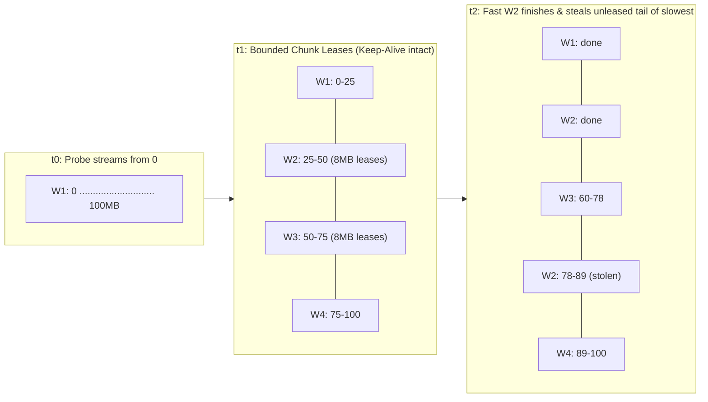

### 8.4 وضع النهاية (End-Game Mode — Hedged Requests)

للقضاء نهائياً على مشكلة "التعليق عند 99%" (مستوحى من BitTorrent End-Game وورقة Google *"The Tail at Scale"*):
- يُفعَّل وضع النهاية عندما تتحقق المتباينة المركّبة:
  $$B_{\text{total\_rem}} \le \min(0.02 \cdot S,\; 16\text{ MiB}) \;\land\; \hat{v}_i < 0.30 \cdot \operatorname{median}_j(\hat{v}_j) \;\land\; \frac{B_{\text{rem}, i}}{\hat{v}_i} > 3 \cdot \text{RTT}_{\text{ewma}}$$
- نُطلق **طلباً مكرراً مُحاطاً (Hedged Request)** لنفس المدى المتبقي على أسرع اتصال متاح؛ أول Worker يسلّم البايتات يفوز، والآخر يُلغى فوراً عبر `CancellationToken` (مع تجاهل أي بايتات مكررة بفضل مطابقة الإزاحة الذرية).

### 8.5 التحكم التكيّفي في التوازي المضاد للـ Bufferbloat (BBR / Gradient2 + AIMD)

التحكم الساذج (زيادة الاتصالات طالما السرعة تزيد) يتسبب في ظاهرة **Bufferbloat**: امتلاء طوابير الراوتر وارتفاع الـ Ping من `20ms` إلى `400ms` مقابل زيادة 2% فقط في السرعة!
يستخدم Vortex خوارزمية هجينة مستوحاة من **Google BBR** و**Netflix Gradient2** توازن بين **السرعة الكلية $\hat{V}$** و**تدرّج تأخير الطابور (Queueing Delay Gradient $g$)**:

$$g_t = \frac{\text{RTT}_{\min}}{\text{RTT}_{\text{ewma}, t}} \in (0, 1], \qquad U(N) = \frac{\hat{V}(N)}{\big(1 / g_t\big)^{0.5}}$$

**كيف نقيس $\text{RTT}$ و$\text{RTT}_{\min}$ بدقة ميكروثانية بدون ضوضاء السيرفر؟**
قياس HTTP TTFB وحده يتلوث بوقت معالجة السيرفر الخلفي؛ لذا يسحب `vortex-net` القياس مباشرة من طبقة النقل عبر سمة `TransportMetrics`:
- **الاتصالات المباشرة على Windows 10/11:** استدعاء **`WSAIoctl(SIO_TCP_INFO)`** لقراءة `RttUs` و`MinRtt` مباشرة من نواة TCP بالميكروثانية (`TCP_INFO_v1` على Windows 10 2004+/11، مع رجوع تلقائي لـ `TCP_INFO_v0` + مرشّح `Windowed Min-Filter` بنافذة 60 ثانية على الإصدارات الأقدم؛ وعلى Linux/macOS لاحقاً عبر `getsockopt(TCP_INFO)`).
- **اتصالات HTTP/3 (QUIC):** مباشرة من `quinn::Connection::rtt()`.
- **الاتصالات خلف بروكسي محلي/خارجي:** لأن مقبس TCP يقيس المسافة للبروكسي فقط (`127.0.0.1`)، ننتقل تلقائياً لقياس زمن `HTTP/2 PING` أو زمن مصافحة الاستجابة عبر **Windowed Min-Filter** (أسلوب BBR لعزل قفزات معالجة الخادم).

يعمل المتحكم كل $2\text{ s}$:
1. **نقصان ضربي عند الإشباع القسري (AIMD Multiplicative Decrease):** عند ظهور `429` أو `503` أو ارتفاع مفاجئ في قطع الاتصالات:
   $$N_{t+1} = \max\!\big(1,\; \lfloor 0.5 \cdot N_t \rfloor\big)$$
2. **حماية ضد Bufferbloat:** إذا تدهور التدرّج $g_t < 0.65$ (أي تضخم الـ RTT بأكثر من $1.53\times$) دون مكسب سرعة يبرره:
   $$N_{t+1} = \max(1,\; N_t - 1)$$
3. **زيادة جمعية ذكية (Additive Increase):** إذا حققت الزيادة السابقة نمواً في دالة المنفعة $\frac{U(N_t) - U(N_{t-1})}{U(N_{t-1})} > 0.05$:
   $$N_{t+1} = \min(N_{\max},\; N_t + 1)$$
4. **استقرار (Cruise):** غير ذلك نثبت عند $N_t$ لمدة 30 ثانية ونحفظ أفضل $N$ لهذا النطاق في **Host Profile Cache** (LRU مع TTL).

### 8.6 التقدير الرياضي للسرعة والـ ETA، إعادة المحاولة، وقاعدة `If-Range` الصارمة

1. **مقدّر السرعة المزدوج الحساس للزمن (Dual-Horizon Time-Continuous EWMA):**
   لأن فواصل القياس $\Delta t$ قد تتفاوت، نستخدم معامل الاضمحلال الأُسّي المستمر زمنياً (وليس ثابتاً ساذجاً):
   $$\alpha(\Delta t, \tau) = 1 - e^{-\Delta t / \tau}, \qquad \hat{v}_t = \alpha(\Delta t, \tau)\cdot \frac{\Delta B}{\Delta t} + \big(1 - \alpha(\Delta t, \tau)\big)\cdot \hat{v}_{t-1}$$
   - **أفق سريع لعرض السرعة الحية:** $\tau_{\text{fast}} = 1.5\text{ s}$ (استجابة فورية لعين المستخدم).
   - **أفق مستقر لحساب الوقت المتبقي (ETA):** $\tau_{\text{slow}} = 8.0\text{ s}$ لمنع تذبذب الوقت المتبقي:
     $$\text{ETA} = \frac{B_{\text{remaining}}}{\max(\hat{v}_{\text{slow}},\; 1\text{ B/s})}$$

2. **Exponential Backoff مع Decorrelated Full Jitter (معادلة AWS المرجعية):**
   $$d_k = \operatorname{Uniform}\!\Big(0,\; \min\big(d_{\max},\; d_{\text{base}} \cdot 2^{k}\big)\Big), \qquad d_{\text{base}} = 500\text{ ms},\; d_{\max} = 300\text{ s}$$
   مع أولوية مطلقة لترويسة `Retry-After` إن أرسلها الخادم، و**Circuit Breaker** لكل خادم (`Closed → Open → Half-Open`)، و**Watchdog** يقطع الاتصالات الخاملة بعد 30 ثانية.

3. **خوارزمية اختيار مُحقّق الاستكمال الصارمة وفق RFC 9110 §13.1.5 (تجنب فخ Weak ETag):**
   ينص المعيار RFC 9110 على أن ترويسة `If-Range` **تمنع منعاً باتاً استخدام Weak ETags** (التي تبدأ بـ `W/"..."`، وهي شائعة جداً في Nginx وCloudflare)؛ إرسال `If-Range: W/"..."` يجعل الخادم يتجاهل `Range` ويعيد الملف كاملاً بـ `200 OK`! لذا نتبع الترتيب الرياضي الصارم:
   - **الحالة أ (Strong ETag):** إذا وُجد `ETag` **لا يبدأ** بـ `W/` ← نرسل `If-Range: "<etag>"`.
   - **الحالة ب (Strong Last-Modified):** إذا كان الـ ETag ضعيفاً أو غائباً، ووُجدت `Last-Modified` تحقق شرط القوة $\text{Date} - \text{Last-Modified} \ge 1\text{ s}$ (RFC 9110 §8.8.2.2) ← نرسل `If-Range: <Last-Modified>`.
   - **الحالة ج (Weak Validators Only):** لا نرسل `If-Range`، بل نرسل `Range` مباشرةً ونتحقق برمجياً فور وصول ترويسات `206` من تطابق الحجم الكلي في `Content-Range` وتطابق الـ Weak ETag / `Last-Modified` قبل كتابة بايت واحد؛ وإذا اختلفا نوقف الكتابة فوراً وننتقل إلى `NeedsAttention (VTX-RES-003)`.

### 8.7 تحديث الرابط المنتهي (Link Refresh) — ميزة IDM الشهيرة، لكن أذكى

روابط كثيرة (Google Drive، Mega، CDNs الموقّعة) تنتهي صلاحيتها. عند استقبال `403/410` بعد تحميل جزء من الملف:
1. تنتقل الحالة إلى `NeedsAttention` ويظهر زر **"🔄 تحديث الرابط"** مباشرة على صف التحميل.
2. يفتح Vortex صفحة المصدر (`Referrer`) في المتصفح، ويضع الإضافة في وضع **"التقاط للتحديث"**.
3. عندما يضغط المستخدم تحميل مرة أخرى، تطابق الإضافة الطلب الجديد بالتحميل القديم (الحجم الكلي + نوع MIME + تشابه الاسم)، وتتحقق من تطابق أول `64 KiB` محمّلة مسبقاً (Byte-Prefix Sanity Check!) لضمان أنه نفس الملف تماماً حتى لو تغيّر الـ URL والـ ETag!
4. يُستبدل الرابط ويُستكمل التحميل من آخر بايت محفوظ بأمان تام.

### 8.8 محرك تحميل الفيديوهات ويوتيوب المتكامل (First-Class YouTube & Streaming Media Engine)

> **هدف صريح في الإصدار العام `v1.0`:** يجب أن يعمل Vortex في تحميل الفيديوهات من **YouTube** ومنصات الفيديو العامة (Vimeo، Dailymotion، X/Twitter، Twitch Clips، Facebook، TikTok... إلخ) **بسهولة IDM وبكفاءة وسرعة وجودة أعلى منه بمراحل**، مع التزام قانوني قاطع بعدم كسر أي حماية DRM.

**لماذا يتفوق Vortex على IDM في يوتيوب؟**
IDM غالباً يعرض جودة `360p` المدمجة فقط أو يفشل عند تحديث يوتيوب لتوقيعاته أو يعجز عن دمج تدفقات `4K/8K AV1/VP9` المنفصلة والترجمات والفصول. Vortex يحل ذلك بمعمارية ثنائية المحرك (Dual-Engine Media Pipeline):


1. **تجربة مستخدم ساحرة (مثل IDM وأجمل):**
   - يظهر زر عائم أنيق وشبه شفاف (**"⬇ تحميل بـ Vortex"**) أعلى زاوية مشغّل الفيديو داخل **Closed Shadow DOM** (معزول 100%، يختفي تلقائياً عند ملء الشاشة أو سكون الماوس حتى لا يشتت المشاهدة أبداً).
   - بالضغط عليه تظهر قائمة فورية بالجودات الحقيقية المتاحة مع الحجم الدقيق ونوع الترميز:
     `4K 2160p60` · `2K 1440p60` · `1080p60 Full HD` · `720p` · `480p` · **`صوت فقط (MP3 / M4A / Opus بأعلى نقاء)`**.
   - دعم اختيار **الترجمة (Subtitles/CC)** بالعربية أو الإنجليزية (مدمجة داخل الملف أو `.srt`)، وحفظ **فصول الفيديو (Chapters)** وصورة الغلاف (Thumbnail)، ودعم **قوائم التشغيل (Playlists)** باختيار الفيديوهات المطلوبة بنقرة واحدة!
2. **سرعة خارقة على يوتيوب (تجاوز خنق السرعة القانوني لطلبات HTTP):**
   - يوتيوب يخنق طلبات `GET` المفتوحة العادية إلى ~50–70 KB/s في أحيان كثيرة، لكنه يرسل كامل سرعة الخط لطلبات **Range المحدودة بحجم ~8–10 MiB** (لأن مشغّل المتصفح نفسه يطلب مقاطع بهذا الحجم).
   - بعد استخراج الروابط المباشرة عبر محرك `yt-dlp` المُدار، يتولى **محرك Vortex الأصلي المكتوب بـ Rust** تحميل مسار الفيديو ومسار الصوت **بالتوازي الكامل** عبر Chunks محدودة، فيحمّل فيديو 4K في ثوانٍ!
3. **التنزيل عند الطلب ونظافة الترخيص والحجم (`MediaToolchainManager`):**
   - حفاظاً على ميزانية حجم المُثبّت الأساسي (**`< 15 MB`**)، لا يُدمج `yt-dlp` ولا `FFmpeg` داخل المُثبّت؛ بل يُنزَّلان **عند الطلب فقط (On-Demand)** عند أول تحميل فيديو (أو بخيار اختياري في معالج الترحيب) إلى `%LOCALAPPDATA%\Vortex\toolchains\`.
   - **توثيق مزدوج للأمان:** يتم التحقق من توقيع **Ed25519** لقائمة الأدوات وبصمة **SHA-256** لكل ملف قبل فكه أو تشغيله.
   - **نقاء ترخيص `GPL-3.0-or-later` وحجم مصغّر:** نبني نسخة **FFmpeg مصغّرة خاصة بـ Vortex** (`tools/ffmpeg-min-build/`، بحجم ~12–15 MB فقط) تقتصر على الـ Muxers/Demuxers ومشفرات الصوت الحرة (`libmp3lame`, `aac`, `libopus`) مع `--enable-gpl --enable-version3` و**حظر تام لـ `--enable-nonfree`** (لا `libfdk-aac` ولا مكتبات مغلقة)، مع نشر سكربت البناء والمصدر التزاماً ببنود GPLv3.
4. **HLS (`.m3u8`) وDASH (`.mpd`) العام:** محلل Rust أصلي يحمّل المقاطع بالتوازي عبر الـ Actors مع دعم تشفير HLS AES-128 القياسي، ثم يدمجها `FFmpeg` بوضع `-c copy` (بدون إعادة ترميز = دمج ملف 2GB في أقل من ثانيتين!).
5. **الحدود القانونية الصارمة:** أي بث محمي بـ **DRM** (Widevine / PlayReady / FairPlay مثل أفلام يوتيوب المدفوعة أو Netflix أو Shahid) يُكتشف فوراً ويُرفض برسالة واضحة (`VTX-SEC-002`) دون أي محاولة لكسره.

### 8.9 محدد السرعة الهرمي (Hierarchical Token Bucket) ووضع LEDBAT++

1. **معادلة Token Bucket الهرمية (`Global → Queue → Download`):**
   تتجدد الرموز في كل عقدة $i$ بمعدل $r_i$ (بايت/ثانية) وسعة اندفاع $B_{\text{burst}, i} = \max(64\text{ KiB},\; 0.25\text{ s}\cdot r_i)$ لضمان سلاسة تدفق TCP ACK بدون تقطّع:
   $$T_i(t) = \min\!\Big(B_{\text{burst}, i},\; T_i(t_0) + r_i \cdot (t - t_0)\Big)$$
   يطلب كل Worker الرموز **قبل** استدعاء `read` على الـ Socket، فيطبّق ضغطاً عكسياً حقيقياً على نافذة TCP (`TCP Receive Window`).

2. **وضع التحميل المهذّب للألعاب والمكالمات (LEDBAT++ — RFC 6817، في v2.0):**
   يقيس تأخير الاصطفاف $q_t = D_{\text{current}} - D_{\text{base}}$ ويعدّل المعدل المستهدف ليُبقي التأخير الإضافي تحت $\tau_{\text{target}} = 60\text{ ms}$:
   $$\Delta r \propto \frac{\tau_{\text{target}} - q_t}{\tau_{\text{target}}}$$
   فإذا فتح المستخدم لعبة أونلاين أو مكالمة Zoom ينخفض Vortex تلقائياً في أجزاء من الثانية، ويعود لأقصى سرعة فور انتهاء الاستخدام!

### 8.10 الجدولة والطوابير (Scheduler)

- **طوابير متعددة**، لكل طابور: حد للتحميلات المتزامنة، أولوية، جدول زمني (مثلاً من 2 صباحاً إلى 8 صباحاً)، إجراء بعد الانتهاء (إيقاف تشغيل الجهاز / سكون / إغلاق البرنامج / تشغيل أمر — مع عدّاد تنازلي 30 ثانية للإلغاء).
- **منع السكون (Sleep Prevention):** أثناء التحميل نطلب من النظام عدم الدخول في السكون (`SetThreadExecutionState` على Windows).
- **مراقبة الشبكة:** عند انقطاع الإنترنت تُعلَّق التحميلات تلقائياً وتُستأنف عند العودة (بدون استهلاك محاولات إعادة).
- **الشبكات المحدودة (Metered):** خيار لإيقاف التحميل تلقائياً على اتصال بيانات محدود.

### 8.11 التحقق فائق السرعة من سلامة الملفات (SIMD Integrity)

| المصدر | الآلية |
|---|---|
| الخادم يرسل `Digest` / `Repr-Digest` (RFC 9530) أو `Content-MD5` | تحقق تلقائي |
| ملف Metalink (`.meta4`) | هاشات لكل جزء + للملف كاملاً + روابط بديلة (Mirrors) |
| المستخدم يلصق Hash من الموقع | تحقق بنقرة (SHA-256 / SHA-1 / MD5 / BLAKE3) |
| ملفات `.sha256` بجوار الملف على الخادم | اكتشاف وتحقق تلقائي (اختياري) |

نستخدم **`BLAKE3`** بتعليمات **SIMD (AVX2 / AVX-512 / NEON)** وتوازي شجرة Merkle عبر كل أنوية المعالج (تصل سرعته إلى **6–12 GB/s**)، و**`sha2`** بتسريع العتاد (**Intel/AMD SHA-NI** بسرعة **2–4 GB/s**) للتوافق القياسي.


---

## 9. هياكل البيانات المستخدمة ولماذا

> **المبدأ:** نختار هيكل البيانات بناءً على **الحجم الحقيقي (Real N)** ونمط الوصول الفعلي، وليس فقط على التعقيد النظري. (مثلاً: مصفوفة من 32 عنصراً بمسح خطي أسرع عملياً من Heap بسبب الـ CPU Cache.)

| الاستخدام | هيكل البيانات | التعقيد | لماذا هذا الاختيار |
|---|---|---|---|
| الأجزاء المكتملة (للاستكمال) | **RangeSet** مبني على `BTreeMap<u64, u64>` (Interval Set مع دمج تلقائي للفترات المتجاورة) | `O(log K)` حيث `K ≤ 32` عملياً (يقع في L1 Cache) | يدمج `[0,10)+[10,20)` → `[0,20)` فيبقى صغيراً جداً، ويُسلسل (Serialize) بسهولة لقاعدة البيانات. |
| الأجزاء النشطة وعقود الـ Chunks | `SmallVec<[ActiveSegment; 32]>` | `O(N)` مسح، N ≤ 32 | بيانات متجاورة في الذاكرة (Cache-friendly)، صفر تخصيص Heap للحالات الشائعة. |
| طابور التحميلات بالأولوية | **Binary Heap** (`BinaryHeap<(Priority, Reverse<Seq>)>`) | `O(log n)` | اختيار التحميل التالي بأعلى أولوية ثم الأقدم (FIFO عادل). |
| الأحداث الزمنية (جدولة، Backoff، Timeouts) | **Hierarchical Timing Wheel** (داخل Tokio) | `O(1)` إدراج/إلغاء | نفس الهيكل المستخدم في Kafka وNetty وLinux Kernel لملايين المؤقتات. |
| قياس السرعة والـ ETA | **Dual-Horizon Continuous EWMA** + Ring Buffer | `O(1)` | سرعة لحظية سريعة (`τ=1.5s`) + تقدير ETA فائق الاستقرار (`τ=8s`) مقاوم لتفاوت الزمن. |
| تحديد السرعة | **Token Bucket** هرمي (شجرة) | `O(depth)` | دقيق، يسمح بـ Bursts محسوبة (`0.25s`)، معيار صناعي. |
| مطابقة النطاقات المستثناة في الإضافة | **Reversed-Label Radix Trie** (`com → google → drive`) | `O(labels)` | مطابقة `*.example.com` بسرعة ثابتة تقريباً. |
| الجداول الداخلية مقابل المدخلات الخارجية | **`FxHashMap`** للمعرّفات الداخلية الموثوقة + **`AHashMap`** (AES-NI) للنصوص الخارجية | `O(1)` | أقصى سرعة للمفاتيح الرقمية، ومقاومة كاملة لهجمات **HashDoS** على الروابط والهيدرز. |
| فحص روابط الصفحة (Grab all links) | **SIMD Aho-Corasick** (`aho-corasick` + `memchr`) | `O(n + matches)` | مطابقة عشرات الأنماط في مرور واحد بتسريع SIMD. |
| مخازن القراءة والكتابة (Zero-Copy) | **4KiB-Aligned Reusable `BytesMut` Slab Pool** → `bytes::Bytes` | `O(1)` slice/clone | صفر نسخ بين الشبكة والقرص، ومحاذاة `4 KiB` لقطاعات القرص لمنع عقوبة Read-Modify-Write في النواة. |
| حجز مساحة الأقراص للـ Sparse Files | **`VolumeSpaceManager`** (`FxHashMap<VolumeId, AtomicU64>`) | `O(1)` | يتتبع مجموع البايتات المحجوزة منطقياً لكل قرص لمنع تجاوز المساحة الفارغة بين التحميلات المتزامنة. |
| بحث المستخدم الفوري في القائمة | **`nucleo-matcher`** (محرك البحث الضبابي بتسريع SIMD الخاص بمحرر Helix) | فائق السرعة لـ 100k عنصر (صفر تخصيص ذاكرة) | أسرع بـ 5–10 مرات من خوارزميات Fuzzy التقليدية ويدعم Unicode والعربية بكفاءة. |
| شريط الأجزاء المرئي في الواجهة | **512-Bin Compact State Array (`[u8; 512]`)** | `O(1)` تحديث | رسم شريط الأجزاء على `<canvas>` بسرعة 60 FPS بدون ضغط على IPC. |

---

## 10. نموذج التزامن (Concurrency Model)

### 10.1 الهيكل: Actors + Async (Tokio)

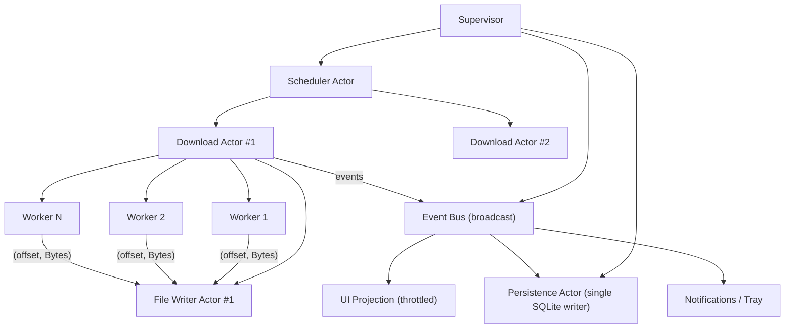

| المكوّن | دوره |
|---|---|
| **Supervisor** | يراقب الـ Actors ويعيد تشغيل الفاشل منها مع سياسة (Restart / Escalate). |
| **Scheduler Actor** | يملك الطوابير ويقرر متى يبدأ كل تحميل. |
| **Download Actor** | يملك حالة تحميل واحد بالكامل (المصدر الوحيد للحقيقة — Single Writer Principle) ويدير الـ Workers. |
| **Worker** | مهمة async خفيفة تقرأ من الشبكة بـ `256–512 KiB` Read Buffer، تجمّع `2–4 MiB` متجاورة محلياً في شريحة `4 KiB`-aligned مستقلة (`Per-Worker Coalescing`) وتحدّث `AtomicU64` بدون أقفال. |
| **File Writer / Overlapped IOCP Sink** | ينفّذ كتابات موضعية متوازية (`FILE_FLAG_OVERLAPPED` لـ `4–8` عمليات متزامنة غير متداخلة) مع حاجز تفريغ (`Flush Barrier`) عند دورة `20s`. |
| **Persistence Actor** | الكاتب الوحيد لـ SQLite (SQLite يدعم كاتباً واحداً — نحترم ذلك بدلاً من محاربته). |

### 10.2 قواعد صارمة

1. **لا أقفال مشتركة في المسار الساخن (Lock-Free Hot Path):** كل حالة يملكها Actor واحد وتُتتبّع مواضع العمال عبر `AtomicU64` + تحديثات دفعية كل `2–4 MiB` (أو `50ms`) — يزيل Deadlocks وMutex contention تماماً.
2. **ضغط عكسي موزون بالبايتات (Byte-Weighted Backpressure `32–64 MiB`):** يحمي الذاكرة من التضخم ويمنع في الوقت ذاته انهيار TCP Receive Window عند أي تباطؤ لحظي للقرص أو `WdFilter.sys`.
3. **الإلغاء المنظم (Structured Concurrency):** كل Actor يحمل `CancellationToken`؛ إيقاف التحميل يلغي كل الـ Workers التابعين بشكل نظيف ومضمون.
4. **العمليات الثقيلة (Hashing، Muxing) خارج الـ Async Runtime:** تُرسل إلى `spawn_blocking` أو Thread Pool مخصص (Rayon) حتى لا تجمّد الشبكة.
5. **تحديثات الواجهة مخففة (Throttled):** المحرك يُصدر آلاف الأحداث في الثانية، لكن الواجهة تستقبل **لقطة مجمّعة (Snapshot) 4-10 مرات في الثانية فقط**، وفقط للعناصر الظاهرة على الشاشة.

---

## 11. طبقة الشبكة والبروتوكولات

### 11.1 البروتوكولات المدعومة

| البروتوكول | المرحلة | التنفيذ | ملاحظات |
|---|---|---|---|
| **HTTP/1.1** | MVP | `hyper` 1.x | الأساس، تقسيم عبر اتصالات TCP متعددة. |
| **HTTPS (TLS 1.2/1.3)** | MVP | `rustls` + `rustls-platform-verifier` | يستخدم مخزن شهادات النظام (يحترم شهادات الشركات). |
| **HTTP/2** | **Phase 1.7** | `hyper` (`h2`) | تفاوض `ALPN: ["h2", "http/1.1"]` بنوافذ عالية الـ BDP (`16 MiB` للتيار / `64 MiB` للاتصال + `adaptive_window`) + فتح **عدة اتصالات H2 متوازية** لتجاوز TCP Head-of-Line blocking وخنق الاتصال الواحد، مع إلغاء `RST_STREAM` النظيف! |
| **HTTP/3 (QUIC)** | v1.x | `quinn` + `h3` | فوق UDP، أفضل على الشبكات المتقطعة والموبايل، اكتشاف تلقائي عبر `Alt-Svc`، مع رجوع (Fallback) لـ HTTP/2. |
| **FTP / FTPS** | v1.0 | `suppaftp` | دعم `REST` للاستكمال، وضع Passive. |
| **SFTP** | v1.x | `russh` + `russh-sftp` | للمطورين والسيرفرات. |
| **HLS / DASH** | v1.0 | `vortex-media` | انظر 8.8. |
| **Metalink 4 (RFC 5854)** | v1.x | داخلي | تحميل من عدة Mirrors في نفس الوقت + هاشات. |
| **BitTorrent / Magnet** | v2.0 | `librqbit` (Rust) | DHT، PEX، تشفير، اختيار ملفات. |

### 11.2 تفاصيل الشبكة الدقيقة والتسريع الفائق

- **Connection Pooling + TLS 1.3 Session Resumption + `ALPN: ["h2", "http/1.1"]`:** مشاركة مخزن الجلسات الدافئة (`rustls::client::Resumption::in_memory_sessions(256)`) وتفاوض `h2` / `http/1.1` بين `probe_and_stream` وجميع العمال، بحيث تفتح الاتصالات الإضافية بمصافحة `1-RTT` سريعة بدون بصمة `ALPN: None` المشبوهة.
- **حارس `VerifiedIpConnector` و`BoundedByteStream` وفصل حد الترويسات (`TH-26`, `TH-27`, `ADR-021`):** فحص كل عنوان IP محلول قبل كل `TcpStream::connect` لمنع `DNS Rebinding` و`SSRF` المباشر، وسقف **`≤ 64 KiB` / `≤ 100` ترويسة** مطبّق على الترويسات فقط (مع `max_header_list_size(64 KiB)` في H2) مع **مخزن قراءة بيانات `256–512 KiB`** لضمان سرعة تدفق قصوى، وقطع أي تدفق يتجاوز طول العقد المطلوب.
- **DNS + Multi-IP CDN Striping:** `hickory-resolver` مع ذاكرة مؤقتة (LRU + احترام TTL) وتوزيع العمال بالتناوب (**Round-Robin Striping**) عبر كافة عناوين Edge IPs الصالحة مع عزل مؤقت (`60s`) لأي IP بطيء، ودعم اختياري لـ **DNS over HTTPS (DoH)** لاحقاً.
- **Happy Eyeballs v2 (RFC 8305):** سباق متوازٍ بين IPv6 وIPv4 بفارق 250ms واختيار المسار الأسرع.
- **البروكسي:** HTTP / HTTPS / SOCKS5، + اكتشاف تلقائي لإعدادات بروكسي النظام وملفات PAC.
- **الكوكيز العادية والمقسّمة (CHIPS) والهوية:** نستقبل من الإضافة الكوكيز العادية + **الكوكيز المقسّمة (`Partitioned` / CHIPS عبر `partitionKey`)**، و`User-Agent`، و`Referer`، مع تجريد `Cookie` و`Authorization` تلقائياً عند أي تحويل عابر للأصول (Cross-Origin Redirect) لحماية الجلسة.
- **المصادقة:** Basic / Digest / NTLM (Windows) / Bearer، مع تخزين بيانات الاعتماد في **Windows Credential Manager**.
- **ضبط مآخذ TCP فائق السرعة (`socket2`):** تفعيل **`TCP_NODELAY`** لإلغاء تأخير Nagle في طلبات الـ Range، مع **عدم تحديد `SO_RCVBUF` يدوياً أبداً على Windows** — لأن التحديد اليدوي يُعطّل ميزة **Windows TCP Receive Window Auto-Tuning** ويخنق السرعات فوق 1 Gbps على الشبكات ذات الـ RTT العالي!

### 11.3 فخاخ HTTP الواقعية ومعالجتها (Hard-won lessons)

| الفخ | المعالجة |
|---|---|
| الخادم يضغط الاستجابة (gzip) فتفسد الإزاحات | إرسال `Accept-Encoding: identity` دائماً لطلبات Range. |
| الخادم يرد `200` بدل `206` على طلب Range | اكتشاف فوري، إلغاء الـ Worker، والرجوع لاتصال واحد. |
| **Weak ETag (`W/"..."`) في `If-Range` يبطل الاستكمال (RFC 9110)** | عدم إرسال Weak ETag أبداً في `If-Range`؛ استخدام `Last-Modified` القوي أو التحقق اليدوي من الرؤوس (انظر §8.6). |
| **بصمة TLS (JA3/JA4) مع Cloudflare أو توكن أحادي الاستخدام يرد `403`** | آلية **Probe-Before-Commit + Auto-Fallback** تعيد التحميل للمتصفح بسلاسة عبر استدعاء `suggest()` على نفس الاتصال المفتوح (بدون `pause()`) ودون ضياع الملف (انظر §8.2 و§13.3). |
| **حظر الخادم لتعدد الاتصالات (`Pixeldrain` / `MediaFire` يرد `403`/`429` على الاتصال #2..#8)** | **التدرج البطيء الموزون (`1→2→4→N`) + الخفض السلس غير القاتل (`Non-Fatal Concurrency Step-Down`):** استرداد عقد الاتصال المرفوض فقط وحفظ سقف النطاق في `HostCapabilityCache` وإكمال التحميل `100%` بالاتصالات السليمة، مع مصنّف أجسام أخطاء محدود (`≤ 1 KiB`) يميز الحصة/CAPTCHA (`VTX-RES-006`) وانحراف الساعة (`VTX-AUTH-002`)! |
| `Content-Range` لا يطابق المطلوب | رفض الاستجابة وعدم كتابة بايت واحد منها. |
| تحويلات (Redirects) مختلفة لكل اتصال (CDN مختلف) | تثبيت الرابط النهائي بعد الاستكشاف، مع السماح بإعادة الحل عند الفشل، وحجب التحويل لـ IPs داخلية (SSRF). |
| روابط موقّعة تنتهي خلال دقائق | Link Refresh مع التحقق من البادئة 64 KiB (§8.7). |
| اسم ملف عربي مُرمّز بشكل غريب | دعم RFC 5987، ثم RFC 2047، ثم تخمين الترميز، ثم الاسم من الـ URL. |
| أسماء محجوزة في Windows (`CON`, `NUL`, `COM1`) وحروف ممنوعة (`<>:"/\|?*`) | تنظيف الاسم (Sanitization) آلياً. |
| مسارات أطول من 260 حرفاً | استخدام بادئة `\\?\` للمسارات الطويلة. |
| محاولات Path Traversal (`../../Windows/evil.dll`) أو مسارات UNC (`\\server\share`) | رفض قاطع (`VTX-SEC-001`) لمنع الكتابة الخبيثة وتسريب NTLM. |

---

## 12. طبقة القرص والتخزين

### 12.1 الكتابة على القرص — "لا مرحلة تجميع ولا تجميد Zero-Fill"

IDM يحمّل كل جزء في ملف مؤقت منفصل ثم **يجمّعها** في النهاية (Assembling) — مما يستغرق دقائق لملف 50GB ويحتاج ضعف المساحة. وفي المقابل، استدعاء `FileEndOfFileInfo` وحده على Windows NTFS ثم الكتابة عند إزاحة 45GB يجبر النواة على عمل **Zero-Fill متزامن** لـ 45GB ويجمد القرص (لأن `SetFileValidData` يتطلب صلاحيات Admin). Vortex يتفادى الفخّين معاً:

1. **الكتابة المتناثرة الذكية على NTFS/ReFS (`FSCTL_SET_SPARSE`):**
   - نفحص خصائص القرص عبر `GetVolumeInformationByHandleW` (`FILE_SUPPORTS_SPARSE_FILES`).
   - على NTFS/ReFS (وعلى Linux `fallocate` وmacOS `F_PREALLOCATE`): نفعّل **`FSCTL_SET_SPARSE`** على `file.zip.vortex` قبل ضبط حجم النهاية — فيكتب كل Worker في إزاحته النهائية فوراً **بصفر Zero-Fill وبصفر صلاحيات Admin**!
   - عند اكتمال الملف 100% (تغطية `RangeSet` لكامل `[0, S)` ونجاح التحقق)، نحاول إلغاء علم الـ Sparse (`FILE_SET_SPARSE_BUFFER { SetSparse: FALSE }`) قبل إعادة التسمية الذرية؛ وإذا رفض نظام NTFS إلغاء العلم لأي سبب (مثل بقاء نطاق صفري)، يسجّل `vortex-io` تحذيراً غير قاتل (`WARN`) ويكمل الـ `rename` الذري بأمان دون إفشال التحميل المكتمل!
   - **توافق exFAT / FAT32 وفحص حد الـ `4 GiB` المسبق (`UX-M02`):** إذا كان نظام الملفات لا يدعم Sparse، ينتقل `vortex-io` تلقائياً لوضع التمديد المتتابع الآمن؛ وإذا كان القرص **`FAT32`** وحجم الملف **`> 4 GiB - 1 B`** يُمنع البدء فوراً قبل إهدار وقت المستخدم بكود واضح (`VTX-DISK-005`).
2. **حجز المساحة المنطقي (`VolumeSpaceManager`):** لأن الـ Sparse لا يحجز القطاعات مسبقاً على القرص، نتحقق من `GetDiskFreeSpaceExW` مطروحاً منه مجموع البايتات المتبقية لكل التحميلات النشطة على نفس القرص في الذاكرة — يستحيل أن تبدأ 3 تحميلات معاً بأحجام تتجاوز المساحة الفعلية!
3. **التجميع المستقل لكل عامل بمحاذاة `4 KiB` + الكتابة الموضعية المتوازية (`Per-Worker 2–4 MiB Aligned Coalescing` + `Concurrent Overlapped IOCP` — `ADR-021`):** كل عامل يجمّع بياناته المتتالية محلياً في شريحة `2–4 MiB` محاذية لـ `4 KiB` (تجنباً لتدمير التجميع عند تداخل 8–32 عاملاً!) ثم يكتبها مباشرةً في إزاحتها النهائية بالتوازي عبر مقبض `FILE_FLAG_OVERLAPPED` — يخفض نداءات `WriteFile` وفحص `WdFilter.sys` بأكثر من **`99%`**، ويمنع عقوبة Read-Modify-Write، ويطيل عمر SSD.
4. **درع `Anti-TOCTOU NTFS Reparse-Point` وحارس حذف `.vortex` الخارجي (`TH-29` & `UX-M03`):** تُفتح ملفات `.vortex` و`.vortex.meta` مع التحقق من عدم كونها روابط رمزية أو نقاط وصل (`FILE_FLAG_OPEN_REPARSE_POINT` + `GetFinalPathNameByHandleW`) وتُنفّذ التسمية الذرية بدون استبدال صامت، كما يتحقق المحرك عند `Resume` من وجود ملف `.vortex` فعلياً على القرص لمنع فجوات الأصفار التالفة (`VTX-DISK-006`).
5. **Mark-of-the-Web + فحص AV:** كتابة `:Zone.Identifier` واستدعاء `IAttachmentExecute` لتفعيل Windows SmartScreen وDefender.
6. **مستقبلاً (v2.0):** `io_uring` على Linux و**Windows 11 `IoRing`** خلف نفس سمة `FileSink`.

### 12.2 الاستكمال الآمن من الأعطال ثنائي المستوى (Two-Tier Crash-Safe Durability)

**القاعدة الذهبية:** *قاعدة البيانات يجب ألا تدّعي أبداً امتلاك بايتات لم تُثبَّت فعلياً على القرص.*
ولتحقيق **أقصى سرعة قرص (10 Gbps) وأطول عمر للـ SSD** دون التضحية بالأمان، نفصل علمياً بين مستويين من المتانة:

| المستوى | ما يحمي منه | كيف يعمل وتكلفته |
|---|---|---|
| **المستوى 1: ضد تعطل البرنامج أو `kill -9`** | انهيار العملية أو إغلاقها قسراً بينما نظام التشغيل يعمل | بمجرد عودة `WriteFile`، تكون البايتات محفوظة في **OS Kernel Page Cache** الذي يعيش في نواة النظام حتى لو قُتلت العملية! |
| **المستوى 2: ضد انقطاع الكهرباء أو الشاشة الزرقاء (BSOD)** | فقدان ذاكرة النظام بالكامل | دورة **Durable Checkpoint** كل **20 ثانية** (قابلة للضبط 15–30s) **وإلزامياً** عند `Pause`، و`Graceful Shutdown` (`WM_QUERYENDSESSION`)، وعند الاكتمال `100%`. |

```text
DURABLE CHECKPOINT PROTOCOL (every 20s, and on Pause / Shutdown / Complete):
  1. Writer: FlushFileBuffers(file)           // flushes OS Page Cache + drive cache to physical media
  2. Writer → Persistence: "durable up to SegmentMap snapshot S"
  3. Persistence: BEGIN; UPDATE segments = S; COMMIT;   (SQLite WAL) + atomic write .vortex.meta
```

- **لماذا كل 20 ثانية وليس كل 32 MiB؟** على خط 1 Gbps، التثبيت كل 32 MiB يستدعي `FlushFileBuffers` أربع مرات في الثانية فيخنق القرص ويهلك الـ SSD! التثبيت كل 20 ثانية يمنح القرص سرعة قصوى، وفي أسوأ انقطاع كهرباء مفاجئ نعيد تحميل آخر ≤ 20 ثانية فقط، بينما **يستحيل تلف الملف بنسبة 100%** لأن SQLite لا يسجل أبداً بايتاً لم يسبقه `FlushFileBuffers`!
- عند الاستئناف: نطبّق خوارزمية `If-Range` المتوافقة مع RFC 9110 (§8.6) للتحقق من عدم تغيّر الملف على الخادم.
- **ملف جانبي احتياطي** (`.vortex.meta`) بجوار الملف المؤقت يُحدَّث ذرياً في كل Checkpoint — يسمح بالاستكمال حتى لو فُقدت قاعدة البيانات أو نُقل الملف لجهاز آخر.

### 12.3 قاعدة البيانات (SQLite)

**لماذا SQLite؟** موثوقيته أسطورية (يُستخدم في كل هاتف Android/iOS وفي Chrome وWindows نفسه)، ملف واحد، لا يحتاج خادماً، معاملات ACID.

**الإعدادات:** `journal_mode=WAL`, `synchronous=NORMAL`, `foreign_keys=ON`, `busy_timeout=5000`.
**الترحيل (Migrations):** مرقّمة ومُختبرة، تعمل تلقائياً عند التحديث، مع نسخة احتياطية قبل كل ترحيل.

**المخطط المبدئي (مبسّط):**

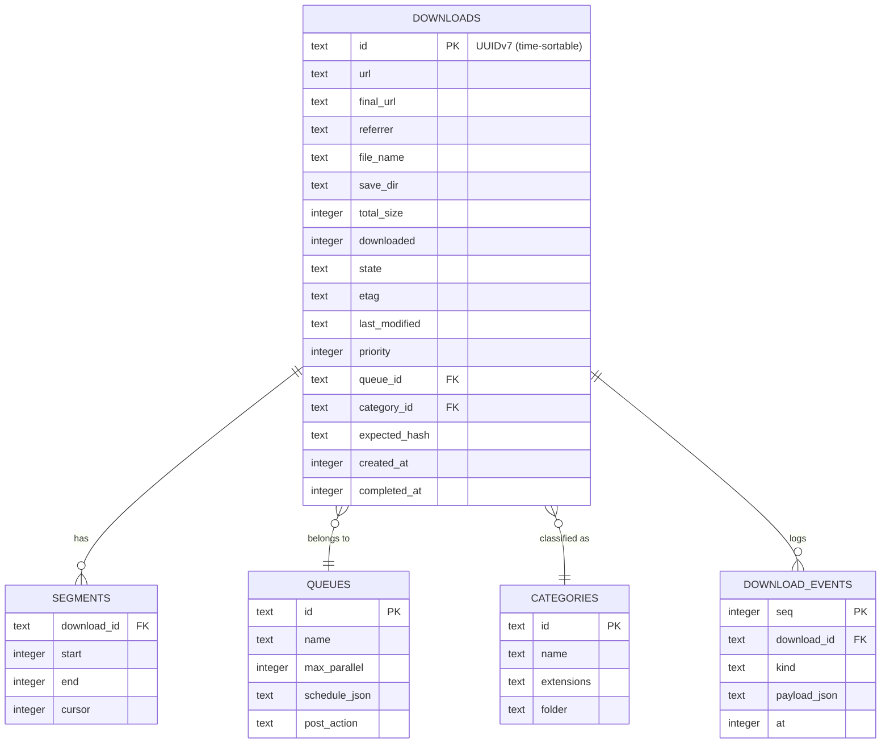

> [!NOTE] نستخدم **UUIDv7** كمعرّفات: فريدة عالمياً ومرتبة زمنياً — أداء فهرسة أفضل من UUIDv4 العشوائي.

الكوكيز والهيدرز الحساسة **لا تُخزّن في قاعدة البيانات بنص واضح** — تُشفّر عبر **DPAPI** (Windows) أو Keychain (macOS) أو Secret Service (Linux).

---

## 13. إضافة المتصفح (Browser Extension)

### 13.1 المتصفحات المدعومة

| المتصفح | المرحلة | ملاحظات |
|---|---|---|
| Chrome / Edge / Brave / Opera / Vivaldi | MVP | نفس الكود (Chromium MV3). |
| Firefox | v1.0 | MV3 في Firefox، مع اختلافات بسيطة يعالجها WXT. |
| Safari | لاحقاً | يتطلب تغليف Xcode — بعد دعم macOS. |

### 13.2 مكونات الإضافة

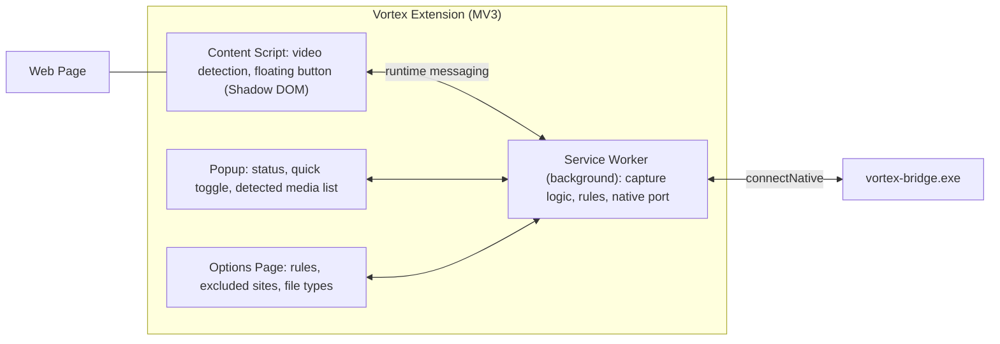

### 13.3 آليات الالتقاط (Capture Strategies)

| الآلية | API المستخدم | ماذا تلتقط |
|---|---|---|
| **1. اعتراض التحميلات الذكي بدون قطع الاتصال** | Chromium: Async `onDeterminingFilename` (تأخير `suggest()`) · Firefox: Blocking `webRequest.onHeadersReceived` | **لا نستدعي `downloads.pause()` أبداً أثناء الفحص** (لأن `pause()` في Chromium يقطع اتصال TCP ويحرق التوكن أحادي الاستخدام!). نؤخر `suggest()` (بميزانية ≤ 2s مع حارس `SafeSuggestGuard`)؛ فإذا قبل الـ Core نلغي تحميل المتصفح، وإذا رفض استدعينا `suggest()` فيكمل المتصفح على **نفس الاتصال المفتوح**! |
| **2. اكتشاف الوسائط ويوتيوب** | `chrome.webRequest.onHeadersReceived` + YouTube/SPA URL Observer | استجابات `video/*`، `audio/*`، `m3u8`، `mpd`، وصفحات YouTube ومنصات الفيديو العامة. |
| **3. زر "تحميل هذا الفيديو"** | Content Script + **Closed Shadow DOM** | كبسولة زجاجية أنيقة وهادئة أعلى مشغّل الفيديو (تختفي عند ملء الشاشة أو السكون) تعرض الجودات (`4K`، `1080p60`، `MP3`، الترجمة) بنقرة واحدة. |
| **4. القائمة المختصرة** | `chrome.contextMenus` | "تحميل بـ Vortex"، "تحميل كل الروابط بـ Vortex"، "تحميل الروابط المحددة". |
| **5. اختصار التجاوز** | مفتاح `Alt` أثناء النقر | تحميل عادي بالمتصفح بدون التقاط (عند الحاجة). |

**منطق قرار الالتقاط (Decision Engine):**

```text
should_capture(download):
  if user holds bypass key                      → NO
  if site in excluded list (Domain Trie)        → NO
  if url scheme is blob: or data:               → NO (browser-only resources, let browser handle)
  if request method was POST with body          → NO (cannot be replayed safely) — v1 limitation
  if extension in capture list (HashSet)        → YES
  if size known and size < min_size (e.g. 1MB)  → NO (small files: browser is fine)
  if MIME in capture list                       → YES
  else                                          → NO
```

### 13.4 ما الذي ترسله الإضافة؟

```json
{
  "v": 1,
  "id": "0192f3a4-...",
  "replyTo": "",
  "traceId": "0192f3a4-88b1-...",
  "timestampMs": 1764094000000,
  "type": "download.handoff",
  "payload": {
    "url": "https://example.com/download?id=42",
    "finalUrl": "https://cdn2.example.com/file.zip?sig=...",
    "referrer": "https://example.com/downloads",
    "topLevelSite": "https://example.com",
    "suggestedName": "file.zip",
    "mimeType": "application/zip",
    "sizeBytes": 1073741824,
    "userAgent": "Mozilla/5.0 ...",
    "cookies": "session=...; cf_clearance=...; partitioned_tok=...",
    "headers": { "Accept-Language": "ar,en;q=0.9" },
    "incognito": false,
    "source": "determining-filename",
    "autoStart": false
  }
}
```

### 13.5 تحديات Manifest V3 الحديثة وحلولها

| التحدي | الحل |
|---|---|
| الـ Service Worker يتوقف بعد ~30 ثانية خمول | فتح منفذ `connectNative` يُبقي الـ Worker حياً، + كل الحالة محفوظة في `chrome.storage.session` لاستعادتها فوراً. |
| `webRequest` الحاجب (Blocking) ممنوع | لا نحتاجه: نستخدم `onDeterminingFilename` للالتقاط و`webRequest` للمراقبة فقط. |
| الكوكيز `HttpOnly` + **الكوكيز المقسّمة (CHIPS)** | ندمج `chrome.cookies.getAll({ url })` مع `chrome.cookies.getAll({ url, partitionKey: { topLevelSite } })` لضمان عمل روابط الـ iframes والـ CDNs المحمية. |
| **الروابط أحادية الاستخدام وبصمة Cloudflare JA3/JA4** | نؤخّر `suggest()` داخل `onDeterminingFilename` (`return true` بدون `pause()`) ريثما ينفّذ الـ Core أول `Probe`؛ لو رد الخادم `403/410` (أو كان المتصفح قد حمّل ≥ 80% من ملف صغير سريع بالفعل) ننادي `suggest()` فوراً فيكمل المتصفح على **نفس مقبس TCP المفتوح أصلاً** بدون حرق التوكن أو فقدان الملف! (وفي Firefox MV3 نستخدم `webRequest.onHeadersReceived` الحاجب بنفس النتيجة تماماً). |
| خصوصية وضع التصفح الخفي | لا التقاط افتراضياً في Incognito، وإن فُعّل لا يُحفظ أي سجل. |
| صلاحية `<all_urls>` مخيفة للمستخدم | شرح واضح في صفحة الترحيب، وخيار "صلاحيات اختيارية" (`optional_host_permissions`). |

### 13.6 تسجيل الـ Native Host

المُثبّت يسجّل ملف Manifest للـ Host في الريجستري **للمستخدم الحالي فقط** (لا يحتاج Admin):

```
HKCU\Software\Google\Chrome\NativeMessagingHosts\com.vortex.bridge
HKCU\Software\Microsoft\Edge\NativeMessagingHosts\com.vortex.bridge
HKCU\Software\Mozilla\NativeMessagingHosts\com.vortex.bridge
HKCU\Software\BraveSoftware\Brave-Browser\NativeMessagingHosts\com.vortex.bridge   (Brave/Vivaldi/Opera also read the Chrome key — we register both for safety)
```

> [!NOTE] **متصفح التطوير الأساسي للفريق: Brave** (مبني على Chromium، فنفس كود الإضافة يعمل بدون تعديل). قبل كل إصدار نختبر على Chrome وEdge وFirefox ضمن مصفوفة E2E.

مع `allowed_origins` مقيّد **فقط** بمعرّف إضافة Vortex الرسمي — لا يمكن لأي إضافة أخرى التحدث مع البرنامج.

---

## 14. الاتصال بين المكونات (IPC)

### 14.1 خريطة القنوات

| من ← إلى | القناة | الصيغة | لماذا |
|---|---|---|---|
| Extension ↔ Bridge | **Native Messaging** (stdin/stdout) | JSON بطول مُسبق (4 bytes length prefix)، حد 1MB للرسالة من الـ Host | المعيار الرسمي والوحيد الآمن، بدون منافذ شبكة. |
| Bridge / CLI ↔ Core | **Named Pipe** (`\\.\pipe\vortex-core-<user-SID>`) / Unix Domain Socket على Linux/macOS | **Protobuf** frames (length-delimited) | سريع جداً، مكتوب الأنواع (Typed)، قابل للتطور مع الحفاظ على التوافق. |
| UI ↔ Core | **Tauri IPC** (Commands + Events) | JSON مع أنواع TypeScript مولّدة آلياً (`specta` / `tauri-specta`) | Type-safety من Rust إلى React بدون كتابة يدوية. |

> [!IMPORTANT] **لا نفتح أي منفذ TCP على localhost.** كثير من مديري التحميل يفتحون خادماً محلياً (مثلاً على المنفذ 9614)، وهذا سطح هجوم: أي موقع ويب خبيث يمكنه محاولة إرسال طلبات إليه. الـ Named Pipe مقيّد بـ **ACL لمستخدم Windows الحالي فقط**.

### 14.2 تصميم البروتوكول

- **Envelope موحّد:** `{ v, id, replyTo, traceId, timestampMs, type, payload }` على قناة JSON (وما يقابله في Protobuf وفق [Protocol-Spec.md](./Protocol-Spec.md)) — الإصدار `v` ومعرّف التتبع `traceId` إلزاميان.
- **مصافحة (Handshake):** أول رسالة تتبادل الإصدارات والقدرات (`capabilities: ["handoff", "media", "link-refresh", "diag-dump"]`) — **Capability Negotiation** يضمن عمل إضافة قديمة مع برنامج جديد والعكس.
- **أنماط الرسائل:** Request/Response (مع `id` للربط) + Events (Server Push) للتقدم والإشعارات.
- **قواعد التطور:** إضافة حقول = مسموح. حذف/تغيير معنى حقل = ممنوع (يتطلب `v` جديد). نفس قواعد Google لـ Protobuf.
- **التحقق:** كل رسالة واردة تُتحقق من مخططها (Schema Validation) وحدودها (حجم، طول URL، عدد Headers) قبل المعالجة.

### 14.3 تدفق كامل: من نقرة في المتصفح إلى ملف على القرص (Probe-Before-Commit)

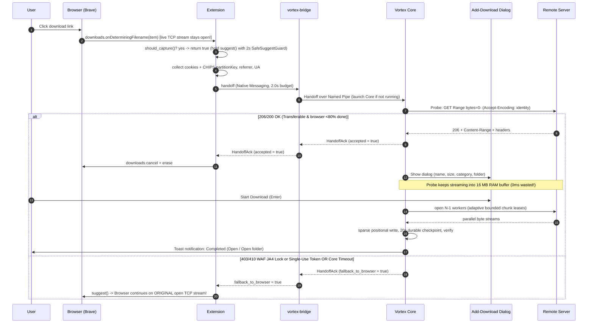

> [!TIP] **صفر تأخير فعلي (0ms Effective Start):** بينما يأخذ تشغيل نافذة WebView2 الباردة ~300–450ms، يكون اتصال الاستكشاف قد بدأ بالفعل ضخ أول 16 MB في الذاكرة منذ اللحظة صفر! وعند الضغط على `Enter` تندفع هذه البايتات للقرص فوراً مع فتح باقي الاتصالات.

---

## 15. الواجهة وتجربة المستخدم (UI/UX)

### 15.1 فلسفة التصميم

| المبدأ | التطبيق |
|---|---|
| **بساطة IDM — بمظهر 2026** | نفس النموذج الذهني الذي يعرفه الملايين (قائمة + أزرار + تصنيفات)، بتصميم حديث. |
| **Zero-Config** | يعمل بشكل ممتاز بدون فتح الإعدادات إطلاقاً. |
| **Progressive Disclosure** | الخيارات المتقدمة مخفية خلف "خيارات متقدمة" — لا تُربك المبتدئ ولا تحرم المحترف. |
| **Don't Make Me Think** (Steve Krug) | كل زر واضح بأيقونة + نص، لا مصطلحات تقنية في الواجهة الأساسية. |
| **Undo بدل التأكيد** | حذف تحميل من القائمة يُظهر "تم الحذف — تراجع" بدلاً من نافذة "هل أنت متأكد؟" (استثناء: حذف الملف من القرص يطلب تأكيداً). |
| **Nielsen's 10 Heuristics** | مرجع لمراجعة كل شاشة. |
| **الاستجابة الفورية** | كل تفاعل يعطي رد فعل بصري خلال < 100ms. |

### 15.2 لغة التصميم والراحة البصرية (Calm & Eye-Friendly Design System)

- **الإلهام:** **Microsoft Fluent 2 × فلسفة الهدوء البصري (Calm UI مثل Linear وArc)** — واجهة فخمة تريح العين لساعات طويلة بلا أي ازدحام بصري.
- **فضاء ألوان OKLCH المريح للعين:** نتجنب الأسود الفاحم `#000000` على الأبيض الصارخ (الذي يسبب إجهاد العين وظاهرة Halation على شاشات OLED/IPS)، ونستخدم درجات رمادية دافئة ناعمة في الوضعين الفاتح والداكن مع توحيد السطوع الإدراكي عبر **OKLCH**.
- **نقطة تركيز واحدة لكل شاشة (Single Focal Point):** الزر الأساسي فقط يأخذ لون العلامة المشبع؛ الأزرار الثانوية وصفوف التحميل المكتملة تبقى هادئة وتُظهر أزرار الإجراءات الإضافية عند التحويم فقط (**Progressive Action Reveal**).
- **المواد:** خلفية **Mica Alt** / **Acrylic** على Windows 11، زوايا مستديرة 8px، ظلال خفيفة.
- **الخطوط:** `Segoe UI Variable` / `Inter` للإنجليزية — و **`IBM Plex Sans Arabic`** للعربية، مع إلزامية **`tabular-nums`** لكل الأرقام المتغيرة حتى لا تهتز الأعمدة بصرياً أبداً.
- **الألوان الدلالية:** 🔵 جاري — 🟢 مكتمل — 🟡 متوقف / يحتاج انتباه — 🔴 فشل — 🟣 في الطابور (تباين ≥ 4.5:1 WCAG AA).
- **الحركة:** انتقالات `120–220ms` بمنحنيات فيزيائية هادئة، مع احترام `prefers-reduced-motion`.

### 15.3 النافذة الرئيسية

```text
┌──────────────────────────────────────────────────────────────────────────────────────┐
│ 🌀 Vortex                                         🔍 ابحث في التحميلات...    ─  ☐  ✕ │
├──────────────────────────────────────────────────────────────────────────────────────┤
│ [＋ إضافة رابط]  [▶ استئناف]  [⏸ إيقاف]  [⏹ إيقاف الكل]  [🗑 حذف]  [⏰ جدولة]  [⚙]     │
├────────────────┬─────────────────────────────────────────────────────────────────────┤
│ 📥 الكل   (128) │  الاسم                        الحجم     التقدم            السرعة   المتبقي│
│ ⬇ جاري     (3) │  ───────────────────────────────────────────────────────────────────│
│ ✅ مكتمل  (120) │  🎬 Movie.2026.1080p.mkv      4.2 GB   ███████░░░ 72%   18.4 MB/s  1:04 │
│ ⏸ متوقف    (2) │  📦 ubuntu-26.04.iso          5.1 GB   ███░░░░░░░ 31%   22.1 MB/s  2:43 │
│ ❌ فشل      (1) │  🎵 Podcast-Ep-42.mp3         86 MB    ██████████ ✓     —          —    │
│ ─────────────  │  📄 Report.pdf                2.3 MB   ⏸ متوقف          —          —    │
│ 📁 التصنيفات    │  ⚙ setup-tool.exe             120 MB   ❌ انتهى الرابط [🔄 تحديث الرابط]  │
│   🎬 فيديو      │                                                                     │
│   🎵 صوتيات     │                                                                     │
│   📦 مضغوطات    │                                                                     │
│   ⚙ برامج       │                                                                     │
│   📄 مستندات    │                                                                     │
│   🖼 صور        │                                                                     │
│ ─────────────  │                                                                     │
│ 🗂 الطوابير     │                                                                     │
│   ▸ الرئيسي     │                                                                     │
│   ▸ الليلي 🌙   │                                                                     │
├────────────────┴─────────────────────────────────────────────────────────────────────┤
│ ⬇ 40.5 MB/s   ⬆ 0.1 MB/s   │  3 نشط · 2 في الطابور   │  💾 مساحة حرة: 412 GB            │
└──────────────────────────────────────────────────────────────────────────────────────┘
```

**تفاصيل:**
- **قائمة افتراضية (Virtualized List):** ترسم فقط الصفوف الظاهرة → سلاسة كاملة مع 100,000 عنصر.
- **سحب وإفلات (Drag & Drop):** اسحب رابطاً أو ملف `.txt` به روابط أو ملف `.torrent` إلى النافذة.
- **نقرة مزدوجة** على مكتمل = فتح الملف؛ على جاري = نافذة التقدم.
- **قائمة النقر الأيمن:** فتح، فتح المجلد، نسخ الرابط، تحديث الرابط، إعادة التحميل، التحقق من Hash، نقل لطابور، خصائص.
- **اختصارات لوحة المفاتيح:** `Ctrl+N` إضافة رابط، `Space` إيقاف/استئناف، `Del` حذف، `Ctrl+F` بحث، `Ctrl+,` إعدادات.
- **دعم RTL كامل:** الواجهة تنعكس بالكامل في العربية (باستخدام CSS Logical Properties: `margin-inline-start` بدل `margin-left`).

### 15.4 نافذة "إضافة تحميل" (تظهر عند الالتقاط من المتصفح)

```text
┌──────────────────────────────────────────────────────────┐
│ 🌀 تحميل جديد                                          ✕ │
├──────────────────────────────────────────────────────────┤
│  📦  ubuntu-26.04-desktop-amd64.iso                       │
│      releases.ubuntu.com  ·  5.1 GB  ·  ✅ يدعم الاستكمال  │
│                                                          │
│  التصنيف:   [ 📦 مضغوطات         ▾ ]                      │
│  حفظ في:   [ D:\Downloads\Compressed          ] [📂]     │
│  الاسم:    [ ubuntu-26.04-desktop-amd64.iso    ]         │
│                                                          │
│  ▸ خيارات متقدمة (الطابور، التحقق من Hash، بيانات الدخول) │
│                                                          │
│  ☐ تذكّر هذا المسار لهذا التصنيف                          │
│                                                          │
│        [ لاحقاً (أضف للطابور) ]   [ ⬇ ابدأ التحميل ]      │
└──────────────────────────────────────────────────────────┘
```

- **الزر الأساسي مُبرز** ويعمل بـ `Enter` مباشرة — في الحالة المعتادة يكفي ضغطة واحدة.
- خيار "**لا تسألني مجدداً، ابدأ التحميل مباشرة**" للمستخدمين المتقدمين.
- إذا كان الملف موجوداً مسبقاً: تنبيه ذكي مع خيارات (استبدال / إعادة تسمية تلقائية / فتح الموجود).

### 15.5 نافذة التقدم (مع شريط الأجزاء الشهير)

```text
┌──────────────────────────────────────────────────────────┐
│ 🎬 Movie.2026.1080p.mkv                         ─  ✕     │
├──────────────────────────────────────────────────────────┤
│  ████████████████████████████░░░░░░░░░░░  72.4%          │
│  3.04 GB من 4.20 GB                                       │
│                                                          │
│  السرعة:       18.4 MB/s     (أقصى: 24.1 MB/s)            │
│  المتبقي:      1 دقيقة 4 ثوانٍ                             │
│  الاتصالات:    12 نشط  (تكيّفي)                           │
│  الاستكمال:    ✅ مدعوم                                    │
│                                                          │
│  خريطة الأجزاء:                                           │
│  ▓▓▓▓▓▓▓▓▓▓▓▓░▓▓▓▓▓▓▓▓▓░▓▓▓▓▓▓▓▓▓░░▓▓▓▓▓▓▓░▓▓▓▓▓▓░░▓▓▓  │
│  (كل لون = اتصال، الرمادي = متبقي — يتحرك مباشرة)         │
│                                                          │
│  📈 [رسم بياني صغير للسرعة خلال آخر 60 ثانية]              │
│                                                          │
│  ☐ إيقاف تشغيل الجهاز عند الانتهاء                        │
│  [ ⏸ إيقاف مؤقت ]  [ ⚡ تحديد السرعة ]  [ ✕ إلغاء ]        │
└──────────────────────────────────────────────────────────┘
```

- شريط الأجزاء يُرسم على **Canvas** (وليس عناصر DOM) لأداء ممتاز.
- يمكن **تصغير** النافذة إلى شريط صغير عائم أو إخفاؤها تماماً.

### 15.6 عناصر أخرى في الواجهة

| العنصر | الوصف |
|---|---|
| **أيقونة الـ Tray** | تعرض السرعة الكلية عند المرور، قائمة سريعة (إيقاف الكل، تحديد السرعة، فتح المجلد)، ونقطة ملونة عند وجود تحميل نشط. |
| **إشعارات Windows الأصلية** | "اكتمل التحميل" مع أزرار **[فتح]** و**[فتح المجلد]** مباشرة في الإشعار. |
| **مراقبة الحافظة** | عند نسخ رابط ملف قابل للتحميل، يظهر إشعار صغير "تحميل بـ Vortex؟" (قابل للإيقاف). |
| **معالج الترحيب (Onboarding)** | 3 خطوات فقط: ① اختر مجلد التحميل ② ثبّت الإضافة (زر يفتح المتجر مباشرة مع اكتشاف المتصفحات المثبتة) ③ جاهز! |
| **الإعدادات** | مقسمة لـ: عام · التحميل · الاتصال والسرعة · المتصفح · التصنيفات · الطوابير · المظهر · متقدم — مع **بحث داخل الإعدادات**. |
| **الحالات الفارغة (Empty States)** | رسم توضيحي جميل + "اسحب رابطاً هنا أو حمّل من متصفحك" بدلاً من شاشة فارغة. |
| **نافذة التحميل المجمّع** | لصق عدة روابط أو نمط (`file[001-100].jpg`) لتحميل دفعة واحدة. |
| **نافذة تحميل فيديو يوتيوب والمنصات** | صورة مصغّرة أنيقة + بطاقات جودة واضحة بنقرة واحدة (`4K 60fps`، `1080p60`، `720p`، `MP3 صوت نقي`) + اختيار الترجمة (عربي/إنجليزي) + دعم قوائم التشغيل الكاملة! |

```text
┌──────────────────────────────────────────────────────────────────┐
│ 🌀 تحميل فيديو — YouTube                                      ✕ │
├──────────────────────────────────────────────────────────────────┤
│  ┌──────────────┐  System Design Deep Dive (2026)                │
│  │  🎬 24:18    │  قناة التقنية · 4K HDR متاح · يدعم الفصول      │
│  └──────────────┘                                                │
│  اختر الجودة:                                                    │
│   (●) 🌟 4K Ultra HD (2160p60 · AV1)             1.42 GB         │
│   ( )    Full HD (1080p60 · VP9)                   410 MB        │
│   ( )    HD (720p · H.264 — متوافق مع كل الأجهزة)  185 MB        │
│   ( ) 🎵 صوت فقط — MP3 / M4A (320 kbps)             28 MB        │
│                                                                  │
│  الترجمة: [ ☑ العربية + الإنجليزية (مدمجة) ▾ ]  حفظ في: [📂 الفيديو]│
│                                                                  │
│              [ أضف للطابور ]        [ ⬇ ابدأ التحميل الفائق ]     │
└──────────────────────────────────────────────────────────────────┘
```

### 15.7 إتاحة الوصول (Accessibility) والتدويل (i18n)

- **WCAG 2.2 AA:** تنقل كامل بلوحة المفاتيح، مؤشر تركيز واضح، دعم قارئ الشاشة (Narrator / NVDA) عبر ARIA الذي يُترجمه WebView2 إلى UI Automation.
- **i18n:** مكتبة `i18next` مع **ICU MessageFormat** لدعم صيغ الجمع العربية المعقدة (ملف واحد، ملفان، 3 ملفات، 11 ملفاً...).
- **اللغات عند الإطلاق:** العربية والإنجليزية، مع منصة ترجمة مجتمعية (مثل **Weblate**) لباقي اللغات.
- **الأرقام والتواريخ:** حسب إعدادات المستخدم (`Intl` APIs) — أرقام عربية أو هندية حسب التفضيل.

### 15.8 تدفق المستخدم الأساسي

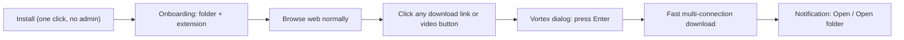


---

## 16. حزمة التقنيات (Tech Stack)

### 16.1 الجدول الكامل

| الطبقة | التقنية | البديل الذي رفضناه | سبب الاختيار |
|---|---|---|---|
| **لغة المحرك** | **Rust (Edition 2024)** | C++, Go, C# | أداء C++ مع **أمان ذاكرة مضمون** وقت الترجمة. Microsoft تعيد كتابة أجزاء من Windows بـ Rust، وGoogle تستخدمه في Android وChrome. Go: الـ GC يسبب توقفات واستهلاك ذاكرة أعلى. C#: Runtime أثقل. |
| **Async Runtime** | **Tokio** | async-std, smol | المعيار الفعلي في Rust، ناضج، يستخدمه AWS وDiscord وCloudflare. |
| **HTTP** | **hyper 1.x** (`http1` + High-BDP `http2`) + `hyper-util` | reqwest (فقط) | تحكم كامل في نوافذ التدفق (`16/64 MiB` لـ H2 و`256–512 KiB` Read Buf لـ H1.1) واتصالات Keep-Alive المتعددة و`RST_STREAM`. |
| **TLS** | **rustls** (`ring` crypto provider + `rustls-platform-verifier` + `ALPN: ["h2", "http/1.1"]`) | OpenSSL | آمن ذاكرياً 100%، أسرع في الـ Handshake مع تذاكر جلسات TLS 1.3، يستخدم مخزن شهادات النظام، ولا يعتمد على DLL خارجية. |
| **HTTP/3** | **quinn** + **h3** *(Phase 3)* | — | تنفيذ QUIC الأنضج في Rust. |
| **DNS** | **hickory-resolver** + `VerifiedIpConnector` | resolver النظام وحده | Cache، Happy Eyeballs v2، فحص SSRF/DNS-Rebinding على مستوى المقبس، وDoH لاحقاً. |
| **قاعدة البيانات** | **SQLite** عبر **rusqlite** (`WAL` + ترحيلات SQL مدمجة مرقّمة في `vortex-storage`) | sled, RocksDB, JSON files | موثوقية مثبتة، نسخ احتياطي آلي قبل الترحيل، وفحص `PRAGMA quick_check` مع صفر اعتماديات ترحيل خارجية زائدة. |
| **التسلسل (Serialization)** | **serde** + **prost** (Protobuf) | — | المعيار في Rust. |
| **الـ Logging** | **tracing** + `tracing-subscriber` + `tracing-appender` | log, env_logger | Logs منظمة (Structured) مع Spans لتتبع كل تحميل. |
| **الأخطاء** | **thiserror** (مكتبات) + **anyhow** (تطبيقات) | — | أخطاء مكتوبة الأنواع في الطبقات الداخلية. |
| **الهاشات** | **blake3**, **sha2**, **md-5** | — | سرعة + توافق. |
| **الإطار المكتبي** | **Tauri 2** | Electron, WinUI 3, Qt, Flutter | **Electron:** 150MB+ RAM و100MB حجم. **WinUI 3:** Windows فقط وتطويره أبطأ. **Qt:** C++ وتعقيد ترخيص. **Flutter Desktop:** أقل نضجاً في تكامل النظام. **Tauri:** مثبّت NSIS فعلي **`5.82 MiB`** وMSI **`8.32 MiB`** (`< 15 MB`)، ذاكرة قليلة، Rust أصلي، أمان (Capabilities + `on_navigation` lock). |
| **إطار الواجهة** | **React 19 + TypeScript (strict)** | Svelte, Vue, SolidJS | أكبر منظومة مكتبات وأدوات، توظيف أسهل للمساهمين، وأداء ممتاز مع حزمة مدمجة **`155.16 kB`** مضغوطة (`< 200 KB`). |
| **أداة البناء** | **Vite** | Webpack | سرعة تطوير فائقة (HMR). |
| **التنسيق والأيقونات** | **Zero-Runtime OKLCH Design Tokens (`packages/design-tokens`) + CSS Logical Properties + `lucide-react`** | CSS-in-JS أو مكتبات UI متضخمة | صفر تكلفة وقت تشغيل، دعم عربي RTL أصيل 100%، شعار `VortexLogo` شعاعي، وحجم حزمة فائق الصغر (`< 200 KB`). |
| **مكونات الواجهة** | **مكونات Vortex الأصلية المتوافقة مع WCAG 2.2 AA (`axe-core` verified)** | MUI, مكتبات ثقيلة تفرض شكلاً عاماً | تحكم بصري وهندسي كامل (`Edge-to-Edge Mica`, `SmartConfirmModal`, `LiveInspectorDrawer`) بصفر مخالفات وصول. |
| **إدارة الحالة** | **Zustand** (حالة العميل) + اشتراكات أحداث Tauri وطابور السحب المتماثل | Redux | بسيط، أداء ممتاز، Selectors دقيقة تمنع إعادة الرسم غير الضرورية. |
| **القوائم الطويلة** | **TanStack Virtual** | — | Virtualization بـ 60 FPS ثابتة لـ 10,000+ عنصر. |
| **الحركة** | **GPU-Accelerated CSS Transitions (`transform` / `opacity`)** | مكتبات JS ثقيلة للحركة | سلاسة 60 FPS بدون حمل على الخيط الرئيسي مع احترام `prefers-reduced-motion`. |
| **الرسوم البيانية** | **HTML5 `<canvas>` مخصص بدقة `devicePixelRatio`** (`512-bin` + `SpeedSparkline`) | Chart.js | أخف وأسرع بمراحل للرسوم اللحظية في شريط الأجزاء وكبسولة السرعة. |
| **أنواع مشتركة Rust→TS** | **specta / tauri-specta** (`#[specta(type = f64)]` في `specta-typescript 0.0.15` + بوابة فحص CI) | كتابة يدوية | يستحيل انحراف العقد بين Rust وTypeScript (`generated.ts` مولّد آلياً ومفحوص في CI). |
| **الإضافة** | **WXT** + TypeScript + Preact/React (للـ Popup) | Plasmo, يدوي | يدعم MV3 لكل المتصفحات من كود واحد، HMR للإضافات. |
| **CLI** | **clap** | — | المعيار. |
| **الوسائط** | `m3u8-rs`, `dash-mpd` + **`yt-dlp`** & **`FFmpeg-min`** (Managed On-Demand Sidecars وفق `ADR-020`) | بناء FFmpeg ضخم أو مدمج في المثبّت | تنزيل عند الطلب بتحقق مزدوج (`Ed25519` + `SHA-256`) وبناء GPLv3 مصغّر بدون `non-free` للحفاظ على حجم المثبّت `< 15 MB`. |
| **التورنت** | **librqbit** | libtorrent (C++) | Rust أصلي، حديث. |
| **الإضافات (Plugins)** | **wasmtime** (WebAssembly Component Model) | Lua, DLLs | Sandbox حقيقي، أمان، لغات متعددة. |
| **التثبيت** | **WiX v4 (MSI)** + **NSIS** | Inno Setup | MSI للشركات (Group Policy)، NSIS للمستخدم العادي. |
| **التحديث التلقائي** | **tauri-plugin-updater** (توقيع Ed25519) | Squirrel | تحديثات موقّعة، تحديثات تفاضلية لاحقاً. |
| **بيانات الاعتماد** | **keyring** crate | — | Windows Credential Manager / macOS Keychain / Linux Secret Service. |
| **مخصّص الذاكرة (Global Allocator)** | **`mimalloc`** (من Microsoft Research) | مخصص النظام الافتراضي | تسريع 15–30% في التخصيص متوازي الخيوط وتقليل تشظي الذاكرة في المسار الساخن. |
| **مقابس الشبكة والبحث النصي** | **`socket2`** + **`nucleo-matcher`** + **`aho-corasick`** | خوارزميات غير مسرّعة بـ SIMD | ضبط `TCP_NODELAY` الدقيق، وبحث ضبابي ونصي بتسريع SIMD وبصفر تخصيص ذاكرة. |
| **أداة المهام** | **just** + **pnpm workspaces** + **cargo workspaces** (`lto="thin"`, `panic="unwind"`) | Make, npm | بناء سريع مع الحفاظ على `panic="unwind"` لضمان عمل عزل الـ Actors (`JoinError::is_panic`). |

### 16.2 متطلبات التشغيل

- **Windows 10 (1809+) / Windows 11** — x64 و ARM64 (أجهزة Snapdragon الجديدة).
- **WebView2 Runtime** (مثبت مسبقاً في Windows 11 وأغلب Windows 10؛ المُثبّت يضيفه عند الحاجة).
- لاحقاً: **macOS 12+** (Universal: Intel + Apple Silicon)، **Linux** (AppImage، deb، rpm، Flatpak).

---

## 17. الأمان والخصوصية

### 17.1 نمذجة التهديدات (STRIDE)

| التهديد | السيناريو | الحماية |
|---|---|---|
| **S**poofing | موقع/إضافة خبيثة تنتحل إضافة Vortex | `allowed_origins` في Native Host، Named Pipe بـ ACL للمستخدم الحالي، لا منافذ TCP. |
| **T**ampering | تعديل ملف التحديث أثناء النقل | توقيع Ed25519 لكل تحديث + HTTPS + Pinning لمفتاح التوقيع داخل البرنامج. |
| **R**epudiation | — | سجل أحداث محلي لكل تحميل (للتشخيص). |
| **I**nformation Disclosure | تسريب الكوكيز وكلمات المرور | تشفير DPAPI، عدم كتابتها في الـ Logs أبداً (Redaction تلقائي)، لا Telemetry. |
| **D**enial of Service | رسائل ضخمة/مشوهة من الإضافة | حدود حجم صارمة، Schema validation، Fuzzing. |
| **E**levation of Privilege | Path Traversal يكتب في `C:\Windows` | Sanitization للمسارات، التحقق أن المسار النهائي داخل المجلد المسموح، **البرنامج لا يعمل كـ Admin أبداً**. |

### 17.2 ضوابط أمنية إضافية

- **أمان الذاكرة وتصفير الأسرار:** Rust يمنع Buffer Overflows وUse-After-Free (المسؤولة عن ~70% من الثغرات الحرجة حسب Microsoft وGoogle). استخدام `unsafe` ممنوع إلا بمراجعة خاصة وتعليق تبرير (`// SAFETY:`). كما نستخدم `secrecy` و`zeroize` لحفظ الكوكيز وكلمات المرور ومفاتيح البروكسي بحيث تُمسح من الذاكرة (Zeroized) فور انتهاء استخدامها ولا تُطبع أبداً في `Debug`/`Display`.
- **الحماية الشاملة على مستوى المقبس من `SSRF` و`DNS Rebinding` و`UNC / NTLM Leak` (`TH-03`, `TH-04`, `TH-26`):** قائمة بيضاء صارمة للبروتوكولات (`http`, `https`) ورفض قاطع لـ `file://` و`javascript:` ومسارات الشبكة `\\server\share`، مع فحص كل عنوان IP محلول داخل `VerifiedIpConnector` مباشرةً قبل `TcpStream::connect` لمنع كلٍّ من الاستهداف المباشر للعناوين المحلية/السحابية (`127.0.0.1`, `169.254.169.254`, RFC1918) وهجمات `DNS Rebinding` بين طلب الاستكشاف واتصالات العمال، بالإضافة إلى **ربط الكوكيز في DPAPI بالأصل المسجّل (`Origin-Pinned Secret Vault` — `TH-28`)**.
- **درع المواقع الإعلانية والفحص السحري ونواة NTFS (`TH-20` → `TH-25`, `TH-29` → `TH-33`):** فحص أول `512` بايت في الذاكرة لكشف صفحات الـ HTML الخادعة والملفات التنفيذية المتنكرة والاختصارات المسلحة (`.lnk`, `.chm`, `ClickOnce`, `.svg` الملغمة) وتطهير محارف `RTLO` (`TH-21`, `TH-30`)، وحارس عواصف الإعلانات وقفل `350ms` (`TH-20`)، وحماية نواة الملفات بـ `FILE_FLAG_OPEN_REPARSE_POINT` و`GetFinalPathNameByHandleW` ضد هجمات `Symlink/Junction TOCTOU` (`TH-29`)، وصلاحيات مجلد `%LOCALAPPDATA%\Vortex` الحصرية للمستخدم الحالي (`TH-31`)، ومحدد معدل أنبوب IPC بـ `100 msg/s` (`TH-32`)، وقفل تصفح `WebView2` على `tauri.localhost` فقط (`TH-33` — انظر [Cybersecurity-Layers-And-Misuse-Prevention-Spec.md](./Cybersecurity-Layers-And-Misuse-Prevention-Spec.md)).
- **حماية مراقبة الحافظة (Clipboard Hygiene):** لا تُسجَّل محتويات الحافظة أبداً في الـ Logs، ونحترم صيغ الاستثناء القياسية لمديري كلمات المرور على Windows (`ExcludeClipboardContentFromMonitorProcessing` و`CanIncludeInClipboardHistory`) لتجاهل أي نص منسوخ من 1Password / Bitwarden / KeePass.
- **حماية فك الضغط التلقائي (v1.x — Anti Zip-Slip & Decompression Bombs):** رفض المسارات الخارجة عن مجلد الهدف والروابط الرمزية (Symlinks) داخل الأرشيف، وفرض حدود على نسبة الضغط والحجم الكلي وعدد الملفات.
- **عزل العمليات الجانبية ومنع حقن الأوامر (`TH-19`):** استدعاء `yt-dlp` و`FFmpeg` مباشرةً عبر `std::process::Command` (**ممنوع منعاً باتاً المرور عبر `cmd.exe /c` أو `powershell`**)، مع تمرير `--no-exec --no-config-locations --ignore-config --` قبل أي رابط، والتحقق المزدوج من توقيع `Ed25519` وبصمة `SHA-256` قبل التشغيل والتحديث.
- **سياسة أمان الواجهة (CSP):** صارمة في Tauri — لا تحميل لأي سكربت خارجي، لا `eval`.
- **Tauri Capabilities:** الواجهة لا تستطيع إلا استدعاء الأوامر المصرّح بها صراحة.
- **Mark-of-the-Web + فحص مضاد الفيروسات:** استدعاء **`IAttachmentExecute`** على Windows بعد اكتمال التحميل — يُشغّل Windows Defender أو أي مضاد فيروسات مثبت (نفس ما تفعله المتصفحات).
- **توقيع الكود:** كل ملف `.exe` و`.msi` موقّع (عبر **Azure Trusted Signing** أو شهادة OV/EV) — يقلل تحذيرات SmartScreen وإنذارات مضاد الفيروسات الكاذبة.
- **سلسلة التوريد (Supply Chain):**
  - `cargo-audit` و`cargo-deny` (ثغرات + تراخيص + مصادر) و`pnpm audit` في كل CI.
  - **SBOM** (CycloneDX) مع كل إصدار.
  - **SLSA Level 3** provenance عبر GitHub Actions + **Sigstore** لتوقيع الـ Artifacts.
  - Dependabot/Renovate لتحديث الاعتماديات.
  - Lockfiles إلزامية ومراجعة أي اعتمادية جديدة.
- **سياسة الإفصاح الأمني:** ملف `SECURITY.md` وقناة خاصة للإبلاغ عن الثغرات.

### 17.3 الخصوصية

- **صفر Telemetry افتراضياً.** لا إحصاءات، لا تتبع، لا إعلانات — أبداً.
- تقارير الأعطال (Crash Reports) **اختيارية** (Opt-in)، تُعرض على المستخدم قبل الإرسال، ومنظفة من المسارات الشخصية والروابط.
- التحقق من التحديثات هو الاتصال الوحيد بخوادمنا (ويمكن إيقافه).
- وضع **Portable** يحفظ كل شيء بجوار البرنامج (للـ USB).

---

## 18. الأداء (Performance Budgets)

| المقياس | الميزانية | كيف نحققها |
|---|---|---|
| Cold Start (Core + Tray جاهز) | < 300ms | Core بدون WebView عند البدء، `mimalloc`، تحميل كسول (Lazy). |
| بدء تدفق التحميل الفعلي بعد نقرة المتصفح | **0ms إهدار** | الـ Probe يبدأ الضخ في مخزن RAM (`16 MiB`) بالتوازي مع فتح النافذة. |
| ظهور نافذة "إضافة تحميل" | **< 80ms (Warm)** / **< 450ms (Cold WebView2)** | حزمة خفيفة جداً، مع خيار "الوضع الفوري" الاختياري لإبقاء WebView دافئاً للأجهزة ذات الذاكرة الكبيرة. |
| فتح النافذة الرئيسية | < 400ms | Code Splitting، حجم JS < 250KB مضغوط. |
| ذاكرة Idle (النافذة مغلقة وWebView2 مدمَّر) | < 45MB نموذجياً (سقف < 60MB) | تدمير WebView عند الإغلاق، Core بـ Rust (~15–25MB). |
| معالج أثناء 1 Gbps | < 5% | Zero-copy `Bytes`، `FSCTL_SET_SPARSE`، كتابات مجمّعة بمحاذاة `4 KiB`، Checkpoint كل 20s، وSIMD للهاشات. |
| ذاكرة لكل تحميل نشط | < 8MB | قنوات محدودة، Slab Pool ثابت السعة. |
| أقصى سرعة مدعومة | ≥ 10 Gbps | اختبارات Benchmark على Loopback وشبكات 10GbE مع الحفاظ على Windows TCP Auto-Tuning. |
| تحديثات الواجهة | ≤ 10Hz | Throttling + Delta Updates + العناصر الظاهرة فقط + Canvas. |

**الأدوات:** `criterion` (Benchmarks دقيقة)، `cargo flamegraph` / **Windows Performance Analyzer (WPA)** / **Tracy** للتحليل، **Chrome DevTools Performance** للواجهة، ومقارنة أداء تلقائية في CI تمنع أي تراجع > 5% (**Performance Regression Gate**).

---

## 19. استراتيجية الاختبار والجودة

### 19.1 هرم الاختبارات

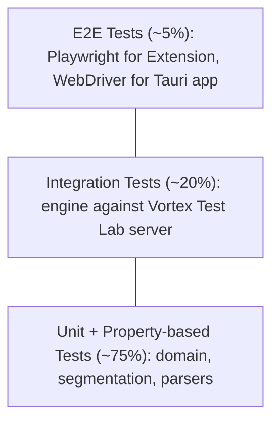

| النوع | الأدوات | ماذا نختبر |
|---|---|---|
| **Unit Tests** | `cargo test` / `cargo-nextest`، **Vitest** للـ TS | منطق النطاق، آلة الحالات، المحللات، مكونات React. |
| **Property-Based Testing** | **proptest** | خصائص يجب أن تصح دائماً: "اتحاد كل الأجزاء = الملف كاملاً بلا تداخل ولا فجوات"، "أي تسلسل من Split/Complete/Pause/Resume يحافظ على صحة SegmentMap". |
| **Integration Tests** | **Vortex Test Lab** (خادم اختبار مخصص) | سيناريوهات شبكة حقيقية (انظر أدناه). |
| **Fuzzing** | **cargo-fuzz** (libFuzzer) + OSS-Fuzz لاحقاً | محلل `Content-Disposition`، `Content-Range`، m3u8، mpd، رسائل IPC، Metalink. |
| **Chaos / Network Emulation** | **Toxiproxy**، Windows `clumsy` | زمن استجابة عالٍ، فقد حزم، انقطاعات، بطء متغير. |
| **Crash-Safety Tests** | قتل العملية عشوائياً (`kill -9`) أثناء التحميل آلاف المرات | التحقق أن الاستكمال ينتج دائماً ملفاً مطابقاً بالـ Hash. |
| **Visual Regression** | **Playwright screenshots** / Storybook + Chromatic | عدم تغير الواجهة بشكل غير مقصود (فاتح/داكن/عربي/إنجليزي). |
| **Accessibility Tests** | **axe-core** | مخالفات WCAG تلقائياً في CI. |
| **E2E** | **Playwright** (الإضافة في Chrome حقيقي)، **WebdriverIO + tauri-driver** (التطبيق) | التدفق الكامل: نقرة في المتصفح ← ملف مكتمل على القرص. |
| **Mutation Testing** | **cargo-mutants** | قياس جودة الاختبارات نفسها في المكونات الحرجة. |
| **Deterministic Time & Fault Injection** | سمة **`Clock` Trait** (`FakeClock`) + **Failpoints** (feature-gated) | اختبار Backoff والجدولة ومحدد السرعة في أجزاء من الثانية بحتمية 100%، وحقن أعطال دقيقة (بين `Flush` و`COMMIT`، `ENOSPC`، `ERROR_SHARING_VIOLATION`) للتأكد من سلامة كل مسار خطأ. |
| **Secret-Leak & Redaction Tests** | اختبارات آلية على مخرجات `tracing` وملف التشخيص | ضمان عدم تسرب أي Cookie أو Authorization أو Token أو اسم مستخدم في الـ Logs أو حزمة التشخيص. |
| **Architecture Fitness Functions** | فحص آلي في CI (رسم بياني للـ Dependencies + Clippy strict) | منع كسر قاعدة الاعتمادية (DAG)، ومنع `.unwrap()`/`.expect()`/`panic!()` في كود الإنتاج، ومراقبة حجم الملفات التنفيذية. |

### 19.2 Vortex Test Lab — خادم اختبار خاص بنا

خادم Rust صغير يحاكي "أسوأ خوادم الإنترنت":
- خادم لا يدعم Range / يرد `200` بدل `206`.
- تحديد سرعة **لكل اتصال** (لإثبات فائدة التقسيم).
- قطع الاتصالات عشوائياً بعد عدد بايتات عشوائي.
- روابط تنتهي صلاحيتها بعد X ثانية.
- تغيير الملف (ETag) أثناء التحميل.
- سلاسل تحويل (Redirect chains) طويلة ودائرية.
- `Content-Length` خاطئ، Chunked encoding، Gzip رغم طلب identity.
- إرسال **Weak ETag (`W/"..."`)** مع `If-Range`، واختبار **قفل Cloudflare JA4 (`403`)**، و**التوكنات أحادية الاستخدام** التي تحترق من أول طلب، وتحويلات **SSRF Redirect** نحو `127.0.0.1` / `169.254.169.254`.
- أسماء ملفات بترميزات عربية غريبة (RFC 5987 / RFC 2047).
- رد `429` مع `Retry-After`.

### 19.3 معايير الجودة (Quality Gates) في كل Pull Request

- ✅ `cargo fmt` + `cargo clippy -D warnings` (مع `clippy::pedantic` + منع `unwrap_used` و`expect_used` و`panic` و`indexing_slicing` في كود الإنتاج)
- ✅ `eslint` + `prettier` + `tsc --noEmit` (strict)
- ✅ كل الاختبارات تمر على Windows + Linux + macOS (بما فيها اختبارات عدم تسرب الأسرار واختبارات الأعطال)
- ✅ تغطية الكود (Coverage) للـ Domain والمحرك ومعالجة الأخطاء ≥ 90% (عبر `cargo-llvm-cov`)
- ✅ فحص معماري آلي (Architecture Fitness: لا اعتمادية معاكسة بين الطبقات)
- ✅ فحص الاعتماديات والتراخيص (`cargo-audit`, `cargo-deny`, `pnpm audit`)
- ✅ لا تراجع في الأداء (> 5%) أو حجم الـ Binary
- ✅ مراجعة كود من شخص آخر

---

## 20. هيكل المستودع وأسلوب العمل الهندسي

### 20.1 هيكل الـ Monorepo

```
vortex/
├── crates/                        # Rust core libraries (see §6.3)
│   ├── vortex-error/
│   ├── vortex-observability/
│   ├── vortex-domain/
│   ├── vortex-application/
│   ├── vortex-engine/
│   ├── vortex-net/
│   ├── vortex-proto-ftp/
│   ├── vortex-media/
│   ├── vortex-storage/
│   ├── vortex-io/
│   ├── vortex-ipc/
│   ├── vortex-platform/
│   └── vortex-plugin-host/
├── apps/
│   ├── desktop/                   # Tauri 2 desktop app
│   │   ├── src-tauri/             # Rust: composition root, Specta commands, Mica windows (main + confirm), tray
│   │   └── ui/                    # React 19 + TS strict front-end (155.16 kB gzipped < 200 KB)
│   │       └── src/
│   │           ├── bindings/      # auto-generated Specta types (generated.ts) + normalized IPC client
│   │           ├── features/      # capture/, downloads/, progress/, settings/, diagnostics/ (FSD)
│   │           ├── shared/        # i18n/ (AR RTL ICU & EN), lib/, state/ (Zustand), ui/ (VortexLogo, VtxErrorCard)
│   │           └── styles.css     # Pure OKLCH tokens + 100% CSS Logical Properties
│   ├── bridge/                    # Native Messaging host (vortex-bridge.exe 882.50 KiB < 1 MB, FILE_FLAG_OVERLAPPED)
│   └── cli/                       # (Phase 3) vortex-cli
├── assets/                        # Master Kinetic Vortex SVG mark (vortex-logo.svg)
├── scripts/                       # Deterministic multi-resolution icon generator & E2E/installer verification scripts
├── extension/                     # WXT browser extension (MV3, Brave primary, 70.6 kB)
│   ├── public/icon/               # High-DPI generated extension icons (16..128px)
│   └── src/                       # Live-Stream Hold capture, Radix Trie, CHIPS cookies, popup & options
├── proto/                         # Protobuf v3 schemas — single source of truth for IPC
├── packages/                      # Shared TS packages (@vortex/protocol, @vortex/design-tokens)
├── tools/
│   ├── test-lab/                  # Adversarial HTTP/1.1-H2/Range/WAF/Concurrency-Cap/Throughput Test Lab server
│   ├── bench/                     # Criterion & MVP/Throughput budget benchmark harness
│   ├── arch-check/                # Automated architecture fitness checker (5-level DAG + unsafe comments)
│   └── ffmpeg-min-build/          # (Phase 2) Reproducible GPLv3-only minimal FFmpeg build recipe
├── installer/                     # WiX v4 (per-user MSI) + NSIS scripts, native-host manifests
├── docs/
│   ├── adr/                                               # Architecture Decision Records (ADR-001..0021 + README.md)
│   ├── Creative-UI-And-Brand-Overhaul-Spec.md             # Phase 1.5 brand, SVG mark & edge-to-edge workspace spec
│   ├── Cybersecurity-Layers-And-Misuse-Prevention-Spec.md # Phase 1.6 5-layer security (TH-26..33) & misuse guards (UX-M01..12)
│   ├── Design-System.md                                   # UI/UX, OKLCH tokens, RTL & WCAG 2.2 AA spec
│   ├── Engineering-Standards.md                           # Rust / TS / Tokio / MV3 / Specta Gate / Licensing rules
│   ├── Host-Resilience-And-Contract-Integrity-Spec.md     # Phase 1.6 slow-start, non-fatal step-down & contract gate spec
│   ├── Protocol-Spec.md                                   # IPC, Native Messaging & Tauri Channel C v1 spec
│   ├── Smart-Capture-And-Anti-Abuse-Spec.md               # Phase 1.5 confirmation flow, 512B sniffer & burst shield spec
│   ├── Tasks.md                                           # Master topological execution plan & exit gates
│   ├── Threat-Model.md                                    # Microsoft SDL STRIDE threat matrix (TH-01..TH-33)
│   ├── Ultra-High-Throughput-Engine-Spec.md               # Phase 1.7 Per-Worker IOCP, High-BDP H2, BBR/Gradient2 & End-Game spec
│   └── Vortex-Architecture-Design.md                      # Master Architecture Document (SADD)
├── .github/workflows/             # CI/CD
├── Cargo.toml                     # cargo workspace
├── pnpm-workspace.yaml
├── justfile                       # task runner
├── LICENSE
├── SECURITY.md
├── CONTRIBUTING.md
└── CODE_OF_CONDUCT.md
```

### 20.2 أسلوب العمل

| الممارسة | التفاصيل |
|---|---|
| **Trunk-Based Development** | `main` دائماً قابل للإصدار، فروع قصيرة (< 2 يوم)، Feature Flags للميزات غير المكتملة. |
| **Conventional Commits** | `feat(engine): add end-game mode` — يولّد CHANGELOG والإصدارات آلياً. |
| **Semantic Versioning** | `MAJOR.MINOR.PATCH` للتطبيق والإضافة وبروتوكول IPC. |
| **ADRs** | كل قرار معماري مهم يُوثق (المشكلة، الخيارات، القرار، العواقب). |
| **Code Review** | قائمة مراجعة: صحة، اختبارات، أمان، أداء، وضوح، توثيق. |
| **Feature-Sliced Design** للواجهة | تنظيم كود React حسب الميزات وليس حسب النوع. |
| **Composition Root** | ربط كل الـ Ports بالـ Adapters في مكان واحد فقط (`apps/desktop/src-tauri/src/bootstrap.rs` المستدعى من `main.rs`، وكذلك في `apps/cli` و`apps/bridge`) — Dependency Injection يدوي واضح بدون سحر. |
| **Documentation as Code** | التوثيق في المستودع، `rustdoc` للـ APIs، Storybook لمكونات الواجهة. |

### 20.3 الترخيص المعتمد

- **المحرك، التطبيق المكتبي، الوسيط، وسطر الأوامر:** مرخّصة رسمياً تحت **`GPL-3.0-or-later`** (انظر `ADR-013`) — مما يحفظ حقوق المؤلف وبراءات الاختراع ويضمن قانونياً بقاء Vortex وأي نسخة مشتقة منه **مجانية ومفتوحة المصدر للأبد**.
- **مجلد إضافة المتصفح الرقيق (`extension/`):** مرخّص بترخيص مزدوج متوافق **`MPL-2.0 OR GPL-3.0-or-later`** لضمان التوافق مع جميع متاجر المتصفحات مستقبلاً (بما فيها Safari).
- **أدوات الوسائط المُدارة عند الطلب (`FFmpeg` / `yt-dlp`):** تُبنى وتُوزّع حصراً بتراخيص حرة متوافقة مع `GPL-3.0-or-later` (حظر قاطع لأي إضافات `non-free` مثل `libfdk-aac`)، ويتحقق `cargo-deny` آلياً من توافق تراخيص كل الاعتماديات في CI.

---

## 21. البناء والتوزيع والتحديث

### 21.1 خط CI/CD


- **GitHub Actions** مع مصفوفة (Matrix) لـ Windows x64/ARM64 وLinux وmacOS.
- **sccache** لتسريع بناء Rust.
- **بناء قابل لإعادة الإنتاج (Reproducible Builds)** قدر الإمكان + SLSA Provenance.
- **أرشفة رموز التصحيح (Debug Symbols — PDB / dSYM):** لكل إصدار تُحفظ ملفات `.pdb` بشكل منفصل وموقّع لتمكين فك رموز الـ Minidumps (Symbolication) عند تحليل تقارير الأعطال، مع إزالة الرموز من الملفات الموزعة للمستخدمين (`strip`) لتقليل الحجم.
- **اختبار التوافق (Compatibility Matrix):** التحقق آلياً في CI أن بروتوكول IPC الحالي لا يكسر عملاء الإصدار السابق (N-1).

### 21.2 قنوات الإصدار

| القناة | الجمهور | التكرار |
|---|---|---|
| **Nightly** | المطورون | يومياً |
| **Beta** | المتطوعون | كل أسبوعين |
| **Stable** | الجميع | شهرياً + تحديثات أمنية فورية |

**Staged Rollout:** التحديث يصل لـ 5% ← 25% ← 100% من المستخدمين، مع إمكانية الإيقاف إذا ظهرت مشكلة (مثل Google Play / Chrome).

### 21.3 قنوات التوزيع

- الموقع الرسمي (مُثبّت NSIS صغير + MSI للشركات + نسخة Portable ZIP).
- **winget** (`winget install Vortex.VortexDownloadManager`)، **Scoop**، **Chocolatey**.
- **Microsoft Store** (اختياري لاحقاً).
- متاجر الإضافات: **Chrome Web Store**، **Edge Add-ons**، **Firefox Add-ons (AMO)**، Opera Add-ons.

### 21.4 التحديث التلقائي

- فحص دوري (مثلاً يومياً) لملف `latest.json` موقّع.
- تنزيل في الخلفية بـ Vortex نفسه (نأكل من طبخنا — Dogfooding).
- التحقق من توقيع **Ed25519** قبل التثبيت.
- التثبيت عند إعادة التشغيل التالية (أو فوراً بموافقة المستخدم) **دون مقاطعة التحميلات الجارية**.

---

## 22. المراقبة والسجلات والتشخيص

> **المبدأ (Google SRE / Microsoft Diagnostics):** لا يمكن إصلاح ما لا تستطيع رؤيته. المراقبة ليست ميزة ثانوية تُضاف قبل الإطلاق — بل هي **بنية أساسية تُبنى في Phase 0** وتُستخدم في كل طبقة من اليوم الأول، مع التزام مطلق بالخصوصية (كل شيء محلي افتراضياً، صفر Telemetry).

### 22.1 التتبع الموزّع عبر العمليات (End-to-End Trace Correlation)

النظام يتكوّن من 4 عمليات (Extension ← Bridge ← Core ← UI). لتتبع أي مشكلة من نقرة المتصفح حتى كتابة البايت على القرص:

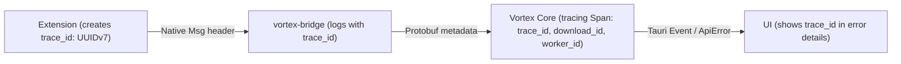

- كل عملية رئيسية (التقاط تحميل، أمر من الواجهة، تحديث رابط) تُنشئ **`trace_id`** (UUIDv7) وتمرّره عبر كل القنوات.
- إذا فشل تحميل، يظهر للمستخدم زر **"نسخ رمز التشخيص"** الذي ينسخ `error_code + trace_id`، وبحث واحد في ملفات الـ Log يعرض القصة الكاملة مرتبة زمنياً عبر جميع العمليات.

### 22.2 معمارية السجلات (Structured Logging Architecture)

| الطبقة / المكوّن | التنفيذ | المسار والصيغة |
|---|---|---|
| **Core & Bridge** | `tracing` + `tracing-subscriber` + `tracing-appender::non_blocking` | `%LOCALAPPDATA%\Vortex\logs\core.jsonl` و`bridge.jsonl` (صيغة **JSONL** منظمة في الإنتاج، وصيغة ملونة مقروءة في التطوير). |
| **Desktop UI (React)** | Logger خفيف يرسل أخطاء الواجهة و`ErrorBoundary` للـ Core عبر أمر Tauri `log_frontend_event` | تُكتب في `ui.jsonl` بنفس `trace_id`. |
| **Browser Extension** | Ring-buffer محلي في `chrome.storage.session` (آخر 500 حدث) يُصدَّر عند الطلب أو يُمرَّر عند الخطأ | يُدمج داخل حزمة التشخيص. |

**قواعد صارمة للـ Logging:**
1. **عدم حجب الـ Async Runtime:** الكتابة للقرص دائماً **غير حاجبة (Non-Blocking)** عبر قناة مخصصة (`tracing_appender::non_blocking`)؛ إذا امتلأت القناة عند طوفان أخطاء، نُسقط سجلات `DEBUG/TRACE` ونحتفظ بـ `ERROR/WARN` مع تسجيل عداد `dropped_log_events` — **الـ Logging لا يُبطئ التحميل أبداً**.
2. **التحكم في الضوضاء (Hot-Path Hygiene):** ممنوع كتابة Log لكل Packet أو لكل `write_at` على مستوى `INFO` أو `DEBUG`؛ المسار الساخن يستخدم Counters ومجاميع دورية (مثلاً كل 5 ثوانٍ).
3. **سياسة المستويات (Log Level Contract):**
   - `ERROR`: فشل يمنع إتمام عملية للمستخدم أو خطأ برمجي غير متوقع (يحمل دائماً `error_code` و`trace_id`).
   - `WARN`: خطأ قابل للاستعادة تلقائياً (مثلاً قطع اتصال وسيُعاد المحاولة، `429 Retry-After`، قفل ملف مؤقت، مساحة قرص منخفضة).
   - `INFO`: معالم دورة الحياة المهمة (بدء التطبيق، إضافة تحميل، اكتمال الاستكشاف، اكتمال التحميل، تغيّر إعدادات).
   - `DEBUG`: قرارات المحرك الداخلية (تقسيم جزء، تعديل عدد الاتصالات التكيّفي، تغيير حالة Circuit Breaker).
   - `TRACE`: تفاصيل بروتوكولية منخفضة المستوى (رؤوس HTTP المنظفة، إطارات IPC) — معطّلة افتراضياً.
4. **تغيير المستوى ديناميكياً بدون إعادة تشغيل (Runtime Dynamic Reload):** عبر `tracing_subscriber::reload::Handle` يمكن للمستخدم أو المطور تفعيل **"وضع التشخيص المفصّل (Debug Mode)"** من الإعدادات فوراً (ويُطفأ تلقائياً بعد 30 دقيقة لتجنب تضخم الملفات).
5. **المسجّل الصندوقي في الذاكرة (In-Memory Flight Recorder):** حتى عندما يكون مستوى الكتابة للقرص `INFO`، نحتفظ بـ **Ring Buffer في الذاكرة** (مثلاً آخر 2,000 سجل `DEBUG` — أقل من 2 MB). عند وقوع أي `ERROR` حرج أو `Panic`، يُفرَغ محتوى الصندوق الأسود تلقائياً في ملف السجل ليعطي السياق الكامل لما حدث قبل الخطأ بثوانٍ — **نفس أسلوب Chromium وGoogle وWindows ETW**.
6. **تدوير وحفظ السجلات (Rotation & Retention):** تدوير يومي + حد حجم صارم (**10 MB × 5 ملفات = 50 MB كحد أقصى لكل مكوّن**)، ضغط الملفات القديمة بـ `gzip`، وحذف تلقائي لما يزيد عن 14 يوماً.

### 22.3 حماية الأسرار في السجلات (Zero-Leakage Redaction)

- **حماية على مستوى الأنواع (Type-Level):** الكوكيز ورؤوس `Authorization` وكلمات المرور تُغلَّف بـ `secrecy::SecretString`، وتُصفَّر في الذاكرة (`zeroize`) عند الـ Drop.
- **مغلّف `RedactedUrl`:** يزيل تلقائياً `user:pass@` ومعاملات الاستعلام الحساسة (`token`, `sig`, `signature`, `key`, `auth`, `access_token`, `X-Amz-Signature`, `X-Amz-Credential`, `expires`...) عند الطباعة.
- **تنظيف المسارات عند التصدير:** استبدال `C:\Users\<اسم المستخدم>` بـ `<USERPROFILE>` تلقائياً في حزمة التشخيص.
- **اختبار آلي إلزامي (Zero-Leakage CI Test):** اختبار يشغّل تحميلات بكوكيز وتوكنز وهمية معروفة ثم يفحص كل سطر في ملفات الـ Log وحزمة التشخيص ليتأكد من **صفر تطابق**.

### 22.4 سجل التدقيق، المقاييس، الفحص الصحي، وحزمة التشخيص

- **سجل التدقيق المحلي (Audit Trail):** جدول `download_events` في SQLite يسجّل انتقالات الحالة وأكواد الأخطاء ونتائج التحقق من الهاش لكل تحميل (مع سياسة تنظيف تلقائي للاحتفاظ بآخر 90 يوماً).
- **مقاييس داخلية محلية (Local Metrics):** عدادات وتوزيعات (Histograms) محفوظة محلياً فقط (مجموع البيانات المحملة، توزيع السرعات، معدل الأخطاء حسب `error_code`، زمن استجابة IPC، زمن الكتابة للقرص، استهلاك RAM) — تُعرض للمستخدم في شاشة "الإحصاءات" و"التشخيص".
- **فحص صحة النظام الذاتي (Self-Health Check):** أمر IPC/واجهة يفحص بضغطة زر: حالة Core، سلامة SQLite (`PRAGMA quick_check`)، حالة Pipe، اتصال Bridge، نبض Extension (`ping/pong`)، والمساحة الحرة على القرص، ويعطي تشخيصاً فورياً مع زر إصلاح تلقائي (مثل إعادة تسجيل Native Host).
- **حزمة التشخيص بنقرة واحدة (Diagnostic Bundle `.zip`):** تجمع السجلات المنظفة (Core + Bridge + UI + Extension) + معلومات النظام (إصدار Windows، المعمارية، إصدار Vortex) + الإعدادات بدون أسرار + ملخص الأخطاء، مع **نافذة معاينة** تتيح للمستخدم رؤية كل ملف داخل الحزمة قبل حفظها أو إرسالها.
- **معالجة الأعطال (Crash Reporting — Opt-in):** التقاط Minidumps عبر عملية جانبية (`crash-handler` + `minidumper`)، حفظها محلياً، وعرض ملخصها للمستخدم عند التشغيل التالي مع خيار إرسالها لخادم Sentry/GlitchTip ذاتي الاستضافة (يُفك ترميزها عبر ملفات PDB المؤرشفة في CI).

---

## 23. هندسة معالجة الأخطاء والمرونة

> **المبدأ (Microsoft / Google Production Engineering):** الخطأ ليس حالة استثنائية نادرة — في برامج الشبكات والقرص، **الأخطاء هي الوضع الطبيعي**. المعالجة الاحترافية تعني: لا تعطل مفاجئ (No panics)، لا فشل صامت (No silent failures)، لا ضياع بيانات (No data loss)، ورسائل واضحة قابلة للتصرف للمستخدم.

### 23.1 تصنيف الأخطاء والأكواد الثابتة (Error Taxonomy & Stable Codes)

كل خطأ في النظام ينتمي لفئة واضحة ويحمل كوداً ثابتاً (`VTX-<CAT>-<NNN>`) لا يتغير بين الإصدارات، ومصنّفاً حسب **إمكانية الاستعادة (Recoverability)**:

| الفئة | البادئة | أمثلة | سلوك النظام |
|---|---|---|---|
| **الشبكة** | `VTX-NET-*` | انقطاع اتصال، Timeout، فشل DNS، خطأ TLS، `5xx`، `429` | **عابر (Transient):** إعادة محاولة بـ Backoff + Jitter + Circuit Breaker. |
| **البروتوكول/المورد** | `VTX-RES-*` | `404`، `410`، `403` رابط منتهي، تغيّر ETag، رد `200` بدل `206` | **يحتاج تدخل / نهائي:** انتقال لـ `NeedsAttention` (تحديث رابط) أو fallback لاتصال واحد. |
| **المصادقة** | `VTX-AUTH-*` | `401`، `407` بروكسي، كوكيز منتهية | **يحتاج تدخل (UserActionRequired):** طلب بيانات دخول أو تحديث من المتصفح. |
| **القرص والملفات** | `VTX-DISK-*` | امتلاء القرص (`ENOSPC`)، رفض صلاحيات (`EACCES`)، ملف مقفل من مضاد فيروسات، فصل قرص خارجي | **مخصص حسب السبب:** انظر 23.4 (لا تلف أبداً!). |
| **السلامة (Integrity)** | `VTX-INTG-*` | عدم تطابق SHA-256/BLAKE3، حجم ملف لا يطابق | **نهائي مع إبقاء الدليل:** وسم الملف كفاشل وعدم تسميته بالاسم النهائي، مع خيار إعادة التحميل. |
| **التخزين (DB/Config)** | `VTX-DB-*` | تلف SQLite، فشل ترحيل، قفل قاعدة بيانات | **تعافي ذاتي:** استعادة من نسخة احتياطية / `.vortex.meta` وإبلاغ المستخدم. |
| **الاتصال الداخلي** | `VTX-IPC-*` | فشل Native Messaging، انقطاع Named Pipe، عدم توافق إصدار | **إعادة ربط تلقائية** + Fallback آمن في الإضافة. |
| **التحقق والأمان** | `VTX-SEC-*` | Path Traversal، بروتوكول ممنوع (`file://`/UNC)، SSRF Redirect، Zip Slip | **رفض فوري وتسجيل `WARN`** مع رسالة واضحة. |
| **أخطاء داخلية** | `VTX-BUG-*` | حالة غير متوقعة، Panic معزول داخل Actor | **عزل كامل:** يفشل هذا التحميل فقط + تفريغ Flight Recorder + زر إبلاغ. |

### 23.2 تدفّق الأخطاء عبر الطبقات (Layer-by-Layer Error Mapping)

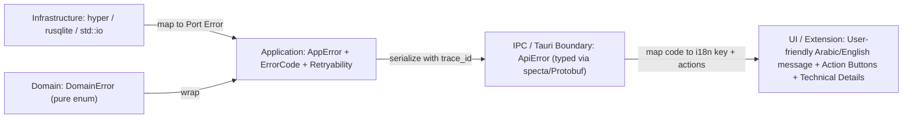

عقد الخطأ الموحّد العابر للحدود (`ApiError` — مُسلسل بصيغة `camelCase` قياسية ومولّد آلياً عبر `tauri-specta` مع `#[specta(type = f64)]` في `specta-typescript 0.0.15` وبوابة فحص انحراف في CI):

```rust
#[derive(Serialize, Deserialize, specta::Type)]
#[serde(rename_all = "camelCase")]
pub struct ApiError {
    pub code: ErrorCode,                 // e.g. "VTX-DISK-001"
    pub category: ErrorCategory,         // Network | Resource | Auth | Disk | Integrity | Database | Ipc | Security | Internal
    pub recoverability: String,          // "Transient" | "UserActionRequired" | "Permanent" | "SelfHealed" | "IsolatedBug"
    pub retry_after_ms: Option<u64>,     // populated when recoverability == "Transient"
    pub user_message_key: String,        // i18n key e.g. "errors.disk.full"
    pub message_params: BTreeMap<String, String>, // e.g. { "drive": "D:", "needed": "4.2 GB" }
    pub suggested_actions: Vec<SuggestedAction>,  // e.g. [ChangeFolder, Retry, RefreshLink, CopyDiag]
    pub technical_detail: String,        // sanitized (NO secrets), shown only in expandable "Details"
    pub trace_id: TraceId,               // correlates directly to logs across all processes
}
```

> [!IMPORTANT] **فصل تام بين رسالة المستخدم والتفاصيل التقنية:** المستخدم العادي يرى *"المساحة غير كافية على القرص D: (مطلوب 4.2 جيجا)"* مع زرين **[اختيار مجلد آخر]** و**[إعادة المحاولة]**. التفاصيل التقنية (`VTX-DISK-001`, `trace_id`, كود نظام التشغيل) مخفية خلف سهم **"تفاصيل تقنية"** مع زر **"نسخ"**.

### 23.3 سياسة الـ Panic وعزل الأعطال (Zero-Panic Policy)

1. **منع الـ Panic وقت الترجمة:** فرض قواعد Clippy في الـ Workspace لكل كود الإنتاج (ما عدا `#[cfg(test)]`):
   - `#![deny(clippy::unwrap_used)]`
   - `#![deny(clippy::expect_used)]`
   - `#![deny(clippy::panic)]`
   - `#![deny(clippy::indexing_slicing)]`
2. **عزل الـ Actors (Bulkhead Pattern):** كل `DownloadActor` يعمل في `tokio::spawn` مستقل يراقبه الـ `Supervisor`. لو حدث Panic غير متوقع داخل تحميل واحد، يلتقطه الـ `Supervisor` عبر `JoinError::is_panic()`، يفرّغ الـ Flight Recorder، يوسم ذلك التحميل فقط بـ `Failed (VTX-BUG-001)`، **وتستمر باقي التحميلات والبرنامج دون أي تأثر**.
3. **Global Panic Hook:** يسجل Backtrace كاملاً مع `trace_id` ويفرّغ السجلات ويكتب Minidump قبل إنهاء العملية في حال وقع Panic كارثي في خيط رئيسي.

### 23.4 معالجة حالات القرص والنظام الواقعية (OS/Disk Fault Matrix)

| الحالة الواقعية | المعالجة الهندسية |
|---|---|
| **امتلاء القرص (`ERROR_DISK_FULL` / `ENOSPC`)** | 1) فحص المساحة قبل البدء (Pre-allocation). 2) **مراقب حي لمساحة القرص** كل 3 ثوانٍ أثناء التحميل: إذا هبطت المساحة الحرة عن 256 MB يُوقِف التحميلات على هذا القرص تلقائياً قبل أن يصل النظام لـ 0 بايت! 3) إشعار واضح مع زر "نقل المجلد" أو "إعادة المحاولة". |
| **ملف مقفل من مضاد الفيروسات أو Explorer (`ERROR_SHARING_VIOLATION` / Win32 32)** | شائعة جداً على Windows عند إعادة تسمية `.vortex` إلى الاسم النهائي. نطبّق إعادة محاولة سريعة ومحدودة (مثلاً 5 محاولات خلال 3 ثوانٍ مع Jitter) قبل إبلاغ المستخدم. |
| **فصل قرص خارجي (USB/NAS) أثناء التحميل** | اكتشاف خطأ الجهاز، إيقاف التحميل مؤقتاً (`Paused / NeedsAttention`) مع الاحتفاظ بسجل الأجزاء، وعدم مسح أي بيانات. |
| **نقص الصلاحيات (`EACCES`) على مجلد الحفظ** | اكتشاف فوري قبل فتح اتصالات الشبكة، واقتراح مجلد `Downloads` الافتراضي. |
| **تلف سجل واحد في DB أو ملف `.vortex.meta` (Poison Pill)** | عزل العنصر التالف (Quarantine) وتسجيل `ERROR`، حتى لا يمنع سجل تالف واحد تشغيل التطبيق بأكمله. |

### 23.5 مرونة الواجهة والإضافة (Frontend & Extension Resilience)

- **React Error Boundaries:**
  - **Root Error Boundary:** يلتقط أي خطأ غير متوقع في شجرة React ويعرض شاشة تعافٍ أنيقة مع أزرار **[إعادة تحميل الواجهة]** و**[تصدير سجل الخطأ]** — مع استمرار عمل المحرك والتحميلات في الخلفية بلا انقطاع!
  - **Feature Error Boundaries:** لكل لوحة مستقلة (نافذة الإعدادات، تفاصيل التحميل، الإحصاءات) بحيث خطأ في لوحة واحدة لا يُسقط القائمة الرئيسية.
- **وضع التدهور اللطيف (Degraded Mode):** لو فقدت الواجهة الاتصال بالـ Core مؤقتاً، يظهر شريط علوي هادئ *"جارٍ إعادة الاتصال بمحرك Vortex..."* مع إعادة محاولة تلقائية.
- **التراجع المتفائل (Optimistic Rollback):** عند فشل أمر من الواجهة، تعود الحالة فوراً لقيمتها الحقيقية مع Toast واضح بالسبب.
- **شبكة الأمان في إضافة المتصفح (Zero Lost Downloads):**
  - إذا لم يرد `vortex-bridge` أو `Core` خلال مهلة `SafeSuggestGuard` الصارمة (**`2.0 ثانية`**) أثناء التقاط تحميل، **لا نضيع التحميل بصمت أبداً**: نستدعي `suggest()` فوراً (بدون استدعاء `downloads.pause()` أبداً) فيكمل المتصفح التحميل تلقائياً على **نفس مقبس الـ TCP الأصلي المفتوح**، مع تسجيل الحدث في Ring Buffer وإشعار هادئ عند الحاجة.
  - فحص `chrome.runtime.lastError` في كل استدعاء API، والتعامل النظيف مع استيقاظ Service Worker بعد الخمول.

---

## 24. دورة حياة التطبيق، الإعدادات، والتعافي الذاتي

### 24.1 ضمان النسخة الواحدة (Single-Instance Lock)

- عند تشغيل `vortex.exe`، يحاول أخذ **OS Named Mutex** (`Local\VortexDownloadManager_SingleInstance_<user-SID>` على Windows، و`flock` lockfile على Linux/macOS).
- إذا كانت هناك نسخة تعمل بالفعل: تُرسل النسخة الجديدة وسائط التشغيل (مثل رابط مُمرر من سطر الأوامر) عبر الـ Named Pipe إلى النسخة القائمة، ترفع النافذة الرئيسية للأمام، وتغلق فوراً بكود 0.

### 24.2 تسلسل التشغيل والتعافي الذاتي (Startup & Self-Healing Sequence)

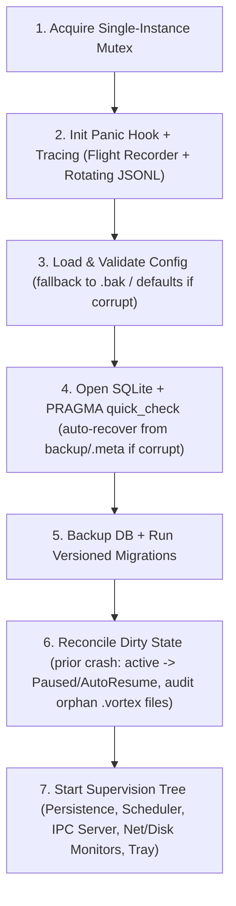

- **التعافي التلقائي لقاعدة البيانات:** إذا فشل `PRAGMA quick_check`، ننسخ الملف التالف كـ `vortex.db.corrupt.<timestamp>`، نستعيد آخر نسخة احتياطية سليمة، ونمسح مجلد التحميلات بحثاً عن ملفات `.vortex.meta` لإعادة استيراد أي تحميلات غير مكتملة.
- **النسخ الاحتياطي التلقائي:** نسخة احتياطية خفيفة لـ SQLite عبر Online Backup API يومياً وقبل كل Migration (الاحتفاظ بآخر 3 نسخ).

### 24.3 الإيقاف اللطيف (Graceful Shutdown Protocol)

يلتقط Vortex إشارات الإيقاف من المستخدم (قائمة Tray → خروج) ومن نظام التشغيل (**`WM_QUERYENDSESSION` / `WM_ENDSESSION`** عند إغلاق Windows أو إعادة تشغيله، و`SIGTERM`/`SIGINT` على Linux/macOS):

1. إرسال إشارة إلغاء عبر `CancellationToken` الجذري (بميزانية زمنية صارمة **≤ 5 ثوانٍ** لتجنب إجبار Windows على قتل العملية).
2. كل `DownloadActor` نشط يوقف استقبال بيانات جديدة، يفرّغ مخازن الكتابة في `FileWriterActor`، ينفّذ `FlushFileBuffers`، ويحفظ آخر `SegmentMap` في SQLite.
3. تحرير قفل منع السكون (`SetThreadExecutionState`).
4. إغلاق خادم الـ Named Pipe بلطف.
5. تنفيذ `PRAGMA wal_checkpoint(TRUNCATE)` لدمج ملف WAL داخل قاعدة البيانات بنظافة.
6. تفريغ مخزن السجلات (`WorkerGuard` drop) والخروج بكود `0`.

### 24.4 إدارة الإعدادات وأعلام الميزات (Configuration & Feature Flags)

| الجانب | التصميم |
|---|---|
| **المخطط والتحقق (Typed Schema)** | ملف `config.toml` مُدار بنوع Rust صارم يحمل `schema_version`، مع تحقق من الحدود عند القراءة والتعديل (مثلاً `max_connections ∈ [1, 32]`، `min_split_bytes ≥ 256 KiB`). |
| **الكتابة الذرية (Atomic Save)** | كل تعديل يُكتب إلى `config.toml.tmp` ← `fsync` ← نسخ القديم إلى `config.toml.bak` ← `rename` ذري. يستحيل تلف ملف الإعدادات بانقطاع الكهرباء. |
| **التحديث الحي (Hot-Reload)** | توزيع الإعدادات داخل الـ Core عبر `tokio::sync::watch::Sender<Arc<AppConfig>>` — تغيير حد السرعة أو عدد الاتصالات أو قواعد الالتقاط أو مستوى السجلات يَسري فوراً بدون إعادة تشغيل، ويُدفع للإضافة برسالة `settings.changed`. |
| **الاستيراد والتصدير** | تصدير/استيراد الإعدادات كملف JSON منظف (بدون كلمات مرور أو كوكيز) + زر "إعادة للوضع الافتراضي". |
| **أعلام الميزات (Feature Flags)** | نظام Flags محلي (مرتبط بـ Trunk-Based Development) لتفعيل/تعطيل الميزات التجريبية (مثل HTTP/3، LEDBAT، WASM Plugins) بأمان وإمكانية إطفائها كـ Kill Switch عند ظهور خلل. |

---

## 25. نظام الإضافات (Plugin System)

**الهدف:** السماح للمجتمع بإضافة دعم مواقع جديدة أو معالجات ما بعد التحميل **دون تعريض أمان المستخدم للخطر**.

| الجانب | التصميم |
|---|---|
| **التقنية** | **WebAssembly Component Model** عبر **wasmtime** — الـ Plugin يعمل داخل Sandbox معزول تماماً. |
| **الواجهة (WIT)** | `resolve(url) -> list<media-option>`، `post-process(file) -> result`... |
| **نموذج الصلاحيات (Capability-based)** | الـ Plugin يعلن ما يحتاجه (مثلاً: "الوصول لـ `*.example.com` فقط")، والمستخدم يوافق. لا وصول للقرص أو الشبكة إلا عبر واجهات Vortex المراقبة. |
| **اللغات** | Rust، Go (TinyGo)، JavaScript، Python — أي لغة تُترجم إلى WASM. |
| **أمثلة** | معالج لموقع معين، فك ضغط تلقائي، تحويل صيغ، إرسال إشعار لـ Telegram عند الانتهاء. |
| **الاستثناء: `yt-dlp` و`FFmpeg-min`** | يُداران كعمليات جانبية عند الطلب (**Managed On-Demand Sidecars**) بتوثيق مزدوج (`Ed25519` + `SHA-256`) وتحديث مستقل وفق [ADR-020](./adr/0020-youtube-hybrid-media-engine.md). |

---

## 26. قائمة الميزات الكاملة

### 26.1 ميزات IDM التي سنطابقها

| الميزة | الحالة |
|---|---|
| تحميل متعدد الاتصالات مع تقسيم ديناميكي | ✅ MVP |
| استكمال التحميلات المنقطعة | ✅ MVP |
| التقاط تلقائي من كل المتصفحات | ✅ MVP |
| زر "تحميل هذا الفيديو" + **تحميل فيديوهات وقوائم تشغيل YouTube (4K/1080p60/MP3/ترجمة)** | ✅ **v1.0 (أساسي)** |
| التصنيفات التلقائية والمجلدات | ✅ MVP |
| الطوابير والجدولة وإيقاف التشغيل بعد الانتهاء | ✅ v1.0 |
| محدد السرعة | ✅ v1.0 |
| تحديث رابط التحميل المنتهي | ✅ v1.0 |
| مراقبة الحافظة | ✅ v1.0 |
| البروكسي والمصادقة | ✅ v1.0 |
| التحميل المجمّع | ✅ v1.0 |
| Site Grabber (تحميل موقع كامل/أنماط) | 🔜 v2.0 |

### 26.2 ميزات تجعل Vortex أفضل من IDM

| الميزة | لماذا مهمة |
|---|---|
| **مجاني ومفتوح المصدر** | للجميع، شفاف، بلا "نسخ مكسورة" مليئة بالفيروسات. |
| **لا مرحلة تجميع ولا تجميد Zero-Fill** | كتابة متناثرة فورية `FSCTL_SET_SPARSE` توفر دقائق وضعف المساحة للملفات الضخمة. |
| **تفوق كاسح في تحميل YouTube والفيديو** | زر عائم أنيق + جودات حقيقية حتى `4K/8K 60fps` + ترجمات وفصول وصوت MP3 + تسريع متوازٍ يتجاوز خنق السرعة. |
| **تحكم تكيّفي مضاد للـ Bufferbloat (BBR/Gradient2)** | أقصى سرعة خط دون رفع الـ Ping أثناء التصفح أو الألعاب. |
| **End-Game Mode** | لا مزيد من "التعليق عند 99%". |
| **HTTP/2 و HTTP/3** | أداء أفضل مع الخوادم الحديثة والشبكات المتقطعة. |
| **التحقق من الـ Hash تلقائياً** | ضمان أن الملف سليم وغير معدّل. |
| **Metalink + Mirrors** | التحميل من عدة خوادم معاً. |
| **BitTorrent مدمج** | برنامج واحد لكل شيء. |
| **فحص مضاد الفيروسات + Mark-of-the-Web** | أمان على مستوى المتصفحات. |
| **معالجة أخطاء وتشخيص بمستوى المؤسسات** | أكواد واضحة، تعافٍ ذاتي، Flight Recorder، وحزمة تشخيص بنقرة. |
| **واجهة حديثة + داكن + عربي RTL كامل** | تجربة 2026 حقيقية. |
| **متعدد المنصات** | Windows ثم macOS وLinux. |
| **CLI + API محلي** | للمحترفين والأتمتة. |
| **نظام Plugins آمن** | مجتمع يوسّع البرنامج. |
| **وضع Portable** | على USB بدون تثبيت. |
| **صفر Telemetry** | خصوصية كاملة. |
| **وضع التحميل المهذب (LEDBAT-like)** | التحميل لا يؤثر على الألعاب والمكالمات. |
| **فك الضغط التلقائي (اختياري)** | ZIP/7z/RAR بعد التحميل مباشرة (مع حماية Zip-Slip). |

---

## 27. خارطة الطريق (Roadmap)

> المدد تقديرية لفريق صغير (2-4 مطورين) وتُراجع بعد كل مرحلة. التفاصيل الكاملة بالمهام ومعايير القبول في [Tasks.md](./Tasks.md).

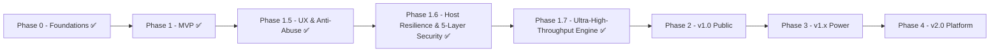

| المرحلة | المخرجات الرئيسية | معيار الإنجاز (Definition of Done) |
|---|---|---|
| **Phase 0: الأساسات ✅** | Monorepo، `vortex-error` و`vortex-observability` (Logs + Flight Recorder + Redaction + Error Taxonomy)، CI/CD، ADRs، Design System، Vortex Test Lab، اختبارات المعمارية (DAG + Zero-Panic) | CI أخضر؛ اختبارات عدم تسرب الأسرار وTest Lab تعمل؛ الـ 20 ADR والـ Design Tokens معتمدة. |
| **Phase 1: MVP ✅** | محرك HTTP/HTTPS متعدد الاتصالات بالعقود المحدودة التكيّفية (Keep-Alive كامل)، الكتابة المتناثرة `FSCTL_SET_SPARSE` + الاستكمال الآمن (20s Checkpoint) + التعافي الذاتي والإيقاف اللطيف، SQLite + Config الذري، إضافة Brave/Chrome/Edge (`onDeterminingFilename` + CHIPS + Probe-Before-Commit Auto-Fallback) + Bridge (`< 1 MB`)، مُثبّت Windows (`< 15 MB`) | تحميل ملف 10GB بأقصى سرعة وبدون Zero-Fill ولا تجميع، قتل العملية 100 مرة والاستكمال ينتج Hash صحيحاً؛ التقاط من Brave (حتى مع Cloudflare) يعمل بصفر تحميلات ضائعة. |
| **Phase 1.5: التأكيد الذكي والهوية الإبداعية ✅** | تأكيد الالتقاط الذكي (`autoStart: false`)، فاحص أول `512` بايت بدون فقد، حارس عواصف الإعلانات وقفل `350ms`، نافذة الـ Tray المدمجة (`580×520`)، شعار Vortex الشعاعي وحزمة الأيقونات، مساحة العمل `Edge-to-Edge Mica` | صفر تحميلات صامتة غير مرغوبة، حجب صفحات الـ HTML والملفات التنفيذية المتنكرة، وصفر مخالفات `axe-core` مع E2E كامل على Brave. |
| **Phase 1.6: مرونة الخوادم والأمن المتعمق ✅** | التدرج البطيء الموزون، الخفض غير القاتل للتوازي على الخوادم المقيدة (`Pixeldrain` `403` Step-Down + `HostCapabilityCache`)، بوابة عقود `tauri-specta` في CI (`generated.ts`)، الطبقات الأمنية الخمس (`TH-26..TH-33`)، ومنع أخطاء الاستخدام (`UX-M01..M12`) | `111/111` اختبار Rust، `22/22` اختبار TS، `5/5` Brave E2E (شاملاً `Pixeldrain 8 MiB` `100% SHA-256`)، تغطية `≥ 90%` (`error/domain/engine`)، وأحجام `Bridge 882.50 KiB` / `UI 155.16 kB` / `NSIS 5.82 MiB` / `MSI 8.32 MiB`. |
| **Phase 1.7: محرك السرعة القصوى ونزع اختناقات I/O والشبكة ✅** | `Per-Worker 2 MiB Coalescing` + `Concurrent Overlapped IOCP` + `32 MiB Byte-Weighted Backpressure`، فصل حد ترويسات `TH-27` ورفع Read Buf لـ `512 KiB`، `HTTP/2` عالي الـ BDP (`16/64 MiB` + `Multi-Connection H2`)، `Multi-IP Striping`، إزالة `NetConnectionLost` من Step-Down + `SmartHostProfileCache`، `BBR/Gradient2 Auto-Scaler (1..32)`، `Lock-Free Hot Path`، و`End-Game Hedging` | `≤ 64` استدعاء `WriteFile` لـ `64 MiB` (`≥ 1.5 MiB/write`)، كفاءة `≥ 95%` على `test-lab`، تغطية `error 100%` / `domain 92.69%` / `engine 90.40%` / 6-core `77.63%`، `5/5` Brave E2E (`Pixeldrain 8 MiB` في `2.30s`)، وأحجام `Bridge 882.50 KiB` / `UI 155.67 kB` / `NSIS 6.03 MiB` / `MSI 8.62 MiB`. |
| **Phase 2: v1.0** | **محرك YouTube والفيديو المتكامل (زر الفيديو العائم + 4K/1080p60/MP3 + الترجمات وقوائم التشغيل + `yt-dlp` و`FFmpeg` المُدارين تلقائياً)**، HLS/DASH، FTP، الطوابير والجدولة، محدد السرعة الهرمي، `BLAKE3`/SHA-NI، Link Refresh (بفحص 64KiB)، Firefox، مراقبة الحافظة الآمنة، التحديث التلقائي، الإعدادات الكاملة، Onboarding، توقيع الكود، Fuzzing + Crash Minidumps | Beta مع 100+ مستخدم، تحميل YouTube 4K يعمل بسلاسة وسرعة فائقة، Crash-free ≥ 99.9%، تقييم سهولة استخدام (SUS) ≥ 80. |
| **Phase 3: v1.x** | HTTP/3، SFTP، Metalink، CLI والـ API المحلي، نظام Plugins (WASM)، فك الضغط التلقائي الآمن، الإحصاءات، Portable، نافذة إضافة أصلية فورية (اختيارية) | — |
| **Phase 4: v2.0** | BitTorrent، macOS وLinux، Site Grabber، وضع LEDBAT، io_uring/IoRing، مزامنة إعدادات اختيارية مشفرة بين الأجهزة | — |

---

## 28. المخاطر وخطط التخفيف

| الخطر | الاحتمال | التأثير | التخفيف |
|---|---|---|---|
| **إنذارات مضاد فيروسات كاذبة** (شائعة جداً لمديري التحميل) | عالٍ | عالٍ | توقيع الكود، إرسال الملفات مسبقاً لـ Microsoft Defender وVirusTotal، بناء شفاف مفتوح المصدر، عدم استخدام تقنيات تشبه البرمجيات الخبيثة (حقن DLL في المتصفح كما يفعل IDM — **نحن نستخدم الإضافة الرسمية فقط**). |
| **تغييرات Manifest V3 والمتصفحات** | متوسط | عالٍ | الاعتماد فقط على APIs مستقرة وموثقة، طبقة تجريد (WXT)، متابعة مستمرة لقنوات Chromium، وFallback آمن يضمن عدم فقد التحميل. |
| **حظر الخوادم بسبب كثرة الاتصالات** | متوسط | متوسط | حد أقصى لكل خادم، AIMD، احترام `429`/`Retry-After`، ذاكرة تفضيلات لكل نطاق. |
| **تغيّر مواقع الفيديو باستمرار** | عالٍ | متوسط | فصل منطق المواقع في Plugins/yt-dlp قابلة للتحديث المستقل عن البرنامج. |
| **تلف قاعدة البيانات أو الإعدادات عند انقطاع الكهرباء** | منخفض | عالٍ | WAL + Checkpoint بعد Flush، كتابة ذرية للإعدادات + `.bak`، `PRAGMA quick_check` والتعافي التلقائي من `.vortex.meta`. |
| **تسرب بيانات حساسة في الـ Logs أو تقارير الأخطاء** | متوسط | عالٍ | `secrecy`/`zeroize`، `RedactedUrl`، اختبار آلي في CI يمنع الدمج عند أي تسرب، ومعاينة للمستخدم قبل التصدير. |
| **مخاطر قانونية (حقوق النشر)** | منخفض | عالٍ | لا كسر DRM إطلاقاً، شروط استخدام واضحة، أداة محايدة كالمتصفح. |
| **منحنى تعلم Rust للفريق** | متوسط | متوسط | توثيق، Pair programming، أمثلة وقوالب داخلية، البدء بالـ Domain البسيط. |
| **تعقيد WebView2 على أنظمة قديمة** | منخفض | متوسط | المُثبّت يتحقق ويثبّت WebView2 Evergreen تلقائياً. |
| **Scope Creep (تضخم الميزات)** | عالٍ | عالٍ | Roadmap صارمة، كل ميزة مرتبطة بمرحلة، Feature Flags، "لا" افتراضية لأي ميزة خارج المرحلة. |

---

## 29. سجل القرارات المعمارية (ADRs)

> الملفات الرسمية الكاملة لكل قرار موجودة في [docs/adr/README.md](./adr/README.md).

| # | القرار | الحالة |
|---|---|---|
| ADR-001 | استخدام **Rust (Edition 2024)** للمحرك وكل المكونات الأصلية | ✅ Accepted |
| ADR-002 | استخدام **Tauri 2 + React 19 + TypeScript** للواجهة بدلاً من Electron/WinUI | ✅ Accepted |
| ADR-003 | معمارية **Hexagonal + Layered + DDD** مع فرض قاعدة الاعتمادية آلياً | ✅ Accepted |
| ADR-004 | نموذج **Actor** مع قنوات محدودة وبدون حالة مشتركة | ✅ Accepted |
| ADR-005 | فصل **Core / UI / Bridge** في عمليات مستقلة وتدمير WebView عند الإغلاق | ✅ Accepted |
| ADR-006 | **Native Messaging + Named Pipes** وعدم فتح أي منفذ TCP محلي | ✅ Accepted |
| ADR-007 | **الكتابة الموضعية المتناثرة (`FSCTL_SET_SPARSE`)** مع `VolumeSpaceManager` وبديل exFAT بدلاً من التجميع أو Zero-Fill | ✅ Accepted |
| ADR-008 | **SQLite WAL** + متانة ثنائية المستوى (OS Page Cache + Durable Checkpoint كل **20s** وعند Pause/Shutdown/Complete) | ✅ Accepted |
| ADR-009 | **التقسيم الهجين بالعقود التكيّفية (Keep-Alive) + Work Stealing + End-Game + BBR/Gradient2 Concurrency** | ✅ Accepted |
| ADR-010 | **Protobuf v3** لبروتوكول IPC الداخلي مع قواعد تطور صارمة | ✅ Accepted |
| ADR-011 | **عدم دعم كسر DRM** نهائياً | ✅ Accepted |
| ADR-012 | **WASM (wasmtime)** لنظام الإضافات | ✅ Accepted |
| ADR-013 | ترخيص **`GPL-3.0-or-later`** (مع توزيع macOS مباشر عبر Notarized DMG و`MPL-2.0` لغلاف الإضافة عند الحاجة) | ✅ Accepted |
| ADR-014 | **صفر Telemetry** افتراضياً | ✅ Accepted |
| ADR-015 | **تصنيف الأخطاء الموحّد (`VTX-*`) وسياسة Zero-Panic** (`deny(unwrap_used/expect_used/panic)`) + React Error Boundaries | ✅ Accepted |
| ADR-016 | **التتبع الموزّع (`trace_id`) + السجلات المنظمة JSONL + Flight Recorder + حجب الأسرار الآلي (`secrecy`/`zeroize`)** | ✅ Accepted |
| ADR-017 | **دورة الحياة والتعافي الذاتي** (Single-Instance Mutex، الإيقاف اللطيف مع `WM_QUERYENDSESSION`، وتعافي SQLite/Config الذري) | ✅ Accepted |
| ADR-018 | **تجريد الزمن (`Clock` Trait) وحقن الأعطال (Failpoints)** لضمان حتمية الاختبارات | ✅ Accepted |
| ADR-019 | **الحماية من SSRF/UNC NTLM Leak وخصوصية مراقبة الحافظة** (`ExcludeClipboardContentFromMonitorProcessing`) | ✅ Accepted |
| ADR-020 | **محرك YouTube والوسائط الهجين (v1.0):** `yt-dlp` المُدار للاستخراج + محرك Rust Range-Chunks للتسريع المتوازي + `FFmpeg -c copy` | ✅ Accepted |
| ADR-021 | **محرك السرعة القصوى (`Phase 1.7`):** `Per-Worker 2–4 MiB Coalescing` + `Concurrent Overlapped IOCP` + `High-BDP HTTP/2` + `BBR/Gradient2 Auto-Scaling` + `Multi-IP Striping` + `Lock-Free Hot Path` | ✅ Accepted |

**قالب الـ ADR:**

```markdown
# ADR-XXX: <Title>
- Status: Proposed | Accepted | Superseded by ADR-YYY
- Date: YYYY-MM-DD
## Context            — what problem and forces are at play?
## Decision Drivers   — key engineering drivers (performance, security, simplicity...)
## Considered Options — at least 2 alternatives with pros/cons
## Decision           — what we chose
## Consequences       — positive, trade-offs, and CI verification/enforcement
```

---

## 30. الملاحق

### 30.1 ملحق أ: أنواع رسائل بروتوكول الإضافة والـ IPC (v1)

> المخطط الكامل المرجعي موجود في [Protocol-Spec.md](./Protocol-Spec.md).

| الاتجاه | النوع | الوصف |
|---|---|---|
| Ext/CLI → Core | `hello` | المصافحة: إصدار العميل، نوعه، نطاق الإصدارات، القدرات، `trace_id`. |
| Core → Ext/CLI | `hello.ack` | النسخة المتفاوض عليها، القدرات المدعومة، وأحدث قواعد الالتقاط (`CaptureRules`). |
| Ext → Core | `download.handoff` | تسليم تحميل (انظر §13.4) مع الكوكيز والـ CHIPS و`trace_id`. |
| Core → Ext | `download.handoffAck` | قرار القبول بعد الـ Probe (`accepted` أو `fallback_to_browser` + `fallback_reason`). |
| Ext → Core | `download.batch` | تسليم عدة روابط دفعة واحدة (Grab all links). |
| Ext → Core | `media.detected` | اكتشاف وسائط/Manifest أو صفحة فيديو في تبويب. |
| Ext → Core | `media.download` | المستخدم اختار تحميل فيديو/قائمة تشغيل بجودة وترجمات محددة. |
| Core → Ext | `linkRefresh.begin` | ادخل وضع التقاط لتحديث رابط تحميل منتهي الصلاحية. |
| Ext → Core | `linkRefresh.candidate` | طلب جديد مرشح لتحديث الرابط (يخضع لفحص تطابق أول `64 KiB`). |
| Core → Ext | `settings.changed` | دفع تحديث قواعد الالتقاط حياً للإضافة. |
| Core → Ext | `diagnostics.dumpReq` | طلب سجلات الـ Ring Buffer من الإضافة لضمها لحزمة التشخيص. |
| Ext → Core | `diagnostics.dumpResp` | إرسال سجلات الإضافة المنظفة من الأسرار. |
| Client → Core | `health.checkReq` / `Resp` | فحص صحة Core وSQLite والـ Named Pipe والمساحة الحرة. |
| Instance → Core | `bringToFront` | رفع النافذة وتمرير رابط عند تشغيل نسخة ثانية (Single-Instance). |
| كلاهما | `ping` / `pong` | فحص الاتصال الحي كل 30 ثانية. |
| كلاهما | `error` | خطأ منظم (`ApiError`): `{ code, category, recoverability, retryAfterMs, userMessageKey, messageParams, suggestedActions, technicalDetail, traceId }`. |

### 30.2 ملحق ب: الإعدادات الافتراضية المقترحة

| الإعداد | القيمة الافتراضية |
|---|---|
| عدد الاتصالات لكل تحميل | تكيّفي مضاد للـ Bufferbloat (`BBR/Gradient2`: يبدأ بـ `8` للمضيفين السريعين ويتوسع ديناميكياً حتى `32` عند الحاجة، أو يُقفل تلقائياً على `1..2` للخوادم المقيدة مثل `Pixeldrain`) |
| التحميلات المتزامنة في الطابور الرئيسي | 3 |
| حجم نافذة الطلب في HTTP/1.1 (Chunk Lease) | تكيّفي فوري `2–64 MiB` (يستهدف `~3 ثوانٍ` لكل طلب مع Keep-Alive كامل) |
| دورة التثبيت الفيزيائي للقرص (Durable Checkpoint) | كل **20 ثانية** + عند `Pause` و`Shutdown` والاكتمال |
| Timeout للاتصال الخامل | 30 ثانية |
| عدد إعادة المحاولات | 10 (مع Decorrelated Full-Jitter Backoff حتى 5 دقائق) |
| حد الإيقاف التلقائي لانخفاض المساحة | 256 MB حرة على القرص (+ حجز منطقي للـ Sparse Files) |
| أصغر ملف يلتقطه المتصفح | 1 MB (قابل للتعديل) |
| سلوك الإضافة عند قفل Cloudflare JA4 أو تعذر Core | إكمال تلقائي في المتصفح عبر `suggest()` على نفس الاتصال المفتوح (بدون `pause()`) بصفر تحميلات ضائعة |
| مجلد التحميل | `%USERPROFILE%\Downloads\<التصنيف>` |
| الامتدادات الملتقطة | `zip rar 7z iso exe msi apk dmg mp4 mkv avi mov mp3 flac pdf ...` |
| مراقبة الحافظة | مفعّلة (مع إشعار غير مزعج واحترام مديري كلمات المرور) |
| مستوى السجلات (Log Level) | `INFO` على القرص + `DEBUG` في Flight Recorder بالذاكرة |
| الثيم | حسب النظام |
| التحقق من التحديثات | يومياً |
| Telemetry | **معطّل** |

### 30.3 ملحق ج: سجل أكواد الأخطاء المبدئي (Error Code Registry)

| الكود | القابلية للاستعادة (`Recoverability`) | المعنى | الإجراء المقترح للمستخدم |
|---|---|---|---|
| `VTX-NET-001` | `Transient` | فشل حل DNS | إعادة محاولة تلقائية / فحص الإنترنت |
| `VTX-NET-002` | `Transient` | انقطاع الاتصال / Timeout | إعادة محاولة تلقائية بـ Backoff |
| `VTX-NET-003` | `Permanent` | خطأ شهادة TLS (غير موثوقة أو منتهية) | تحذير أمني واضح (لا تجاوز صامت) |
| `VTX-NET-004` | `Transient` | الخادم يطلب التهدئة (`429 Too Many Requests`) | احترام `Retry-After` وخفض الاتصالات |
| `VTX-NET-005` | `Transient` / `Permanent` | استجابة بروتوكولية مشوهة (`MalformedResponse`: ترويسة `Content-Length` أو `Content-Range` غير صالحة) | رفض الاستجابة المشوهة أو التحول لتدفق غير محدد الحجم |
| `VTX-RES-001` | `Permanent` | المورد غير موجود (`404 Not Found`) | فحص الرابط |
| `VTX-RES-002` | `UserActionRequired` | انتهت صلاحية الرابط (`403` / `410`) | زر **[تحديث الرابط]** (أو Fallback تلقائي في أول Probe) |
| `VTX-RES-003` | `UserActionRequired` | تغيّر الملف على الخادم أثناء الاستكمال (Validator mismatch) | زر **[إعادة التحميل من البداية]** |
| `VTX-RES-004` | `SelfHealed` | الخادم لا يدعم Range (رد `200` بدل `206`) | انتقال تلقائي لاتصال واحد مع تنبيه |
| `VTX-RES-005` | `SelfHealed` | الخادم يقيّد عدد الاتصالات المتزامنة (`403`/`429` على عمال إضافيين) | خفض التوازي تلقائياً واسترداد العقد وإكمال التحميل بلا انقطاع |
| `VTX-RES-006` | `UserActionRequired` | الموقع يطلب تحقق `CAPTCHA` أو استُنفدت حصة التحميل المجانية | زر **[فتح صفحة المصدر في المتصفح]** (بلا تجاوز آلي للـ CAPTCHA) |
| `VTX-AUTH-001` | `UserActionRequired` | مطلوب تسجيل دخول (`401`) أو مصادقة بروكسي (`407`) | نافذة إدخال بيانات الاعتماد |
| `VTX-AUTH-002` | `UserActionRequired` | انحراف ساعة نظام Windows أبطل صلاحية الرابط الموقّع (`Clock Skew`) | تنبيه المستخدم لضبط ساعة الجهاز ثم **[إعادة المحاولة]** |
| `VTX-DISK-001` | `UserActionRequired` | المساحة غير كافية على القرص (`ENOSPC` / حد 256MB) | تفريغ مساحة أو **[اختيار مجلد آخر]** |
| `VTX-DISK-002` | `UserActionRequired` | لا توجد صلاحية كتابة في المجلد (`EACCES`) | **[اختيار مجلد آخر]** |
| `VTX-DISK-003` | `Transient` | الملف مقفل من برنامج آخر أو مضاد فيروسات (`ERROR_SHARING_VIOLATION`) | 5 محاولات سريعة بـ Jitter ثم إبلاغ المستخدم |
| `VTX-DISK-004` | `UserActionRequired` | القرص الخارجي غير متصل | إعادة توصيل القرص ثم استئناف |
| `VTX-DISK-005` | `UserActionRequired` | حجم الملف (`> 4 GiB`) يتجاوز سقف نظام ملفات `FAT32` | فحص مسبق قبل البدء + **[اختيار قرص NTFS / exFAT]** |
| `VTX-DISK-006` | `SelfHealed` / `UserActionRequired` | الملف المؤقت `.vortex` حُذف خارجياً قبل الاستئناف | منع فجوات الأصفار وإعادة التحميل بأمان من البداية |
| `VTX-INTG-001` | `Permanent` | عدم تطابق بصمة الملف (Hash Mismatch) | **[إعادة التحميل]** أو فحص المصدر |
| `VTX-DB-001` | `SelfHealed` | تلف قاعدة البيانات أو فشل الترحيل (أو قاعدة أحدث من البرنامج) | استعادة تلقائية من النسخة الاحتياطية / `.vortex.meta` (أو طلب تحديث البرنامج) |
| `VTX-IPC-001` | `Transient` | تعذر الاتصال بـ Vortex Core من الإضافة | تشغيل تلقائي أو Fallback للمتصفح عبر `suggest()` |
| `VTX-IPC-002` | `UserActionRequired` | عدم توافق إصدار الإضافة مع البرنامج | **[تحديث Vortex]** |
| `VTX-IPC-003` | `Permanent` | إطار IPC بطول غير صالح (`0` أو يتجاوز حد `4 MiB` / `1 MiB`) | إغلاق الاتصال وتسجيل `WARN` (حماية DoS) |
| `VTX-IPC-004` | `Transient` | تجاوز معدل رسائل IPC المسموح (`> 100` رسالة/ثانية لكل عميل) | تأخير/رفض مؤقت لحماية استقرار الـ Core |
| `VTX-SEC-001` | `Permanent` | محاولة Path Traversal أو `Symlink/Junction TOCTOU` أو `SSRF / DNS Rebinding` أو `RTLO` | حجب فوري وتسجيل `WARN` |
| `VTX-SEC-002` | `Permanent` | اكتشاف حماية DRM غير مدعومة | توضيح السبب للمستخدم |
| `VTX-SEC-003` | `Permanent` | حجر أو حذف الملف بواسطة مضاد الفيروسات (`Windows Defender`) | توضيح السبب الدقيق بدلاً من التباس صلاحيات المجلد |
| `VTX-BUG-001` | `IsolatedBug` | خطأ داخلي غير متوقع (Panic معزول داخل Actor عن باقي التحميلات) | **[تصدير حزمة التشخيص]** |

### 30.4 ملحق د: مصفوفة توافق الإصدارات (Version Compatibility Matrix)

| الحد الفاصل | سياسة التوافق |
|---|---|
| **Extension ↔ Bridge ↔ Core** | دعم متبادل للإصدار الحالي والإصدارين السابقين (**N, N-1, N-2**) عبر `v` + Capability Negotiation — تحديث الإضافة من المتجر لا يكسر برنامجاً أقدم والعكس. |
| **Core ↔ SQLite Schema** | ترقية تلقائية للأمام فقط مع نسخة احتياطية إلزامية قبل الترحيل. عند تشغيل إصدار أقدم على قاعدة أحدث: رفض نظيف برسالة واضحة (`VTX-DB-001`) بدلاً من إتلاف البيانات. |
| **Core ↔ Config (`config.toml`)** | حقول جديدة لها قيم افتراضية؛ الحقول المجهولة تُتجاهل مع `WARN` ولا تمنع الإقلاع. |

### 30.5 ملحق هـ: مسرد المصطلحات

| المصطلح | الشرح |
|---|---|
| **Range Request** | طلب HTTP لجزء محدد من الملف (`Range: bytes=100-200`) — أساس التقسيم والاستكمال. |
| **ETag** | بصمة يرسلها الخادم لإصدار الملف — تتغير إذا تغير الملف. |
| **Backpressure** | آلية تجعل المنتج السريع يبطئ عندما يكون المستهلك بطيئاً، لمنع امتلاء الذاكرة. |
| **Actor** | وحدة مستقلة تملك حالتها وتتواصل فقط بالرسائل. |
| **Bulkhead Pattern** | عزل الأعطال بحيث سقوط وحدة واحدة لا يُغرق النظام كله. |
| **Flight Recorder** | مخزن دائري في الذاكرة يسجل أحداث التشخيص التفصيلية ويفرغها للقرص فقط عند وقوع خطأ. |
| **Trace ID** | معرّف فريد يرافق الطلب عبر كل العمليات لربط السجلات معاً. |
| **Failpoint** | نقطة حقن أعطال مخصصة للاختبارات لمحاكاة انقطاع كهرباء أو خطأ قرص في لحظة محددة بدقة. |
| **EWMA** | متوسط متحرك أُسّي — يعطي وزناً أكبر للقيم الحديثة. |
| **AIMD** | زيادة جمعية / نقصان ضربي — الخوارزمية التي يستخدمها TCP للتحكم بالازدحام. |
| **Token Bucket** | خوارزمية تحديد معدل: "دلو" يمتلئ بالرموز بمعدل ثابت وكل بايت يستهلك رمزاً. |
| **WAL** | Write-Ahead Logging — تقنية SQLite لكتابات آمنة وسريعة وقراءات متزامنة. |
| **Native Messaging** | الآلية الرسمية للمتصفحات للتواصل بين إضافة وبرنامج مثبت على الجهاز. |
| **MV3** | Manifest V3 — الجيل الحالي من نظام إضافات المتصفحات. |
| **QUIC / HTTP/3** | بروتوكول نقل حديث من Google فوق UDP، أسرع في إنشاء الاتصال وأفضل مع فقد الحزم. |
| **HLS / DASH** | بروتوكولات بث الفيديو المجزّأ (الفيديو مقسم لمقاطع صغيرة مع ملف فهرس). |
| **Muxing** | دمج مسارات الفيديو والصوت في ملف واحد بدون إعادة ترميز. |
| **Mark-of-the-Web** | علامة يضعها Windows على الملفات المحملة من الإنترنت لتفعيل فحوصات الأمان. |
| **SBOM** | قائمة مكونات البرنامج — شفافية سلسلة التوريد. |
| **Hedged Request** | إرسال طلب مكرر لنفس العمل واعتماد أسرع رد — لتقليل زمن الذيل. |

---

## ✅ الحالة التنفيذية والخطوات التالية

1. **ما تم إنجازه والتحقق منه بالكامل (`Phase 0` + `Phase 1` + `Phase 1.5` + `Phase 1.6` ✅):** جميع الأساسات الهندسية، النطاق النقي، محرك الـ Actors، الكتابة المتناثرة `FSCTL_SET_SPARSE`، الوسيط الرشيق `vortex-bridge.exe` (`882.50 KiB`)، إضافة Brave (`70.6 kB`)، تأكيد الالتقاط الذكي والفاحص السحري، مساحة العمل المكتبية الإبداعية (`155.16 kB` gzip، `NSIS 5.82 MiB` / `MSI 8.32 MiB`)، مرونة الخوادم المقيدة (`Pixeldrain 403 Step-Down`)، بوابة عقود `tauri-specta` الآلية (`generated.ts`)، والطبقات الأمنية الخمس (`TH-26..TH-33`) ومنع أخطاء الاستخدام (`UX-M01..M12`) كلها مكتملة ومُتحقَّق منها (`111/111` Rust + `22/22` TS + `5/5` Brave E2E).
2. **الخطوة الحالية المباشرة (`Phase 1.7` 🛠️):** تنفيذ مهام `P1.7-T01` → `P1.7-T12` في [Tasks.md](./Tasks.md) وفق [Ultra-High-Throughput-Engine-Spec.md](./Ultra-High-Throughput-Engine-Spec.md) و[ADR-021](./adr/0021-ultra-high-throughput-iocp-and-adaptive-transport.md) (`Per-Worker 2–4 MiB Coalescing` + `Concurrent Overlapped IOCP` + فصل حد ترويسات `TH-27` ورفع Read Buf إلى `256–512 KiB` + `High-BDP HTTP/2` + `Multi-IP Striping` + `SmartHostProfileCache` + `BBR/Gradient2 Auto-Scaler 1..32` + `Lock-Free Hot Path` + `End-Game Hedging`).
3. **المرحلة التالية بعد إغلاق بوابة `Phase 1.7` (`Phase 2 — v1.0`):** محرك YouTube والفيديو الهجين (`4K/60fps` + ترجمات + `MP3`)، محدد السرعة الهرمي، `BLAKE3`/SHA-NI، FTP، الطوابير والجدولة، Link Refresh، دعم Firefox، وتوقيع الإصدار العام.

> **"اجعله يعمل، ثم اجعله صحيحاً، ثم اجعله سريعاً"** — Kent Beck
> وفي Vortex: نصممه **آمناً، مرصوداً (Observable)، صحيحاً، وسريعاً من اليوم الأول**، لأن الموثوقية والسرعة هما المنتج نفسه.
